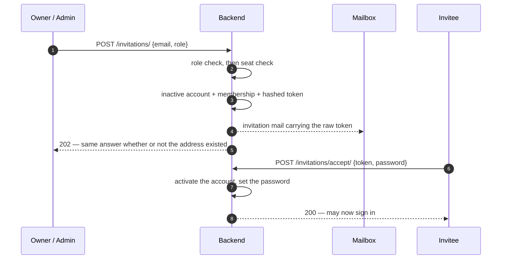

# Tenant Invitations API Documentation

Add somebody to your organisation without ever choosing their password.

**Base path**: `/api/v1/auth/invitations/`

---

## Why this exists

[Creating a user](./users.md#3-create-a-user) works, but it means an admin picks a colleague's
password and then tells them what it is. Somebody who can set your password can become you.

An invitation inverts that: the inviter supplies an address and a role, the invitee proves control
of the mailbox and chooses their own credentials.

---

## Endpoints Summary

| Method | Path | Auth | Purpose |
|---|---|---|---|
| `POST` | `/auth/invitations/` | Owner / admin | Invite somebody |
| `GET` | `/auth/invitations/` | Owner / admin | List invitations for your organisation |
| `GET` | `/auth/invitations/{id}/` | Owner / admin | Retrieve one |
| `POST` | `/auth/invitations/{id}/revoke/` | Owner / admin | Withdraw one and release its seat |
| `POST` | `/auth/invitations/accept/` | **None** | Exchange a token for a usable account |

---

## The flow



### The seat is spent when the invitation is sent

Not when it is accepted. The `USER` allowance counts live tenant memberships, so the membership is
created up front and released on revoke or expiry.

The alternative would be worse: if invitations were free until accepted, a five-seat tenant could
send fifty and have all fifty accept, because the limit would have been checked fifty times against
a number that never moved.

So a **pending invitation occupies a seat**, which is the honest position — that seat is committed
to a named person. [Revoke](#4-revoke-an-invitation) gives it back.

### A pending invitation is not a way in

The account created at invite time is `is_active: false` with an unusable password. Login gates on
`is_active`, so the account cannot be used until the invitation is accepted.

---

## Endpoint Details

### 1. Invite Somebody

- **Path**: `POST /api/v1/auth/invitations/`
- **Request Payload**:
  ```json
  { "email": "sam@acme.com", "role": "MEMBER" }
  ```

| Field | Type | Description | Validation |
|---|---|---|---|
| `email` * | string | Where to send the invitation. | Required, valid email. Lower-cased. |
| `role` | enum | The role they receive on joining. | Optional, default `MEMBER`. `ADMIN` or `MEMBER` only — see below. |

- **Success Response (202 Accepted)**:
  ```json
  {
    "status": true,
    "message": "If that address can be invited, an invitation is on its way.",
    "data": null,
    "errors": null
  }
  ```

| Status | When | `message` |
|---|---|---|
| **202** | Accepted for delivery. **Also returned when the address already has an account** — see below. | `If that address can be invited, an invitation is on its way.` |
| **400** | `email` missing or malformed, or `role` is `OWNER`. | `"OWNER" is not a valid choice.` |
| **402** | Your plan has no seats left. | `QUOTA_EXCEEDED` |
| **403** | You are a `MEMBER`. | `Only an owner or admin can manage the people at this organisation.` |
| **401** | Missing or invalid token. | — |

> ### 202, and never 201
>
> **The response does not reveal whether the address already has an account.** `email` is unique
> platform-wide, so the naive implementation returns *"user with this email already exists"* — which
> tells the inviter that address is registered **somewhere on this platform**, possibly at a
> competitor. That is a membership disclosure to anyone who can send an invitation.
>
> Both cases return an identical status and body. Only the email differs: a fresh address gets an
> invitation, an existing account holder gets a "somebody tried to add you" notice with no token and
> no new account. The person learns they were invited; the inviter learns nothing.
>
> The status is `202` rather than `201` for the same reason — whether a row was created is exactly
> what must not leak.

> **`OWNER` cannot be invited.** Ownership is transferred between existing members, never granted to
> somebody who has not joined yet. See [transfer-ownership](./users.md#11-transfer-ownership).

> **Re-inviting the same address replaces the previous invitation** rather than adding a second.
> Several live tokens for one seat would be several independent ways in for one person. The earlier
> token stops working immediately.

> **A previously removed employee cannot be re-invited.** Their soft-deleted account still owns the
> address at the database level, so the invitation takes the "already registered" path and they
> receive the notice rather than an invitation. Restoring their account is the way back.

---

### 2. List Invitations

- **Path**: `GET /api/v1/auth/invitations/`
- Paginated. Scoped to your own organisation; another tenant's invitations are invisible.

| Status | When |
|---|---|
| **200** | Listed. |
| **403** | You are a `MEMBER`. |

**Response item:**

```json
{
  "id": "5fa85f64-…",
  "email": "sam@acme.com",
  "role": "MEMBER",
  "status": "PENDING",
  "expires_at": "2026-09-09T10:00:00Z",
  "created_at": "2026-09-02T10:00:00Z"
}
```

| `status` | Meaning |
|---|---|
| `PENDING` | Live and unaccepted. Holding a seat. |
| `ACCEPTED` | Redeemed. The person is now an ordinary user. |
| `EXPIRED` | Past `expires_at`. Still holding a seat until swept or revoked. |
| `REVOKED` | Withdrawn. Seat released. |

> **`status` is derived from the timestamps, not stored.** A stored column would need a job to flip
> it the moment an invitation expired, and a row that is expired in fact but `PENDING` in the column
> is exactly the sort of thing that lets a dead token through.

> **Members cannot list invitations.** A pending invitation names somebody who has not joined yet,
> which is hiring information rather than ordinary roster detail.

> **The token is never in any response.** Not in the list, not in the detail, not in any field. A
> list of pending invitations must not double as a list of live ways in — only its SHA-256 is
> stored, and even that is never serialised.

---

### 3. Retrieve an Invitation

- **Path**: `GET /api/v1/auth/invitations/{id}/`

Same object as §2 plus `invited_by_email` and `accepted_at`. Same 403 for members, 404 outside
your organisation.

---

### 4. Revoke an Invitation

- **Path**: `POST /api/v1/auth/invitations/{id}/revoke/`
- **Request Payload**: none.

| Status | When | `message` |
|---|---|---|
| **200** | Revoked; seat released; token dead. | `Invitation revoked` |
| **400** | Already accepted. | `That invitation has already been accepted. Remove the user instead.` |
| **403** | You are a `MEMBER`. | — |
| **404** | Outside your organisation. | `Not found.` |

> **An accepted invitation cannot be revoked.** By then it is only a record of how somebody joined;
> to remove the person, [delete the user](./users.md#5-delete-a-user).

> **The placeholder account is hard-deleted, not soft-deleted.** `email` is unique at the database
> level and a soft delete is only a flag write, so a soft-deleted placeholder would keep owning the
> address and the same person could never be invited again. The guard is narrow: only an account
> that has never been active and has no usable password is ever hard-deleted.
>
> The invitation row itself survives as an audit record — which is why `email` is captured on it
> rather than read through the user.

---

### 5. Accept an Invitation

**Unauthenticated.** The invitee has no account to authenticate with; resolving that is the whole
point of the endpoint.

- **Path**: `POST /api/v1/auth/invitations/accept/`
- **Request Payload**:
  ```json
  {
    "token": "…from the emailed link…",
    "password": "Str0ng!Passphrase",
    "confirm_password": "Str0ng!Passphrase"
  }
  ```

| Field | Type | Description | Validation |
|---|---|---|---|
| `token` * | string | The raw token from the invitation link. | Required. |
| `password` * | string | The password the invitee chooses. | Required. Django's configured validators. |
| `confirm_password` * | string | Must match. | Required. |

| Status | When | `message` |
|---|---|---|
| **200** | Account activated. | `Your account is ready. You can now sign in.` |
| **400** | Token unknown, expired, revoked, or already used. | `This invitation link is not valid or has expired.` |
| **400** | Passwords do not match, or the password fails a validator. | `Passwords do not match.` |
| **429** | Too many attempts from this address. | — |

> **Every token failure returns the same message.** Unknown, expired, revoked, and already-used are
> indistinguishable in the response. Distinguishing them would make this endpoint an oracle for
> guessing which tokens exist.

> **Throttled per client IP** — `20/hour` by default, `INVITATION_ACCEPT_RATE`. The token is the
> only credential this endpoint accepts, so without a limit it is an offer to enumerate. Generous
> enough that a genuine invitee mistyping their password is unaffected.

> **A token works once.** Accepting stamps `accepted_at`, and the lookup ignores accepted rows.

---

## Tokens

| Property | Value |
|---|---|
| Entropy | 256 bits, from `secrets.token_urlsafe(32)` |
| Stored as | SHA-256, indexed and unique |
| Raw value lives in | the email, and nowhere else — never stored, never logged |
| Default lifetime | 7 days (`TENANT_INVITATION_EXPIRY_DAYS`) |

> **A plain SHA-256, not a password hash.** Agent tokens use Django's password hasher because a
> password is low-entropy and guessable, so it needs a slow KDF — and they carry a separate
> plain-text prefix precisely because you cannot index a bcrypt hash. An invitation token is 256
> random bits: there is nothing to brute force, so a slow hash buys nothing and costs an indexed
> lookup. It is hashed at all so that read access to the table does not hand over every live
> invitation.

> **A lost token cannot be recovered, only reissued.** That is the intended trade for not keeping
> live tokens in the database. Re-invite the address.

---

## Configuration

| Setting | Default | Purpose |
|---|---|---|
| `TENANT_INVITATION_EXPIRY_DAYS` | `7` | How long a link stays usable. Days, not minutes — this is onboarding, and the invitee may not read their mail today. |
| `INVITATION_ACCEPT_RATE` | `20/hour` | Throttle on the unauthenticated accept endpoint. |
| `FRONTEND_BASE_URL` | *(empty)* | Where the emailed link points. **Must be set**, or the link is relative and goes nowhere — the API and the app are different origins, so it cannot be derived from the request. |

---

## Known gaps

| # | Gap | Impact |
|---|---|---|
| 1 | **Expired invitations are not swept automatically.** `sweep_expired` exists but runs only from a management command. | An expired invitation keeps holding a seat until somebody revokes it or the sweep is run. The token itself is already refused, so this is a billing-accuracy gap, not a security one. |
| 2 | **A removed employee cannot be re-invited** — their soft-deleted account still owns the address. | Their account must be restored instead. Fixing it properly means revisiting platform-wide email uniqueness. |
| 3 | **No resend endpoint.** | Re-inviting the same address issues a fresh token and invalidates the old one, which achieves the same thing with a different name. |
| 4 | **The invitee's name cannot be set at invite time.** | They arrive with an email and nothing else until they fill in their profile. |

---

## Related

- [Users API](./users.md) — roles, and what each one may do
- [Authentication API](./auth.md) — signing in once the invitation is accepted
