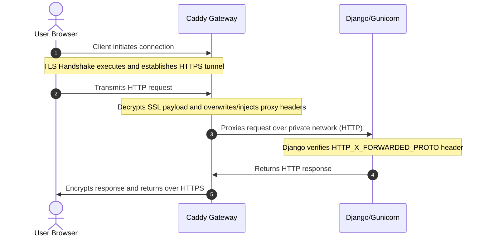
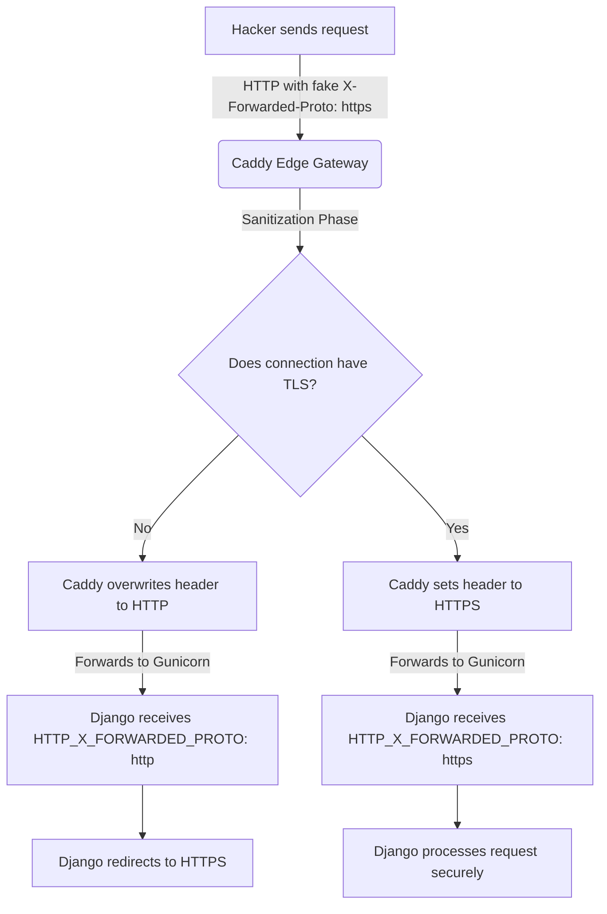
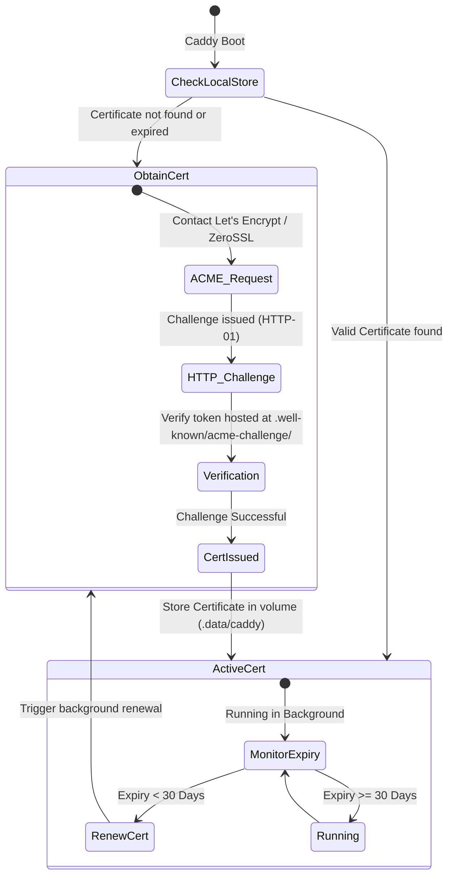

# Caddy Reverse Proxy & Django Gateway Security Flow

This guide provides a comprehensive overview of how traffic flows from a user's browser, through the Caddy Gateway, and into the Django backend. It explains SSL termination, header sanitization, spoofing prevention, and certificate lifecycle management.

---

## 1. Request Architecture Flow



### Visual Request Flow (ASCII representation)
```text
  [ User Browser ]
         │
         │  1. Connects to Port 443 (HTTPS)
         ▼
  [ Caddy Gateway ]
         │
         │  2. Terminates SSL, injects/sanitizes headers:
         │     - X-Forwarded-For: [User IP]
         │     - X-Forwarded-Proto: "https"
         ▼
  [ Django / Gunicorn ] (Internal Private Port 8000)
         │
         │  3. Reads HTTP_X_FORWARDED_PROTO == "https"
         │     - Processes request securely
         ▼
  [ User Browser ]  <─── Encrypted Payload (HTTPS) ───  [ Caddy ]
```

---

## 2. Header Transformation Step-by-Step

When a request travels through the gateway, headers are mutated by Caddy to ensure security and forward client metadata.

### Step A: Sent by Browser to Caddy (Over SSL)
The browser initiates a request over the secure TLS channel with standard headers:
```http
GET /users/profile/ HTTP/1.1
Host: api.yourdomain.com
User-Agent: Mozilla/5.0 ...
Accept: application/json
Cookie: sessionid=xyz123
```

### Step B: Forwarded by Caddy to Gunicorn (Internal Network)
Caddy terminates the TLS connection, parses the request, and injects/overwrites forwarding headers before sending it over the private Docker network:
```http
GET /users/profile/ HTTP/1.1
Host: api.yourdomain.com
User-Agent: Mozilla/5.0 ...
Accept: application/json
Cookie: sessionid=xyz123

# Headers Caddy appends/overwrites:
X-Forwarded-For: 203.0.113.195        # Client's actual public IP
X-Forwarded-Proto: https              # The protocol used by the client (HTTPS)
X-Forwarded-Host: api.yourdomain.com  # The original Host header requested
X-Real-IP: 203.0.113.195              # Direct IP of the client
```

### Step C: Translated by Gunicorn to Django WSGI
Gunicorn receives the headers and translates them into the Python WSGI standard environment dictionary:
```python
request.META['HTTP_X_FORWARDED_PROTO'] = "https"
```
Because `config/settings/production.py` defines:
```python
SECURE_PROXY_SSL_HEADER = ("HTTP_X_FORWARDED_PROTO", "https")
```
Django reads the environment dictionary, recognizes that the connection is secure, and processes the request without redirecting it.

---

## 3. Header Spoofing Protection

If a malicious user attempts to bypass security controls by spoofing headers, Caddy’s gateway architecture guarantees protection:



### Spoofing Protection Logic (ASCII representation)
```text
  [ User sends request ]  ───( HTTP with FAKE X-Forwarded-Proto: https )───► [ Caddy Edge Gateway ]
                                                                                   │
                                                                           [ Sanitization Phase ]
                                                                                   │
                                                          ┌────────────────────────┴────────────────────────┐
                                                (Is TLS active on connection?)                    (Is TLS active on connection?)
                                                          │ No                                              │ Yes
                                                          ▼                                                 ▼
                                            [ Overwrite header to HTTP ]                      [ Keep header as HTTPS ]
                                                          │                                                 │
                                                          ▼                                                 ▼
                                                [ Forwards to Django ]                            [ Forwards to Django ]
                                           (HTTP_X_FORWARDED_PROTO: http)                    (HTTP_X_FORWARDED_PROTO: https)
                                                          │                                                 │
                                                          ▼                                                 ▼
                                                [ Django Redirects ]                              [ Django processes ]
                                               (301 Redirect to HTTPS)                            (Secure request)
```

### Why Spoofing Fails:
1. **Edge Overwrite:** Caddy does not trust client-supplied forwarding headers. The `reverse_proxy` directive automatically discards or overwrites client-provided `X-Forwarded-Proto` and `X-Forwarded-For` headers with actual socket values.
2. **Network Isolation:** Because the Gunicorn container only binds to `127.0.0.1` and the private Docker network, external users cannot connect to it directly, ensuring every request is sanitized by Caddy.

---

## 4. SSL Certificate Lifecycle Management

Caddy uses the **ACME protocol** (Automatic Certificate Management Environment) to automatically request, install, and renew SSL certificates from Let's Encrypt and ZeroSSL.



### SSL Certificate Lifecycle (ASCII representation)
```text
  [ Caddy Boot ]
        │
        ▼
  ( Check Local Storage ) ─────[ Valid certificate found? ]
        │                                 │
        │ No                              │ Yes
        ▼                                 ▼
  [ Obtain Certificate ]            [ Active Certificate State ]
        │                                 │
        ├─► Contact Let's Encrypt / ACME  │
        ├─► Solve HTTP-01 Challenge       │
        ├─► Store in volume (.data/caddy) │
        │                                 │
        ▼                                 ▼
  [ Active Certificate State ] ◄──────────┘
        │
        ▼
  ( Background Expiry Monitor )
        │
        ├─► Expiry >= 30 days  ──► Keep Running (No action)
        │
        └─► Expiry < 30 days   ──► Trigger background renewal challenge
```

- **Persistence:** Certificates are stored in the mounted `.data/caddy/data` volume, preventing rate-limiting blocks during container restarts.
- **Auto-Renewal:** Caddy monitors certificate age. At the 60-day mark (30 days before expiry), it performs a background renewal challenge, swapping certificates with zero downtime.

---

## 5. Automatic HTTP-to-HTTPS Redirection Flow

Caddy does not wait for a user request to generate certificates; certificates are requested and loaded at Caddy's startup. 

When a user tries to access a service via HTTP (`http://`), the request does not reach Django. Instead, Caddy intercepts it on Port 80 and forces a redirection:

```text
User Browser                       Caddy Gateway                      Django Backend
(HTTP client)                     (Port 80 & 443)                     (Internal Port 8000)
     │                                   │                                    │
     │─── [http://api.domain.com] ──────►│ (Port 80)                          │
     │                                   │                                    │
     │◄── [301 Moved Permanently] ───────┤ (Intercepted by Caddy)             │
     │    (Redirect to https://...)      │                                    │
     │                                   │                                    │
     │─── [https://api.domain.com] ─────►│ (Port 443 - SSL TLS Tunnel OK)     │
     │                                   │                                    │
     │                                   │─── (HTTP + X-Forwarded-Proto) ────►│
     │                                   │                                    │
```

### Flow Details:
1. **SSL is ready:** The SSL certificate is already generated and cached on the Caddy host.
2. **Immediate Port 80 Intercept:** Any connection on port 80 (HTTP) triggers a Caddy-level `301` HTTP response redirecting the client to the `https://` version of the URL.
3. **Secure Re-route:** The client's browser disconnects from Port 80 and reconnects to Caddy on Port 443 (HTTPS) executing a full TLS handshake.
4. **Internal Dispatch:** Caddy decrypts the TLS connection and passes the request internally to Django via standard HTTP over the private Docker network, appending the security metadata headers (`X-Forwarded-Proto: https`).

