# Kubernetes System Architecture & Migration Guide

This document defines the Kubernetes (K8s) architecture, resource mapping, networking ingress, and observability flows for hosting the Voicebot backend stack in a production Kubernetes cluster.

---

## 1. Kubernetes System Architecture Map (Mermaid)

The following diagram maps out how the containerized Docker Compose stack translates to a Kubernetes-native deployment model, showing Ingress routing, Service mappings, Workload abstractions, and Storage bindings.

```mermaid
flowchart TB
    %% Class Definitions
    classDef client fill:#eceff1,stroke:#37474f,stroke-width:2px,color:#263238;
    classDef ingress fill:#e0f7fa,stroke:#006064,stroke-width:2px,color:#004d40;
    classDef service fill:#e8f5e9,stroke:#2e7d32,stroke-width:2px,color:#1b5e20;
    classDef deployment fill:#e3f2fd,stroke:#1565c0,stroke-width:2px,color:#0d47a1;
    classDef statefulset fill:#fff3e0,stroke:#ef6c00,stroke-width:2px,color:#e65100;
    classDef daemonset fill:#f3e5f5,stroke:#6a1b9a,stroke-width:2px,color:#4a148c;
    classDef config fill:#fffde7,stroke:#fbc02d,stroke-width:2px,color:#f57f17;

    %% Subgraphs
    subgraph ClientSpace ["Public Internet / Client Space"]
        Browser["User Web Browser"]
        APIClient["REST API Client"]
    end
    class ClientSpace client;

    subgraph IngressLayer ["Kubernetes Ingress & Routing (Ingress Controller)"]
        Ingress["K8s Ingress Controller<br/>(e.g., NGINX / Traefik / Caddy)"]
        CertManager["cert-manager<br/>(Let's Encrypt SSL/TLS)"]
        BasicAuthSecret["Secret: gateway-basic-auth<br/>(.htpasswd)"]
    end
    class IngressLayer ingress;

    subgraph ServiceLayer ["Kubernetes Service Layer (ClusterIP)"]
        SvcWSGI["Service: backend-wsgi-service<br/>(Port 8000)"]
        SvcASGI["Service: backend-asgi-service<br/>(Port 8000)"]
        SvcPgBouncer["Service: pgbouncer-service<br/>(Port 5432)"]
        SvcPostgres["Service: postgres-service<br/>(Port 5432)"]
        SvcRedis["Service: redis-service<br/>(Port 6379)"]
        SvcAzurite["Service: azurite-service<br/>(Ports 10000-10002)"]
        SvcPgAdmin["Service: pgadmin-service<br/>(Port 80)"]
        SvcRedisInsight["Service: redisinsight-service<br/>(Port 5540)"]
        SvcGrafana["Service: grafana-service<br/>(Port 3000)"]
        SvcLoki["Service: loki-service<br/>(Port 3100)"]
        SvcPrometheus["Service: prometheus-service<br/>(Port 9090)"]
    end
    class ServiceLayer service;

    subgraph WorkloadLayer ["Application Workloads (Deployments)"]
        DepWSGI["Deployment: backend-wsgi<br/>(Gunicorn - REST API)"]
        DepASGI["Deployment: backend-asgi<br/>(Daphne - WebSockets)"]
        DepPgBouncer["Deployment: pgbouncer<br/>(Conn Pooler)"]
        DepPgAdmin["Deployment: pgadmin<br/>(DB Admin UI)"]
        DepRedisInsight["Deployment: redisinsight<br/>(Redis UI)"]
        DepGrafana["Deployment: grafana<br/>(Dashboards)"]
    end
    class WorkloadLayer deployment;

    subgraph StatefulLayer ["Stateful Storage & Databases (StatefulSets)"]
        StsPostgres["StatefulSet: postgres<br/>(PostgreSQL DB)"]
        StsRedis["StatefulSet: redis<br/>(Cache & Pub/Sub)"]
        StsAzurite["StatefulSet: azurite<br/>(Azure Storage Emulator)"]
        StsLoki["StatefulSet: loki<br/>(Logs DB)"]
        StsPrometheus["StatefulSet: prometheus<br/>(Metrics TSDB)"]
    end
    class StatefulLayer statefulset;

    subgraph TelemetryLayer ["Telemetry & Exporters (DaemonSets / Sidecars)"]
        DsAlloy["DaemonSet: alloy<br/>(Log Collector)"]
        DepPgExporter["Deployment: postgres-exporter<br/>(PG Metrics)"]
        DepRedisExporter["Deployment: redis-exporter<br/>(Redis Metrics)"]
    end
    class TelemetryLayer daemonset;

    subgraph ConfigLayer ["Configuration & Storage Assets"]
        ConfigMap["ConfigMap: voicebot-config"]
        SecretDB["Secret: voicebot-secrets"]
        PVCPostgres["PVC: postgres-data-pvc"]
        PVCRedis["PVC: redis-data-pvc"]
        PVCAzurite["PVC: azurite-data-pvc"]
        PVCLoki["PVC: loki-data-pvc"]
        PVCPrometheus["PVC: prometheus-data-pvc"]
        PVCGrafana["PVC: grafana-data-pvc"]
    end
    class ConfigLayer config;

    %% Client and Ingress Connections
    Browser & APIClient -->|HTTPS / WSS| Ingress
    CertManager -.->|Issue & Renew Certs| Ingress
    BasicAuthSecret -.->|Verify Credentials| Ingress

    %% Ingress to Services Routing
    Ingress -->|api.domain| SvcWSGI
    Ingress -->|ws.domain| SvcASGI
    Ingress -->|pgadmin.domain| SvcPgAdmin
    Ingress -->|redisinsight.domain| SvcRedisInsight
    Ingress -->|grafana.domain| SvcGrafana
    Ingress -->|prometheus.domain| SvcPrometheus
    Ingress -->|loki.domain| SvcLoki
    Ingress -->|azurite-blob.domain| SvcAzurite

    %% Service to Pod Routing
    SvcWSGI --> DepWSGI
    SvcASGI --> DepASGI
    SvcPgAdmin --> DepPgAdmin
    SvcRedisInsight --> DepRedisInsight
    SvcGrafana --> DepGrafana
    SvcAzurite --> StsAzurite
    SvcPgBouncer --> DepPgBouncer
    SvcPostgres --> StsPostgres
    SvcRedis --> StsRedis
    SvcLoki --> StsLoki
    SvcPrometheus --> StsPrometheus

    %% App Communication Flows
    DepWSGI & DepASGI --> SvcPgBouncer
    DepPgBouncer --> SvcPostgres
    DepWSGI & DepASGI --> SvcRedis
    DepWSGI & DepASGI --> SvcAzurite

    %% Volumes & Config bindings
    ConfigMap & SecretDB -.->|Inject Env Vars| DepWSGI & DepASGI & StsPostgres & StsRedis
    StsPostgres ==> PVCPostgres
    StsRedis ==> PVCRedis
    StsAzurite ==> PVCAzurite
    StsLoki ==> PVCLoki
    StsPrometheus ==> PVCPrometheus
    DepGrafana ==> PVCGrafana

    %% Observability Scrape Loops
    DsAlloy -->|Scrape Node Pod Logs| DepWSGI & DepASGI
    DsAlloy -->|Push Logs| SvcLoki
    
    DepPgExporter -->|Scrape DB| SvcPostgres
    DepRedisExporter -->|Scrape Cache| SvcRedis
    
    StsPrometheus -->|Scrape Metrics| DepPgExporter
    StsPrometheus -->|Scrape Metrics| DepRedisExporter
    StsPrometheus -->|Scrape Metrics /prom-metrics/| SvcWSGI
    StsPrometheus -->|Scrape Metrics /prom-metrics/| SvcASGI
    
    DepGrafana -->|Query Metrics| SvcPrometheus
    DepGrafana -->|Query Logs| SvcLoki

    DepPgAdmin -->|Manage| SvcPostgres
    DepRedisInsight -->|Inspect| SvcRedis
```



---

## 2. Visual Conceptual Infographic

Here is a conceptual illustration of the production-grade Kubernetes container stack, ingress routing, database layer, and monitoring loop:


---

## 3. Docker Compose to Kubernetes Mapping

The table below maps each service defined in `docker-compose.yml` to its corresponding native Kubernetes resource type and scaling properties.

| Docker Compose Service | Kubernetes Workload Kind | Controller Type | Storage Requirement | Recommended Scaling Strategy |
| :--- | :--- | :--- | :--- | :--- |
| **`caddy`** | `Ingress` + `IngressController` | Deployment / DaemonSet (Ingress Controller) | None (Stateless) | Horizontal Pod Autoscaler (HPA) on CPU/Mem |
| **`backend-wsgi`** | `Deployment` | `apps/v1` | None (Stateless) | HPA based on CPU Utilization (>70%) |
| **`backend-asgi`** | `Deployment` | `apps/v1` | None (Stateless) | HPA based on Connection Count / Memory |
| **`backend-dev`** | *N/A (Exclude)* | Do not deploy to prod | None | Only run locally or inside isolated Dev namespaces |
| **`postgres`** | `StatefulSet` | `apps/v1` | Persistent Volume Claim (PVC) | Vertical Scaling / Managed DB (e.g., Cloud SQL) |
| **`pgbouncer`** | `Deployment` | `apps/v1` | None (Stateless) | Replicas scaled to match WSGI/ASGI pool sizes |
| **`redis`** | `StatefulSet` | `apps/v1` | Persistent Volume Claim (PVC) | Clustered Deployment or Managed Service |
| **`azurite`** | `Deployment` or `StatefulSet` | `apps/v1` | PVC or Object Storage | Dev/Test only; replace with native Cloud Object Store |
| **`pgadmin`** | `Deployment` | `apps/v1` | PVC (for config db persistence) | Single replica (1 pod) |
| **`redis-insight`** | `Deployment` | `apps/v1` | PVC (for saved connections) | Single replica (1 pod) |
| **`prometheus`** | `StatefulSet` / Operator | `monitoring.coreos.com/v1` | PVC (TSDB block storage) | Stateful replication or managed Prometheus |
| **`loki`** | `StatefulSet` or Microservices | `loki.grafana.com/v1` | PVC / Object Storage | Scale read/write paths independently (if clustered) |
| **`alloy`** | `DaemonSet` | `apps/v1` | HostPath (reads `/var/log/pods`) | Runs exactly 1 pod per Kubernetes Node |
| **`postgres-exporter`**| `Deployment` or Sidecar | `apps/v1` | None | Run as a sidecar container inside PostgreSQL Pod |
| **`redis-exporter`** | `Deployment` or Sidecar | `apps/v1` | None | Run as a sidecar container inside Redis Pod |
| **`grafana`** | `Deployment` | `apps/v1` | PVC (for dashboards database) | Single replica (1 pod) or horizontal with shared DB |

---

## 4. Ingress, TLS, and Routing Architecture

Yes, you can absolutely use **Caddy** as your Kubernetes Ingress! There are two main ways to implement this depending on whether you want a Kubernetes-native Ingress controller or if you prefer to reuse your existing `Caddyfile` configuration.

Here is a conceptual illustration of the Caddy-focused Kubernetes system architecture showing configuration (Secrets/ConfigMaps), network traffic flow, memory/storage allocation limits, and observability tracing pathways:


---

### Method A: The Caddy Ingress Controller (Kubernetes-Native)

The official [Caddy Ingress Controller](https://github.com/caddyserver/ingress-controller) runs as a pod in the cluster, watches Kubernetes Ingress resources, and automatically configures an internal Caddy server to route traffic and request SSL/TLS certificates.

#### 1. Ingress Class Configuration
First, you define the `IngressClass` pointing to Caddy:

```yaml
apiVersion: networking.k8s.io/v1
kind: IngressClass
metadata:
  name: caddy
spec:
  controller: caddyserver.com/ingress-controller
```

#### 2. Ingress Resource Definition
You can then declare ingress routes. Caddy Ingress automatically handles SSL certificate generation through Let's Encrypt / ZeroSSL without requiring `cert-manager`:

```yaml
apiVersion: networking.k8s.io/v1
kind: Ingress
metadata:
  name: voicebot-ingress
  namespace: voicebot
  annotations:
    # Caddy-specific annotations (e.g. email for ACME)
    caddy.ingress.kubernetes.io/email: "acme-admin@example.com"
spec:
  ingressClassName: caddy
  rules:
  - host: api.example.com
    http:
      paths:
      - path: /
        pathType: Prefix
        backend:
          service:
            name: backend-wsgi-service
            port:
              number: 8000
  - host: ws.example.com
    http:
      paths:
      - path: /
        pathType: Prefix
        backend:
          service:
            name: backend-asgi-service
            port:
              number: 8000
```

---

### Method B: Standalone Caddy Gateway Deployment (Direct Migration)

If you want to reuse your exact `Caddyfile` (complete with custom error handlers, compression algorithms, and specific header rules), you can run Caddy as a standard stateless `Deployment` and mount the `Caddyfile` using a `ConfigMap`.

#### 1. Create the Caddyfile ConfigMap
We convert the local `Caddyfile` configuration into a Kubernetes resource:

```yaml
apiVersion: v1
kind: ConfigMap
metadata:
  name: caddy-config
  namespace: voicebot
data:
  Caddyfile: |
    (error_handler) {
        handle_errors {
            @offline expression {err.status_code} in [502, 503]
            handle @offline {
                rewrite * /error-502.html
                file_server {
                    root /var/www/html
                }
            }
        }
    }

    (basic_auth) {
        basicauth {
            {$GATEWAY_BASIC_AUTH_USER} {$GATEWAY_BASIC_AUTH_PASSWORD_HASH}
        }
    }

    (security_headers) {
        header {
            X-Frame-Options "DENY"
            X-Content-Type-Options "nosniff"
            X-XSS-Protection "1; mode=block"
            Referrer-Policy "strict-origin-when-cross-origin"
            Strict-Transport-Security "max-age=31536000; includeSubDomains; preload"
            Permissions-Policy "interest-cohort=()"
            Cross-Origin-Opener-Policy "same-origin"
            Cross-Origin-Resource-Policy "same-origin"
            -Server
        }
    }

    (compression) {
        encode zstd gzip
    }

    # Global configuration block
    {
        email {$ACME_EMAIL}
    }

    # 1a. REST API Gateway
    api.{$DOMAIN} {
        import error_handler
        import security_headers
        import compression
        # Route to the internal K8s cluster service
        reverse_proxy backend-wsgi-service:8000

        log {
            output file /var/log/caddy/api_access.log {
                roll_size 10mb
                roll_keep 3
            }
        }
    }

    # 1b. WebSockets Gateway
    ws.{$DOMAIN} {
        import error_handler
        import security_headers
        import compression
        # Route to the internal K8s cluster service
        reverse_proxy backend-asgi-service:8000

        log {
            output file /var/log/caddy/ws_access.log {
                roll_size 10mb
                roll_keep 3
            }
        }
    }

    # 2. Database Administration
    pgadmin.{$DOMAIN} {
        import error_handler
        import security_headers
        import compression
        reverse_proxy pgadmin-service:80
    }

    # 3. Redis Dashboard
    redisinsight.{$DOMAIN} {
        import error_handler
        import basic_auth
        import security_headers
        import compression
        reverse_proxy redisinsight-service:5540
    }

    # 4. Observability Dashboard
    grafana.{$DOMAIN} {
        import error_handler
        import security_headers
        import compression
        reverse_proxy grafana-service:3000
    }

    # 5. Metrics Engine
    prometheus.{$DOMAIN} {
        import error_handler
        import basic_auth
        import security_headers
        import compression
        reverse_proxy prometheus-service:9090
    }

    # 6. Log Engine
    loki.{$DOMAIN} {
        import error_handler
        import basic_auth
        import security_headers
        import compression
        reverse_proxy loki-service:3100
    }

    # 7. Azurite Storage Emulator Services
    azurite-blob.{$DOMAIN} {
        import error_handler
        import security_headers
        import compression
        reverse_proxy azurite-service:10000
    }
    azurite-queue.{$DOMAIN} {
        import error_handler
        import security_headers
        import compression
        reverse_proxy azurite-service:10001
    }
    azurite-table.{$DOMAIN} {
        import error_handler
        import security_headers
        import compression
        reverse_proxy azurite-service:10002
    }

    # 8a. Secure Fallback Subdomain
    notfound.{$DOMAIN} {
        import error_handler
        import security_headers
        import compression
        root * /var/www/html
        file_server
        rewrite * /unconfigured.html
    }

    # 8b. HTTP Redirection Catch-all
    http://*.{$DOMAIN} {
        redir https://notfound.{$DOMAIN}
    }
```

#### 2. Create the Caddy Deployment & Service
We run Caddy as a Pod, mounting the ConfigMap and injecting environment secrets:

```yaml
apiVersion: apps/v1
kind: Deployment
metadata:
  name: caddy-gateway
  namespace: voicebot
spec:
  replicas: 2
  selector:
    matchLabels:
      app: caddy-gateway
  template:
    metadata:
      labels:
        app: caddy-gateway
    spec:
      containers:
      - name: caddy
        image: caddy:2.7-alpine
        ports:
        - name: http
          containerPort: 80
        - name: https
          containerPort: 443
        envFrom:
        - configMapRef:
            name: voicebot-config
        - secretRef:
            name: voicebot-secrets
        volumeMounts:
        - name: caddyfile-vol
          mountPath: /etc/caddy/Caddyfile
          subPath: Caddyfile
        # Caddy needs persistent storage to cache certificates (prevents rate limits)
        - name: caddy-data
          mountPath: /data
      volumes:
      - name: caddyfile-vol
        configMap:
          name: caddy-config
      - name: caddy-data
        persistentVolumeClaim:
          claimName: caddy-data-pvc
---
apiVersion: v1
kind: Service
metadata:
  name: caddy-gateway-service
  namespace: voicebot
spec:
  type: LoadBalancer
  ports:
  - name: http
    port: 80
    targetPort: 80
  - name: https
    port: 443
    targetPort: 443
  selector:
    app: caddy-gateway
```

### B. Gateway Basic Authentication
For admin consoles and telemetry endpoints (`pgadmin`, `redisinsight`, `prometheus`, `loki`), Basic Authentication is handled at the Ingress controller using annotations that reference a Kubernetes Secret containing a `.htpasswd` list.

1. **Create the htpasswd Secret:**
   ```bash
   htpasswd -c auth admin
   kubectl create secret generic gateway-basic-auth --from-file=auth -n voicebot
   ```
2. **Apply Ingress Annotations:**
   ```yaml
   metadata:
     annotations:
       nginx.ingress.kubernetes.io/auth-type: basic
       nginx.ingress.kubernetes.io/auth-secret: gateway-basic-auth
       nginx.ingress.kubernetes.io/auth-realm: "Authentication Required"
   ```

---

## 5. Configuration & Secrets Management

Application configurations and secrets are decoupled from image definitions using Kubernetes resources.

### A. ConfigMaps (`voicebot-config`)
ConfigMaps store non-sensitive environment variables shared across deployments:
* `DJANGO_SETTINGS_MODULE`
* `DOMAIN`
* `WSGI_HOST` (mapped to `backend-wsgi-service`)
* `ASGI_HOST` (mapped to `backend-asgi-service`)
* `DB_HOST` (mapped to `pgbouncer-service`)
* `REDIS_ADDR` (mapped to `redis-service:6379`)

### B. Secrets (`voicebot-secrets`)
Secrets store base64-encoded credentials and certificates:
* `POSTGRES_USER` & `POSTGRES_PASSWORD`
* `GF_SECURITY_ADMIN_PASSWORD`
* `AZURITE_CONNECTION_STRING`
* `ACME_EMAIL`

Both ConfigMaps and Secrets are injected into the Django pods as environment variables:
```yaml
envFrom:
  - configMapRef:
      name: voicebot-config
  - secretRef:
      name: voicebot-secrets
```

---

## 6. Stateful Storage Strategy (StatefulSets & PVCs)

Services that retain persistent data are modeled as **StatefulSets** to ensure stable hostnames, network identifiers, and ordinal storage bindings.

### A. Volume Provisioning
* **StorageClasses:** Set up dynamic volume provisioning using standard cloud storage classes (e.g., GCP `pd-ssd` or AWS `gp3`).
* **Volume Claim Templates:** StatefulSets define `volumeClaimTemplates` to automatically request and bind a Persistent Volume (PV) for each pod replica:

```yaml
spec:
  volumeClaimTemplates:
  - metadata:
      name: postgres-data
    spec:
      accessModes: [ "ReadWriteOnce" ]
      storageClassName: "premium-rwo"
      resources:
        requests:
          storage: 50Gi
```

### B. Pod Co-location & Optimization
* **PgBouncer Deployment:** Deployed as a stateless Deployment sitting in front of the PostgreSQL StatefulSet. The `pgbouncer-service` routes connection queries to the active primary replica.
* **Sidecar Exporters:** To simplify network scraping and avoid running multiple independent metric exporter pods:
  - **`postgres-exporter`** runs as a secondary container inside the same Pod as the `postgres` database container.
  - **`redis-exporter`** runs as a secondary container inside the same Pod as the `redis` container.

---

## 7. Observability Stack in Kubernetes

The Docker Compose monitoring stack is converted into Kubernetes resources to establish a complete telemetry loop:

1. **Alloy DaemonSet:** Runs on every node in the cluster. It mounts the node's `/var/log/pods` path using a `hostPath` volume, reads container logs, enriches them with Kubernetes metadata (namespace, pod name, container name), and streams them to the Loki service.
2. **Loki StatefulSet:** Aggregates logs. Scaled with persistent block storage or configured to dump historical chunks into cloud object storage (e.g., GCS, AWS S3) for long-term retention.
3. **Prometheus Operator / StatefulSet:** Discovers scrapable targets dynamically using `ServiceMonitor` custom resources. It regularly polls:
   * `backend-wsgi-service` and `backend-asgi-service` at `/prom-metrics/`
   * `postgres-exporter` sidecar at `:9187/metrics`
   * `redis-exporter` sidecar at `:9121/metrics`
4. **Grafana Deployment:** Visually aggregates data. Configured with ConfigMaps to provision default Prometheus and Loki data sources, alongside custom Grafana dashboard JSON configurations.
