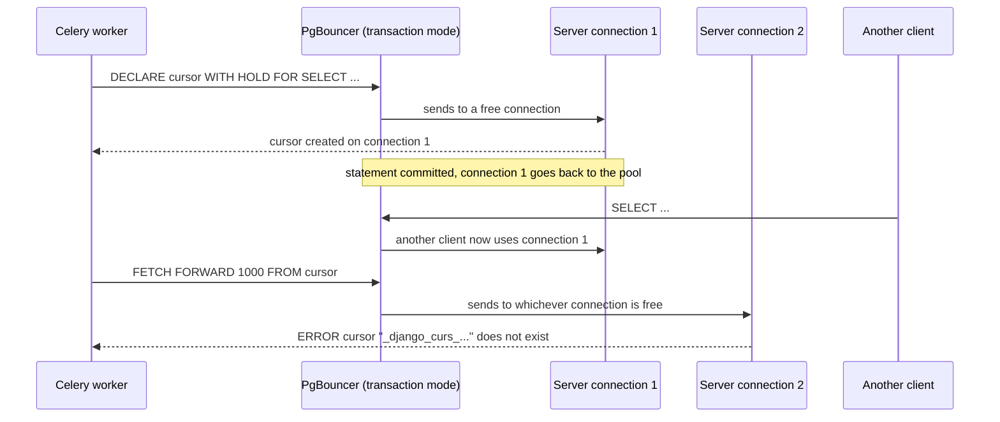

# Iterating Large Querysets behind PgBouncer

**Why `.iterator()` broke in September 2026, what `batched_queryset` does instead, and which
one to use in new code.**

On 2026-09-17 Celery tasks started failing with:

```text
psycopg2.errors.InvalidCursorName: cursor "_django_curs_139701448332160_sync_391" does not exist
```

Two of them were `materialize_campaign`, which builds a campaign's audience, and
`refresh_calendar_tokens`, which keeps Google Calendar logins alive. Both looped over a queryset
with `.iterator()`. This page explains why that call fails in our stack, how the fix works, and
the rules for writing new code so it doesn't come back.

---

## TL;DR

- **Don't use `.iterator()` in application code.** Use `batched_queryset` or `batched_values`
  from `utils/querysets.py`.
- **Why:** `.iterator()` keeps a *cursor* open on one database connection. Our PgBouncer runs in
  **transaction pooling** mode, which can move you to a different connection between statements,
  so the cursor disappears. Azure's built-in PgBouncer uses the same mode by default.
- **How the fix works:** `batched_queryset` runs a series of ordinary short queries ("give me the
  next 500 rows after this id"), so there's nothing to lose between statements.
- **Safety net:** `DISABLE_SERVER_SIDE_CURSORS: True` in `config/settings/base.py` makes any
  `.iterator()` we don't control (a third-party library, old migrations) pooler-safe. The cost
  is that it holds that query's whole result in memory.

---

## 1. The problem `.iterator()` solves

A plain loop over a queryset loads **every** matching row into memory before the first iteration,
and keeps the objects there until the loop ends, because the queryset caches its results:

```python
# Loads all matching contacts at once and holds them for the whole loop.
for contact in Contact.objects.filter(tenant=tenant):
    send_something(contact)
```

For 50 rows that's fine. For a campaign audience of 100,000 contacts, memory grows with every
row, and a Celery worker can be killed for it.

`.iterator()` fixes the memory problem by streaming:

```python
# Holds roughly 1,000 rows at a time instead of all of them.
for contact in Contact.objects.filter(tenant=tenant).iterator(chunk_size=1000):
    send_something(contact)
```

That's why the codebase used it in every loop that could see a lot of rows: campaign audiences,
report rows, bookings due a reminder, calendar integrations, availability profiles, wallets.

---

## 2. How `.iterator()` streams on Postgres: a server-side cursor

On Postgres, Django implements `.iterator()` with a **named server-side cursor**. The SQL it sends
looks like this:

```sql
-- 1. Ask the server to prepare the result and keep it open under a name
DECLARE "_django_curs_139701448332160_sync_391" CURSOR WITH HOLD FOR
    SELECT ... FROM core_contact WHERE tenant_id = '...' ORDER BY id;

-- 2. Pull it down in chunks
FETCH FORWARD 1000 FROM "_django_curs_139701448332160_sync_391";   -- rows 1–1000
FETCH FORWARD 1000 FROM "_django_curs_139701448332160_sync_391";   -- rows 1001–2000
-- ...until a fetch returns fewer rows than asked for

-- 3. Release it
CLOSE "_django_curs_139701448332160_sync_391";
```

The name in our error message has exactly this `_django_curs_<n>_sync_<n>` shape. That's how
you recognise this failure.

**The key fact:** that cursor exists **only inside the one server connection** (one Postgres
backend process) that ran `DECLARE`. Any other connection has never heard of it.

---

## 3. What PgBouncer's transaction pooling does

Django doesn't connect to Postgres directly. It connects to **PgBouncer**, which shares a small
number of real server connections among many clients. From `docker-compose/database.yml`:

```yaml
pgbouncer:
  environment:
    POOL_MODE: transaction
    MAX_CLIENT_CONN: 1000     # clients that may connect to pgbouncer
    DEFAULT_POOL_SIZE: 20     # real Postgres connections they share
```

PgBouncer has two main modes:

| Mode | A server connection belongs to a client for… | Server-side cursors |
|---|---|---|
| `session` | the whole client session | work |
| `transaction` (**ours**) | **one transaction** only | break |

Outside `transaction.atomic()`, Django runs in autocommit, so **every statement is its own
transaction**. After each one, PgBouncer can give the server connection to another client and
send your next statement to a different connection.

That's exactly what happens to the cursor:



The traceback can end at the `FETCH` or at `cursor.close()`. The `CLOSE` is also a statement,
and it can also land on a connection that never had the cursor.

### Why it "worked" before

It fails **only when PgBouncer hands the worker a different connection**. On a quiet machine,
with little traffic and small result sets, it often hands back the same one, so everything looks
fine. It started failing once there was real load: several Celery worker processes at once, and
restored QA data large enough that loops needed many fetches. A bug that depends on timing and
load like this passes locally and fails on a busy server.

---

## 4. Why not just wrap the loop in a transaction?

Inside `transaction.atomic()`, PgBouncer keeps the **same** server connection until the
transaction ends, so the cursor survives:

```python
with transaction.atomic():
    for contact in queryset.iterator(chunk_size=1000):   # works behind transaction pooling
        ...
```

This is why the old data migrations that use `.iterator()` (`onboard/0031`, `tenant/0012`) are
safe: Django runs each migration inside one transaction.

It's the wrong fix for application code, though:

- **It ties up a pooled connection for the whole loop.** A 100,000-row loop holds one of the 20
  shared connections for minutes.
- **It makes the loop all-or-nothing.** `materialize_campaign` deliberately commits each batch
  separately, so one bad row doesn't discard the other 99,999.
- **It keeps locks and old row versions alive.** A long transaction delays Postgres's cleanup of
  dead rows on busy tables.
- **Network calls would run inside a database transaction.** `refresh_calendar_tokens` calls
  Google for every row.

---

## 5. The fix: keyset pagination with `batched_queryset`

Instead of one long-lived cursor, run **a series of ordinary, independent queries**, each starting
right after the last row of the previous page:

```sql
-- page 1
SELECT ... FROM core_contact WHERE tenant_id = '...' ORDER BY id LIMIT 1000;
--   last id on this page: 'c1f0…'

-- page 2
SELECT ... FROM core_contact WHERE tenant_id = '...' AND id > 'c1f0…' ORDER BY id LIMIT 1000;
--   last id on this page: 'd72a…'

-- page 3
SELECT ... FROM core_contact WHERE tenant_id = '...' AND id > 'd72a…' ORDER BY id LIMIT 1000;
--   fewer than 1000 rows came back, so this was the last page
```

Every page is a complete query. There's no cursor and nothing that has to survive between
statements, so it works through any pooler, on any connection, on any Postgres. Memory stays
bounded to one page, just like `.iterator()`.

### Using it

```python
from utils.querysets import batched_queryset

for contact in batched_queryset(Contact.objects.filter(tenant=tenant), batch_size=1000):
    send_something(contact)
```

A real before-and-after, from `materialize_campaign` in `core/services/campaigns.py`:

```python
# Before: server-side cursor, fails behind PgBouncer
for contact in audience.iterator(chunk_size=batch_size):
    batch.append(contact)
    if len(batch) >= batch_size:
        _write_batch(campaign, batch)
        batch = []

# After: keyset pages, no cursor
for contact in batched_queryset(audience, batch_size=batch_size):
    batch.append(contact)
    if len(batch) >= batch_size:
        _write_batch(campaign, batch)
        batch = []
```

Only the `for` line changes. The loop body is the same.

### How it works inside

A simplified version of `utils/querysets.py`:

```python
def batched_queryset(queryset, batch_size=500, order_by=("pk",)):
    queryset = queryset.order_by(*order_by)
    last = None
    while True:
        page = queryset if last is None else queryset.filter(<rows after `last`>)
        rows = list(page[:batch_size])        # one ordinary query: ... LIMIT batch_size
        yield from rows
        if len(rows) < batch_size:            # a short page is the last one
            return
        last = <the ordering values of rows[-1]>
```

**Query count:** for `N` rows and a batch size of `B`, that's `ceil(N / B)` queries. When `N` is
an exact multiple of `B`, add one more: the last page is full, so one extra, empty query is needed
to learn it was the end.

### Why not `OFFSET`?

The obvious alternative is numbered pages:

```sql
SELECT ... ORDER BY id LIMIT 1000 OFFSET 2000;   -- page 3
```

It has two problems, and the second one is a correctness bug.

**1. Deep pages get slow.** Postgres has to read and throw away every skipped row, so page 100
reads 100,000 rows to return 1,000.

**2. Rows get skipped when the loop changes the data it's reading.** Many of our loops do exactly
that. `refresh_calendar_tokens` loops over integrations whose token expires soon, and refreshing
a token moves its expiry forward, so that row **drops out of the filter**.

Take five integrations, ids 1–5, a batch size of 2, and a loop that removes each row from the
filter once it's processed:

| Step | `OFFSET` pages | Keyset pages |
|---|---|---|
| Page 1 | `OFFSET 0` → rows **1, 2** (processed, leave the filter) | `ORDER BY id` → rows **1, 2** |
| Page 2 | filter now matches 3, 4, 5; `OFFSET 2` → row **5** | `id > 2` → rows **3, 4** |
| Page 3 | `OFFSET 4` → nothing | `id > 4` → row **5** |
| Result | **3 and 4 never refreshed** | all five refreshed |

Keyset paging asks "rows after id 2", and the answer doesn't depend on how many earlier rows still
match. `expire_reports` has the same shape (it moves reports from `COMPLETED` to `EXPIRED`), and
the test `test_rows_updated_out_of_the_filter_do_not_shift_later_pages` pins this behaviour.

### Paging in an order other than the primary key

The campaign report must list members in the same order as the members screen: `created_at`,
then `id`. For that, pass `order_by`:

```python
batched_queryset(member_queryset(campaign), batch_size=2000, order_by=("created_at", "id"))
```

The "rows after the last one" condition then compares both columns:

```sql
WHERE created_at > :last_created_at
   OR (created_at = :last_created_at AND id > :last_id)
ORDER BY created_at, id
LIMIT 2000
```

**Why `id` has to be last: ties.** Members built in one transaction share the same `created_at`.
Here are five members and a batch size of 2:

| Member | `created_at` |
|---|---|
| a | 09:00 |
| b | 09:00 |
| c | 09:00 |
| d | 09:00 |
| e | 09:05 |

- **Wrong, `created_at > last` only:** page 1 returns a, b. Page 2 asks `created_at > 09:00` and
  gets only e, so **c and d are skipped**.
- **Right, `created_at` then `id`:** page 2 asks `created_at > 09:00 OR (created_at = 09:00 AND
  id > b)` and gets c, d. Page 3 gets e.

The rules for `order_by` follow from that:

| Rule | Why |
|---|---|
| **Ascending only.** Descending raises `ValueError`. | The "after" condition uses `>`. A descending key would page backwards. |
| **Fields on the model itself, and never null.** | `NULL > x` isn't true or false in SQL, so those rows would silently fall out. |
| **The last field is unique** (normally `id`). | Otherwise ties across a page boundary are skipped or repeated. |
| **Pass an unsliced queryset.** | Django can't reorder or filter a sliced queryset. To cap rows, see below. |

### Capping the number of rows

`queryset[:limit]` can't be paged, because the helper needs to add its own ordering and filter.
Count rows with `islice` instead. From `member_rows` in `core/services/campaign_reports.py`:

```python
from itertools import islice

members = batched_queryset(
    member_queryset(campaign), batch_size=2000, order_by=("created_at", "id")
)
if limit is not None:
    members = islice(members, limit)

for member in members:
    ...
```

### Only need a few columns: `batched_values`

When the loop doesn't need model instances, `batched_values` pages `values_list` rows instead.
The primary key is always appended as the last element, because that's what it pages on. From
`check_window_horizon` in `core/management/commands/audit_bookings.py`:

```python
for profile_id, _pk in batched_values(profiles, ["id"], batch_size=500):
    ...
```

### `select_related` and `prefetch_related`

Both work, **per page**. `select_related` adds its join to each page's query. `prefetch_related`
runs its extra query once per page, covering only that page's rows, so it stays bounded too.
`materialize_tenant` relies on this: it prefetches each profile's `rules`.

### One thing keyset paging is *not*: a snapshot

A server-side cursor reads the data as it was when the query started. Keyset pages are separate
queries, so a row **inserted** during the loop is picked up if its key sorts after the current
position, and missed if it sorts before. Our ids are UUIDs, so which of those happens is
effectively random.

That's fine for every current use: the sweeps run again on the next schedule, and a campaign
audience is frozen before materialisation starts. If you ever need an exact snapshot, collect the
ids first (`list(queryset.values_list("id", flat=True))`), then page over those.

---

## 6. The safety net: `DISABLE_SERVER_SIDE_CURSORS`

In `config/settings/base.py`:

```python
DATABASES = {
    "default": {
        # ...
        "DISABLE_SERVER_SIDE_CURSORS": True,
    }
}
```

**What it changes:** `.iterator()` stops using a named cursor. The query runs once with an
ordinary cursor, psycopg2 receives the whole result, and Django still hands rows to your loop in
chunks. Nothing stays open on the server, so there's nothing for PgBouncer to break.

**What it costs:** the memory benefit of `.iterator()` is gone, because the whole result sits in
memory as raw rows.

**Why we keep it even though our loops use `batched_queryset`:**

- **Code we don't control still calls `.iterator()`.** The CSV/XLSX exports for agents, agent
  templates, contacts and probing questions go through django-import-export, which calls
  `queryset.iterator(chunk_size=...)` internally. Without the setting, a large export fails the
  same way. An export builds its whole file in memory anyway, so buffering the rows as well adds
  comparatively little.
- **Migrations and future code.** Anything that slips through review fails safe instead of failing
  intermittently in production.

**The setting doesn't replace `batched_queryset`.** One keeps memory bounded; the other only stops
the crash. Use the helper in our own code, and treat the setting as a net.

### Does this work on Azure managed Postgres?

Yes. The setting changes how **Django** reads results; it doesn't ask the server for anything, so
any Postgres works. Whether production *needs* it depends on what sits in front of the database:

| Production connects through | Needed? |
|---|---|
| Azure Flexible Server's built-in PgBouncer (port **6432**) | **Yes.** It runs in transaction mode by default; check the `pgbouncer.pool_mode` server parameter. |
| A pgbouncer container in transaction mode | **Yes.** |
| Directly to Azure on port **5432**, no pooler | Not strictly, but harmless. |

To see which one a server uses:

```bash
docker exec <backend-container> printenv POSTGRES_HOST POSTGRES_PORT
```

---

## 7. The options side by side

| Approach | Memory | Safe behind transaction pooling | Order | Loop changes the rows it reads |
|---|---|---|---|---|
| Plain `for row in queryset` | all rows | yes | any | safe (evaluated once) |
| `.iterator()`, server-side cursor | about one chunk | **no** | any | safe (snapshot) |
| `.iterator()` with `DISABLE_SERVER_SIDE_CURSORS` | all rows, buffered | yes | any | safe (evaluated once) |
| `OFFSET` pages | about one page | yes | any | **skips or repeats rows** |
| **`batched_queryset`** | **about one page** | **yes** | ascending, ends in a unique field | **safe** (keyset) |

---

## 8. Where the helpers are used

| File | Function | Loops over | Order |
|---|---|---|---|
| `core/services/campaigns.py` | `preview_audience` | selected contacts | `pk` |
| `core/services/campaigns.py` | `count_callable`, which runs **inside the launch request** | campaign audience | `pk` |
| `core/services/campaigns.py` | `materialize_campaign` | campaign audience | `pk` |
| `core/services/campaign_reports.py` | `member_rows` | campaign members for the report file | `created_at`, `id` |
| `core/services/campaign_reports.py` | `expire_reports` | reports past retention | `pk` |
| `core/services/reminders.py` | `send_due_reminders` | bookings due a reminder | `pk` |
| `core/services/availability_materializer.py` | `materialize_tenant` | a tenant's availability profiles | `pk` |
| `core/tasks.py` | `materialize_availability_horizon` | tenants | `pk` |
| `core/tasks.py` | `refresh_calendar_tokens`, `renew_calendar_watches` | calendar integrations | `pk` |
| `core/management/commands/audit_bookings.py` | `check_unmaterialized_profiles`, `check_window_horizon` | availability profiles | `pk` |
| `core/management/commands/materialize_availability.py` | `handle` | tenants | `pk` |
| `wallet/management/commands/reconcile_wallets.py` | `handle` | wallets | `pk` |
| `core/services/contact_resolution.py` | `backfill_call_logs`, `backfill_participants` | call logs and booking participants with no linked contact | `pk` (used the helper before this incident) |
| `core/management/commands/audit_upload_key_ownership.py` | `handle` (via `batched_values`) | stored file keys of uploaded records | `pk` (used the helper before this incident) |

**Left as `.iterator()` on purpose:** `onboard/migrations/0031_backfill_subscription_allocated_credits.py`
and `tenant/migrations/0012_tenantusermapping_role_backfill.py`. Each runs inside one transaction
(section 4), the setting covers them as well, and both are already applied. Don't edit applied
migrations: databases that have them never run them again, so an edit changes nothing there and
only risks a fresh database behaving differently.

---

## 9. Checklist for new code

- [ ] **Looping over a queryset that could be large?** Use `batched_queryset`, not `.iterator()`
      and not a plain loop.
- [ ] **Only need a few columns?** Use `batched_values`.
- [ ] **Need a specific order?** Use `order_by=(..., "id")`: ascending, non-null, ending in a
      unique field.
- [ ] **Need at most N rows?** Use `islice(batched_queryset(...), N)`, not `queryset[:N]`.
- [ ] **The loop changes rows so they leave the filter?** That's fine with keyset paging, and
      exactly where `OFFSET` would skip rows.
- [ ] **Tempted to wrap a long loop in `transaction.atomic()` to keep a cursor alive?** Don't
      (section 4).
- [ ] **Reviewing a PR?** `grep -rn "\.iterator(" --include=*.py` should find nothing outside
      migrations and docstrings.

---

## 10. Tests

`core/tests/test_batched_queryset.py` pins what the helpers guarantee:

| Test | Proves |
|---|---|
| `test_pages_every_row_once_in_pk_order` | every row, exactly once, across several pages |
| `test_custom_ordering_survives_a_tie_across_a_page_boundary` | `order_by=("created_at", "id")` handles ties that span pages (the a–e example above) |
| `test_rows_updated_out_of_the_filter_do_not_shift_later_pages` | rows the loop changes don't cause skips (the `OFFSET` example above) |
| `test_descending_ordering_is_refused` | a descending key raises instead of silently skipping rows |
| `test_a_short_last_page_ends_without_an_extra_query` | 7 rows, batch of 3: exactly 3 queries |
| `test_a_full_last_page_needs_one_empty_query_to_know_it_is_done` | 7 rows, batch of 7: exactly 2 queries |
| `test_batched_values_yields_the_fields_then_the_pk` | `batched_values` tuple shape and order |

**Why no test reproduces `InvalidCursorName` itself:** it needs PgBouncer in transaction mode
*and* another client taking the connection mid-loop. The test suite connects to Postgres directly,
where server-side cursors work. So the tests prove the replacement is correct rather than
re-creating the pooler.

---

## 11. FAQ

**Is `.iterator()` wrong in Django generally?**
No. It's correct with a direct connection or session pooling. It's wrong *for us* because we pool
in transaction mode.

**Why did it only fail on the server, not locally?**
It fails only when PgBouncer hands the next statement to a different connection. That's rare on a
quiet machine and common under load (section 3).

**If `DISABLE_SERVER_SIDE_CURSORS` stops the crash, why do we need `batched_queryset`?**
Because the setting stops the crash by loading the whole result into memory. For a 100,000-row
audience, that gives back the problem `.iterator()` was used to solve. The helper stops the crash
*and* keeps memory bounded.

**Can I tell from a traceback that it's this problem?**
Yes: `InvalidCursorName`, a cursor named `_django_curs_<n>_sync_<n>`, raised from
`compiler.py` `cursor_iter`, often at `cursor.close()`.

**Does any of this change query results?**
No, apart from order. Each loop returns the same rows as before. `member_rows` pages in its
original `created_at, id` order, so report files list people exactly as before. Every other loop
is now in primary-key order, and none of them depended on order.

---

## Related

- `utils/querysets.py`: `batched_queryset` and `batched_values`
- `core/tests/test_batched_queryset.py`: the guarantees above, as tests
- `config/settings/base.py`: `DATABASES`, the `DISABLE_SERVER_SIDE_CURSORS` safety net
- `docker-compose/database.yml`: PgBouncer and `POOL_MODE: transaction`
- [System Architecture](system-architecture.md): where PgBouncer sits in the stack
- Django docs: [Transaction pooling and server-side cursors](https://docs.djangoproject.com/en/stable/ref/databases/#transaction-pooling-server-side-cursors)
- PgBouncer docs: [Pool modes and feature support](https://www.pgbouncer.org/features.html)
