# Campaign Module — Overview & Complete Flow

Everything about how campaigns work: the architecture, the end-to-end flow, every state machine,
and how data moves between this backend and the external voice runner.

**API references:** [Campaigns API](../apiDocs/core/campaign.md) ·
[Campaign Runner API](../apiDocs/core/campaign_runner.md)

---

## Contents

0. [Start here — the whole thing in plain terms](#0-start-here--the-whole-thing-in-plain-terms)
1. [What a campaign is](#1-what-a-campaign-is)
2. [System architecture](#2-system-architecture)
3. [Entity model](#3-entity-model)
4. [The complete flow](#4-the-complete-flow)
5. [Campaign state machine](#5-campaign-state-machine)
6. [Member state machine](#6-member-state-machine)
7. [Suppression — how DNC works](#7-suppression--how-dnc-works)
8. [Scheduling & timezones](#8-scheduling--timezones)
9. [Data flow diagrams](#9-data-flow-diagrams)
10. [Concurrency & idempotency](#10-concurrency--idempotency)
11. [Failure modes](#11-failure-modes)
12. [Glossary](#12-glossary)

---

## 0. Start here — the whole thing in plain terms

No jargon. If you only read one section, read this one.

### What "materializing" means

It is **taking a snapshot** — turning a plan into a fixed list.

Before materializing, a campaign just says *"call these 500 contacts"* — a pointer to your live
contact records. Nothing is decided yet.

Materializing walks that list **once** and writes down **one row per person**, recording three
things for each:

- their phone number, **copied** (not linked)
- whether we are allowed to call them
- if not, **why not**

Think of a wedding. The guest list is a plan that keeps changing. On the morning of the wedding
you print the place cards — and from that moment the cards are what matters, not the spreadsheet.

### Why bother? Because contacts change, and the plan would start lying

Say Raj is on do-not-call today, so we skip him. Next week somebody clears that flag.

If we had only kept a *pointer* to his live record, and you later asked *"why didn't we call
Raj?"*, the system would look at him **as he is now**, see no do-not-call flag, and answer
*"no reason — we should have called him."* Your compliance record would have quietly rewritten
itself.

Same with his phone number. If he edits it next month, a pointer would claim we dialled the new
number. We did not.

**Materializing freezes the truth at the moment it mattered.**

### The whole flow, step by step

**1. You create a campaign.** Name it, pick a bot, pick contacts, optionally set a date and time.
It sits in `DRAFT` — nothing happens yet and you can change anything.

**2. You preview** *(optional)*. *"I picked 500 people — how many can we actually call?"* You get
back: 470 callable, 30 blocked, and the reason for each. All before committing to anything.

**3. You hit Launch.** The system checks: is the bot still active, is at least one person
callable. If everybody is blocked it refuses immediately and the campaign stays `DRAFT` — better
than starting something pointless and telling you five minutes later.

**4a. If you set a future time** → the campaign becomes `SCHEDULED` and waits. A background job
checks every 60 seconds for campaigns whose time has arrived.

**4b. If you did not** → it starts right away.

**5. Materializing happens.** The status reads `MATERIALIZING` for a few seconds while the
snapshot is written. For 500 contacts you would get:

| Rows | Status | Meaning |
|---|---|---|
| 470 | `PENDING` | Ready to call |
| 30 | `SUPPRESSED` | Blocked, each with a reason like `DO_NOT_CALL` |

Then the status becomes `RUNNING`.

**6. The voice service picks it up.** It asks this backend *"give me campaign X"* and receives
the campaign, the bot's settings, and the list of people to call.

**Crucially, it only ever receives the 470.** The 30 blocked people are never sent. The voice
service cannot accidentally call somebody who opted out, because it was never told they exist.

**7. It makes the calls.** That service owns the dialling — how many at once, how fast, whether
to retry a busy signal. None of that is this backend's business.

**8. It reports back.** After each call: *"member 9f1c finished, they were interested"* or
*"member 7b2d — no answer."* Those rows flip from `PENDING` to `COMPLETED` or `FAILED`, and the
campaign counters update so you can watch progress live.

### What you end up with

For that campaign, permanently:

> 500 people in the audience. 30 we correctly refused to call, with the reason for each. 470 we
> handed over. 380 reached, 90 unreachable.

Every one of those numbers is answerable **from the campaign itself** — without looking at
anybody's contact record as it stands today. That is the entire point of the snapshot.

---

## 1. What a campaign is

A **campaign** is a named, bot-bound, optionally scheduled outbound calling job. It answers four
questions and keeps the answers permanently:

1. **Who** should be called — selected from the tenant's existing contacts.
2. **Which bot** calls them.
3. **When** it starts.
4. **Who must not be called**, and why.

This backend **prepares and records**. It never places a call — there is no telephony client in
this service. At the scheduled moment the audience is frozen and handed to the external voice
runner, which dials and reports back.

> **Key mental model:** this backend owns *intent, eligibility, and record*.
> The runner owns *execution*.

---

## 2. System architecture

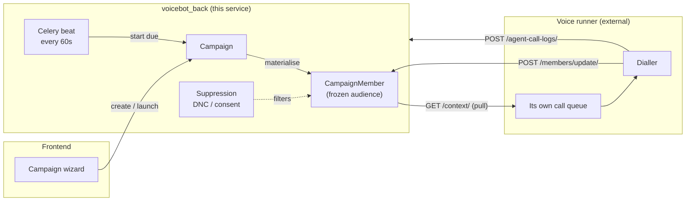

### Who owns what

| This backend owns | The runner owns |
|---|---|
| Campaign definition, schedule, audience | **The call queue itself** |
| Suppression (DNC / consent) and its audit | Dialling, concurrency, pacing |
| The frozen record of what was handed over | Retry policy on busy / no-answer |
| Applying the updates that come back | Sending per-member updates |

`CampaignMember` is **not a queue**. It is the record of what was handed over and the landing
place for the runner's updates.

---

## 3. Entity model

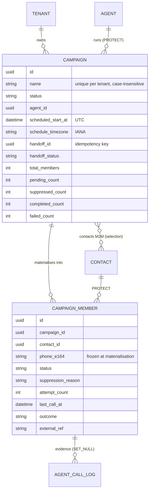

### Why both `contacts` and `CampaignMember`

They answer different questions and diverge the moment anything changes.

| | `Campaign.contacts` (M2M) | `CampaignMember` |
|---|---|---|
| Records | What the user **picked** | What the system **resolved** |
| Mutable? | Yes — edit the campaign | No — frozen at launch |
| Holds a reason? | No | Yes — `suppression_reason` |
| Holds the dialled number? | No (follows the contact) | Yes — copied at materialisation |
| Survives contact edits? | No | Yes |

Without `CampaignMember`, four things become unanswerable:

- *"Why wasn't Raj called?"* — recomputing from his **current** DNC flag means the answer changes
  retroactively if the flag changes.
- *"What number did we dial?"* — the M2M points at the contact's current number.
- *"Was Priya reached?"* — a bare join table has nowhere to put it.
- *"What was in this campaign?"* — removing a contact from the audience erases the history.

---

## 4. The complete flow

### 4.1 End-to-end sequence

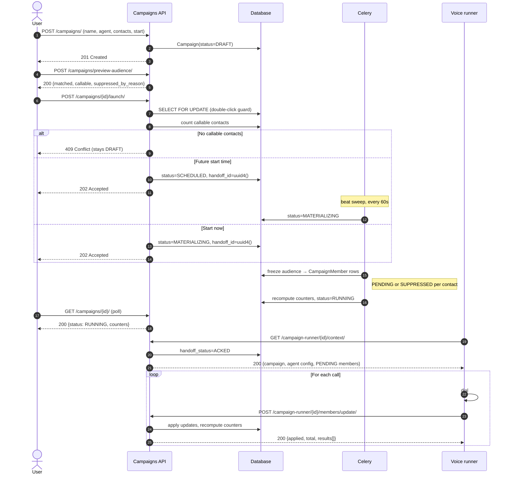

### 4.2 Step-by-step

| # | Step | Actor | Result |
|---|---|---|---|
| 1 | Create campaign | User | `DRAFT` |
| 2 | Preview audience *(optional)* | User | Callable count + suppression breakdown |
| 3 | Launch | User | `SCHEDULED` or `MATERIALIZING` |
| 4 | Beat sweep *(scheduled only)* | System | `SCHEDULED` → `MATERIALIZING` |
| 5 | Materialise | System | Members frozen; `MATERIALIZING` → `RUNNING` |
| 6 | Pull context | Runner | `handoff_status` → `ACKED` |
| 7 | Dial + report | Runner | Members → `COMPLETED` / `FAILED` |

### 4.3 A worked example

Campaign **"Q1 Leads"**, three contacts selected. Raj is on do-not-call.

**At launch, three members are frozen:**

| contact | phone_e164 | status | suppression_reason |
|---|---|---|---|
| Jane | +919876543210 | `PENDING` | — |
| Raj | +919812345678 | `SUPPRESSED` | `DO_NOT_CALL` |
| Priya | +919811112222 | `PENDING` | — |

**Handed to the runner:** only Jane and Priya. Raj is never sent.

**Runner reports:** Jane answered → `COMPLETED`. Priya did not answer after its retries →
`FAILED`.

**Final report:** 3 in audience, 1 refused (DNC), 1 reached, 1 unreachable. Every number is
answerable from the campaign alone, without inspecting anyone's current contact record.

---

## 5. Campaign state machine

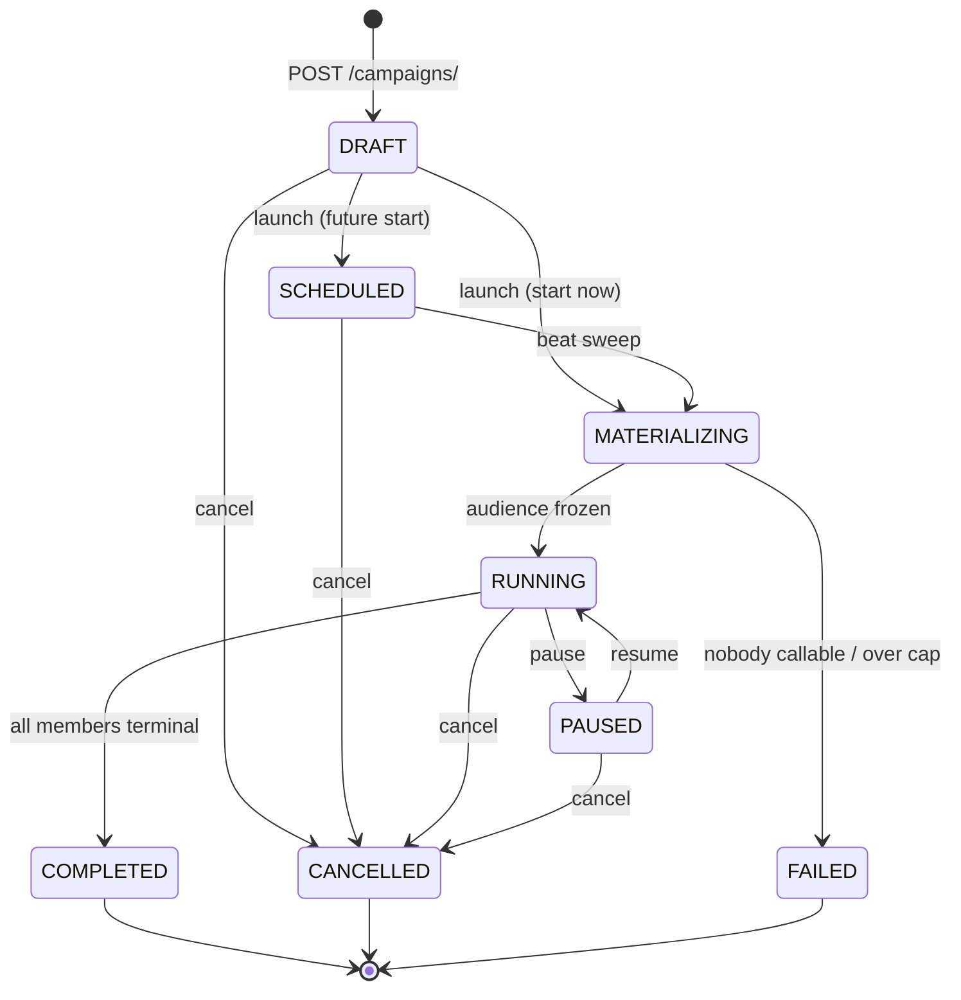

### What each status means

| Status | Meaning | Who sets it | Editable fields | Can launch? | Can delete? |
|---|---|---|---|---|---|
| `DRAFT` | Created, not launched | API on create | **All** | ✅ | ✅ |
| `SCHEDULED` | Waiting for its start time | `launch` | name, description, schedule | ❌ | ✅ |
| `MATERIALIZING` | Freezing the audience (transient) | `launch` / beat | **None** | ❌ | ❌ 409 |
| `HANDING_OFF` | Audience frozen; runner being notified | Materialisation | **None** | ❌ | ❌ 409 |
| `RUNNING` | Audience frozen; runner may work it | Materialisation | name, description | ❌ | ❌ 409 |
| `PAUSED` | Operator-held | `pause` | name, description | ❌ | ✅ |
| `COMPLETED` | Every member terminal | *(see note)* | **None** | ❌ | ✅ |
| `CANCELLED` | Operator-terminated | `cancel` | **None** | ❌ | ✅ |
| `FAILED` | Materialisation failed | Materialisation | **None** | ❌ | ✅ |

**`status` is always server-derived.** Sending it in a request body is silently ignored.

> **Note on `COMPLETED`:** nothing transitions a campaign into it yet. It becomes reachable when
> a "close the campaign once all members are terminal" sweep is added. Until then a fully
> reported campaign stays `RUNNING` with `pending_count = 0`. The status exists in the enum now so
> that adding the sweep later is not a migration, and so its meaning never has to change.

> **Note on `HANDING_OFF`:** no longer reserved. When `CAMPAIGN_RUNNER_NOTIFY_ENABLED` is on,
> materialisation ends here rather than at `RUNNING`, a background task POSTs the campaign to the
> runner, and the campaign moves to `RUNNING` once that POST succeeds. `RUNNING` therefore means
> *the runner has been told* — without the intermediate state there is no way to distinguish
> "notified and dialling" from "notify still queued" from "notify failed and nobody is dialling".
>
> With the flag off, materialisation goes straight to `RUNNING` exactly as before.
>
> The runner may pull `/context/` while a campaign is still `HANDING_OFF` — it is in
> `WORKABLE_STATUSES` — so a runner that reacts to the push immediately is served correctly.

### Which statuses group together

| Group | Members | Used for |
|---|---|---|
| `OPEN_STATUSES` | `DRAFT`, `SCHEDULED` | Still editable / launchable |
| `LIVE_STATUSES` | `MATERIALIZING`, `HANDING_OFF`, `RUNNING`, `PAUSED` | **Blocks deleting the campaign and its bot** |
| `TERMINAL_STATUSES` | `COMPLETED`, `CANCELLED`, `FAILED` | No further work |

---

## 6. Member state machine

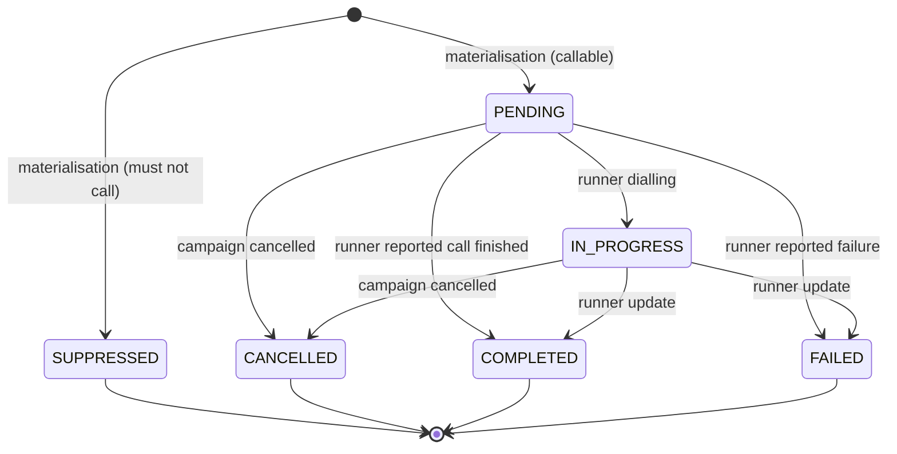

### Ownership — who may write each status

| Status | Meaning | Written by | Terminal? |
|---|---|---|---|
| `PENDING` | Handed over, awaiting outcome | **This backend** (materialisation) | No |
| `SUPPRESSED` | Excluded, never handed over | **This backend** (materialisation) | Yes |
| `CANCELLED` | Campaign cancelled before it was reached | **This backend** (cancel) | Yes |
| `IN_PROGRESS` | Runner reported dialling | Runner update | No |
| `COMPLETED` | Runner reported a finished call | Runner update | Yes |
| `FAILED` | Runner reported failure | Runner update | Yes |

The runner may set **only** `IN_PROGRESS`, `COMPLETED`, `FAILED`. Sending `PENDING`,
`SUPPRESSED`, or `CANCELLED` is a **400**.

This is load-bearing: accepting `PENDING` would let an external service move someone who opted
out back into the callable set.

### Terminal is write-once

Once a member is terminal, further updates are **ignored, not errors** — reported as
`result: "ignored"` so a runner retrying a whole batch does not see spurious failures.

Consequences:

- A resent batch cannot double-count `attempt_count`.
- A late `IN_PROGRESS` arriving after `COMPLETED` is discarded; members never walk backwards.
- A `SUPPRESSED` member can never be revived, even by a well-formed `COMPLETED`.

### `attempt_count`

Increments **only** on `COMPLETED` or `FAILED`, never on `IN_PROGRESS`. So an
`IN_PROGRESS → FAILED` sequence records **one** attempt, not two. It mirrors what the runner
reports; the runner owns the actual retry policy.

---

## 7. Suppression — how DNC works

Suppression happens **here**, not in the runner. The runner receives a list that has already had
opt-outs removed, so honouring DNC is not a behaviour it can get wrong.

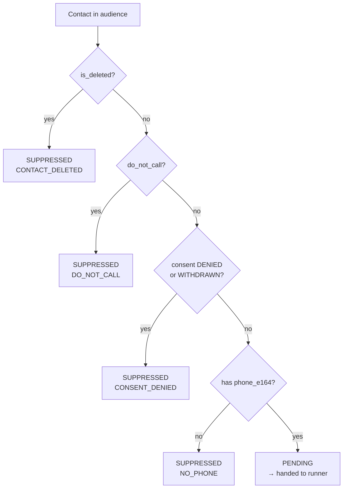

Evaluated in that order — `do_not_call` is reported ahead of a consent state because *"they asked
us not to call"* is the more specific answer.

| Reason | Trigger |
|---|---|
| `CONTACT_DELETED` | Contact was soft-deleted |
| `DO_NOT_CALL` | `contact.do_not_call = true` |
| `CONSENT_DENIED` | `consent_status` is `DENIED` or `WITHDRAWN` |
| `NO_PHONE` | No usable `phone_e164` |

### Three rules that matter

1. **`SUPPRESSED` is not `FAILED`.** *"We refused to call them"* and *"we tried and it failed"*
   are different answers to a regulator. Collapsing them makes the compliance report unbuildable.
2. **Suppressed members are kept as rows**, never silently dropped. *"Why wasn't this person
   called"* must be answerable from the campaign alone, without checking the contact's **current**
   state — which may have changed since.
3. **`consent_status = UNKNOWN` does not suppress.** Every contact starts `UNKNOWN`, so
   suppressing it would mean no campaign ever calls anyone. Whether an unknown consent state
   *should* block dialling is a compliance policy question, not an engineering default.

### ⚠️ Known limitation — the suppression window

Suppression is applied **once**, at materialisation. Between then and the runner's last call,
someone can opt out — and the runner is working from a snapshot that no longer reflects that.
The window is as long as the campaign takes to run.

Closing it needs one of: re-checking on each context page the runner pulls; a suppression-delta
endpoint the runner polls; or the runner re-checking before each dial. All three need agreement
with the runner's owner. **This is the largest compliance exposure in the current design.**

---

## 8. Scheduling & timezones

The API takes two pickers — `start_date` and `start_time` — and stores **one UTC instant plus the
IANA zone it was expressed in**.

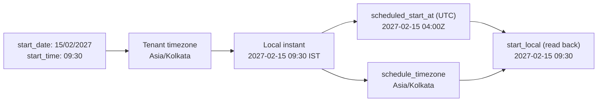

**Why not store the date and time as-is?** A tenant that changes timezone, or a DST boundary
between save and fire, would silently move every scheduled campaign. Storing the resolved instant
means an already-scheduled campaign never moves; storing the zone alongside it means the pickers
can still repopulate exactly as typed.

### Validation rules

| Rule | Behaviour |
|---|---|
| Date and time are **all-or-nothing** | One without the other → 400. A date with no time has no defined firing instant, and defaulting to midnight is how a system calls people at 00:00 |
| The **combined instant** must be in the future | Today's date with a time two hours ago → 400. A date-only check would wave it through |
| Evaluated in the **tenant's** timezone | A tenant in `Asia/Kolkata` at 02:00 local is on the previous UTC day; a UTC comparison would reject a legal date |
| Dates are **day-first** | `01/02/2027` is 1 February, not 2 January |
| DST gaps resolve, never raise | A non-existent local time picks the later offset; the stored UTC instant records which |

### Timing guarantee

`scheduled_start_at` is a **"not before"** guarantee, not exact-fire. The beat sweep runs every
**60 seconds**, so a campaign starts within about a minute of its scheduled time.

---

## 9. Data flow diagrams

### 9.1 Materialisation — how the audience is frozen

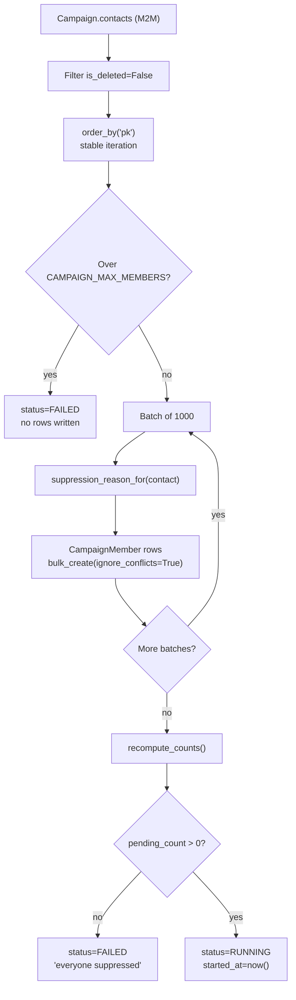

Each batch commits in its own savepoint, so one bad row cannot discard a 100k-member
materialisation. `ignore_conflicts=True` makes a retried task idempotent against the
`(campaign, contact)` unique constraint.

### 9.2 Where each field comes from

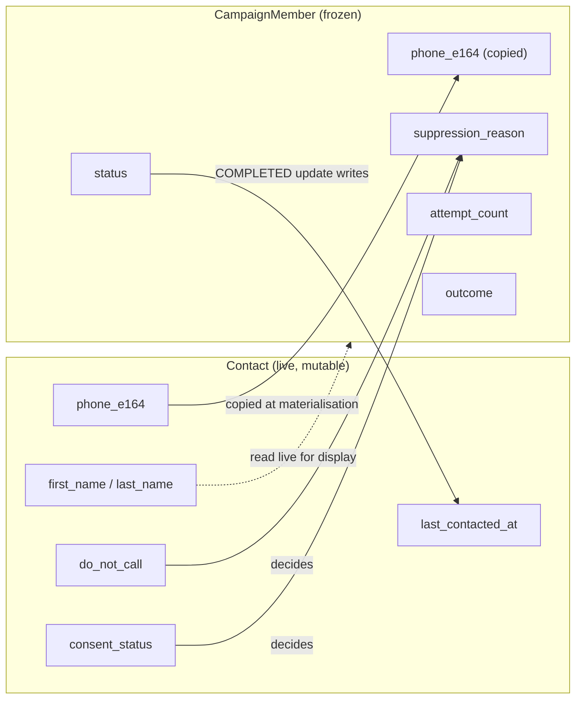

`phone_e164` is **copied**, not referenced — if the contact's number is edited later, the
campaign still records what was handed over. `full_name` is read live, because a display name has
no compliance significance.

### 9.3 Counter maintenance

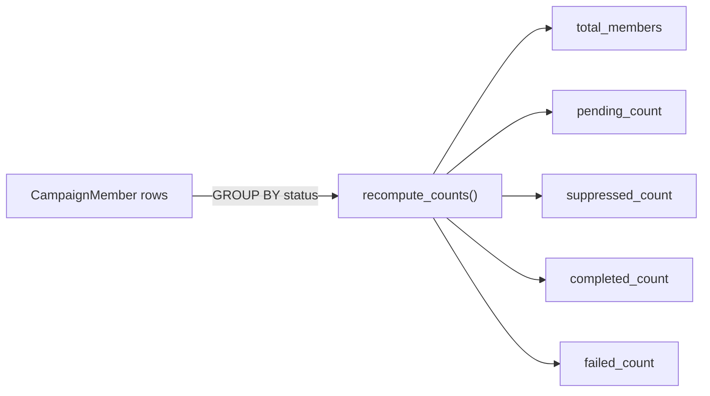

Counters are denormalised onto `Campaign` because the detail endpoint is a **poll target** — a
`GROUP BY` over 100k members on every poll is a self-inflicted load test. They are recomputed
after materialisation, after cancel, and after every batch of runner updates, so drift is
repairable rather than permanent.

### 9.4 Linking a call log to a member

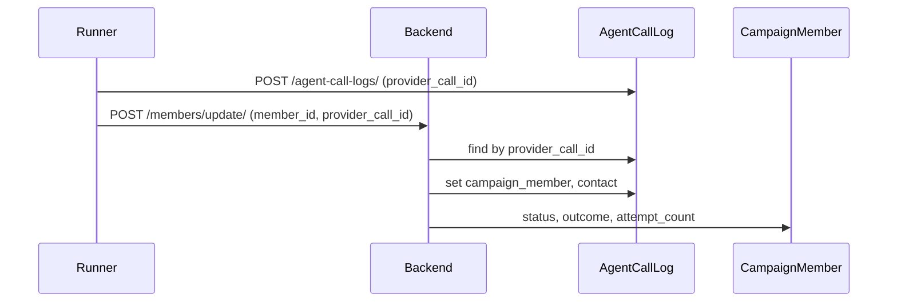

The link is **explicit**, never inferred from contact + time window. `AgentCallLog` carries
inbound calls too, and a concurrent campaign may be calling the same person — a heuristic match
would count an inbound call as an outbound contact.

---

## 10. Concurrency & idempotency

| Risk | Guard |
|---|---|
| Double-click launch | `SELECT FOR UPDATE` + status check — one 202, one 409 |
| Same person twice in one campaign | Partial unique constraint on `(campaign, contact)` |
| Retried materialisation task | `bulk_create(ignore_conflicts=True)` |
| Duplicate beat sweep | Status re-checked under the row lock |
| Retried runner batch | Terminal statuses are write-once → `ignored` |
| Out-of-order runner updates | Terminal is write-once; late updates discarded |
| Deleting a live campaign | `Campaign.soft_delete()` refuses on `LIVE_STATUSES` — covers `DELETE`, `bulk_delete`, and the admin |
| Deleting a bot in use | `Agent.soft_delete()` refuses while a live campaign references it |
| Duplicate handoff delivery | `handoff_id` — one UUID per launch, reused across every attempt |

### `handoff_id`

Generated **once per launch**, not per attempt. That distinction is the whole point: a
per-attempt id makes a retry indistinguishable from new work, so a delivery that timed out
*after* being received would call the entire audience twice.

---

## 11. Failure modes

| What happens | Result | How to recover |
|---|---|---|
| Launch with an empty audience | **409**, campaign stays `DRAFT` | Add contacts |
| Launch with everyone suppressed | **409**, campaign stays `DRAFT` | Check `/preview-audience/` |
| All contacts opt out between launch and materialisation | `FAILED` with `error_message` | Create a new campaign |
| Audience over `CAMPAIGN_MAX_MEMBERS` | `FAILED`, **no partial rows** | Split the campaign |
| Bot deleted after create, before launch | **409** on launch | Pick another bot |
| Runner never pulls context | Stays `RUNNING`, `handoff_status=PENDING` | Check `handoff_status` |
| Runner reports an unknown member id | `result: "not_found"` for that item only | Others still apply |
| Beat worker down | Scheduled campaigns do not start | Query `SCHEDULED` with a past `scheduled_start_at` |

### Diagnosing "why hasn't my campaign started?"

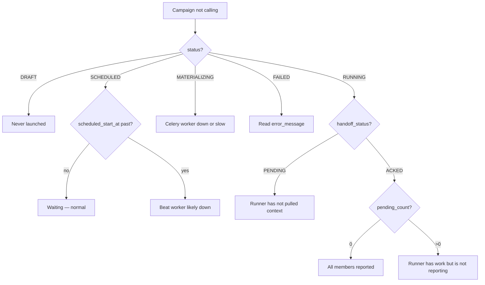

---

## 12. Glossary

| Term | Meaning |
|---|---|
| **Campaign** | A named outbound calling job |
| **Member** | One contact's place in one campaign, frozen at launch |
| **Materialisation** | Taking the snapshot: walking the selected contacts once and writing one permanent row per person, with their number copied and their eligibility decided. See [§0](#0-start-here--the-whole-thing-in-plain-terms) |
| **Suppression** | Excluding a contact from calling, with the reason recorded |
| **Handoff** | Passing the campaign to the runner; `handoff_id` is its idempotency key |
| **Runner** | The external voice service that owns the queue and dials |
| **Audience** | The contacts selected for a campaign |
| **Callable** | A contact in the audience with no suppression reason |
| **DNC** | Do Not Call — a hard suppression |

---

## Related settings

| Setting | Default | Effect |
|---|---|---|
| `CAMPAIGN_MAX_SELECTED_CONTACTS` | 5000 | Cap on contacts per create/update request |
| `CAMPAIGN_MAX_MEMBERS` | 100000 | Cap on what materialisation will build |
| `CAMPAIGN_MATERIALIZE_BATCH_SIZE` | 1000 | Rows per savepoint |
| `CAMPAIGN_MAX_CONCURRENT_RUNNING` | 5 | Reserved |

Beat entry: `campaigns-start-due` runs `core.tasks.start_due_campaigns` every **60 seconds**.
