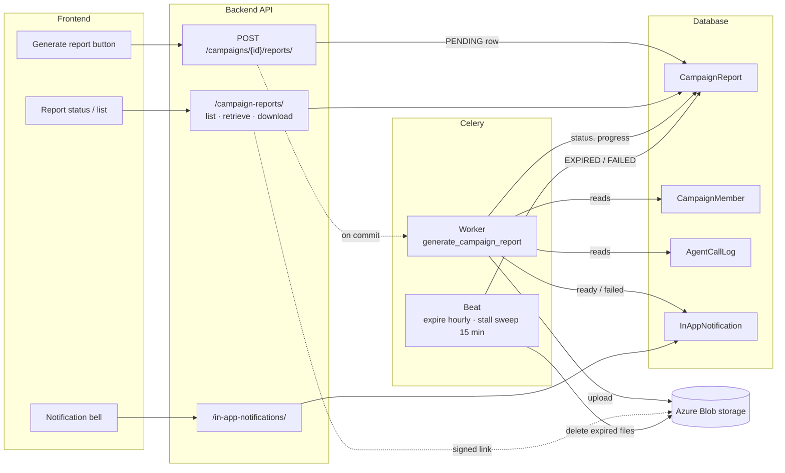
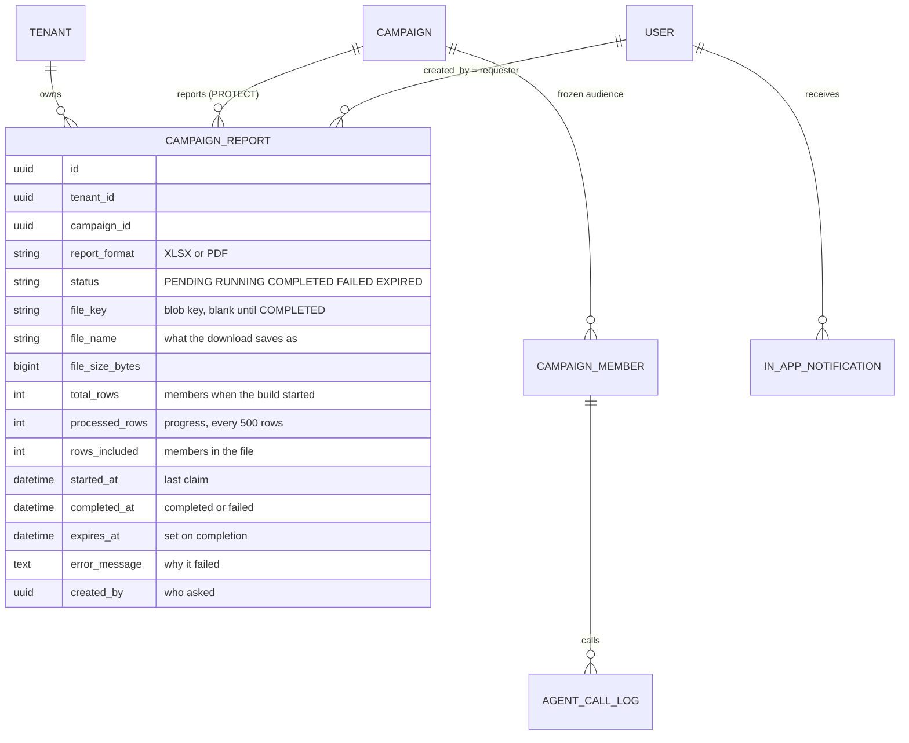
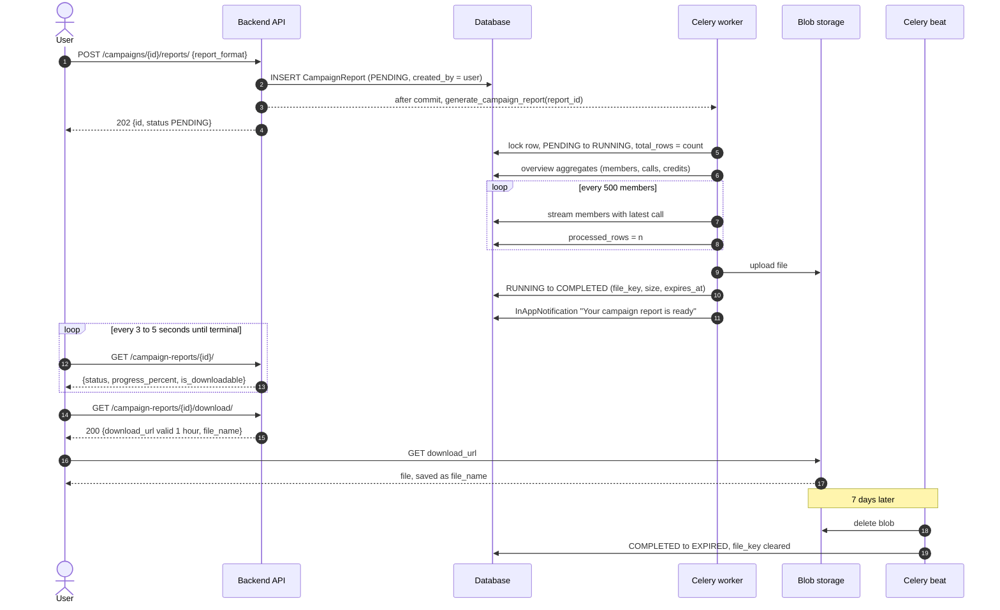
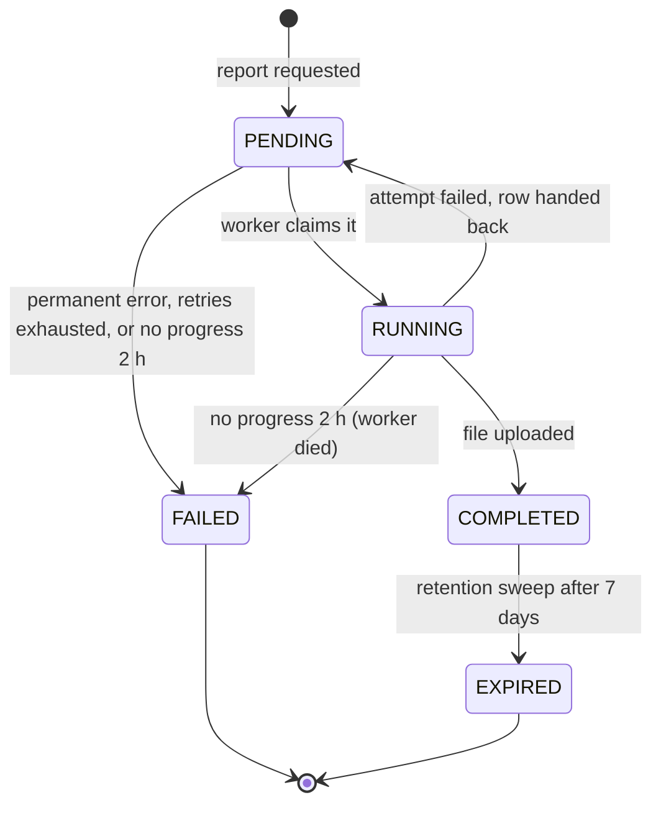
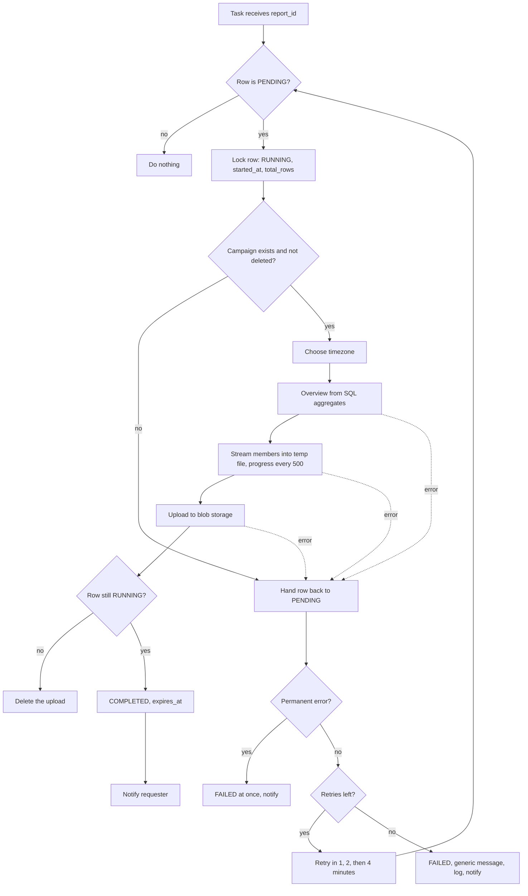
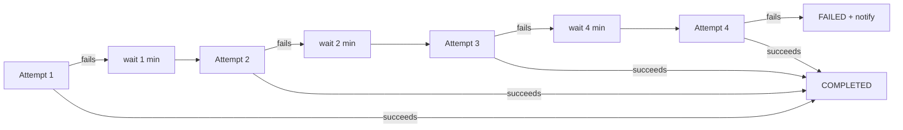

# Campaign Reports — Overview & Complete Flow

Everything about how campaign reports work: the end-to-end flow, the report lifecycle, every
endpoint, the background jobs, storage, notifications, failure handling, and how a frontend should
drive it.

**API reference:** [Campaign Reports API](../apiDocs/core/campaign_report.md) ·
**Design reasoning:** [Feature Detail](../feature-detail-scratch/campaign-report.md) ·
**Build notes:** [Implementation Plan](../implementation-plan-scratch/campaign-report-plan.md) ·
**Parent module:** [Campaign Module](README.md) ·
**Field comparison:** [Our report vs the reference dashboard](report-field-comparison.md)

---

## Contents

0. [Start here — the whole thing in plain terms](#0-start-here--the-whole-thing-in-plain-terms)
1. [What a report is](#1-what-a-report-is)
2. [System architecture](#2-system-architecture)
3. [Entity model](#3-entity-model)
4. [The complete flow](#4-the-complete-flow)
5. [Report lifecycle — the state machine](#5-report-lifecycle--the-state-machine)
6. [Inside the build](#6-inside-the-build)
7. [What goes in the file](#7-what-goes-in-the-file)
8. [Endpoints](#8-endpoints)
9. [Frontend integration guide](#9-frontend-integration-guide)
10. [Background jobs](#10-background-jobs)
11. [Storage and download links](#11-storage-and-download-links)
12. [Notifications](#12-notifications)
13. [Concurrency & idempotency](#13-concurrency--idempotency)
14. [Failure modes & diagnosis](#14-failure-modes--diagnosis)
15. [Security & tenant isolation](#15-security--tenant-isolation)
16. [Configuration](#16-configuration)
17. [Operations](#17-operations)
18. [Limits](#18-limits)
19. [Code map](#19-code-map)
20. [Glossary](#20-glossary)

---

## 0. Start here — the whole thing in plain terms

No jargon. If you only read one section, read this one.

### The problem

A campaign has run and somebody wants the result as a file — to open in Excel, to send to a
client, to keep. A campaign can have 100,000 people in it. Building that file takes far longer than
a web request should ever stay open, so the file **cannot** be built while the user waits.

### The whole flow, step by step

**1. You press "Generate report"** on a campaign and pick **Excel** or **PDF**.

**2. The server writes a note and answers immediately.** The note says *"Alex asked for an Excel
report of campaign Q1 Leads"*. That note is a **report row**, and its status is `PENDING`. No file
exists yet. The answer comes back in milliseconds, carrying the report's id.

**3. A background worker picks it up.** The status becomes `RUNNING`. The worker counts the
members, works out the summary figures, then writes the file one person at a time. Every 500
people it updates the progress, so a screen can show *"Generating… 42%"*.

**4. The file is uploaded to storage** and the status becomes `COMPLETED`. The person who asked
gets an in-app notification: *"Your campaign report is ready"*.

**5. You click Download.** The server hands back a link that works for one hour, and the browser
downloads the file directly from storage, saved as something readable like
`campaign-q1-leads-20270215-093012.xlsx`.

**6. Seven days later the file is deleted.** The report row stays, marked `EXPIRED`, so the history
of who pulled which report and when is kept, without paying to store the file forever.

### When something goes wrong

- **Storage or the database hiccups** → the worker tries again after 1 minute, then 2, then 4. If
  the fourth attempt also fails, the report becomes `FAILED` and the requester is told.
- **The campaign was deleted** before the worker got to it → `FAILED` straight away. Retrying would
  fail the same way.
- **The worker machine dies mid-report** → nothing else would ever notice, so a sweep runs every 15
  minutes and fails any report that has made no progress for 2 hours.

### What you end up with

For every report ever requested, permanently: who asked, when, for which campaign, in which
format, whether it worked, and why not if it did not. For the last seven days' successful ones,
the file itself.

---

## 1. What a report is

A **campaign report** is one file describing one campaign: a summary of the campaign as a whole,
then one row per member of its frozen audience.

| Rule | Meaning |
|---|---|
| **One campaign per report** | No cross-campaign or date-range reports. |
| **One format per report** | Excel and PDF are two requests and two reports. |
| **One report per request** | Asking twice builds twice. Nothing is deduplicated. |
| **A snapshot** | The file shows the campaign as it was when the worker read it. For a campaign that is still running, request again later for fresher figures. |
| **Built in the background** | The request only records that a report was asked for. |

### The two formats

| | XLSX (Excel) | PDF |
|---|---|---|
| For | Someone who will filter, sort and pivot | Someone who will read or forward it |
| Layout | Sheet **Campaign Overview**, then sheet **Members** | Overview on portrait pages, then a landscape member table |
| Members | **All** of them | The first **2,000**, and the page says how many were left out |
| Text | Kept in full | Each cell cut at 300 characters |
| Non-Latin names (e.g. Devanagari) | Correct | Do not render properly — standard PDF fonts are Latin-1 only |
| Columns | The fixed columns, **the call's own record** (15 more), and two per probing question | The fixed columns only |
| Extras | Frozen header row, autofilter, real date cells, numbers that sum | Header repeated on every page, zebra striping, page numbers |

> **Key mental model:** the request owns *intent* (a row saying a report was asked for). The worker
> owns *the file*. Beat owns *cleanup*. Storage owns *delivery*.

---

## 2. System architecture



### Who owns what

| Actor | Owns | Never does |
|---|---|---|
| **API request** | Validating the request, writing the `PENDING` row, scheduling the task | Reading members, building a file |
| **Celery worker** | Claiming the row, building the file, uploading it, completing the row, notifying | Deciding who may request a report |
| **Celery beat** | Deleting expired files, failing stalled reports | Building anything |
| **Blob storage** | Holding the file, serving the download | — |
| **Frontend** | Polling, showing progress, fetching a link on click | Storing download links |

---

## 3. Entity model



### Fields, in plain words

| Field | Set by | When | Notes |
|---|---|---|---|
| `status` | API, worker, beat | Every transition | See [§5](#5-report-lifecycle--the-state-machine) |
| `report_format` | API | Request | Never changes |
| `created_by` | API | Request | The requester — the only person notified |
| `total_rows` | Worker | Claim | One `count()` of the campaign's members |
| `processed_rows` | Worker | Every 500 rows | Reset to `0` if an attempt fails |
| `rows_included` | Worker | Completion | Equals `total_rows` except for a PDF past its cap |
| `file_key` | Worker, beat | Completion; cleared on expiry | **Never sent to clients** |
| `file_name`, `file_size_bytes` | Worker | Completion | `file_name` is kept after expiry |
| `started_at` | Worker | Each claim | Overwritten by a retry |
| `completed_at` | Worker | Completion **or failure** | |
| `expires_at` | Worker | Completion | `completed_at` + 7 days |
| `error_message` | Worker, beat | Failure | Written for the user, never a stack trace |

Derived, not stored:

| Property | Rule |
|---|---|
| `is_downloadable` | `status == COMPLETED` and `file_key` is set |
| `progress_percent` | `100` for `COMPLETED` and `EXPIRED`; otherwise `processed_rows / total_rows`, capped at `99`; `0` when `total_rows` is `0` |

Indexes: `(tenant, campaign, -created_at)` for the list, `(status, expires_at)` for the expiry sweep.

`campaign` is `PROTECT`, but campaigns are soft-deleted, so deleting a campaign through the API
leaves its reports — and their files — in place until they expire.

---

## 4. The complete flow



### Step by step

| # | Step | Where | Detail |
|---|---|---|---|
| 1 | Request | `CampaignViewSet.reports` | Campaign looked up through the tenant-scoped queryset (404 otherwise), body validated, throttle checked |
| 2 | Row written | `request_report` | `CampaignReport` in `PENDING`, inside a transaction |
| 3 | Task scheduled | `transaction.on_commit` | Fired only after the row is committed, so the worker can always find it |
| 4 | 202 returned | View | Full report serialised, no link, no key |
| 5 | Claim | `_claim` | `SELECT … FOR UPDATE`; anything not `PENDING` is skipped |
| 6 | Campaign loaded | `_generate` | Soft-deleted campaign → `PermanentReportError` |
| 7 | Timezone chosen | `report_timezone` | Campaign schedule zone, else tenant zone, else UTC |
| 8 | Overview | `build_overview` | SQL aggregates, before any member is streamed |
| 9 | Members streamed | `member_rows` | Keyset paging, 500 at a time; each page joins its call logs (and appointments) in one query |
| 10 | File written | `write_xlsx` / `write_pdf` | Into a temp file on the worker; progress every 500 rows |
| 11 | Upload | `AzureBlobStorageService.upload_file` | Last step that touches the file; temp file removed afterwards |
| 12 | Complete | Conditional `UPDATE … WHERE status = RUNNING` | If no row matched, the sweep failed it meanwhile — the upload is deleted |
| 13 | Notify | `_notify` | Requester only; a failure here is logged and ignored |
| 14 | Poll | `CampaignReportViewSet.retrieve` | One row |
| 15 | Download | `CampaignReportViewSet.download` | Fresh signed link per call; 409 when there is no file |
| 16 | Expire | `expire_reports` (beat, hourly) | Blob deleted first, then the row moves |

---

## 5. Report lifecycle — the state machine



### Statuses

| Status | Meaning | Open? | Client should |
|---|---|---|---|
| `PENDING` | Queued, **or** an attempt failed and a retry is waiting | Open | Keep polling |
| `RUNNING` | A worker is building the file | Open | Keep polling, show `progress_percent` |
| `COMPLETED` | File ready | — | Offer the download |
| `FAILED` | Gave up; `error_message` says why | Terminal | Show the message, offer "Generate again" |
| `EXPIRED` | File removed after retention | Terminal | Offer "Generate again" |

`OPEN_STATUSES = [PENDING, RUNNING]`. `COMPLETED` stops changing except for the one move to
`EXPIRED`.

### Every transition

| From → To | Who | Trigger | Code |
|---|---|---|---|
| — → `PENDING` | API | `POST /campaigns/{id}/reports/` | `request_report` |
| `PENDING` → `RUNNING` | Worker | Task claims the row under a lock | `_claim` |
| `RUNNING` → `COMPLETED` | Worker | Upload succeeded; conditional update on `RUNNING` | `_generate` |
| `RUNNING` → `PENDING` | Worker | Any exception while building; `processed_rows` reset to `0` | `build_report` |
| `PENDING` → `RUNNING` | Worker | Retry after 1, 2 or 4 minutes claims it again | `_claim` |
| `PENDING` → `FAILED` | Worker | Campaign deleted — at once, no retry | `generate_campaign_report` → `mark_failed` |
| `PENDING` → `FAILED` | Worker | Fourth attempt failed — generic message | `generate_campaign_report` → `mark_failed` |
| `PENDING` / `RUNNING` → `FAILED` | Beat | No write to the row for 120 minutes | `fail_stalled_reports` |
| `COMPLETED` → `EXPIRED` | Beat | `expires_at` passed and the blob was deleted | `expire_reports` |

Rules that hold across every transition:

- **Only `PENDING` can be claimed.** A duplicate task finds `RUNNING` or later and does nothing.
- **Only an open report can fail.** `mark_failed` filters on `PENDING`/`RUNNING`, so a late failure
  can never overwrite `COMPLETED`.
- **Only `RUNNING` can complete.** If the stall sweep failed a report while it was still building,
  the build's completion matches nothing and its upload is deleted.
- **Only `COMPLETED` can expire**, and only after its blob is gone.

### What the fields look like in each status

| Status | `progress_percent` | `is_downloadable` | `file_name` | `started_at` | `completed_at` | `expires_at` | `error_message` |
|---|---|---|---|---|---|---|---|
| `PENDING` (new) | `0` | `false` | `""` | `null` | `null` | `null` | `""` |
| `PENDING` (awaiting retry) | `0` | `false` | `""` | last attempt | `null` | `null` | `""` |
| `RUNNING` | `0`–`99` | `false` | `""` | set | `null` | `null` | `""` |
| `COMPLETED` | `100` | `true` | set | set | set | set | `""` |
| `FAILED` | last value reached — ignore it | `false` | `""` | set or `null` | set | `null` | set |
| `EXPIRED` | `100` | `false` | **kept** | set | set | set (past) | `""` |

---

## 6. Inside the build



### How the data is read

**Members** — streamed a page at a time, never loaded into memory at once:

```python
members = batched_queryset(               # keyset paging on (created_at, id)
    CampaignMember.objects.filter(campaign=campaign).select_related("contact"),
    batch_size=PAGE_SIZE, order_by=("created_at", "id"),
)
for page in _pages(members, PAGE_SIZE):   # 500 members
    logs = _latest_logs(page)             # one query: newest call per member
    demos = _demo_times(campaign, page)   # one query: appointments, detailed reports only
```

- **Each page costs three queries, not three per member.** The call figures used to be one
  correlated subquery per column, which is fine for three of them; the workbook now carries fifteen
  call columns, and fifteen correlated lookups per member over a six-figure audience is a different
  proposition.
- `_latest_logs` keeps the member's newest `AgentCallLog` by `created_at`. Somebody called three
  times gets **one row** describing the latest call; `Attempts` says how many there were.
- **Keyset paging, not `.iterator()`** — a named cursor does not survive pgbouncer's transaction
  pooling.
- The order matches the campaign members endpoint, so the report and the screen list people the
  same way.
- Soft-deleted members are excluded.

**The overview** — aggregates, computed before streaming starts:

| Figure | Query |
|---|---|
| Members by status and by suppression reason | `GROUP BY` on `CampaignMember` |
| Total calls, connected, talk time, average duration | `AgentCallLog` filtered by `campaign_member__campaign` |
| Credits charged, calls charged | `SUM` / `COUNT` of `AgentCallLog.credits_charged` |
| Credits per service tier | `GROUP BY service_tier` |

A call is **connected** when `duration_seconds > 0`. Only call logs the runner has linked to a
member count — an unlinked log is not part of any campaign.

**The file** — written to a temporary file on the worker, never held in memory. The XLSX uses
openpyxl's write-only mode, which spools rows to disk as they are appended. The PDF is laid out in
memory, which is why it is capped at 2,000 members.

---

## 7. What goes in the file

Full rationale is in the [Feature Detail](../feature-detail-scratch/campaign-report.md); this is the
reference.

### Overview (XLSX sheet 1 / PDF first pages)

| Group | Lines |
|---|---|
| **Campaign** | Name · Description · Status · Bot · Audience source · Created at · Launched by |
| **Schedule** | Scheduled start · Schedule timezone · Started at · Completed at · Elapsed |
| **Audience** | Total members · Callable · Suppressed · one line per suppression reason |
| **Outcomes** | Completed · Failed · Pending · In progress · Cancelled · Reach rate · Failure rate |
| **Calls** | Direction · Total calls · Connected · Connect rate · Not picked up · Not picked up rate · Attempts reported · Total talk time · Average duration · Longest call |
| **Call length** | Under 30 seconds · 30 to 60 · 60 to 120 · Over 120 — connected calls only |
| **Attendance** | Handled by the bot · Transferred to a human · Appointments booked |
| **Sentiment** | One line per mood the calls recorded, with its count |
| **Dispositions** | One line per outcome the runner sent, with its count — free text, so two spellings count separately |
| **Credits** | Credits charged · Calls charged · Average per charged call · one line per service tier · a note that credits are as charged, not net of refunds |
| **Report** | Report ID · Generated at · Requested by · Members in campaign · Members included · Times shown in |

Reach rate and failure rate are percentages **of callable members** (total minus suppressed).
Connect rate is connected calls over total calls. All counts come from member rows, so completed +
failed + pending + in progress + suppressed + cancelled always adds up to the total.

### Members (XLSX sheet 2 / PDF landscape table)

| # | Column | Source | Empty when |
|---|---|---|---|
| 1 | Member ID | `CampaignMember.id` | never |
| 2 | Name | `Contact.full_name` | contact has no name |
| 3 | Company | `Contact.company` | not set |
| 4 | Phone | `CampaignMember.phone_e164` — **frozen at launch** | no usable number |
| 5 | Status | Member status, e.g. `Completed`, `In progress` | never |
| 6 | Suppression reason | e.g. `On the do-not-call list` | not suppressed |
| 7 | Outcome | Runner's disposition, verbatim | no outcome reported |
| 8 | Attempts | `CampaignMember.attempt_count` | never (`0`) |
| 9 | Last call at (*zone*) | `CampaignMember.last_call_at` | never called |
| 10 | Duration (seconds) | Latest call's `duration_seconds` | no call log — `0` means it did not connect |
| 11 | Credits charged | Latest call's `credits_charged` | **never charged** — different from `0`, a free call |
| 12 | Error | `CampaignMember.error_message` | no error |
| 13 | Provider call ID | Latest call's `provider_call_id` | no call log |
| 14 | Probing questions asked | Latest call's `probing_questions_count` | never (`0`) |
| 15–29 | The call's own record — see below | The member's latest `AgentCallLog` | XLSX only |
| 30+ | Two columns per probing question — see below | Latest call's `probing_questions` | XLSX only |

**Suppressed members are included**, with their reason — unlike everywhere else in the campaign
module, where they are hidden.

**A report on a `DRAFT` or `SCHEDULED` campaign has no member rows.** The audience only becomes
members at launch; selected contacts that were never materialised are not listed.

### The call's own record (XLSX only)

Fifteen columns describing the member's latest call — what a standalone call-analytics export
carries:

| Column | Source |
|---|---|
| Call from · Call to | `caller_number` · `callee_number` (falling back to `customer_number`) |
| Bot | The agent that placed the call |
| Call started at · Call ended at | `started_at` · `ended_at`, in the report's zone |
| Attended by | `AI`, or `Human` when the call recorded a transfer |
| Sentiment · Sentiment confidence | `mood` · `mood_confidence` |
| Detected language | `preferred_language` |
| Appointment booked for | The earliest active booking for that person since the campaign started |
| Follow-up note | `follow_up_detail`, as sent |
| Recording | The runner's own URL, else a signed link to our copy |
| AI summary | `ai_summary` |
| Transcript | `speaker: text` lines, cut at 32,000 characters — Excel refuses more |
| Call logged at | When the call log reached us |

Every cell is blank for a member who was never called. "Attended by" is blank too: nobody attended
a call that did not happen.

> **A downloaded workbook carries recording links.** They are signed for the report's own lifetime,
> so whoever holds the file can fetch those recordings until it expires. That is why reports are
> tenant-scoped, expire with their files, and record who asked for them.

**Appointments are correlation, not proof.** A booking is tied to a person, never to a call, so the
column answers "did an appointment appear for this person after the campaign began". A bot that
books directly would have to report it for anything stronger.

### Probing questions (XLSX only)

After the call columns, the workbook adds **two columns per probing question**:

| Column | Holds |
|---|---|
| `Q1 — How do you manage your leads?` | That call's `answerSummary`, verbatim |
| `Q1 positive?` | `Yes` / `No`, from `isPositive` |

The question list is discovered per report, **before the first row is written** — the workbook is
append-only, so no column can be added once the header row is out:

1. the bot's configured questions, in `ProbingQuestion.priority` order, so the columns have a
   deliberate order and a question nobody ever reached still gets one — an empty column is itself
   the answer;
2. anything else this campaign's call logs contain, appended in first-seen order, so a question
   asked ad hoc or renamed after the call does not go missing.

Two extra queries per report, none per row. Questions are matched on normalised text — trimmed,
inner whitespace collapsed, case-folded — so one question cannot claim two columns, and editing a
question on the bot produces a new column rather than rewriting what older calls recorded.

Both cells are blank when the call did not carry that question: "not asked" and "asked but
unanswered" are different answers, and only the first is silent. `isPositive` is written as sent —
the runner uses `false` both for a negative answer and for one never given, and only the summary
text separates them.

`CAMPAIGN_REPORT_MAX_PROBING_QUESTIONS` (25) caps how many pairs a sheet can grow; `0` turns them
off. **The PDF carries none** — its landscape table is already at its width limit with the fixed
columns.

### Times

Every time in one file is in **one zone**: the campaign's `schedule_timezone`, else the tenant's
timezone, else UTC. The zone is written into the member sheet's header
(`Last call at (Asia/Kolkata)`) and into the overview's **Times shown in** line.

### File name

```
campaign-<slug>-<YYYYMMDD-HHMMSS>.<xlsx|pdf>
e.g. campaign-q1-lead-qualification-20270215-093012.xlsx
```

- `<slug>` is the campaign name slugified, at most 60 characters, `campaign` if empty.
- The timestamp is when the report was **requested**, in UTC — so every retry of one report produces
  the same name.

### Cell safety

| Hazard | Handling |
|---|---|
| Text beginning with `=` (e.g. a contact named `=HYPERLINK(…)`) | Written as a string cell — never a live formula in Excel |
| Control characters in runner text | Stripped — openpyxl would otherwise refuse the whole file |
| `<`, `>`, `&` in names (PDF) | Escaped — the PDF layout engine parses cell text as markup |
| Very long text (PDF) | Cut at 300 characters per cell; overview values at 2,000 |
| Missing values | Empty cells — never `None`, `null` or `N/A` |

---

## 8. Endpoints

All paths are under `/api/v1/core/`. All need `Authorization: Bearer <access_token>`. All are
scoped to the caller's tenant. Every response uses the standard envelope
`{ "status", "message", "data", "errors" }`.

### Summary

| Method | Path | Purpose | Success | Throttle |
|---|---|---|---|---|
| `POST` | `/campaigns/{id}/reports/` | Request a report | **202** | 30/min, shared with launch, cancel, preview-audience |
| `GET` | `/campaign-reports/` | List reports | 200 | — |
| `GET` | `/campaign-reports/{id}/` | One report — the poll target | 200 | — |
| `GET` | `/campaign-reports/{id}/download/` | A fresh download link | 200 | — |
| `GET` | `/campaign-reports/dropdown/` | Picker options | 200 | — |
| `GET` | `/in-app-notifications/?notification_type=REPORTS` | Report notifications | 200 | — |

### `POST /campaigns/{id}/reports/`

```json
{ "report_format": "XLSX" }
```

`report_format` is optional — `XLSX` (default) or `PDF`. An empty body `{}` requests an XLSX.

**202**

```json
{
  "status": true,
  "message": "Report requested",
  "data": {
    "id": "7b1d…",
    "campaign": { "id": "3f2a…", "name": "Q1 Lead Qualification", "status": "RUNNING" },
    "report_format": "XLSX",
    "status": "PENDING",
    "progress_percent": 0,
    "processed_rows": 0,
    "total_rows": 0,
    "rows_included": 0,
    "file_name": "",
    "file_size_bytes": 0,
    "is_downloadable": false,
    "started_at": null,
    "completed_at": null,
    "expires_at": null,
    "error_message": "",
    "created_by": { "id": "…", "email": "alex@acme.com", "first_name": "Alex", "last_name": "P" },
    "created_at": "2027-02-15T09:30:12Z",
    "…": "audit and tenant fields"
  },
  "errors": null
}
```

| Code | When | `message` |
|---|---|---|
| **202** | Queued | `Report requested` |
| **400** | Unknown `report_format` | `"CSV" is not a valid choice.` |
| **401** | Missing or invalid token | `Authentication credentials were not provided.` |
| **403** | No tenant mapping / `VB_AGENT` token | `Your user account is not associated with any active tenant.` / `This endpoint is not available to agent tokens.` |
| **404** | Unknown, soft-deleted, or another tenant's campaign | `Not found.` |
| **429** | Throttled | `Request was throttled. Expected available in N seconds.` |

Allowed in **every** campaign status, `DRAFT` included.

### `GET /campaign-reports/`

| Query parameter | Values |
|---|---|
| `campaign` | Campaign UUID — an unknown one is **400** |
| `status` | `PENDING`, `RUNNING`, `COMPLETED`, `FAILED`, `EXPIRED` |
| `report_format` | `XLSX`, `PDF` |
| `ordering` | `created_at`, `-created_at` (default), `completed_at`, `-completed_at` |
| `page`, `page_size` | Default `1` and `10`; `page_size` at most `100` |

Paginated. The list shape omits `processed_rows`, `total_rows`, `rows_included`, `started_at` and
`error_message` — retrieve one report for those.

### `GET /campaign-reports/{id}/`

The full shape shown in the 202 above, with the current values. **404** for an unknown report or
another tenant's.

### `GET /campaign-reports/{id}/download/`

**200**

```json
{
  "status": true,
  "message": "Download link issued",
  "data": {
    "download_url": "https://<account>.blob.core.windows.net/<container>/t-<tenant>/campaign-reports/7b1d…_campaign-q1-lead-qualification-20270215-093012.xlsx?sv=…&se=…&sp=r&rscd=…&sig=…",
    "file_name": "campaign-q1-lead-qualification-20270215-093012.xlsx",
    "file_size_bytes": 1843201,
    "expires_in_seconds": 3600
  },
  "errors": null
}
```

| Code | Status of the report | `message` |
|---|---|---|
| **200** | `COMPLETED` | `Download link issued` |
| **409** | `PENDING` | `This report is queued and not ready yet.` |
| **409** | `RUNNING` | `This report is still being generated.` |
| **409** | `FAILED` | `This report failed and has no file. Request a new one.` |
| **409** | `EXPIRED` | `This report has expired. Request a new one.` |
| **404** | — | `Not found.` |

Why a JSON link and not a redirect: this endpoint needs a bearer token, so the browser must call it
with `fetch`; a `fetch` following a redirect would pull the file into JavaScript memory, or be
blocked by storage CORS, instead of downloading it.

### `GET /campaign-reports/dropdown/`

`[{ "label", "value" }]`. `label` is the file name once there is one, otherwise the format and
status label, e.g. `PDF document (Queued)`. Same filters as the list, plus `?limit=` up to `1000`.

### Not available

| Request | Result |
|---|---|
| `POST /campaign-reports/` | **405** — request on the campaign instead |
| `PUT` / `PATCH /campaign-reports/{id}/` | **405** — only the build changes a report |
| `DELETE /campaign-reports/{id}/` | **405** — only the retention sweep removes files |
| `POST /campaign-reports/bulk_delete/` | Not routed |
| Cancel a running report | Not supported |

---

## 9. Frontend integration guide

### Button and row states

| `status` | `is_downloadable` | Show |
|---|---|---|
| `PENDING` | `false` | "Queued…" with a spinner |
| `RUNNING` | `false` | "Generating… {progress_percent}%" |
| `COMPLETED` | `true` | "Download" and the size from `file_size_bytes`; "available until {expires_at}" |
| `FAILED` | `false` | `error_message` and a "Generate again" button |
| `EXPIRED` | `false` | "Expired" and a "Generate again" button |

Gate the download button on **`is_downloadable`**, not on `status`.

### The whole client flow

```js
const BASE = "/api/v1/core";
const OPEN = ["PENDING", "RUNNING"];

async function generateReport(campaignId, format = "XLSX") {
  // Disable the button before this call and re-enable after: two clicks build two reports.
  const res = await api.post(`${BASE}/campaigns/${campaignId}/reports/`, { report_format: format });
  return res.data.data; // the report, status PENDING
}

async function waitForReport(reportId, onUpdate) {
  let report;
  do {
    await new Promise((resolve) => setTimeout(resolve, 4000));
    report = (await api.get(`${BASE}/campaign-reports/${reportId}/`)).data.data;
    onUpdate(report); // render status and progress_percent
  } while (OPEN.includes(report.status));
  return report;
}

async function downloadReport(reportId) {
  try {
    const link = (await api.get(`${BASE}/campaign-reports/${reportId}/download/`)).data.data;
    window.location.assign(link.download_url); // straight from storage, no auth header
  } catch (err) {
    if (err.response?.status === 409) {
      // No file (not ready, failed or expired): refresh the row and re-render.
    }
  }
}
```

### Rules for a well-behaved client

1. **Poll every 3–5 seconds** while the report is open, and stop on any terminal status.
2. **Pause polling when the tab is hidden**, and refresh the list when the user comes back.
3. **Render whatever the latest poll says.** Progress can drop back to `0` when an attempt fails
   and is retried.
4. **Never store `download_url`.** Call `download` on each click. A link lasts one hour, and it is
   a credential while it lasts.
5. **Disable "Generate" while the request is in flight.** Every request builds a new report and
   uses the shared 30/min throttle; on **429**, show the retry-after time.
6. **On a campaign screen, list with `?campaign=<id>`** so earlier reports can be downloaded again
   without regenerating.
7. **Notifications are not pushed live.** The requester's in-app notification appears when the
   frontend next fetches `/in-app-notifications/`. Polling the report is what updates the screen the
   user is on; the notification is for a user who navigated away.

---

## 10. Background jobs

| Task | Trigger | Schedule | Does |
|---|---|---|---|
| `core.tasks.generate_campaign_report` | `on_commit` after a request | Once per report, plus retries | Builds, uploads, completes, notifies |
| `core.tasks.expire_campaign_reports` | Celery beat | Every hour (`3600 s`) | Deletes files past `expires_at`, marks `EXPIRED` |
| `core.tasks.fail_stalled_campaign_reports` | Celery beat | Every 15 minutes (`900 s`) | Fails open reports with no progress for 120 minutes |

Beat entries: `campaign-reports-expire` and `campaign-reports-fail-stalled` in
`CELERY_BEAT_SCHEDULE`.

### `generate_campaign_report` — retries

`max_retries = 3`, so at most **four attempts**:



| Error | Retried? | Result |
|---|---|---|
| `PermanentReportError` — the campaign was deleted | No | `FAILED` at once with the specific message |
| Anything else — storage, database, network | Yes, 1 / 2 / 4 minutes | After the fourth attempt: `FAILED` with `The report could not be generated. Please request it again.`, the exception logged to `core.tasks.failures` |

Between attempts the row is `PENDING` with `processed_rows = 0`, and a retry starts again from the
first member.

### `fail_stalled_campaign_reports` — why it exists

Two situations leave a report that **nothing else will ever move**:

| Situation | Row looks like | Why nothing recovers it |
|---|---|---|
| The worker process is killed mid-build (deploy, OOM, crash) | `RUNNING`, `processed_rows` frozen | Tasks are acknowledged when they start, not when they finish, so Celery does not redeliver them |
| The task never reaches a worker (lost `on_commit`, broker outage) | `PENDING`, `started_at` null | There is no task to retry |

The sweep fails any `PENDING` or `RUNNING` report whose **`updated_at` is older than 120 minutes**.
`updated_at` moves on every claim, every progress write and every hand-back to `PENDING`, so this
measures **time without progress**:

- a large build still writing rows is never failed, however long it has run;
- a report waiting out a retry's backoff is not mistaken for a lost task.

A stalled report becomes `FAILED` with `Report generation stopped before it finished. Please request
it again.`, and the requester is notified. Worst case, that is 2 hours 15 minutes after the last
progress.

### `expire_campaign_reports`

For each `COMPLETED` report with `expires_at` in the past:

1. Delete the blob. **If that fails, stop here for this report** — it stays `COMPLETED` and the next
   hourly run tries again.
2. Mark it `EXPIRED` and clear `file_key`. `file_name` and every other field stay.

Because the sweep is hourly, a file can stay downloadable for up to an hour past `expires_at`.

---

## 11. Storage and download links

### Where the file lives

```
<container>/t-<tenant_id>/campaign-reports/<report_id>_<file_name>
e.g. t-5c1e…/campaign-reports/7b1d…_campaign-q1-lead-qualification-20270215-093012.xlsx
```

| Part | Why |
|---|---|
| `t-<tenant_id>/` | Every tenant's files sit under their own prefix |
| `campaign-reports/` | Keeps reports apart from recordings, imports and uploads |
| `<report_id>_` | Unique per report, and ties a blob back to its row |
| `<file_name>` | Sanitised; deterministic per report, so a retry overwrites instead of leaving a second copy |

### Upload

`AzureBlobStorageService.upload_file(key, file, content_type)` — a server-side upload with
`overwrite=True` and the right content type:

| Format | Content type |
|---|---|
| XLSX | `application/vnd.openxmlformats-officedocument.spreadsheetml.sheet` |
| PDF | `application/pdf` |

The file is built in a temp file on the worker and uploaded as the **last** step. The temp file is
removed whether the upload worked or not.

### Download link

`get_presigned_download_url(key, file_name, expiry_hours=1)` signs a **service SAS**:

| Property | Value |
|---|---|
| Permission | Read only (`sp=r`) |
| Scope | That one blob |
| Lifetime | `CAMPAIGN_REPORT_DOWNLOAD_URL_HOURS` — 1 hour |
| `Content-Disposition` | Signed as `attachment; filename="<file_name>"` (`rscd`), so the browser saves the readable name rather than the blob key |
| Host | Rewritten to `AZURE_PUBLIC_ENDPOINT` when set, so Azurite works from a browser in local development |

Links are minted per `download` call and **never stored** on the row or serialised in any report
response.

### When a blob can outlive its row's claim to it

| Case | Handling |
|---|---|
| A retry after an upload | Same key, overwritten |
| The stall sweep failed a build that then finished | The build deletes its own upload |
| An attempt uploads, then every later attempt fails before its own upload | The blob stays behind under a key that contains the report id; the row is `FAILED` with no `file_key`. Rare; findable by the report id |

---

## 12. Notifications

Written to `InAppNotification` for the **requester only** (`created_by`), with
`notification_type = "REPORTS"`.

| Event | `title` | `body` |
|---|---|---|
| Completed | `Your campaign report is ready` | `The Excel workbook report for “Q1 Leads” is ready to download until 22 Feb 2027.` |
| Failed (any cause) | `Your campaign report could not be generated` | `The PDF document report for “Q1 Leads” failed: <error_message>` |

- The expiry date in the body is in the report's timezone.
- If creating the notification fails, the error is logged and the report is **not** affected.
- A report whose `created_by` user no longer exists gets no notification.
- No email, no push, no WebSocket event. The frontend reads them from
  `GET /api/v1/core/in-app-notifications/?notification_type=REPORTS` — see the
  [In-App Notifications API](../apiDocs/core/in_app_notification.md).

---

## 13. Concurrency & idempotency

| Risk | Guard |
|---|---|
| Double-click on "Generate" | Two reports, by design; the frontend disables the button; shared 30/min throttle |
| Task runs before its row is committed | Enqueued with `transaction.on_commit` |
| Same task delivered twice | `_claim` locks the row and skips anything not `PENDING` |
| Retry after a partial attempt | Row handed back to `PENDING`, progress reset, same blob key overwritten |
| Stall sweep fails a report that is still building | Completion is `UPDATE … WHERE status = RUNNING`; on no match the upload is deleted |
| A late failure after completion | `mark_failed` only touches `PENDING`/`RUNNING` |
| Two sweeps at once | Every status change is a conditional update on the expected status |
| Expiry delete fails | Row stays `COMPLETED`, retried next hour |
| Download racing expiry | After the sweep the row is `EXPIRED` → **409**; a link issued just before stops working once the blob is deleted |
| Runner updates arrive during a build | The overview is computed before members are streamed, so on a busy running campaign a few member rows can be newer than the overview counts |

---

## 14. Failure modes & diagnosis

| What happens | Report ends | User sees | Recovery |
|---|---|---|---|
| Campaign has no members (`DRAFT`, `SCHEDULED`, empty) | `COMPLETED` | A file with an overview and zero member rows | None needed |
| Campaign soft-deleted before the build | `FAILED` at once | `The campaign was deleted before its report could be generated.` | — |
| Storage unavailable for all four attempts | `FAILED` after ~7 minutes plus build time | `The report could not be generated. Please request it again.` | Request again |
| Database error mid-build | Retried; `FAILED` if it persists | As above | Request again |
| Worker killed mid-build | `RUNNING` → `FAILED` by the sweep | `Report generation stopped before it finished. Please request it again.` | Request again |
| Task never delivered | `PENDING` → `FAILED` by the sweep | As above | Check the workers, then request again |
| No Celery worker running at all | `PENDING`, then `FAILED` after 2 hours | As above | Start workers |
| No Celery beat running | Stalled reports stay open; files are never expired | Spinner forever | Start beat |
| Notification could not be written | `COMPLETED` | No bell notification; the report list still shows it | None needed |
| Report past retention | `EXPIRED` | **409** on download | Request again |
| Non-Latin names in a PDF | `COMPLETED` | Names do not render properly | Use the XLSX |
| Campaign over 2,000 members, PDF | `COMPLETED`, `rows_included` < `total_rows` | A note on the page | Use the XLSX for everyone |

### "Why is my report stuck?"

1. **`PENDING`, `started_at` is `null`, for minutes** → no worker has picked it up. Check that
   Celery workers are running and consuming tasks. Without one, the sweep fails it after 2 hours.
2. **`PENDING`, `started_at` is set** → an attempt failed and a retry is waiting (at most 4 minutes).
   Look for `core.services.campaign_reports` or task errors in the worker logs.
3. **`RUNNING`, `processed_rows` not moving** → the worker probably died. The sweep fails it within
   2 h 15 min of the last progress write.
4. **`FAILED` with the generic message** → search the logs for
   `generate_campaign_report gave up on <report id>` on the `core.tasks.failures` logger.
5. **`COMPLETED` but the link returns 404 from storage** → the blob is gone: the expiry sweep ran
   between issuing the link and using it, or the blob was removed by hand.

---

## 15. Security & tenant isolation

| Concern | How it is handled |
|---|---|
| Another tenant's campaign or report | Tenant-scoped querysets → **404**, never 403 |
| Machine (`VB_AGENT`) tokens | **403** on every report endpoint, including the request action |
| Download credentials | Minted per call, read-only, one blob, one hour; never stored, never in list or detail responses |
| The blob key | Never serialised; lives under the tenant's `t-<tenant_id>/` prefix |
| Who pulled a client's data | `created_by` on every report, kept after expiry |
| Editing a report | No write endpoints; the Django admin is read-only with no add |
| Hostile cell content | Formulas neutralised in XLSX, markup escaped in PDF |
| Superusers | Bypass tenant scoping, as everywhere else on tenant resources |

---

## 16. Configuration

| Setting | Default | Effect |
|---|---|---|
| `CAMPAIGN_REPORT_RETENTION_DAYS` | `7` | Days a file stays downloadable; sets `expires_at` |
| `CAMPAIGN_REPORT_PROGRESS_EVERY` | `500` | Members between `processed_rows` writes |
| `CAMPAIGN_REPORT_PDF_MAX_ROWS` | `2000` | Most members in a PDF; the XLSX always has everyone |
| `CAMPAIGN_REPORT_MAX_PROBING_QUESTIONS` | `25` | Most probing questions the XLSX lists, two columns each; `0` turns them off |
| `CAMPAIGN_REPORT_STALL_MINUTES` | `120` | Time without progress before an open report is failed |
| `CAMPAIGN_REPORT_DOWNLOAD_URL_HOURS` | `1` | Lifetime of a download link |

All are read from the environment in `config/settings/base.py` and documented in `.env.example`.
Storage uses the existing `AZURE_*` settings; nothing report-specific is needed there.

Fixed in code:

| Value | Where |
|---|---|
| Retries: 3, backoff 1 / 2 / 4 minutes | `generate_campaign_report` |
| Request throttle: 30/min per user, shared scope `campaign_action` | `CampaignActionThrottle` |
| PDF text cut: 300 characters per member cell, 2,000 per overview value | `report_writers/pdf.py` |
| Member query chunk size: 2,000 | `member_rows` |
| Beat: expiry hourly, stall sweep every 15 minutes | `CELERY_BEAT_SCHEDULE` |

---

## 17. Operations

### Deploy checklist

1. **Rebuild the image** — `reportlab` (and `pillow`, which it needs) are new dependencies.
2. **Migrate** — `core.0059` adds `AgentCallLog.credits_charged`; `core.0060` creates
   `CampaignReport` and adds the `REPORTS` notification type. Both additive.
3. **Restart Celery workers and beat** — workers must register `generate_campaign_report`, beat must
   load the two new schedule entries.
4. **Backfill credits** — `python manage.py backfill_call_credits --dry-run`, then without the
   flag. Until then, older calls show blank credits in reports.

### Running it locally

A report needs a **Celery worker**; without one it stays `PENDING` until the stall sweep fails it.
Storage can be Azurite — set `AZURE_PUBLIC_ENDPOINT` so download links point at a host the browser
can reach.

### Django admin

**Core → Campaign Reports**: list by status and format, search by campaign name, file name or error.
Every field is read-only and reports cannot be added — a hand-made row would be a `PENDING` report no
worker was asked to build.

### Logs

| Logger | What |
|---|---|
| `core.tasks.failures` | A report that exhausted its retries, with the exception |
| `core.services.campaign_reports` | Unknown timezones, skipped claims, discarded uploads, failed expiry deletes, failed notifications |

---

## 18. Limits

| Limit | Value | Notes |
|---|---|---|
| Members in a campaign | 100,000 | `CAMPAIGN_MAX_MEMBERS`, enforced by the campaign module |
| Members in a PDF | 2,000 | Configurable; the XLSX has no cap |
| Formats | XLSX, PDF | No CSV |
| Scope | One campaign | No cross-campaign or date-range reports |
| PDF fonts | Latin-1 | Non-Latin scripts do not render in PDF |
| Cancel | Not supported | A running report finishes or fails |
| Delivery | In-app notification + download | No email, no scheduled or recurring reports |

---

## 19. Code map

| Piece | Location |
|---|---|
| Model | `core/models/campaign_report.py` — `CampaignReport` |
| Migration | `core/migrations/0060_alter_inappnotification_notification_type_and_more.py` |
| Request endpoint | `core/views/campaign.py` — `CampaignViewSet.reports` |
| Read endpoints | `core/views/campaign_report.py` — `CampaignReportViewSet` |
| Serializers | `core/serializers/campaign_report.py` |
| URLs | `core/urls/campaign_report.py` |
| Service: request, content, build, sweeps | `core/services/campaign_reports.py` |
| Report content contract | `core/services/report_writers/__init__.py` — `ReportContent`, `Column` |
| XLSX writer | `core/services/report_writers/xlsx.py` |
| PDF writer | `core/services/report_writers/pdf.py` |
| Tasks | `core/tasks.py` — `generate_campaign_report`, `expire_campaign_reports`, `fail_stalled_campaign_reports` |
| Beat schedule and settings | `config/settings/base.py` |
| Storage | `utils/blob_storage/service.py` — `upload_file`, `get_presigned_download_url` |
| Notification type | `core/models/notification_log.py` — `REPORTS` |
| Credits source | `core/models/agent_call_log.py` — `credits_charged` |
| Admin | `core/admin/campaign_report_admin.py` |
| Tests | `core/tests/campaigns/test_campaign_report.py`, `core/tests/test_upload_tickets.py` |

---

## 20. Glossary

| Term | Meaning |
|---|---|
| **Report row** | The `CampaignReport` record. Created by the request, before any file exists |
| **Claim** | A worker moving a `PENDING` report to `RUNNING` under a row lock |
| **Hand-back** | Returning a report to `PENDING` after a failed attempt, so the retry can claim it |
| **Open** | `PENDING` or `RUNNING` — still worth polling |
| **Overview** | The campaign-level summary: sheet 1, or the PDF's first pages |
| **Member rows** | One row per `CampaignMember` — the frozen audience |
| **Latest call** | A member's newest `AgentCallLog`, which supplies duration, credits and provider call id |
| **Connected** | A call with `duration_seconds > 0` |
| **Callable** | Members who were not suppressed |
| **Stall** | An open report with no write for `CAMPAIGN_REPORT_STALL_MINUTES` |
| **Retention** | How long a completed file is kept — `CAMPAIGN_REPORT_RETENTION_DAYS` |
| **SAS link** | A signed, time-limited, read-only storage URL — the `download_url` |
| **Blob key** | The file's path in storage. Internal; never sent to clients |
