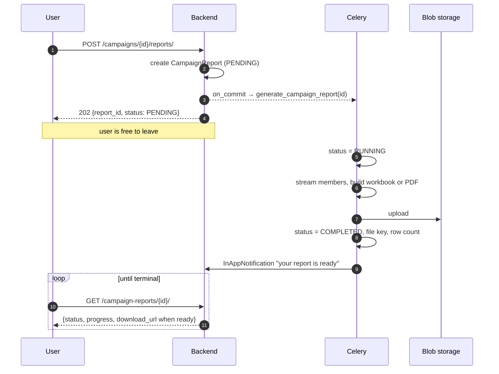

# Campaign Reports — Feature Detail

What a campaign report is, who asks for one, and how the system answers without holding
a request open while it works.

**Status:** 🔴 Not built · **Related:** [Campaign Module](../campaigns/README.md) ·
[Implementation plan](../implementation-plan-scratch/campaign-report-plan.md)

---

## Contents

1. [The problem](#1-the-problem)
2. [What a report contains](#2-what-a-report-contains)
2a. [The two formats](#2a-the-two-formats)
3. [Why it cannot be a synchronous download](#3-why-it-cannot-be-a-synchronous-download)
4. [How it works](#4-how-it-works)
5. [The job record](#5-the-job-record)
6. [Where the file lives](#6-where-the-file-lives)
7. [Telling the user it is ready](#7-telling-the-user-it-is-ready)
8. [What the API looks like](#8-what-the-api-looks-like)
9. [Failure and edge cases](#9-failure-and-edge-cases)
10. [Deliberately out of scope](#10-deliberately-out-of-scope)

---

## 1. The problem

A campaign finishes and somebody wants the outcome as a file — to send to a client, to
open in Excel, to keep. Today there is no way to get one. The
[campaign members endpoint](../apiDocs/core/campaign.md) will page through the audience,
but "page through 100,000 rows and assemble a spreadsheet yourself" is not a feature.

The thing being asked for is: **press a button, get a file, without the browser hanging
while a six-figure audience is read and formatted.**

---

## 2. What a report contains

One campaign, and everything the system knows about what happened to it.

### Summary

Header material — the campaign's own record, which it already keeps. This is **sheet 1
of the workbook** and the first page of the PDF; see [2a](#2a-the-two-formats):

| | Source |
|---|---|
| Name, status, bot, created/started/completed | `Campaign` |
| Audience size, suppressed, pending, completed, failed | `Campaign`'s denormalised counters |
| Credits charged | `AgentCallLog.credits_charged`, summed — see the plan's §0 |
| Total talk time, average duration | `AgentCallLog` |

### Per-member rows

The body of the report — one row per `CampaignMember`, which is the frozen audience
snapshot and therefore the honest record of who was in this campaign:

| Column | Notes |
|---|---|
| Name | From the linked `Contact` |
| Phone | `phone_e164` — **the number as frozen**, not the contact's number today |
| Status | `PENDING`, `SUPPRESSED`, `IN_PROGRESS`, `COMPLETED`, `FAILED`, `CANCELLED` |
| Suppression reason | Why this person was not called |
| Attempts, last call at | |
| Outcome | Runner-supplied disposition, verbatim |
| Duration, credits charged | From the linked `AgentCallLog`, when there is one |

**Suppressed members are included in the report**, unlike everywhere else in the
campaign module. The runner is never told they exist, but the tenant asking "what
happened to my campaign" is owed the answer "these thirty people were not called, and
here is why" — that is the whole point of recording the reason.

---

## 2a. The two formats

**XLSX and PDF. No CSV.** They are two views of the same content, for two different
readers: the workbook is for someone who will filter, sort and pivot; the PDF is for
someone who will read it or forward it to a client.

| | XLSX | |
|---|---|---|
| Sheet 1 | **Campaign Overview** | Everything about the campaign as a whole |
| Sheet 2 | **Members** | One row per person, the full audience |

The PDF carries both, in that order: the overview as a titled first page, then the
member table — **landscape**, because twelve columns do not fit portrait without
shrinking the type past readability.

### Sheet 1 — Campaign Overview

Label/value pairs down the sheet, grouped under headings rather than one flat list, so
it reads as a report rather than a data dump.

| Group | Contents |
|---|---|
| Campaign | Name, description, status, bot, created / started / completed |
| Schedule | Scheduled start, timezone, actual start, cycle length |
| Audience | Total members, callable, suppressed, and the suppression breakdown by reason |
| Outcomes | Completed, failed, pending, cancelled — counts and percentages |
| Calls | Total calls, connected, total talk time, average duration |
| Credits | Total charged, average per call, per-tier breakdown |
| Report | Generated at, generated by, row count — so a printed copy is self-describing |

That last group matters more than it looks. A spreadsheet forwarded twice loses every
piece of context that was not written inside it.

### Sheet 2 — Members

The twelve columns below, header on row 1, **frozen top row and an autofilter** so a
20,000-row sheet is usable the moment it opens rather than after somebody sets it up.

### The PDF

Presentation, not data entry. Same numbers, laid out to be read:

- **Page 1 portrait** — campaign overview, grouped as above, with the headline figures
  given room.
- **Page 2 onward landscape** — the member table, with the header row repeated on every
  page. A table whose headings appear once is unreadable by page three.
- Zebra striping, right-aligned numerics, and suppressed rows visually muted — they are
  present for completeness, not for attention.
- Footer on every page: campaign name, generated-at, page N of M.

> **The PDF is capped.** A hundred thousand rows at ~35 per landscape page is close to
> 3,000 pages — tens of megabytes that nobody opens and that take minutes to render. So
> the PDF includes the overview in full and the first `CAMPAIGN_REPORT_PDF_MAX_ROWS`
> members, then states plainly how many were omitted and that the workbook has them all.
>
> Truncating rather than refusing: for a big campaign the overview is the part somebody
> actually wanted, and a PDF that renders it beats an error that renders nothing.

### Columns

| # | Column | Example | Notes |
|---|---|---|---|
| 1 | `member_id` | `9f1c…` | Stable key, for anyone reconciling against the API |
| 2 | `name` | `Raj Patel` | From the linked contact; blank if none |
| 3 | `phone` | `+919228173970` | **Frozen at materialisation** — the number actually dialled |
| 4 | `status` | `COMPLETED` | Member status |
| 5 | `suppression_reason` | `DO_NOT_CALL` | Blank unless suppressed |
| 6 | `outcome` | `information provided` | Runner's disposition, verbatim |
| 7 | `attempts` | `1` | |
| 8 | `last_call_at` | `04 Sep 2026 09:28` | A real datetime cell in XLSX, blank if never called |
| 9 | `duration_seconds` | `47` | `0` when not connected |
| 10 | `credits_charged` | `949` | **What was charged, not net of refunds.** Blank when the call was never charged — which is different from `0` |
| 11 | `direction` | `outbound` | |
| 12 | `provider_call_id` | `da5ec994…` | Ties a row to the call log and the ledger entry |

Every row is present — including suppressed members, who appear with a reason and empty
call columns.

### Cell formatting

A workbook carries types, which a CSV cannot — so these are settled once here rather
than left to whatever Excel guesses.

| Decision | Why |
|---|---|
| **Phone written as text**, explicitly | Excel reads `+919228173970` as a formula-ish value and a leading-zero number as an integer, dropping the zero. The cell is typed as text so the number survives |
| **Dates as real datetime cells**, `dd mmm yyyy hh:mm` | Sortable and filterable as dates. An ISO string sorts correctly but cannot be grouped by month, which is the first thing anyone does |
| **Numerics as numbers**, not strings | Duration and credits must sum in a status bar. A right-aligned number that will not total is the classic broken export |
| **Empty means empty** | A blank cell, never `None`, `null` or `N/A` — those are strings that break `SUM` and have to be filtered out by hand |
| **Frozen header + autofilter** on sheet 2 | A 20,000-row sheet is usable on open, not after setup |
| **Column widths set** | Unsized columns show `####` for every date, which reads as a broken file |

Non-ASCII names need no special handling: XLSX is UTF-8 internally, so the BOM problem
that dogs CSV exports does not arise.

### Filename

```
campaign-<slug>-<YYYYMMDD-HHMMSS>.<xlsx|pdf>
e.g. campaign-rabi-season-outreach-20260904-113000.xlsx
```

The campaign name slugified, plus the moment it was generated. Two reports for the same
campaign land as two files a person can tell apart in a downloads folder — which is the
only place the filename is ever read.

Stored at `build_tenant_object_key(tenant_id, "campaign-reports", filename)`, so the
blob path is tenant-prefixed even though the visible name is not.

### One format per report

A request names one format and produces one file. Asking for both means two requests and
two rows, each with its own status.

Simpler than it sounds: the two formats have very different costs — a 100k XLSX streams
in seconds, the equivalent PDF does not exist — so a single job producing both would
have one status covering two jobs with different failure modes and no way to say that
one of them worked.

---

## 3. Why it cannot be a synchronous download

Three independent reasons, any one of which is enough:

1. **Size.** `CAMPAIGN_MAX_MEMBERS` is 100,000. Reading that many rows with their
   contacts and call logs, formatting them, and writing a file takes far longer than a
   web request should live. Gunicorn workers are a fixed pool; one long request is one
   worker not serving anybody.
2. **Timeouts are silent and lossy.** A proxy that gives up at 60 seconds produces a
   failed download with no record that the work happened, and the user's only recourse
   is to press the button again — starting the same expensive work a second time.
3. **The user does not need to wait.** A report is not an interactive answer. Producing
   it in the background and telling them when it is ready is a better experience than a
   spinner they must not navigate away from.

So the request that asks for a report must return immediately, having only recorded
**that a report was asked for**.

---

## 4. How it works



The request writes one row and returns. Everything expensive happens in a worker.

**The task is enqueued on `transaction.on_commit`**, not inline — the same rule the
campaign module already follows. A task that starts before its row is committed will
look up an id that does not exist yet.

---

## 5. The job record

A `CampaignReport` row **is** the event. It is created before any work starts, so:

- the API can answer "is it ready?" from the first millisecond;
- a crashed worker leaves a row stuck in `RUNNING` rather than no evidence at all;
- a completed report is a durable artefact that can be downloaded again next week
  without regenerating it.

### Status

| Status | Meaning |
|---|---|
| `PENDING` | Requested; the worker has not picked it up |
| `RUNNING` | Being built |
| `COMPLETED` | File written and downloadable |
| `FAILED` | Gave up; `error_message` says why |
| `EXPIRED` | The file was swept; the row remains as a record it once existed |

Modelled on `ContactImportSession`, which is the same shape of problem — a long job with
a status a user watches — so the two behave alike rather than each inventing their own
vocabulary.

### Progress

`total_rows` and `processed_rows`, updated periodically rather than per row. A progress
bar is the difference between "this is working" and "this is hung", and for a 100k-row
report that difference matters for minutes at a time.

Per-row updates would mean 100,000 UPDATE statements to produce a number nobody reads
that precisely, so it is written every N rows.

### One report per request, not per campaign

Asking twice makes two rows. Reports are cheap to keep and a user may legitimately want
last week's alongside today's — and deduplicating would mean deciding whether a report
requested two seconds ago is "the same" as this one, which is a question with no good
answer.

---

## 6. Where the file lives

Azure Blob, through the existing `utils.blob_storage` service — the same path call
recordings and contact imports already use. Nothing new is introduced.

The key is built with `build_tenant_object_key(tenant_id, "campaign-reports", filename)`,
which puts every tenant's files under their own prefix. That matters because
`is_object_key_owned_by_tenant` is then able to refuse a key belonging to somebody else —
tenant isolation for files is a **path** property here, not a database one.

**Downloads are short-lived presigned URLs**, minted per request via
`get_presigned_url_for_object`. The blob is never public, the URL is not stored, and a
link forwarded to somebody outside the tenant stops working within the hour.

**Reports expire.** A campaign report is a snapshot somebody wanted once; keeping every
one forever is an unbounded storage bill for files nobody opens twice. A retention
window and a sweep that deletes the blob and marks the row `EXPIRED` keep the row's
history without the cost.

---

## 7. Telling the user it is ready

An `InAppNotification` for the user who asked, written by the worker when the report
completes. That model already exists and already has an unread count the frontend
renders.

**Only the requester is notified**, not every admin at the tenant. Somebody else's
report finishing is not news.

Two deliberate limits:

- **Notification failure must not fail the report.** The file is written and the row is
  `COMPLETED`; a notification that could not be created is a missed prompt, not a lost
  report. Logged, swallowed.
- **Email is not in the first version.** In-app is enough to close the loop, and an
  emailed report link raises questions — how long the link lives, whether the file
  should be attached, what happens when a 40MB workbook meets an inbox — that are not worth
  answering before anyone has asked for it.

---

## 8. What the API looks like

| Method | Path | Purpose |
|---|---|---|
| `POST` | `/campaigns/{id}/reports/` | Request one. Returns **202** with the row |
| `GET` | `/campaign-reports/` | List this tenant's reports, filterable by campaign and status |
| `GET` | `/campaign-reports/{id}/` | One report: status, progress, error |
| `GET` | `/campaign-reports/{id}/download/` | **302** to a presigned URL, or 409 if not ready |

The status endpoint is what a polling frontend hits. It is deliberately cheap — one row,
no joins, no aggregation — because a client may call it every few seconds while a large
report builds.

**Download is a redirect, not a proxy.** Streaming the file through Django would put the
whole transfer through a worker for no benefit; a redirect hands it to blob storage,
which is what blob storage is for.

---

## 9. Failure and edge cases

| Case | Behaviour |
|---|---|
| Campaign has no members | Report still generated — a header and zero rows is a true answer |
| Campaign deleted mid-generation | Job fails with a clear message; no partial file is left |
| Worker dies mid-run | Row sits in `RUNNING`. A sweeper marks it `FAILED` after a timeout, since nothing else ever will |
| Blob upload fails | `FAILED`, retried by Celery with backoff; the row is not left claiming success |
| Two requests at once | Two independent reports. Neither blocks the other |
| Report requested on a `DRAFT` campaign | Allowed. It will be mostly empty, which is itself the answer |
| User asks for a report on another tenant's campaign | **404**, from the queryset — not 403, which would confirm it exists |

**A `FAILED` report must never leave a downloadable file.** The upload is the last step,
so a job that fails before it produces nothing; one that fails after must delete what it
wrote. A half-written file that downloads cleanly is worse than an error, because
nobody can tell it is short.

---

## 10. Deliberately out of scope

- **CSV.** The workbook is strictly better for the same reader, and a third format is a
  third thing to keep consistent.
- **Scheduled or recurring reports.** A different feature with its own scheduling
  questions; this one is on-demand.
- **Cross-campaign or date-range reports.** This is one campaign per report. Rolling up
  several is the analytics module's job.
- **Emailing the report.** See §7.
- **Report templates or column selection.** One fixed layout until somebody asks for a
  different one; a column picker built before there is a second opinion about the
  columns is guesswork.
