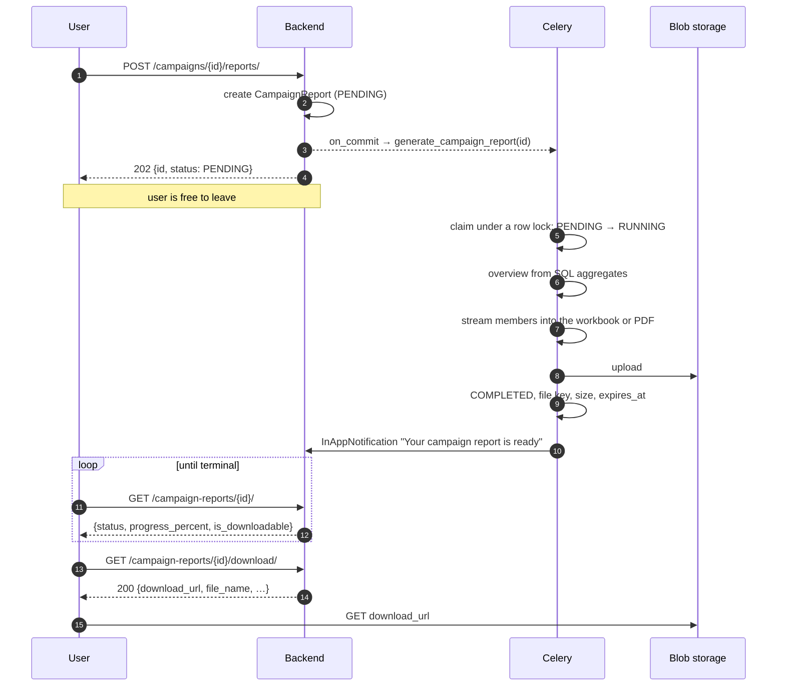

# Campaign Reports — Feature Detail

What a campaign report is, who asks for one, and how the system answers without holding
a request open while it works.

**Status:** ✅ Built · **API:** [Campaign Reports API](../apiDocs/core/campaign_report.md) ·
**Flow:** [Overview & Complete Flow](../campaigns/reports.md) ·
**Related:** [Campaign Module](../campaigns/README.md) ·
[Implementation plan](../implementation-plan-scratch/campaign-report-plan.md)

---

## Contents

1. [The problem](#1-the-problem)
2. [What a report contains](#2-what-a-report-contains)
2a. [The two formats](#2a-the-two-formats)
3. [Why it cannot be a synchronous download](#3-why-it-cannot-be-a-synchronous-download)
4. [How it works](#4-how-it-works)
5. [The job record](#5-the-job-record)
6. [Where the file lives](#6-where-the-file-lives)
7. [Telling the user it is ready](#7-telling-the-user-it-is-ready)
8. [What the API looks like](#8-what-the-api-looks-like)
9. [Failure and edge cases](#9-failure-and-edge-cases)
10. [Deliberately out of scope](#10-deliberately-out-of-scope)
11. [Configuration](#11-configuration)

---

## 1. The problem

A campaign finishes and somebody wants the outcome as a file — to send to a client, to
open in Excel, to keep. Before this there was no way to get one. The
[campaign members endpoint](../apiDocs/core/campaign.md) will page through the audience,
but "page through 100,000 rows and assemble a spreadsheet yourself" is not a feature.

The thing being asked for is: **press a button, get a file, without the browser hanging
while a six-figure audience is read and formatted.**

---

## 2. What a report contains

One campaign, and everything the system knows about what happened to it.

### Summary

Header material — the campaign's own record. This is **sheet 1 of the workbook** and the
first page of the PDF; see [2a](#2a-the-two-formats):

| | Source |
|---|---|
| Name, status, bot, created/started/completed | `Campaign` |
| Audience and outcome counts, including cancelled | Counted from `CampaignMember` rows — the campaign's own counters have no cancelled figure |
| Credits charged | `AgentCallLog.credits_charged`, summed — see the plan's §0 |
| Total talk time, average duration, connect rate | `AgentCallLog` |

### Per-member rows

The body of the report — one row per `CampaignMember`, which is the frozen audience
snapshot and therefore the honest record of who was in this campaign:

| Column | Notes |
|---|---|
| Name, company | From the linked `Contact` |
| Phone | `phone_e164` — **the number as frozen**, not the contact's number today |
| Status | `Pending`, `Suppressed`, `In progress`, `Completed`, `Failed`, `Cancelled` |
| Suppression reason | Why this person was not called |
| Attempts, last call at | |
| Outcome, error | Runner-supplied, verbatim |
| Duration, credits charged, provider call id | From the member's latest `AgentCallLog`, when there is one |

**Suppressed members are included in the report**, unlike everywhere else in the
campaign module. The runner is never told they exist, but the tenant asking "what
happened to my campaign" is owed the answer "these thirty people were not called, and
here is why" — that is the whole point of recording the reason.

---

## 2a. The two formats

**XLSX and PDF. No CSV.** They are two views of the same content, for two different
readers: the workbook is for someone who will filter, sort and pivot; the PDF is for
someone who will read it or forward it to a client.

| | XLSX | |
|---|---|---|
| Sheet 1 | **Campaign Overview** | Everything about the campaign as a whole |
| Sheet 2 | **Members** | One row per person, the full audience |

The PDF carries both, in that order: the overview first, then the member table —
**landscape**, because thirteen columns do not fit portrait without shrinking the type
past readability.

Both formats are fed from one description of the report
(`core/services/campaign_reports.py`); the writers only lay it out. That is what keeps
the workbook and the PDF from quietly disagreeing about a column.

### Sheet 1 — Campaign Overview

Label/value pairs down the sheet, grouped under headings rather than one flat list, so
it reads as a report rather than a data dump.

| Group | Contents |
|---|---|
| Campaign | Name, description, status, bot, audience source, created at, launched by |
| Schedule | Scheduled start, schedule timezone, started, completed, elapsed |
| Audience | Total members, callable, suppressed, and one line per suppression reason |
| Outcomes | Completed, failed, pending, in progress, cancelled; reach rate and failure rate, both of callable members |
| Calls | Total calls, connected, connect rate, total talk time, average duration of connected calls |
| Credits | Credits charged, calls charged, average per charged call, one line per service tier, and a note that the figure is as charged, not net of refunds |
| Report | Report id, generated at, requested by, members in campaign, members included, and the timezone times are shown in |

That last group matters more than it looks. A spreadsheet forwarded twice loses every
piece of context that was not written inside it.

A call counts as **connected** when its `duration_seconds` is above zero.

The overview is computed with SQL aggregates **before** the member rows are streamed, so
it can be the first sheet even though the workbook is written append-only.

### Times

Every time in a report is in **one** zone: the campaign's schedule timezone, else the
tenant's, else UTC. Excel has no timezone-aware datetimes, so the zone is named where the
times are — in the member sheet's header (`Last call at (Asia/Kolkata)`) and in the
overview's Report group.

### Sheet 2 — Members

The thirteen columns below, header on row 1, **frozen top row and an autofilter** so a
20,000-row sheet is usable the moment it opens rather than after somebody sets it up.

### The PDF

Presentation, not data entry. Same numbers, laid out to be read:

- **Portrait overview first**, grouped as above.
- **Landscape member table** from the next page, with the header row repeated on every
  page. A table whose headings appear once is unreadable by page three.
- Zebra striping and right-aligned numbers. Column widths are the workbook's, scaled to
  the page, so the two keep the same proportions.
- Footer on every page: the report title and the page number.

> **The PDF is capped.** A hundred thousand rows at ~35 per landscape page is close to
> 3,000 pages — tens of megabytes that nobody opens and that take minutes to render. So
> the PDF includes the overview in full and the first `CAMPAIGN_REPORT_PDF_MAX_ROWS`
> members, then says so on the page: *Showing the first 2,000 of 48,210 members. The
> Excel report includes everyone.*
>
> Truncating rather than refusing: for a big campaign the overview is the part somebody
> actually wanted, and a PDF that renders it beats an error that renders nothing.

> **Non-Latin names do not render properly in the PDF.** It uses the standard PDF fonts,
> which cover Latin-1 only, so a name written in Devanagari, for example, comes out
> wrong there. The workbook is unaffected. The fix is embedding a Unicode font file in
> the image, which the first version does not do.

Free text in a PDF cell is cut at 300 characters. A single cell taller than a page is a
layout error that fails the whole document; the workbook keeps the text in full.

### Columns

| # | Column | Example | Notes |
|---|---|---|---|
| 1 | Member ID | `9f1c…` | Stable key, for anyone reconciling against the API |
| 2 | Name | `Raj Patel` | `contact.full_name`; blank if none |
| 3 | Company | `Patel Traders` | From the linked contact — client-facing reports usually want it |
| 4 | Phone | `+919228173970` | **Frozen at materialisation** — the number actually dialled |
| 5 | Status | `Completed` | Member status |
| 6 | Suppression reason | `On the do-not-call list` | Blank unless suppressed |
| 7 | Outcome | `information provided` | Runner's disposition, verbatim |
| 8 | Attempts | `1` | |
| 9 | Last call at (*zone*) | `04 Sep 2026 09:28` | A real datetime cell in XLSX; blank if never called |
| 10 | Duration (seconds) | `47` | `0` when the call did not connect; blank when there was no call |
| 11 | Credits charged | `949` | **What was charged, not net of refunds.** Blank when the call was never charged — which is different from `0` |
| 12 | Error | `No answer after 3 attempts` | The only place a failed row explains itself |
| 13 | Provider call ID | `da5ec994…` | Ties a row to the call log and the ledger entry |

No `direction` column: every campaign call is outbound, so it would be one value repeated
down the whole sheet.

**A member called more than once** has one row, and columns 10, 11 and 13 describe the
**latest** call. `Attempts` says how many there were.

> **Cancelled members have no counter.** `Campaign` keeps `total_members`,
> `pending_count`, `suppressed_count`, `completed_count` and `failed_count`, but not
> cancelled. The overview therefore counts every status from the member rows, so
> completed + failed + pending + in progress + suppressed + cancelled reconciles to the
> total on a cancelled campaign.

Every row is present — including suppressed members, who appear with a reason and empty
call columns.

### Cell formatting

A workbook carries types, which a CSV cannot — so these are settled once here rather
than left to whatever Excel guesses.

| Decision | Why |
|---|---|
| **Free text written as string cells**, explicitly | Excel reads `+919228173970` as a formula-ish value and a leading-zero number as an integer, dropping the zero. And openpyxl turns any string starting with `=` into a formula, so a contact named `=HYPERLINK(…)` would arrive as a live link in a client's Excel. Typed as text, both stay inert |
| **Control characters stripped** | openpyxl refuses them outright, so one stray byte in a runner's outcome would fail the entire report |
| **Dates as real datetime cells**, `dd mmm yyyy hh:mm` | Sortable and filterable as dates. An ISO string sorts correctly but cannot be grouped by month, which is the first thing anyone does |
| **Numerics as numbers**, not strings | Duration and credits must sum in a status bar. A right-aligned number that will not total is the classic broken export |
| **Empty means empty** | A blank cell, never `None`, `null` or `N/A` — those are strings that break `SUM` and have to be filtered out by hand |
| **Frozen header + autofilter** on sheet 2 | A 20,000-row sheet is usable on open, not after setup |
| **Column widths set** | Unsized columns show `####` for every date, which reads as a broken file |

Non-ASCII names need no special handling in the workbook: XLSX is UTF-8 internally, so
the BOM problem that dogs CSV exports does not arise.

### Filename

```
campaign-<slug>-<YYYYMMDD-HHMMSS>.<xlsx|pdf>
e.g. campaign-rabi-season-outreach-20260904-113000.xlsx
```

The campaign name slugified, plus the moment the report was **requested**, in UTC. Two
reports for the same campaign land as two files a person can tell apart in a downloads
folder — which is the only place the filename is ever read.

The request time rather than the write time, so every retry of one report produces the
same name, and therefore the same blob key: a retry overwrites what an earlier attempt
uploaded instead of leaving an orphan beside it.

Stored at `build_tenant_object_key(tenant_id, "campaign-reports", filename,
unique_id=<report id>)`, so the blob path is tenant-prefixed even though the visible name
is not.

### One format per report

A request names one format and produces one file. Asking for both means two requests and
two rows, each with its own status.

Simpler than it sounds: the two formats have very different costs — a 100k XLSX streams
in seconds, the equivalent PDF does not exist — so a single job producing both would
have one status covering two jobs with different failure modes and no way to say that
one of them worked.

---

## 3. Why it cannot be a synchronous download

Three independent reasons, any one of which is enough:

1. **Size.** `CAMPAIGN_MAX_MEMBERS` is 100,000. Reading that many rows with their
   contacts and call logs, formatting them, and writing a file takes far longer than a
   web request should live. Gunicorn workers are a fixed pool; one long request is one
   worker not serving anybody.
2. **Timeouts are silent and lossy.** A proxy that gives up at 60 seconds produces a
   failed download with no record that the work happened, and the user's only recourse
   is to press the button again — starting the same expensive work a second time.
3. **The user does not need to wait.** A report is not an interactive answer. Producing
   it in the background and telling them when it is ready is a better experience than a
   spinner they must not navigate away from.

So the request that asks for a report must return immediately, having only recorded
**that a report was asked for**.

---

## 4. How it works



The request writes one row and returns. Everything expensive happens in a worker.

**The task is enqueued on `transaction.on_commit`**, not inline — the same rule the
campaign module already follows. A task that starts before its row is committed will
look up an id that does not exist yet.

---

## 5. The job record

A `CampaignReport` row **is** the event. It is created before any work starts, so:

- the API can answer "is it ready?" from the first millisecond;
- a crashed worker leaves a row stuck in `RUNNING` rather than no evidence at all;
- a completed report is a durable artefact that can be downloaded again next week
  without regenerating it.

### Status

| Status | Meaning |
|---|---|
| `PENDING` | Requested, and the worker has not picked it up — or an attempt failed and a retry is waiting |
| `RUNNING` | Being built |
| `COMPLETED` | File written and downloadable |
| `FAILED` | Gave up; `error_message` says why, in words a user can act on |
| `EXPIRED` | The file was swept; the row remains as a record it once existed |

Modelled on `ContactImportSession`, which is the same shape of problem — a long job with
a status a user watches — so the two behave alike rather than each inventing their own
vocabulary.

Only a `PENDING` report can be claimed, and the claim takes a row lock. A task Celery
delivers twice therefore cannot build the same report twice.

### Progress

`total_rows` and `processed_rows`, and a derived `progress_percent`. A progress bar is the
difference between "this is working" and "this is hung", and for a 100k-row report that
difference matters for minutes at a time.

Per-row updates would mean 100,000 UPDATE statements to produce a number nobody reads
that precisely, so it is written every `CAMPAIGN_REPORT_PROGRESS_EVERY` rows (500).

`progress_percent` stays at **99 or below until the file is uploaded**. The last row is
followed by an upload, and a bar sitting at 100% while nothing is downloadable reads as
broken.

### One report per request, not per campaign

Asking twice makes two rows. Reports are cheap to keep and a user may legitimately want
last week's alongside today's — and deduplicating would mean deciding whether a report
requested two seconds ago is "the same" as this one, which is a question with no good
answer.

---

## 6. Where the file lives

Azure Blob, through the existing `utils.blob_storage` service — the same path call
recordings and contact imports already use. The one addition is a server-side
`upload_file`: everything before it served browser uploads, which never pass through a
worker.

The key is built with `build_tenant_object_key`, which puts every tenant's files under
their own prefix. That matters because `is_object_key_owned_by_tenant` is then able to
refuse a key belonging to somebody else — tenant isolation for files is a **path**
property here, not a database one.

The file is written to a temporary file on the worker and uploaded once it is finished,
**as the last step**. A job that fails before the upload leaves nothing behind.

**Downloads are short-lived signed URLs**, minted per request by
`get_presigned_download_url`. The blob is never public, the URL is not stored, and a
link forwarded to somebody outside the tenant stops working within the hour. The
signature carries a `Content-Disposition`, so the download saves under the readable
filename rather than the blob key.

**Reports expire.** A campaign report is a snapshot somebody wanted once; keeping every
one forever is an unbounded storage bill for files nobody opens twice. After
`CAMPAIGN_REPORT_RETENTION_DAYS` (7) a sweep deletes the blob and marks the row
`EXPIRED`, keeping the row's history without the cost. The blob is deleted **first**: if
that fails, the row stays `COMPLETED` and the next run tries again, instead of forgetting
the file exists.

---

## 7. Telling the user it is ready

An `InAppNotification` for the user who asked, written by the worker. That model already
exists and already has an unread count the frontend renders.

- **Ready:** *Your campaign report is ready* — with the format, the campaign, and the
  date the file will be removed.
- **Failed:** *Your campaign report could not be generated* — with the reason. A report
  that failed silently would leave the user refreshing a list.

Both use notification type `REPORTS`.

**Only the requester is notified**, not every admin at the tenant. Somebody else's
report finishing is not news.

Two deliberate limits:

- **Notification failure must not fail the report.** The file is written and the row is
  `COMPLETED`; a notification that could not be created is a missed prompt, not a lost
  report. Logged, swallowed.
- **Email is not in the first version.** In-app is enough to close the loop, and an
  emailed report link raises questions — how long the link lives, whether the file
  should be attached, what happens when a 40MB workbook meets an inbox — that are not worth
  answering before anyone has asked for it.

---

## 8. What the API looks like

| Method | Path | Purpose |
|---|---|---|
| `POST` | `/campaigns/{id}/reports/` | Request one. Body `{"report_format": "XLSX"}` or `"PDF"`; XLSX by default. Returns **202** with the row |
| `GET` | `/campaign-reports/` | List this tenant's reports, filterable by campaign, status and format |
| `GET` | `/campaign-reports/{id}/` | One report: status, progress, error |
| `GET` | `/campaign-reports/{id}/download/` | **200** with a fresh `download_url`, or **409** if there is no file |

The status endpoint is what a polling frontend hits. It is deliberately cheap — one row,
no aggregation — because a client may call it every few seconds while a large report
builds.

**Download returns a link rather than redirecting, and never proxies.** The API
authenticates with a bearer token, which a browser cannot attach to a plain link, so the
frontend has to `fetch` the download endpoint. A `fetch` that follows a 302 to blob
storage pulls the whole file into JavaScript memory — or is refused by the storage
account's CORS rules — instead of saving it. Returned as JSON, the link is something the
client can navigate to, and the browser downloads the file straight from storage.
Streaming it through Django was never an option: that holds a worker for the length of
the transfer to do what storage already does.

Requesting a report shares the campaign actions' throttle — 30 a minute per user,
together with launch, cancel and audience preview — since each request is a full scan
in a worker.

---

## 9. Failure and edge cases

| Case | Behaviour |
|---|---|
| Campaign has no members | Report still generated — a header and zero rows is a true answer |
| Campaign deleted before generation starts | `FAILED` at once, no retries — it would fail identically every time |
| Worker dies mid-run | Row sits in `RUNNING`. A sweep marks it `FAILED` after `CAMPAIGN_REPORT_STALL_MINUTES`, since nothing else ever will |
| Task never delivered (lost `on_commit`, broker outage) | Row sits in `PENDING`; the same sweep fails it after the same window |
| Blob upload fails | Back to `PENDING` and retried with backoff (1, 2, 4 minutes). After the last retry, `FAILED` with a generic message; the detail goes to the logs |
| A slow build finishes after the sweep failed it | The file it uploaded is deleted — no row refers to it |
| Two requests at once | Two independent reports. Neither blocks the other |
| Report requested on a `DRAFT` campaign | Allowed. It will be mostly empty, which is itself the answer |
| Another tenant's campaign or report | **404**, from the queryset — not 403, which would confirm it exists |
| Contact name with markup, `&`, control characters | Written as inert text in both formats |

**A `FAILED` report never leaves a downloadable file.** The upload is the last step, so
a job that fails before it produces nothing, and `file_key` is only ever set together with
`COMPLETED`. A half-written file that downloads cleanly is worse than an error, because
nobody can tell it is short.

---

## 10. Deliberately out of scope

- **CSV.** The workbook is strictly better for the same reader, and a third format is a
  third thing to keep consistent.
- **Scheduled or recurring reports.** A different feature with its own scheduling
  questions; this one is on-demand.
- **Cross-campaign or date-range reports.** This is one campaign per report. Rolling up
  several is the analytics module's job.
- **Emailing the report.** See §7.
- **Report templates or column selection.** One fixed layout until somebody asks for a
  different one; a column picker built before there is a second opinion about the
  columns is guesswork.
- **Cancelling a running report.** Celery revocation is unreliable mid-task, and a
  report takes minutes. Let it finish and ignore it.
- **Unicode fonts in the PDF.** See [2a](#the-pdf).

---

## 11. Configuration

| Setting | Default | Effect |
|---|---|---|
| `CAMPAIGN_REPORT_RETENTION_DAYS` | `7` | Days a file stays downloadable before the expiry sweep removes it |
| `CAMPAIGN_REPORT_PROGRESS_EVERY` | `500` | Rows between progress writes |
| `CAMPAIGN_REPORT_PDF_MAX_ROWS` | `2000` | Most members a PDF lists; the workbook always has everyone |
| `CAMPAIGN_REPORT_STALL_MINUTES` | `120` | How long a `RUNNING` or `PENDING` report may go without progress before it is failed. Measured from its last write, so a long build that is still writing rows is never failed, and neither is one waiting out a retry |
| `CAMPAIGN_REPORT_DOWNLOAD_URL_HOURS` | `1` | Lifetime of a download link |

Beat runs the expiry sweep **hourly** and the stall sweep **every 15 minutes**.
