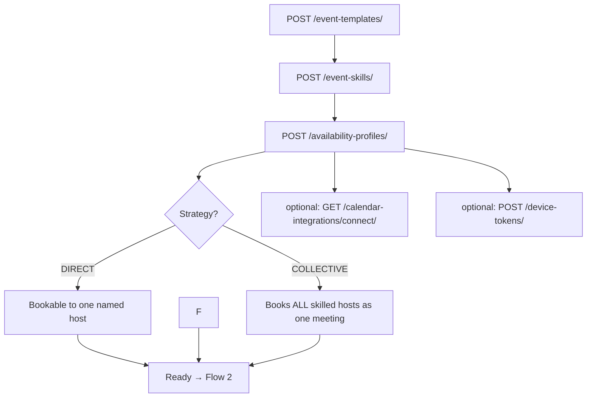

# Flow 1 — Tenant Setup

**Actor:** Tenant admin. **Goal:** make an event type bookable. Everything here is
tenant-scoped automatically (from the caller's `tenant_mapping`).

## Step 1 — Create the event type
`POST /event-templates/`

Body highlights: `name`, `duration_minutes`, `buffer_before_minutes` /
`buffer_after_minutes`, `assignment_strategy`, `min_notice_minutes`,
`max_horizon_days`, `slot_granularity_minutes`, `cancellation_lead_minutes`,
`reschedule_lead_minutes`, `location_type`.

**Outcomes**
- `201` → template created. **Next:** Step 2.
- `400` name already exists / invalid duration → fix and resubmit.

**Options — `assignment_strategy` decides the whole downstream flow:**
- `DIRECT` (default) → the booker must name a `target_host`; the booking stays with that
  host. On host leave the customer is asked to reschedule (Flow 3) — hosts are never
  swapped automatically.
- `COLLECTIVE` → **all** skilled hosts are booked as one meeting (one `Booking` row
  per host, shared `group_id`, all-or-nothing).

## Step 2 — Say who can host it
`POST /event-skills/` (body: `user`, `event_template`, optional `weight`)

**Outcomes**
- `201` → host linked. Repeat for each host. **Next:** Step 3.
- `400` user/template not in your tenant → pick an in-tenant user.

> A template with **no** skills can't be booked → booking later returns `400 no
> eligible host`.

## Step 3 — Set the host's working hours
`POST /availability-profiles/` (body: `user`, `timezone`, `rules[]` where each rule is
`{weekday 0–6, start_time, end_time}`)

**Outcomes**
- `201` → profile + weekly rules created (DST-correct via the timezone). Host is now
  bookable. **Next:** the event type is live → **Flow 2**.
- `400` overlapping rules / user already has a profile → fix.

**Options**
- Multiple rules per weekday = split shifts (e.g. 09:00–12:00 and 14:00–17:00).
- **Overnight shifts:** `end_time <= start_time` means the block ends the next day, so
  `{weekday: 0, start_time: "22:00:00", end_time: "06:00:00"}` is Monday night into Tuesday
  morning. `00:00 → 00:00` is a full 24 hours; seven of those give true 24/7.
- Update rules any time by `PUT/PATCH /availability-profiles/{id}/` (rules are replaced).

> Rules are stored as wall-clock times and converted to absolute UTC intervals by a background
> task after the write commits, so slots can lag the API response by the length of the Celery
> queue. A profile created outside the API produces no slots until
> `manage.py materialize_availability` runs.

## Step 4 — (Optional) Connect an external calendar
`GET /calendar-integrations/connect/` → see **Flow 4**.

Once connected, the host's Google busy times are subtracted from availability and new
bookings are mirrored to their calendar.

## Step 4b — **(Required for email)** Configure a mail sender

Booking email sends through the tenant's own SMTP server, or **not at all** — there is no fallback to
a platform sender. Skip this and bookings still work perfectly, but no customer ever receives a
confirmation, reminder, cancellation, or reschedule link.

Two calls, and both are needed:

1. `POST /api/v1/tenant/email-configurations/` → then `POST /{id}/test/` until it reads `VERIFIED`.
   See [Email Configuration](../apiDocs/tenant/email_configuration.md).
2. `PATCH /api/v1/tenant/settings/` with `{"booking_email_configuration": "<id>"}`.
   See [Tenant Settings](../apiDocs/tenant/settings.md).

Confirm with `booking_email.will_send` on the settings response. **A `VERIFIED` configuration that
has not been assigned still sends nothing** — that is the step people miss.

## Step 5 — (Optional) Register a device for push
`POST /device-tokens/` (body: `token`, `platform`) → see **Flow 5**.

Enables internal push alerts (needs-reschedule). Idempotent: re-posting
the same token reactivates it.

---

**Where this leads:** with Steps 1–3 done, proceed to **[Flow 2 — Booking lifecycle](02-booking-lifecycle.md)**.
Add Step 4b before going live, or the lifecycle in Flow 2 will run silently.
