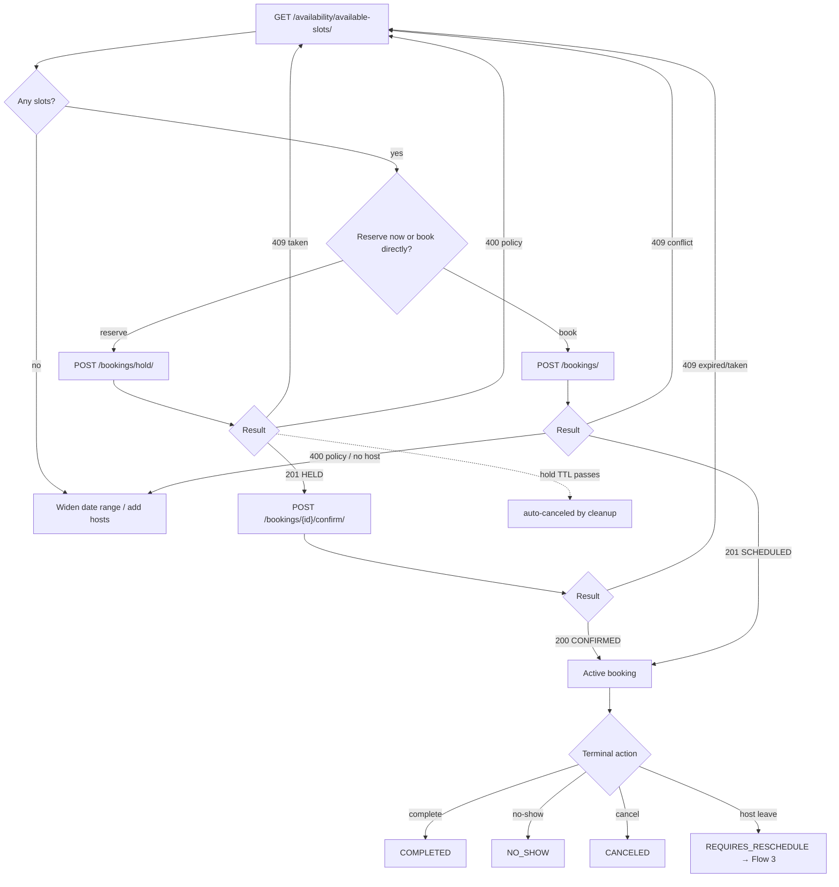

# Flow 2 — Booking Lifecycle

**Actor:** an internal user (or a front-end acting for a customer). **Goal:** turn a
free slot into a confirmed appointment, then run it to a terminal state.

## Step 1 — Find slots
`GET /availability/available-slots/?event_template={id}&start_utc=<ISO>&end_utc=<ISO>[&target_host={id}]`

Returns `[{ start, end, eligible_host_ids }]` in UTC — the engine subtracts existing bookings
(incl. buffers), leave, and external-calendar busy times, then applies min-notice and
horizon.

`start_utc` / `end_utc` are **instants, not dates**: resolve the user's chosen day in the timezone
they are viewing before you call. `start_utc` is inclusive, `end_utc` exclusive.

**Outcomes / options**
- Slots returned → pick one. **Next:** Step 2.
- Empty list → widen the window, or the template has no hosts/availability/materialized windows.
- `403` template belongs to another tenant. `400` inverted range, or range exceeds the horizon.

## Step 2 — Reserve or book

Two entry points depending on UX:

### 2a. Hold (recommended for a customer-picks-a-time UI)
`POST /bookings/hold/` — body: `event_template`, `start_time`, `participants[]`,
optional `target_host`.

- `201` → `HELD` with `hold_expires_at` (default 5 min). The slot is now blocked for
  everyone else. **Next:** Step 3 (confirm) before it expires.
- `409` → someone took it first → back to Step 1.
- `400` → policy (past / min-notice / horizon) or no eligible host.
- *No action:* the `cleanup_expired_holds` job cancels the hold at TTL, freeing the slot.

### 2b. Direct create (internal, one-shot)
`POST /bookings/` — same body.

- `201` → `SCHEDULED`. For a **COLLECTIVE** template the response `data` is a **list**
  of bookings (one per host). Confirmation email + `.ics` sent; event mirrored to
  connected calendars. **Next:** Step 4.
- `409` conflict → back to Step 1.
- `400` policy / `no eligible host`.

> `DIRECT` templates require `target_host`, and it must be a host with the matching
> event-skill. `COLLECTIVE` rejects `target_host` and books every skilled host.
> Nothing is ever auto-assigned.

## Step 3 — Confirm a hold
`POST /bookings/{id}/confirm/`

- `200` → `HELD → CONFIRMED`; confirmation email + `.ics`; calendar push. **Next:** Step 4.
- `409` → the hold expired (or slot taken) → back to Step 1.
- `400` → the booking isn't in `HELD` state.

## Step 4 — Run it to a terminal state

From `SCHEDULED` / `CONFIRMED`:

| Action | Endpoint | Result | Notes |
|---|---|---|---|
| Complete | `POST /bookings/{id}/complete/` | `COMPLETED` | after the appointment |
| No-show | `POST /bookings/{id}/no-show/` | `NO_SHOW` | |
| Cancel | `POST /bookings/{id}/cancel/` | `CANCELED` | enforces `cancellation_lead_minutes`; `400` if too late |
| Force cancel | `DELETE /bookings/{id}/` | `CANCELED` | internal; bypasses lead-time |
| (automatic) | reminder job | — | reminders at 24h & 1h before |
| (automatic) | host logs leave | — | → `REQUIRES_RESCHEDULE` → **Flow 3** |

**Options / branches**
- Cancel too late → `400`; use `DELETE` (internal override) or wait.
- Cancel/complete/no-show also **delete the mirrored calendar event** (if any).
- For a **COLLECTIVE** booking, cancelling any row cancels the whole group.

---

**Where this leads:** a disruption (host leave) moves an active booking into
**[Flow 3 — Leave & Reschedule](03-leave-and-reschedule.md)**.
