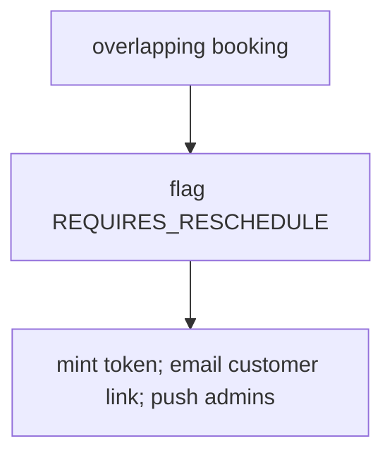

# Flow 3 — Emergency Leave → Reschedule → Public Rebooking

**Actors:** admin (logs leave) + system (reschedule engine) + customer (self-reschedule).
**Goal:** when a host becomes unavailable, keep affected bookings valid — silently move
them to another host, or let the customer pick a new time.

```mermaid
sequenceDiagram
    autonumber
    participant Admin
    participant API as "POST /availability-exceptions/"
    participant Sig as "post_save signal"
    participant Task as "reschedule_on_leave (Celery)"
    participant Eng as "reschedule engine"
    participant Cust as Customer

    Admin->>API: log leave (user, start, end, type)
    API-->>Admin: 201 created
    API->>Sig: on_commit
    Sig->>Task: enqueue(tenant, exception_id)
    Task->>Eng: find overlapping active bookings for that host
    loop each booking
        Eng->>Eng: status = REQUIRES_RESCHEDULE, mint token
            Eng-->>Cust: email reschedule link
            Note over Eng: push tenant admins
        end
    end
```

## Step 1 — Log the leave
`POST /availability-exceptions/` — body: `user`, `start_time`, `end_time`, `type`
(`VACATION` / `SICK` / `EMERGENCY` / `HOLIDAY` / `OTHER`), optional `reason`.

- `201` → exception saved. A `post_save` signal enqueues `reschedule_on_leave` **on
  commit** (never inline). **Next:** the engine runs asynchronously (Step 2).
- The engine only touches **future** `SCHEDULED` / `CONFIRMED` bookings whose time
  overlaps the leave window, for that host, in that tenant.

## Step 2 — Engine decision (per affected booking)



> **No silent host swap.** A free colleague is not a substitute: a `DIRECT` booking is
> for the host the customer chose, and a `COLLECTIVE` one needs everybody. Every
> affected booking therefore takes the outcome below.

### Outcome — Flagged `REQUIRES_RESCHEDULE`
For `DIRECT`, `COLLECTIVE`, or when nobody is free. A single-use `reschedule_token`
(default 72h) is minted; the customer is emailed a link; tenant admins get a push.
- For a **COLLECTIVE** meeting, the **whole group** is flagged with one shared token.
- **Next:** the customer opens the link → Step 3.

## Step 3 — Customer opens the reschedule link
`GET /public/reschedule/{token}/` (public, unauthenticated, throttled 30/min)

Returns the booking summary + available slots for its event type.
- `200` → show slots. **Next:** Step 4.
- `400` → token invalid / already used / expired → tell the customer to contact
  support (an admin can re-flag or book manually).

## Step 4 — Customer picks a new time
`POST /public/reschedule/{token}/` — body: `{ start_time }`

- `201` → a **new** booking is created at the chosen slot; the old booking(s) become
  `RESCHEDULED`; the **token is consumed** (single-use); old calendar events removed;
  confirmation sent. **Next:** new booking is active (**Flow 2**, Step 4).
- `409` → the chosen slot was taken meanwhile → re-`GET` (Step 3) for fresh slots.
- `400` → token expired/used, or policy violation (past / min-notice / horizon).

**Options / branches**
- Reuse of a consumed token → `400` (proven single-use).
- `DIRECT` rebooking targets the original host; `COLLECTIVE` rebooks the whole group.

---

**Related:** the calendar re-sync in Outcome A is detailed in
**[Flow 4 — Google Calendar sync](04-google-calendar-sync.md)**; the emails/pushes are
in **[Flow 5 — Notifications & push](05-notifications-and-push.md)**.
