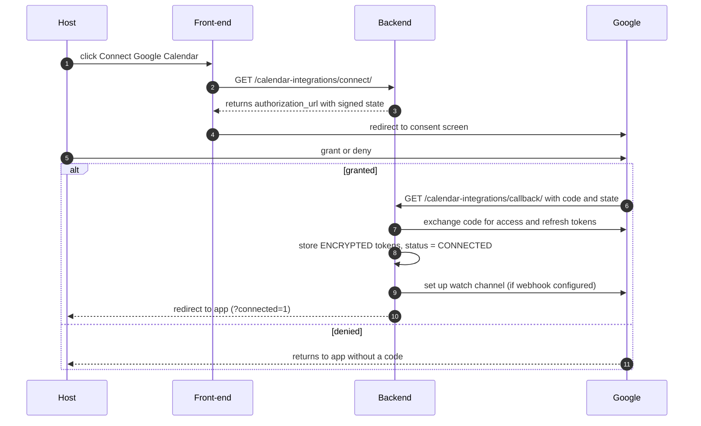
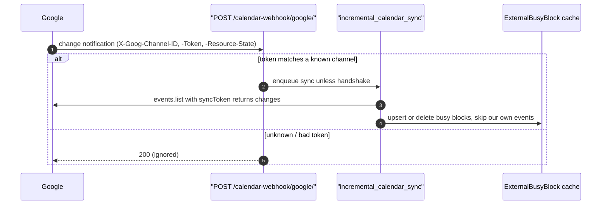

# Flow 4 — Google Calendar Sync

**Actor:** a host (connects their calendar) + the system. **Goal:** keep availability
aware of the host's real calendar (read) and mirror our bookings into it (write).

> Every external piece **fails open**: if a calendar isn't connected or Google errors,
> booking still works — that host just isn't calendar-aware.

## 4.1 Connect (OAuth)

**Step — start:** `GET /calendar-integrations/connect/`
- `200` → `{ authorization_url }`; front-end redirects the host to Google.

**Step — callback:** `GET /calendar-integrations/callback/?code=&state=` (unauthenticated;
trusted via the signed `state`)
- Success → integration `CONNECTED`, tokens stored encrypted, watch established (if
  `GOOGLE_CALENDAR_WEBHOOK_URL` is set), browser redirected back to the app.
- `400` invalid/expired `state`, or code exchange failed → host retries connect.

## 4.2 Read side — free/busy in availability

Whenever slots are computed (**Flow 2, Step 1**), each connected host's busy times are
subtracted:
- **Watch live** → read the local `ExternalBusyBlock` cache (kept fresh by webhooks —
  §4.4). No live API call.
- **No watch** → query Google free/busy on demand (cached ~60s).
- **Google error** → treated as "no busy info" (fails open); logged.

No endpoint you call directly — it's automatic inside `available-slots`.

## 4.3 Write side — mirror our bookings

| Trigger (from Flow 2/3) | Effect on the host's Google calendar |
|---|---|
| Booking created / hold confirmed | insert event; store its id in `external_event_id` |
| Booking canceled / completed¹ | delete the event |

All async + idempotent (keyed on `external_event_id`); no-op if the host has no
connected calendar. ¹ cancel removes it; completion leaves history.

## 4.4 Webhook incremental sync

- Host edits their Google calendar → Google POSTs to `calendar-webhook/google/`.
- The endpoint validates the channel token and always returns `200` (so Google stops
  retrying). Valid non-handshake pings enqueue an incremental sync that updates the
  cache. Our own pushed events are ignored (**echo guard**) to avoid loops.
- Requires a public HTTPS `GOOGLE_CALENDAR_WEBHOOK_URL` on a verified domain; without
  it, the read side falls back to on-demand free/busy (§4.2).

## 4.5 Token & watch lifecycle (automatic, Beat)

| Job | Interval | Behaviour |
|---|---|---|
| `refresh_calendar_tokens` | 15 min | refresh access tokens near expiry; on failure → `sync_status = REAUTH_REQUIRED` |
| `renew_calendar_watches` | hourly | recreate watch channels before they expire |

**Branch — `REAUTH_REQUIRED`:** the host must reconnect (repeat §4.1). Surface this in
the UI and alert on it.

## 4.6 Disconnect
`DELETE /calendar-integrations/{id}/` → stops the watch, best-effort revokes the grant,
soft-deletes the integration. Availability reverts to non-calendar-aware for that host.

---

**Related:** internal alerts for `REAUTH_REQUIRED` and needs-reschedule are in
**[Flow 5 — Notifications & push](05-notifications-and-push.md)**.
