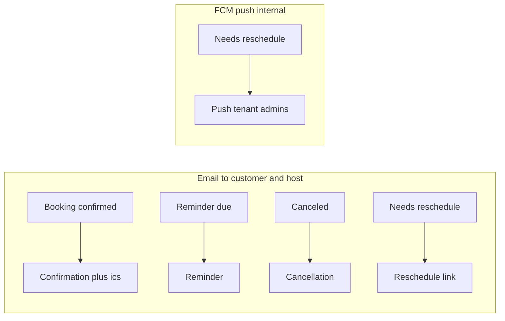

# Flow 5 — Notifications & Push

**Actor:** the system. **Goal:** notify customers (email + `.ics`) and internal staff
(FCM push) at each booking event, exactly once.

> **Once-only:** every **email** send is guarded by `NotificationLog` (unique per tenant +
> `dedup_key`), so retries and duplicate triggers never double-send. Notifications are
> emitted **explicitly from services** (not from a blanket signal), so internal saves
> like audit stamping don't spuriously fire them.

> **Push is guarded the same way.** Internal FCM alerts write their own `NotificationLog`
> row (`channel=FCM`, key prefixed `push:` so it cannot collide with the email for the same
> event), and the push tasks retry like the email ones. See
> [FCM End-to-End](push-notifications.md).

> ## ⚠️ Prerequisite: the tenant must have configured a mail sender
>
> **Email in this flow sends through the tenant's own SMTP server, or not at all.** There is no
> fallback to a platform sender. A tenant with no verified, assigned configuration gets **none** of
> the four emails below.
>
> Push (FCM) is unaffected — it does not go through SMTP.
>
> Setup: [Email Configuration](../apiDocs/tenant/email_configuration.md) to create and verify, then
> [Tenant Settings](../apiDocs/tenant/settings.md) to assign. This belongs in
> [Flow 1 — Tenant Setup](./01-setup.md), alongside availability and event templates.

## Email lifecycle

| Trigger | From flow | Recipients | Content |
|---|---|---|---|
| Create / confirm | 2 | attendees + host | Confirmation + `.ics` invite |
| Reminder | Beat | attendees + host | at each `BOOKING_REMINDER_OFFSETS_MINUTES` (24h, 1h) |
| Cancellation | 2 | attendees + host | Cancellation + `.ics` cancel |
| Reschedule request | 3 | customer (attendees) | link to `public/reschedule/{token}/` |

Emails send via a Celery task (async, retrying) with the `.ics` attached. The task resolves the
tenant's sender **at send time**, not at enqueue time — a message can wait through a retry backoff
while the configuration behind it is disconnected or edited, and the state that matters is the one at
the moment of sending.

**When no sender is configured**, nothing is sent and the `NotificationLog` row is written `FAILED`
with the reason. Because `FAILED` rows are re-enqueueable, configuring a sender later lets the *same*
logical notification go out rather than producing a duplicate.

`NotificationLog` also records which configuration carried each message (`email_configuration`), and
is pruned daily — 90 days for sent, 180 for failed, and **never** for a booking that has not happened
yet, since deleting a row re-arms its notification.

### Reminders (automatic)
`send_due_reminders` (Beat, every 5 min) scans upcoming `SCHEDULED`/`CONFIRMED`
bookings and sends the nearest un-sent offset. Canceled/terminal bookings are skipped.
No endpoint — fully automatic.

## Push (FCM) — internal alerts

> For the full token lifecycle — when the client generates and re-sends a token, how we
> detect dead ones, and what still needs building — see
> **[FCM End-to-End](push-notifications.md)**.

### Step — register a device
`POST /device-tokens/` — body: `token`, `platform` (`ANDROID`/`IOS`/`WEB`).
- `201` → registered (idempotent upsert: re-posting reactivates).
- **Next:** the user now receives push alerts.

### Step — verify it actually works
`POST /device-tokens/test/` → sends a real push to your own devices and reports each
outcome. **Registration returning `201` proves storage, not delivery** — this is the only
call that distinguishes "push is off server-side" from "your credential is broken" from
"your device aged out".

### Step — deactivate
`POST /device-tokens/deactivate/` — body: `token` → `200`. (Tokens are also
auto-deactivated when FCM reports them unregistered/invalid, when the login session behind
them ends, and when they go stale.)

### When pushes fire
| Event | From flow | Target |
|---|---|---|
| Booking needs reschedule | 3 | tenant admins (`user_type = ADMIN`) |

**Branch — push not configured:** if `FIREBASE_CREDENTIALS` is unset, push sends are
no-ops (email still goes out). Nothing breaks.

## Idempotency & failure

- **Dedup keys:** `"{booking}:{type}[:{recipient|offset|host|token}]"`, or
  `"group:{group_id}:{type}"` for COLLECTIVE meetings.
- **Retries:** email and push tasks both retry with backoff (`max_retries=3`); the log
  prevents a second delivery. A push that FCM accepts for zero devices is recorded `FAILED`,
  not `SENT`, so it stays re-enqueueable.
- **Group meetings:** one confirmation / cancellation per meeting (not per host row).

---

**Back to:** [Flow index](README.md).
