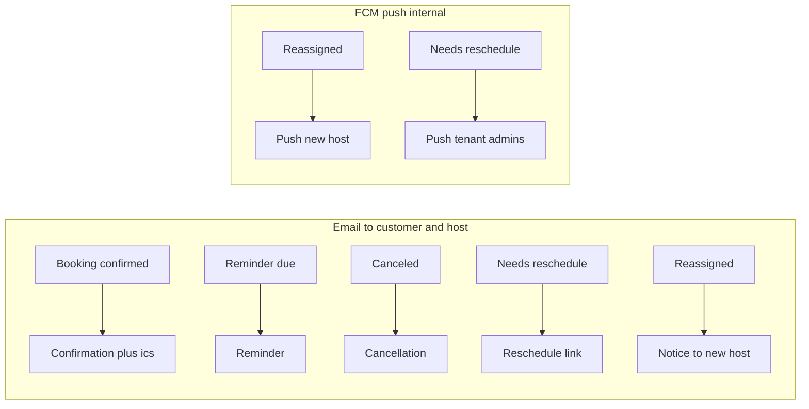

# Flow 5 — Notifications & Push

**Actor:** the system. **Goal:** notify customers (email + `.ics`) and internal staff
(FCM push) at each booking event, exactly once.

> **Once-only:** every send is guarded by `NotificationLog` (unique per tenant +
> `dedup_key`), so retries and duplicate triggers never double-send. Notifications are
> emitted **explicitly from services** (not from a blanket signal), so internal saves
> like audit stamping or reassignment don't spuriously fire them.

## Email lifecycle

| Trigger | From flow | Recipients | Content |
|---|---|---|---|
| Create / confirm | 2 | attendees + host | Confirmation + `.ics` invite |
| Reminder | Beat | attendees + host | at each `BOOKING_REMINDER_OFFSETS_MINUTES` (24h, 1h) |
| Cancellation | 2 | attendees + host | Cancellation + `.ics` cancel |
| Reschedule request | 3 | customer (attendees) | link to `public/reschedule/{token}/` |
| Reassignment | 3 | new host only | "assigned a booking" (customer not bothered) |

Emails send via a Celery task (async, retrying) with the `.ics` attached.

### Reminders (automatic)
`send_due_reminders` (Beat, every 5 min) scans upcoming `SCHEDULED`/`CONFIRMED`
bookings and sends the nearest un-sent offset. Canceled/terminal bookings are skipped.
No endpoint — fully automatic.

## Push (FCM) — internal alerts

### Step — register a device
`POST /device-tokens/` — body: `token`, `platform` (`ANDROID`/`IOS`/`WEB`).
- `201` → registered (idempotent upsert: re-posting reactivates).
- **Next:** the user now receives push alerts.

### Step — deactivate
`POST /device-tokens/deactivate/` — body: `token` → `200`. (Tokens are also
auto-deactivated when FCM reports them unregistered/invalid.)

### When pushes fire
| Event | From flow | Target |
|---|---|---|
| Booking reassigned | 3 (Outcome A) | the new host |
| Booking needs reschedule | 3 (Outcome B) | tenant admins (`user_type = ADMIN`) |

**Branch — push not configured:** if `FIREBASE_CREDENTIALS` is unset, push sends are
no-ops (email still goes out). Nothing breaks.

## Idempotency & failure

- **Dedup keys:** `"{booking}:{type}[:{recipient|offset|host|token}]"`, or
  `"group:{group_id}:{type}"` for COLLECTIVE meetings.
- **Retries:** email/push tasks retry with backoff; the log prevents a second delivery.
- **Group meetings:** one confirmation / cancellation per meeting (not per host row).

---

**Back to:** [Flow index](README.md).
