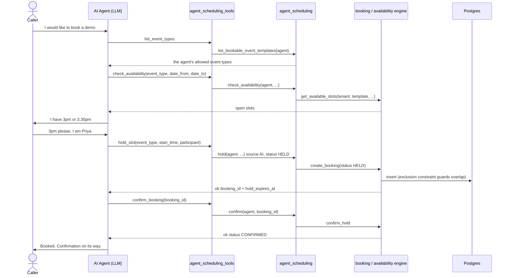

# 6. AI Agent Booking Flow

How a voice/AI **agent** books meetings for hosts during a conversation. The agent calls a
small set of **tools** that wrap the existing scheduling engine — tenant-scoped and guardrailed,
so an agent can only book the meeting types it's configured for.

> **Implemented:** [core/services/agent_scheduling.py](../../core/services/agent_scheduling.py)
> (service) + [core/services/agent_scheduling_tools.py](../../core/services/agent_scheduling_tools.py)
> (LLM tool schemas + dispatcher). See the
> [AI Agent Scheduling plan](../ai-agent-scheduling-plan.md).

---

## The two invariants

1. **Tenant comes from the agent** — every call derives `tenant = agent.tenant` and passes it
   explicitly to the engine. There is no request context in the AI runtime.
2. **Guardrail** — an agent may only act on event templates in its own `event_templates` set
   (configured on the [Agent](../apiDocs/core/agent.md)). Any other template id is rejected
   *before* the engine runs. Bookings are tagged `Source.AI`.

## Host selection is NOT on the agent

The agent books an **event type**; the engine picks the host from the template's strategy:

| Strategy | What the agent passes | Who is booked |
|----------|-----------------------|---------------|
| `DIRECT` | event type **+ `target_host_id`** | that specific host |
| `COLLECTIVE` | just the event type | **every** skilled host (one booking each, grouped) |

---

## Runtime sequence (recommended: hold → confirm)



If two callers race the same slot, the second `hold_slot` returns
`{ok: false, reason: "slot_taken", retry: true}` — the agent re-runs `check_availability` and
offers fresh times. The DB exclusion constraint + hold TTL make double-booking impossible.

---

## The six tools

| Tool | Purpose | Key args |
|------|---------|----------|
| `list_event_types` | What this agent may book | — |
| `check_availability` | Open slots for a type between two of the **caller's** dates | `event_template_id`, `date_from`, `date_to`, `target_host_id?` |
| `hold_slot` | Reserve a slot during the call (then confirm) | `event_template_id`, `start_time`, `participant`, `target_host_id?` |
| `confirm_booking` | Confirm a held slot | `booking_id` |
| `book_meeting` | One-shot booking (collective books all hosts) | `event_template_id`, `start_time`, `participant`, `target_host_id?` |
| `cancel_booking` | Cancel a booking / whole group | `booking_id`, `reason?` |

The schemas are exported as `agent_scheduling_tools.TOOL_SCHEMAS` (Anthropic `tools` shape:
`name` / `description` / `input_schema`). The **agent is not a tool argument** — the runtime binds
it via `call_tool(agent, name, arguments)`, which parses date/datetime strings and routes to the
service.

---

## Timezones — two clocks, never mixed

`Agent.timezone` is **the clock the agent speaks in**. Everything stored and passed between tools
stays UTC. Blank falls back to the tenant's base timezone, then UTC.

| Direction | Field | Clock |
|---|---|---|
| out | `start`, `end`, `hold_expires_at` | **UTC** — pass back into another tool, never say aloud |
| out | `start_local` | caller's clock, ISO with offset |
| out | `speak` | caller's clock, preformatted: *"Tuesday, March 16 at 3:30 PM"* |
| out | `timezone` | the IANA zone the agent is speaking in |
| in | `date_from` / `date_to` | the **caller's** dates — "Tuesday" means Tuesday where the caller is |
| in | `start_time` **with** an offset (or `Z`) | honoured exactly as given |
| in | `start_time` **without** an offset | read as the caller's wall clock |

**Why `speak` is preformatted rather than left to the model.** Asked to convert a UTC timestamp
mid-call, an LLM will occasionally get the offset wrong — and on a voice call a wrong time sounds
exactly like a right one. Nobody finds out until someone misses the meeting. The conversion happens
in Python, once, and the model reads the result.

**Why the agent's zone and not the host's.** The caller is talking to the agent. They neither know
nor care which timezone the host sits in, so resolving "Tuesday" against the host's zone answers a
question nobody asked. For an agent speaking `Asia/Kolkata` with a host in `America/Denver`,
"Tuesday" is Tuesday IST.

**The failure this prevents.** A model that echoes back `2027-03-16T15:00:00` after the caller says
"three o'clock" used to have that read as UTC. For an IST-speaking agent that books 20:30 local —
five and a half hours from what was agreed, with a confirmation email that looks perfectly correct.

### Example: `book_meeting` schema
```json
{
  "name": "book_meeting",
  "description": "Book a meeting in one step (no prior hold). For a collective meeting this books every required host together.",
  "input_schema": {
    "type": "object",
    "properties": {
      "event_template_id": { "type": "string", "description": "Id of the meeting type, from list_event_types." },
      "start_time": { "type": "string", "description": "Chosen slot start in ISO-8601 UTC, e.g. 2027-03-16T10:00:00Z." },
      "participant": {
        "type": "object",
        "properties": {
          "name": { "type": "string" },
          "email": { "type": "string" },
          "phone": { "type": "string" }
        }
      },
      "target_host_id": { "type": "string", "description": "Optional. Pin a specific host (DIRECT types or a named person)." }
    },
    "required": ["event_template_id", "start_time"]
  }
}
```

### Wiring the runtime
```python
from core.services.agent_scheduling_tools import TOOL_SCHEMAS, call_tool

# 1. advertise TOOL_SCHEMAS to the model (as its `tools`)
# 2. when the model emits a tool_use, resolve the active Agent, then:
result = call_tool(agent, tool_use.name, tool_use.input)   # -> {"ok": ...}
# 3. return `result` to the model as the tool_result; it narrates the outcome.
```

---

## Structured results (no exceptions ever reach the conversation)

Every tool returns a dict the model can narrate directly:

| `reason` (on `ok:false`) | Meaning | Agent should |
|--------------------------|---------|--------------|
| `slot_taken` | Slot filled meanwhile (`retry: true`) | re-run `check_availability`, offer new times |
| `no_host_available` | No eligible/free host | offer another time or type |
| `policy_violation` | Past / min-notice / horizon (`field`) | pick a valid time |
| `invalid_state` | e.g. confirming a non-held booking | re-check state |
| `template_not_allowed` | Type not in this agent's set | pick an allowed type |
| `collective_no_hold` | Tried to hold a collective type | use `book_meeting` |
| `not_found` | Unknown booking id | — |
| `unknown_tool` / `bad_arguments` | Dispatch/arg error | fix the call |

---

## See also
- [AI Agent Scheduling plan](../ai-agent-scheduling-plan.md) — full design + roadmap
- [Agent API](../apiDocs/core/agent.md) — configuring `event_templates` on an agent
- [Booking Lifecycle](02-booking-lifecycle.md) — the underlying states
- [Complete API Walkthrough (V4)](booking-v4.md)
