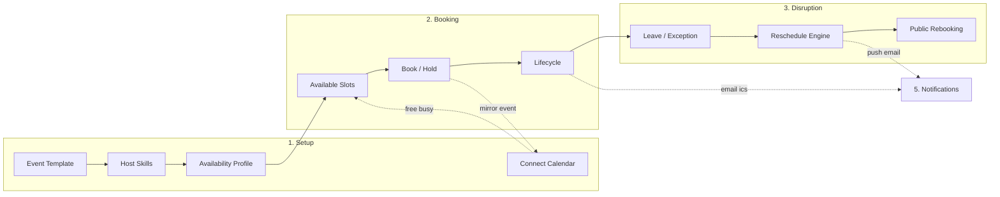
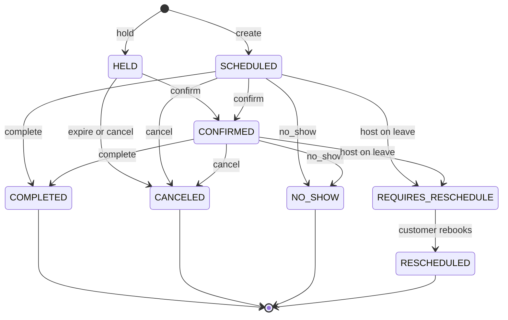

# Scheduling & Booking — Flows

This folder walks through every flow in the scheduling module. Each doc gives a
Mermaid diagram plus **step-by-step actions with the API endpoint**, the possible
**outcomes at each step**, and **where each outcome leads next**.

> Diagrams are Mermaid — they render in GitHub, VS Code (Markdown Preview Mermaid
> Support), Obsidian, and most Markdown viewers.

## Index

| # | Flow | File | Actor |
|---|---|---|---|
| 1 | Tenant setup (event types, hosts, availability, calendar) | [01-setup.md](01-setup.md) | Admin |
| 2 | Booking lifecycle (slots → book/hold → confirm → complete/cancel) | [02-booking-lifecycle.md](02-booking-lifecycle.md) | Customer / Internal |
| 3 | Emergency leave → reschedule → public rebooking | [03-leave-and-reschedule.md](03-leave-and-reschedule.md) | Admin + Customer |
| 4 | Google Calendar sync (OAuth, free/busy, push, webhooks) | [04-google-calendar-sync.md](04-google-calendar-sync.md) | Host + System |
| 5 | Notifications & push (email, `.ics`, reminders, FCM) | [05-notifications-and-push.md](05-notifications-and-push.md) | System |
| 6 | AI agent booking (voicebot tool surface) | [06-ai-agent-booking.md](06-ai-agent-booking.md) | AI Agent |
| — | **Implementation reference** — code-level internals, invariants, concurrency, known gaps | [booking-flow-internals.md](booking-flow-internals.md) | Engineers |
| — | **FCM push end-to-end** — token lifecycle on the client, storage, sending, reaping, retention | [push-notifications.md](push-notifications.md) | Frontend + Engineers |

## System map

## Booking status lifecycle

`HELD SCHEDULED CONFIRMED REQUIRES_RESCHEDULE` are **active** (they block the host's
time). `COMPLETED CANCELED NO_SHOW RESCHEDULED` are **terminal**.

## Endpoint reference

All authenticated endpoints are under `/api/v1/core/` and return the wrapped envelope
`{ status, message, data, errors }`.

| Method | Path | Auth | Purpose |
|---|---|---|---|
| GET/POST | `event-templates/` | Yes | Manage event types |
| GET/POST | `event-skills/` | Yes | Which hosts can host which event type |
| GET/POST | `availability-profiles/` | Yes | Weekly working hours (+ nested rules) |
| GET/POST | `availability-exceptions/` | Yes | Log leave / time off (triggers reschedule) |
| GET | `availability/available-slots/` | Yes | Compute bookable slots |
| GET/POST | `bookings/` | Yes | List / create a booking |
| POST | `bookings/hold/` | Yes | Temporarily reserve a slot |
| POST | `bookings/{id}/confirm/` | Yes | Confirm a held booking |
| POST | `bookings/{id}/cancel/` | Yes | Cancel (lead-time enforced) |
| POST | `bookings/{id}/complete/` | Yes | Mark completed |
| POST | `bookings/{id}/no-show/` | Yes | Mark no-show |
| DELETE | `bookings/{id}/` | Yes | Cancel (bypasses lead-time) |
| GET | `calendar-integrations/connect/` | Yes | Start Google OAuth |
| GET | `calendar-integrations/callback/` | No¹ | OAuth redirect target |
| DELETE | `calendar-integrations/{id}/` | Yes | Disconnect (revoke) |
| GET/POST | `device-tokens/` | Yes | Register an FCM device token |
| POST | `device-tokens/deactivate/` | Yes | Deactivate a device token |
| POST | `device-tokens/test/` | Yes | Send yourself a test push and report per-device outcome |
| POST | `calendar-webhook/google/` | No² | Google push notifications |
| GET/POST | `public/reschedule/{token}/` | No³ | Customer self-reschedule |

¹ trusted via signed `state`. ² validated via channel token. ³ single-use token, throttled.
