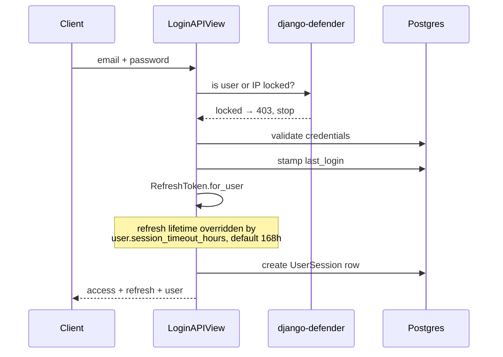
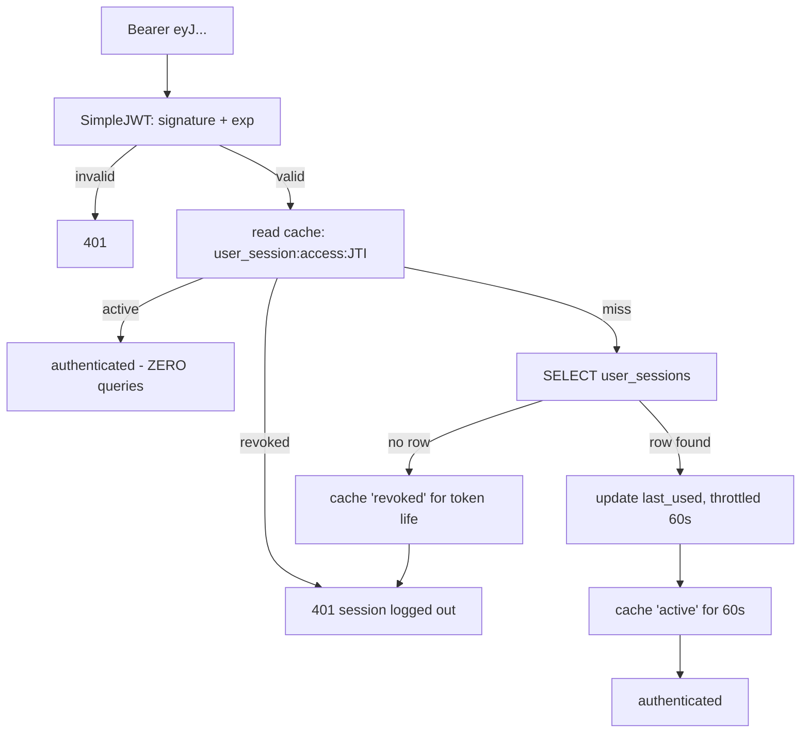
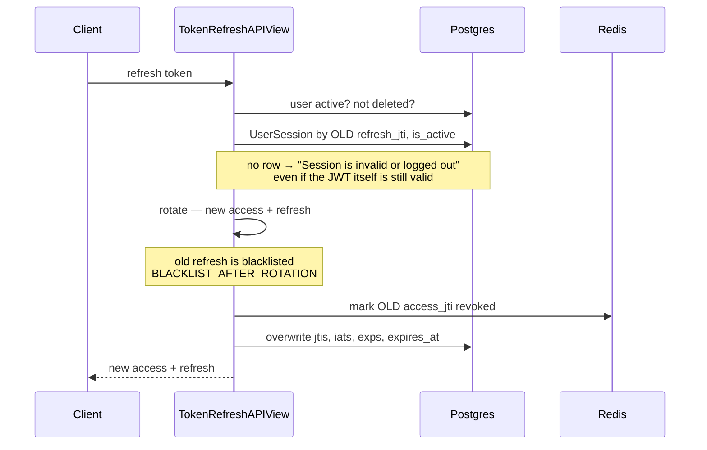
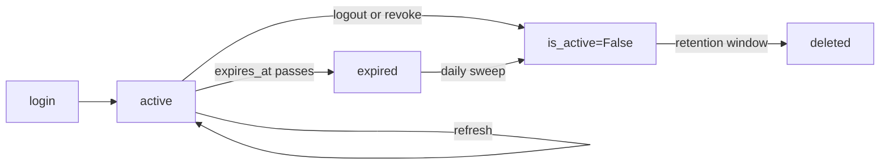

# Authentication — Login, Tokens & Every Authenticated Request

How a caller proves who they are, what happens on each request, and what makes a
credential stop working.

---

## Two kinds of caller

`DEFAULT_AUTHENTICATION_CLASSES` tries them in order, and the first to recognise the
header wins:

| | Header looks like | Who | Session row? |
|---|---|---|---|
| **`AgentTokenAuthentication`** | `Bearer vb_<prefix>_<secret>` | Voicebot agents (machines) | No |
| **`CachedJWTAuthentication`** | `Bearer eyJhbGci…` | People | **Yes** |

The agent class inspects the token and returns `None` if it does not start with `vb_`,
handing off to the JWT class. Everything below is the **JWT / human** path.

---

## 1. Login

`POST /api/v1/auth/login/`

The `UserSession` row records both JTIs, both `iat`/`exp` pairs, the device name parsed
from the User-Agent, and the client IP. **One login = one row = one device**, which is
what makes `/api/v1/user/sessions/` a real "active devices" list.

> **The session write is part of the login, not bookkeeping beside it.** It is atomic with
> the `last_login` stamp, and if it fails the endpoint returns **`503` with no tokens**.
>
> That is deliberate. Step 2 resolves every access token against this row, so tokens issued
> without one `401` on every call — "login worked, app is broken". Reporting the failure
> gives the client something it can retry. The same rule holds for
> [refresh](#3-refresh) and for the post-payment sign-in.

---

## 2. Every authenticated request

This is the hot path — it runs on every single API call.

**The cache hit costs no database query.** That matters: this used to consult the cache
and then run `objects.get(...)` *anyway*, so every authenticated request in the system
carried one query against `user_sessions` — the cache was saving the `last_used` write,
not the read.

### Why the two TTLs differ

| Verdict | Cached for | Why |
|---|---|---|
| `"revoked"` | the token's remaining life | It can never become valid again, so re-checking is pure waste and a rejected token stays cheap |
| `"active"` | **60s** (`SESSION_CACHE_TTL_SECONDS`) | Bounds how long a revocation that bypasses `revoke()` stays invisible |

Every in-code revocation path — logout, refresh rotation — writes `"revoked"` to the
same key, so those take effect **immediately**. The 60 seconds only bounds the paths
that don't: an admin edit, a bulk update, direct SQL.

Redis being unavailable degrades to a database read per request. Slower, never wrong.

---

## 3. Refresh

`POST /api/v1/auth/refresh/` — **rotates the existing row, never creates a second one.**

Two steps carry the weight:

**The session lookup is the gate.** Logout sets `is_active=False`, so a revoked session
cannot be refreshed even though its refresh JWT is still cryptographically valid and
unexpired.

**Revoking the old `access_jti` in cache is not optional.** Without it, the previous
access token keeps working for the remainder of its 60 minutes after a refresh.

If the row update fails, the endpoint returns **`503` with no tokens** — the pair it just
minted would reference a session still pointing at the previous one. Unlike login's `503`
this is terminal: rotation already spent the token you sent, so the client must log in
again.

> ⚠️ **Concurrent refresh logs the user out.** Two parallel refreshes with the same
> token: the first rotates and blacklists it, the second gets `TokenError` →
> `"Invalid refresh token."` Most clients respond by force-logging-out. This is the
> normal case when several requests 401 at once, and it is more likely here because
> multiple browser tabs are explicitly supported. There is no grace window on the old
> token yet.

---

## 4. Logout

`POST /api/v1/auth/logout/`

1. `token.blacklist()` — the refresh token can never be used again
2. every `UserSession` with that `refresh_jti` is `revoke()`d → `is_active=False`
3. `revoke()` writes `"revoked"` to the access token's cache key

Step 3 is what makes logout instant rather than eventually-consistent. Without it the
still-valid access token would keep working until its cache entry expired.

Revoking one device from the session list (`DELETE /user/sessions/{id}/`) calls the same
`revoke()`.

---

## 5. WebSockets

The handshake accepts the token from an `Authorization` header, the
`Sec-WebSocket-Protocol` header, or a `?token=` query parameter, then calls
**`UserSession.get_active_session(jti)`** — not the request-path method.

That difference is deliberate. The HTTP path may answer from cache and return `None`,
which is right when the question is "is this still valid?" thousands of times a second.
A handshake needs the **row itself**, because it goes into `scope["session"]` so a
consumer can address messages at one session. A handshake happens once per connection,
so the guaranteed read costs nothing worth optimising away.

---

## What invalidates what

| Event | Access token | Refresh token | Session row | Push device |
|---|---|---|---|---|
| Access token expires (60 min) | dead | fine | untouched | untouched |
| Refresh (rotation) | old one revoked in cache | old one blacklisted | updated in place | untouched |
| Logout | revoked in cache | blacklisted | `is_active=False` | deactivated |
| Revoke a device | revoked in cache | — | `is_active=False` | deactivated |
| Refresh token expires (default 7d) | — | dead | swept later | deactivated by the sweep |
| Session row deleted by retention | — | — | gone | already deactivated above |

**Sessions own push devices.** A `DeviceToken` records the session it registered under, so
the death of a session silences the device — including on plain expiry, which the client
cannot report because it has no credentials left to call with. See
[Push Notifications](push-notifications.md).

---

## Session lifecycle

The daily `purge_expired_sessions` task marks past-expiry rows inactive, deletes those
older than `USER_SESSION_RETENTION_DAYS`, and flushes SimpleJWT's expired blacklist
rows. Before it existed both tables grew forever — see
[Maintenance Commands](../commands/README.md).

---

## Settings

| Setting | Default | Effect |
|---|---|---|
| `ACCESS_TOKEN_LIFETIME` | 60 min | How long an access token is usable |
| `REFRESH_TOKEN_LIFETIME` | 7 days | Ceiling; per-user `session_timeout_hours` overrides it at login |
| `ROTATE_REFRESH_TOKENS` | `True` | Every refresh issues a new refresh token |
| `BLACKLIST_AFTER_ROTATION` | `True` | The old one is blacklisted — this is what makes the blacklist table grow |
| `SESSION_CACHE_TTL_SECONDS` | 60 | Positive-verdict cache. Raising it trades revocation latency for fewer queries |
| `USER_SESSION_RETENTION_DAYS` | 30 | How long an expired session row is kept, measured from expiry |

---

## Gotchas

1. **A valid JWT is not enough.** Every request also needs a live `UserSession` row. That
   is what makes server-side logout possible with stateless tokens.
2. **`401` can mean "logged out"**, not just "expired" — check the message.
3. **Don't refresh concurrently.** Serialise it behind a single in-flight promise on the
   client, or two tabs will log the user out.
4. **Sessions are per login, not per user.** Logging in again creates another row rather
   than replacing the first.
5. **Machine tokens (`vb_*`) have no session** and no logout — they are revoked by
   deactivating the agent token itself.

---

## Related

- [Sessions API](../apiDocs/user/sessions.md)
- [Authentication API](../apiDocs/user/auth.md)
- [Agent Token Scoping](../apiDocs/core/vb_agent_tenant_scoping.md)
- [Maintenance Commands](../commands/README.md)
