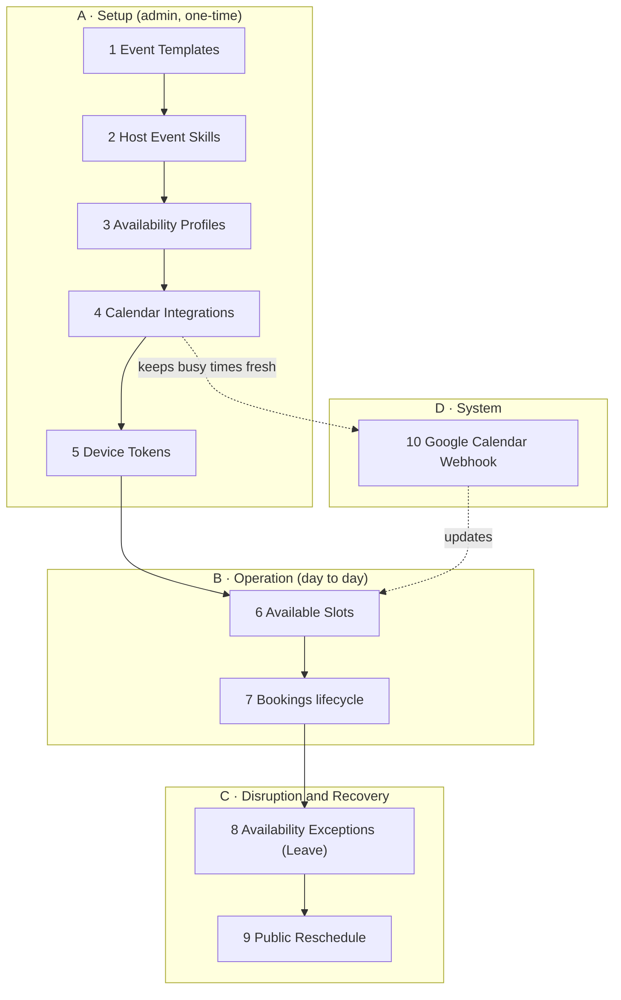

# Booking V4 — Complete API Walkthrough (Step by Step)

A single, ordered tour of **every** scheduling & booking API, in the sequence a tenant
actually uses them: first the one-time **setup**, then day-to-day **operation**, then the
**disruption & recovery** paths, and finally the **machine-only** endpoint.

> **Base prefix:** all paths below are under `/api/v1/core/`.
> **Auth:** every endpoint needs `Authorization: Bearer <token>` **except** the two marked
> _public / system_ (Public Reschedule and the Google Webhook).
> **Tenant:** always derived from the logged-in user — you never pass a tenant id.

---

## The whole system in one sentence

> **Admin sets up** meeting types (1) → who can run them (2) → when they work (3) → syncs
> real calendars (4) → registers for alerts (5). **Customers then** view open slots (6) and
> book / hold / confirm / cancel (7). **When a host goes down** (8), the system hands the
> customer a **self-serve reschedule link** (9). **Google keeps
> calendars honest** via the webhook (10).

---

## Endpoint reference (quick index)

| # | Resource | Key endpoints | Auth |
|---|----------|---------------|------|
| 1 | Event Templates | `GET·POST /event-templates/` · `GET·PATCH·DELETE /event-templates/{id}/` | Bearer |
| 2 | Host Event Skills | `GET·POST /event-skills/` · `DELETE /event-skills/{id}/` | Bearer |
| 3 | Availability Profiles | `GET·POST /availability-profiles/` · `GET·PATCH·DELETE /availability-profiles/{id}/` | Bearer |
| 4 | Calendar Integrations | `GET /calendar-integrations/connect/` · `GET .../callback/` · `GET /calendar-integrations/` · `DELETE /calendar-integrations/{id}/` | Bearer |
| 5 | Device Tokens | `GET·POST /device-tokens/` · `POST /device-tokens/deactivate/` · `DELETE /device-tokens/{id}/` | Bearer |
| 6 | Available Slots | `GET /availability/available-slots/` | Bearer |
| 7 | Bookings | `GET·POST /bookings/` · `GET·DELETE /bookings/{id}/` · `POST /bookings/hold/` · `POST /bookings/{id}/confirm/` · `POST /bookings/{id}/cancel/` · `POST /bookings/{id}/complete/` · `POST /bookings/{id}/no-show/` | Bearer |
| 8 | Availability Exceptions | `GET·POST /availability-exceptions/` · `GET·PATCH·DELETE /availability-exceptions/{id}/` | Bearer |
| 9 | Public Reschedule | `GET /public/reschedule/{token}/` · `POST /public/reschedule/{token}/` | **Public** |
| 10 | Google Calendar Webhook | `POST /calendar-webhook/google/` | **System** |

---

# 🅰️ Setup phase — configure the scheduling system (admin, one-time)

## 1. Event Templates — *what kinds of meetings exist*

`GET · POST /event-templates/` · `GET · PATCH · DELETE /event-templates/{id}/`

**Purpose:** Defines a *bookable meeting type* — its duration, buffers, booking window, min
notice, and crucially the **assignment strategy**:

- `DIRECT` (default) — a specific, named host.
- `COLLECTIVE` — everyone must attend (one booking per host).

Every booking is created *against* a template.

**Real-life examples:**

- A sales team creates **"30-Min Product Demo"** — 30 min, 15-min buffer after, bookable up
  to 21 days out, `min_notice = 2h`, strategy `DIRECT` so the customer books the rep they
  picked.
- A clinic creates **"Case Review (all doctors)"** — 60 min, strategy `COLLECTIVE`, so a
  booking blocks *every* doctor's calendar at once.

📄 [Full API reference](../apiDocs/core/event_template.md)

## 2. Host Event Skills — *who is allowed to run which meeting*

`GET · POST /event-skills/` · `DELETE /event-skills/{id}/`

**Purpose:** Links a host (user) to an event template they're qualified for. This is the
eligibility gate — a booking's `target_host` is rejected unless that host holds the
matching skill.

**Real-life examples:**

- Assign reps **Emma** and **Raj** to "30-Min Product Demo" → both become bookable for it;
  a rep without the skill is rejected even if the booker names them.
- Only **Dr. Chen** gets the "Cardiology Consult" skill → only Chen can be booked for it,
  even though the org has 10 doctors.

📄 [Full API reference](../apiDocs/core/event_skill.md)

## 3. Availability Profiles — *when a host works*

`GET · POST /availability-profiles/` · `GET · PATCH · DELETE /availability-profiles/{id}/`

**Purpose:** A host's weekly recurring working hours + timezone (e.g. Mon–Fri 9–5
America/New_York). Slot generation starts from this grid, then subtracts buffers, existing
bookings, calendar-busy, and leave. DST-correct.

**Real-life examples:**

- Emma sets **Mon–Fri, 09:00–17:00, America/New_York** with a **12:00–13:00 lunch** break →
  no slots ever offered over lunch or on weekends.
- A London-based host sets **Tue/Thu only, 13:00–18:00 Europe/London** → part-time coverage
  that still renders correctly for a customer viewing in IST.

📄 [Full API reference](../apiDocs/core/availability_profile.md)

## 4. Calendar Integrations — *sync with the host's real calendar*

`GET /calendar-integrations/connect/` → `GET .../callback/` (system) ·
`GET /calendar-integrations/` · `DELETE /calendar-integrations/{id}/`

**Purpose:** OAuth-connects a host's Google Calendar. Once connected:

1. their external busy events are **subtracted** from availability, so you never double-book
   against a real meeting, and
2. new bookings are **pushed** to their Google Calendar.

A push "watch" keeps busy-times fresh via webhook (see #10). Tokens are encrypted and
**never** returned by the API.

**Real-life examples:**

- Emma clicks "Connect Google Calendar" → hits `/connect/`, consents, and now her personal
  3pm dentist appointment automatically blocks that slot from customers.
- She later revokes access → `DELETE` stops the watch, revokes the grant, and her
  availability reverts to working-hours-only.

📄 [Full API reference](../apiDocs/core/calendar_integration.md) ·
🔀 [Sync flow](04-google-calendar-sync.md)

## 5. Device Tokens — *where to send push alerts*

`GET · POST /device-tokens/` · `POST /device-tokens/deactivate/` ·
`DELETE /device-tokens/{id}/`

**Purpose:** Registers a browser/mobile FCM token so the **internal team** gets push
notifications for operational events (a booking needing reschedule). Upsert-style:
re-posting a token just reactivates it.

**Real-life examples:**

- The dispatcher's web dashboard registers its FCM token on login → they get an instant push
  when a colleague calls in sick and their bookings need rescheduling.
- On logout the client calls `/deactivate/` → that device stops receiving alerts (and
  FCM-reported dead tokens auto-deactivate anyway).

📄 [Full API reference](../apiDocs/core/device_token.md)

---

# 🅱️ Operation phase — day-to-day booking

## 6. Available Slots — *what times can I actually book*

`GET /availability/available-slots/?event_template=<id>&date_from=…&date_to=…`

**Purpose:** The read endpoint the booking UI calls. Given a template and a date window, it
returns concrete open start/end times, already accounting for working hours, buffers,
existing bookings, external calendar busy, and leave. `DIRECT` templates require a
`target_host`, and slots are returned for that host.

**Real-life examples:**

- Customer opens the demo booking page → UI calls this with `event_template=<demo>` for the
  next 2 weeks → gets back the green time-grid they click.
- For a `COLLECTIVE` case review, it only returns slots where **all** required doctors are
  simultaneously free — often just a handful per week.

📄 [Full API reference](../apiDocs/core/availability_slots.md)

## 7. Bookings — *the core lifecycle*

The heart of the system. Base resource:

`GET /bookings/` · `GET /bookings/{id}/` · `POST /bookings/` (create) ·
`DELETE /bookings/{id}/` (= cancel)

Plus lifecycle **actions**:

| Action | Endpoint | Purpose |
|--------|----------|---------|
| **Hold** | `POST /bookings/hold/` | Tentatively reserve a slot for a short TTL (e.g. while the customer fills a form) — prevents two people grabbing the same time during checkout. Auto-expires. |
| **Confirm** | `POST /bookings/{id}/confirm/` | Turn a hold into a real `SCHEDULED` booking. |
| **Cancel** | `POST /bookings/{id}/cancel/` | Cancel with a reason; auto-cancels the whole group if collective. Sends cancellation notice. |
| **Complete** | `POST /bookings/{id}/complete/` | Mark it happened (post-meeting). |
| **No-show** | `POST /bookings/{id}/no-show/` | Customer didn't turn up. |

Under the hood, `POST /bookings/` auto-detects `COLLECTIVE` templates and creates **one
booking per host** as a linked group. A Postgres exclusion constraint makes double-booking
impossible even under concurrent requests (racing requests get `409 Conflict`, never a
double-book).

**Real-life examples:**

- **Simple flow:** Customer picks 3:00pm for a demo → `POST /bookings/` with the slot +
  their name/email → returns a `SCHEDULED` booking, fires a confirmation email + calendar
  invite for Raj, the rep they picked.
- **Hold flow (high-contention):** During a flash-sale webinar, the client calls
  `POST /bookings/hold/` the moment a slot is clicked, then `POST /{id}/confirm/` after
  payment. If two users clicked 3:00pm at once, the second gets a `409 Conflict` instead of
  a double-book.
- **Collective:** Ops books "Case Review (all doctors)" at Thu 4pm → one call creates linked
  bookings on Chen's, Patel's, and Rao's calendars; cancelling any one cancels the whole
  group.

📄 [Full API reference](../apiDocs/core/booking.md) ·
🔀 [Booking lifecycle flow](02-booking-lifecycle.md)

---

# ©️ Disruption & recovery phase

## 8. Availability Exceptions (Leave) — *host is suddenly out*

`GET · POST /availability-exceptions/` · `GET · PATCH · DELETE /availability-exceptions/{id}/`

**Purpose:** Records a one-off time-off / block (planned leave or emergency). Creating one
doesn't just hide future slots — it **triggers reprocessing of already-booked meetings** in
that window: each is flagged `REQUIRES_RESCHEDULE` and the customer is emailed a self-serve
reschedule link. Hosts are never substituted behind the customer's back.

**Real-life examples:**

- Emma logs **"Vacation, Jul 20–24"** a week ahead → her 3 booked demos in that window are
  flagged `REQUIRES_RESCHEDULE` and those customers get a link to pick a new time; no slots
  offered to new customers.
- Raj calls in sick this morning → ops posts an **emergency leave for today** → his 10am
  demo is flagged `REQUIRES_RESCHEDULE` and the customer gets the self-serve link (next
  endpoint).

📄 [Full API reference](../apiDocs/core/availability_exception.md) ·
🔀 [Leave & reschedule flow](03-leave-and-reschedule.md)

## 9. Public Reschedule — *customer fixes it themselves, no login*

`GET /public/reschedule/{token}/` (options) · `POST /public/reschedule/{token}/` (rebook)

**Purpose:** The **only unauthenticated** customer-facing endpoint. Reached via the
single-use, expiring (72h) token in the "please reschedule" email. `GET` returns the booking
summary + fresh open slots; `POST` atomically rebooks a new time, marks the old one
`RESCHEDULED`, and **burns the token**. Rate-limited 30/min.

**Real-life examples:**

- The customer whose demo got flagged clicks the email link → sees Raj's illness message and
  a list of new times → picks Wed 11am → `POST` books it, old booking closed, token now dead.
- They try to reuse the same link next week → `400 "invalid or already used."`

📄 [Full API reference](../apiDocs/core/public_reschedule.md)

---

# 🔧 System / machine-only endpoint

## 10. Google Calendar Webhook — *Google tells us a calendar changed*

`POST /calendar-webhook/google/` — **no auth** (validated by per-channel token)

**Purpose:** Google's push callback. When a host edits their Google Calendar, Google POSTs
here; the system enqueues an incremental sync that refreshes that host's cached busy-blocks
(ignoring events *we* created — echo guard), so availability stays current without polling.
Always returns `200` so Google stops retrying.

**Real-life examples:**

- Emma drags a personal meeting to 2pm in Google → Google pings this endpoint → within
  seconds the 2pm slot disappears from her bookable availability.
- A stale/unknown channel pings it → silently ignored with `200`, no error surfaced.

📄 [Full API reference](../apiDocs/core/calendar_integration.md#5-google-webhook-system-public) ·
🔀 [Sync flow](04-google-calendar-sync.md)

---

## See also

- 🗺️ [Flows overview & endpoint map](README.md)
- ⚙️ [Tenant setup flow](01-setup.md)
- 🔔 [Notifications & push flow](05-notifications-and-push.md)
- 📘 [Implementation plan (V4 spec)](../scheduling-booking-implementation-plan-v4.md)
- 🚀 [Deployment checklist](../scheduling-deployment-checklist.md)
