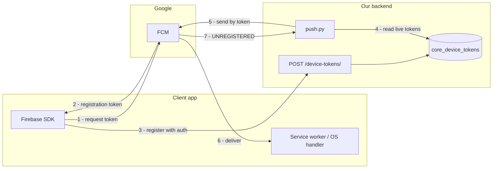
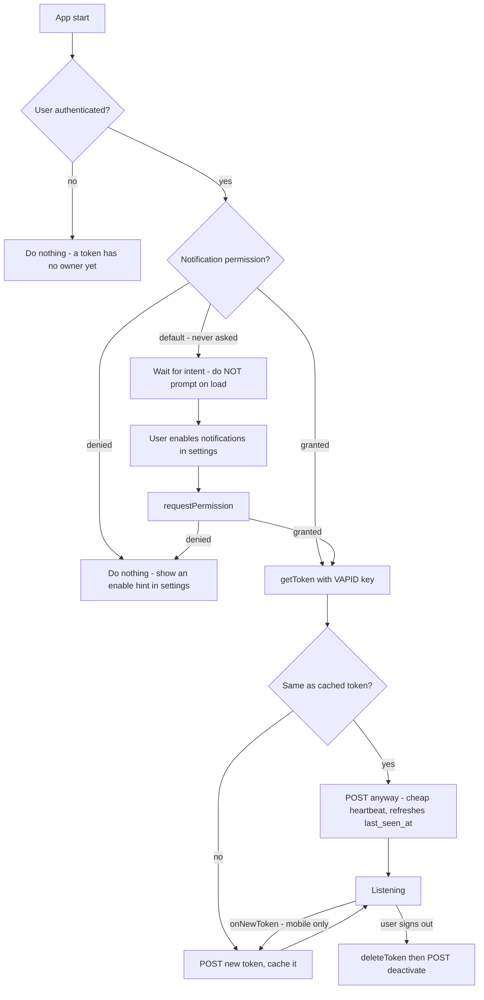
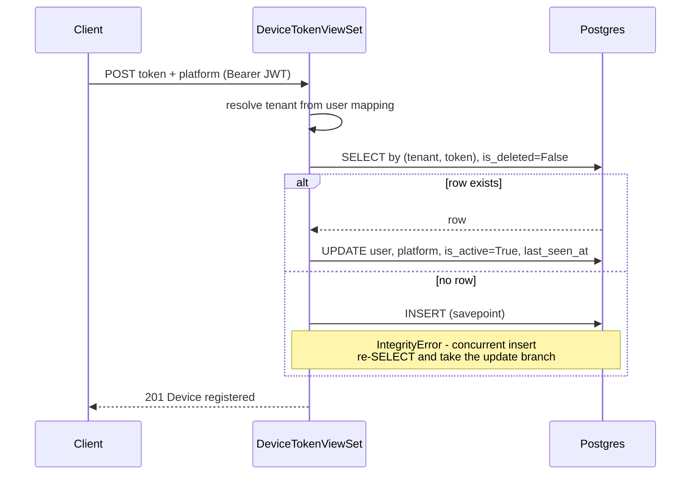
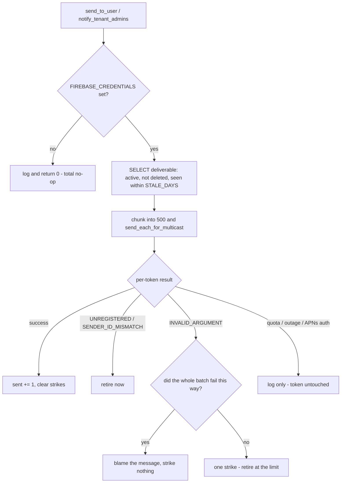
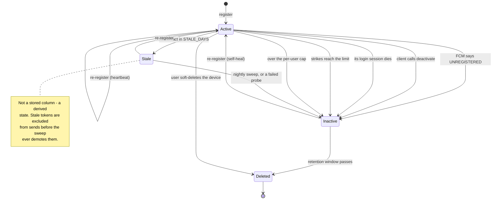
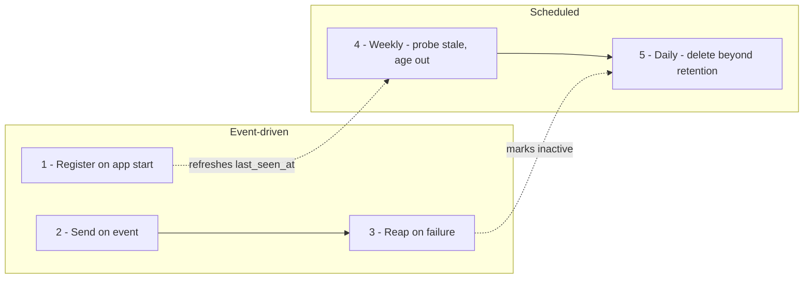

# Push Notifications (FCM) — End-to-End

How a device registration token is born on the client, reaches us, is used, dies, and is
cleaned up — what a production-grade system does at each stage, and where ours stands.

> **Legend used throughout this document**
>
> | | Meaning |
> |---|---|
> | ✅ | Built and working today |
> | ⚠️ | Partially built — works, but has a named gap |
> | ❌ | Not built — described here as the target |
>
> Anything marked ❌ or ⚠️ is **not built** — described here as the target, not as an API
> contract. Everything in Parts 1–5 and 6.1/6.2/6.6/6.7/6.8 is shipped and tested; the
> remaining ❌ items are listed with the reason they were left.

---

## The three parties

Push has no direct client↔server delivery path. We never send anything *to* a browser or a
phone — we send to **Google**, and Google decides whether a device is reachable.



Three consequences fall out of that shape and drive everything below:

1. **The token is the address.** Lose it, or hold a stale one, and the device is
   unreachable — there is no fallback identifier.
2. **Only Google knows if a token is alive.** We cannot inspect one. The string carries no
   expiry, no user, no device id we can read.
3. **Feedback is asynchronous and send-driven.** We learn a token is dead by *trying to use
   it* (step 7). Nothing pushes that news to us.

---

## Part 1 — What an FCM registration token actually is

This is the ground truth the rest of the design has to respect.

| Property | Reality |
|---|---|
| **Format** | Opaque string, ~140–350 chars today, **not** guaranteed stable in length or shape |
| **Expiry** | **None.** No `exp`, no TTL, no timestamp, nothing to parse |
| **Renewal** | **Never on a schedule.** It does not "refresh" like a JWT |
| **Rotation** | Happens *only* on the events below, at unpredictable times |
| **Scope** | One app instance on one device — **not** one user, **not** one login |
| **Validation** | Impossible offline. The only oracle is FCM itself |

### What actually kills a token

| Cause | Platform | Do we find out? |
|---|---|---|
| App uninstalled | Android / iOS | On next send → `UNREGISTERED` |
| App data cleared | Android | On next send → `UNREGISTERED` |
| Browser site data cleared | Web | On next send → `UNREGISTERED` |
| Service worker unregistered | Web | On next send → `UNREGISTERED` |
| Notification permission revoked | All | On next send → `UNREGISTERED` |
| Device restored to new hardware | Android / iOS | On next send → `UNREGISTERED` |
| Client called `deleteToken()` | All | Only if the client also tells us |
| **App instance inactive ~270 days** | All | FCM reaps it; we find out on next send |
| Token issued by a different Firebase project | All | `SENDER_ID_MISMATCH` |
| Token truncated or corrupted in transit | All | `INVALID_ARGUMENT` |

> **Note the pattern: almost every row says "on next send".** That is the whole problem.
> A system that only reaps reactively holds dead rows for as long as it has nothing to say
> to that user — which for a low-traffic alert channel can be months.

### So: "can we know if it is expired?"

**Not from the token.** But there are exactly two mechanisms, and a good system uses both:

| Mechanism | How | Cost | We have it |
|---|---|---|---|
| **Reactive** — learn on failure | Classify the per-token error from a real send | Free (piggybacks on real traffic) | ✅ |
| **Heuristic** — age it out | Treat last contact older than `DEVICE_TOKEN_STALE_DAYS` as stale | Free | ✅ |
| **Proactive** — ask FCM directly | `messaging.send(msg, dry_run=True)` — FCM validates the token and **delivers nothing** | One API call per token | ✅ (opt-in, `--verify`) |

`dry_run=True` is the one people miss: a real liveness probe that never notifies anyone.
It is opt-in rather than scheduled because it costs an API call per token and the age rule
already covers the same ground — use it when a *confirmed* answer is worth the calls.

Google's own guidance is to treat any token not refreshed in **about two months** as stale,
because a client that has not checked in that long has very likely rotated without telling
you. That is where the 60-day default comes from.

---

## Part 2 — The frontend cycle

### The lifecycle



### The five moments a client must call us

| # | Moment | Call | Why it is not optional |
|---|---|---|---|
| 1 | **After login**, once permission is granted | `POST /device-tokens/` | The row's `user` is the authenticated caller — a token registered before login has no owner |
| 2 | **Every app start / page load** | `POST /device-tokens/` | The heartbeat. On **web this is the only rotation detector that exists** |
| 3 | **On SDK-signalled rotation** | `POST /device-tokens/` | Mobile only — the SDK tells you the token changed |
| 4 | **On permission granted** (later, from settings) | `POST /device-tokens/` | A token obtained while permission was `default` is not deliverable |
| 5 | **On sign-out** | `deleteToken()` **then** tell the server (see below) | Otherwise the next alert lands on a device someone else may now be using |

On sign-out there are two server-side options, and the second is usually better:

| | Call | When to prefer it |
|---|---|---|
| Dedicated | `POST /device-tokens/deactivate/` with `{token}` | Turning off one device while staying signed in |
| **Folded into logout** | `POST /auth/logout/` with `{refresh, device_token}` | **Normal sign-out** — one round trip, and it cannot be skipped by a tab closing between two requests |

### Platform differences that change the design

| | Web | Android | iOS |
|---|---|---|---|
| Get a token | `getToken(messaging, {vapidKey})` | `FirebaseMessaging.getInstance().token` | `Messaging.messaging().token()` |
| Rotation callback | **None — removed in JS SDK v9+** | `onNewToken()` in `FirebaseMessagingService` | `messaging(_:didReceiveRegistrationToken:)` |
| Extra requirement | Service worker at origin root + VAPID key | — | APNs auth key uploaded to Firebase, `UNUserNotificationCenter` permission |
| Background handler | `onBackgroundMessage` in the service worker | `onMessageReceived` | `UNUserNotificationCenterDelegate` |
| Foreground handler | `onMessage` — **you must render the toast yourself** | `onMessageReceived` | `willPresent` |

> ⚠️ **The web gap is the one to internalise.** The modular JS SDK has **no**
> `onTokenRefresh`. There is no callback, no event, nothing. If a web client skips moment 2,
> a rotated token is never reported and that browser goes silently dark **forever** — no
> error, no log, no user-visible symptom. "Register on every page load" is not a
> nice-to-have on web; it is the entire mechanism.

### Reference client shape (web)

```js
// After login + permission granted. Safe and expected to run on every page load.
const token = await getToken(messaging, { vapidKey: VAPID_PUBLIC_KEY });

if (token) {
  await api.post("/api/v1/core/device-tokens/", { token, platform: "WEB" });
  localStorage.setItem("fcm_token", token);   // for your own change detection only
}

// On sign-out — both halves matter.
await deleteToken(messaging);                       // kill it at Google
await api.post("/api/v1/auth/logout/", {            // kill it here, in the same call
  refresh: refreshToken,
  device_token: token,
});
```

Killing it at Google is not redundant: deactivating server-side alone leaves the browser
subscribed, so the device is still reachable by anything else holding that token.

### What clients must **not** do

| Anti-pattern | Why it is wrong |
|---|---|
| **Re-register on every JWT refresh** | With a 60-min access token that is ~24 writes/device/day for zero benefit. The FCM lifecycle and the auth lifecycle are unrelated — see [Authentication](authentication.md) |
| **Prompt for permission on page load** | Browsers penalise it, users reflexively deny, and a denial is **sticky** — you often cannot ask again. Ask on intent |
| **Register before login** | The token gets attributed to whoever authenticates, or rejected outright |
| **Cache the token and never re-POST it** | Kills the only staleness signal the server has |
| **Assume `201` means "new device"** | The upsert returns `201` on the update branch too — see [Device Tokens API](../apiDocs/core/device_token.md) |
| **Skip `deleteToken()` on logout** | Deactivating server-side alone leaves the device subscribed at Google; any other sender, or a re-registration bug, resurrects it |

---

## Part 3 — The backend cycle

### Registration (✅ built)



The upsert keys on **`(tenant, token)`**, enforced by a partial unique index over
non-deleted rows. Re-registering reactivates, reassigns the owner, and stamps
`last_seen_at`. Two simultaneous registrations both return `201` and leave exactly one row —
the loser catches the constraint and re-reads.

### What we store

| Column | Set by | Notes |
|---|---|---|
| `tenant` | Server, from the caller's mapping | Uniqueness scope |
| `user` | Server, always the caller | **Reassigned on re-registration** — that is how shared devices work |
| `token` | Client | `CharField(512)`, opaque |
| `platform` | Client, default `WEB` | Informational today; nothing branches on it |
| `is_active` | Server | `False` = FCM disowned it, it was deactivated, it aged out, or it hit the cap |
| `last_seen_at` | Server | ⚠️ **"last registered at", not "last active"** — only this endpoint moves it. Staleness reads `COALESCE(last_seen_at, created_at)` |
| `failure_count` | Server | Consecutive ambiguous send failures. Reset by any success or re-registration |
| `last_error` | Server | Why it was retired — the difference between "signed out", "FCM rejected it" and "aged out" |
| `session` | Server | The login this device registered under. **Moves to the newest login on re-registration** |
| `is_deleted` / `deleted_at` | Server | Soft delete; frees the token string for re-registration |

### The session link, and the one path a client cannot close

When a refresh token expires, the client is signed out and **has no credentials left to
call any endpoint with** — not `/device-tokens/deactivate/`, not `/auth/logout/`. It knows
it has been logged out and is physically unable to tell us. Without a server-side link, that
device kept receiving alerts for the rest of the staleness window with nobody signed in on
it.

So a device token records the `UserSession` it registered under, and the death of that
session takes the device with it:

| Event | How the device is silenced | When |
|---|---|---|
| Logout | `UserSession.revoke()` | Immediately |
| Remote revoke from the device list | `UserSession.revoke()` | Immediately |
| **Refresh token expires** | nightly `deactivate_for_dead_sessions` | Next sweep |
| Admin/bulk deactivation | same sweep | Next sweep |

> **Order is load-bearing in the session sweep.** `purge_expired_sessions` hard-deletes
> session rows, and the FK is `SET_NULL` — so devices must be retired *before* the purge, or
> the link is blanked and the only evidence the device was orphaned is gone. `sweep()` does
> them in that order and a test pins it.

Two deliberate non-behaviours:

- **A token with no session is never swept.** Everything registered before this link existed
  has `session = NULL`, as does anything whose session row has since been purged. Those fall
  to the staleness rule instead — retiring them as "orphaned" would silence every legacy
  device at once.
- **Registration never depends on the link resolving.** Agent tokens are not JWTs, and a
  session can be revoked between authentication and the write. The device is stored either
  way; the link is an optimisation on top of staleness, not a precondition.

> ⚠️ **This means a lapsed session stops push.** A phone whose session expires goes quiet
> until the user signs in again and the client re-registers. For **internal staff alerts**
> that is the point — nobody is signed in, nobody should be alerted. It would be the wrong
> default for consumer re-engagement push, which this channel is not.

### The send path (✅ built)



Branch `H` is the point of sending as a batch. `INVALID_ARGUMENT` means either a malformed
token or a malformed message and FCM does not say which — but if *every* token in a batch
fails the same way, the common factor is the message. The per-token loop this replaced could
not see that pattern, which is why it had to choose between never retiring a bad token and
retiring every device a bad payload touched.

### Token state machine



**Demote before delete.** An active row is never purged however old it is; the sweep marks
it inactive first, so a device is always visible as inactive for a full retention window
before the row disappears and takes the explanation with it.

---

## Part 4 — The production-grade reference cycle

A mature push system runs **five loops** at five different cadences. Most teams build the
first two, discover the table is 90% dead rows a year later, and retrofit the rest.

| # | Loop | Cadence | Purpose | Ours |
|---|---|---|---|---|
| 1 | **Register / heartbeat** | Every app start | Keep the address current, refresh `last_seen_at` | ✅ |
| 2 | **Send** | Event-driven | Actually notify | ✅ |
| 3 | **Reactive reap** | On every send failure | Retire what FCM rejects | ✅ |
| 4 | **Proactive reap** | Daily (age) / on demand (probe) | Find death without waiting for traffic | ✅ |
| 5 | **Retention purge** | Daily | Delete long-dead rows; bound the table | ✅ |

Loops 4 and 5 run as one nightly beat task, `core.tasks.sweep_device_tokens`. The probe half
of loop 4 is deliberately **not** nightly — see [Maintenance Commands](../commands/README.md).



Loops 4 and 5 are what separate "works in the demo" from "works in year two". Without them:

- The table grows without bound — the same failure `user_sessions` and `token_blacklist` had.
- Every fan-out carries dead weight: a user with 8 historical browser tokens costs 8 slots
  to reach 1 live device.
- "How many users can we reach?" becomes unanswerable, because `is_active=True` stops
  meaning anything.

---

## Part 5 — The gaps, and what closed them

Nine gaps were found by reading the code. All nine are closed.

| # | Gap as found | Resolution |
|---|---|---|
| **A** | **Nothing ever deleted a `DeviceToken` row** — no beat task, no retention setting, no command | `sweep_device_tokens` nightly + `purge_device_tokens` command. Only inactive/soft-deleted rows past `DEVICE_TOKEN_RETENTION_DAYS` are removed |
| **B** | **No staleness rule** — a token last registered 14 months ago still received sends | `deliverable()` is now the only queryset the send path uses, and it excludes anything not seen within `DEVICE_TOKEN_STALE_DAYS` |
| **C** | **`INVALID_ARGUMENT` was never fatal**, so a malformed token was retried forever | Three-way classification plus a strike counter; a whole-batch failure blames the message instead |
| **D** | **Logout ignored device tokens** — alerts kept landing on a device the user walked away from | `POST /auth/logout/` accepts an optional `device_token` and deactivates it, best-effort |
| **E** | **One HTTP call per token** | `send_each_for_multicast`, 500 per call — which is also what makes C's discrimination possible |
| **F** | **Push wrote no `NotificationLog` row**; `Channel.FCM` existed but nothing produced it | `emit_admin_push` writes a deduped `FCM` row, same shape as the email ledger |
| **G** | **Push tasks had no retry**, unlike every email task | `max_retries=3, default_retry_delay=30`, and the outcome is recorded on the log row |
| **H** | **`send_push_to_user_task` had no caller** | Still no caller — but it now shares the retry/logging body with the admin task, so it is no longer a separate untested path |
| **I** | **Deactivation query could not use the index** | `token` is indexed. The query stays deliberately un-tenant-scoped: a device FCM disowned is dead in every tenant holding a copy |

### One bug the tests caught before it shipped

The web deep-link used `messaging.WebpushFcmOptions`; the SDK spells it
**`WebpushFCMOptions`**. Since the envelope is built *before* the try/except around the
send, every reschedule push would have raised `AttributeError`, retried three times, and
failed permanently — the exact alert this system exists to deliver. It was caught by a test
asserting the envelope's contents rather than mocking it away.

---

## Part 6 — What else a production system needs

Not asked about, and needed anyway. These are the ones that bite after launch.

### 6.1 Message design ✅

Every send used to be `title` + `body` + stringified `data` and nothing else. All four
missing knobs are now set on every message:

| Knob | Why it matters here | Field |
|---|---|---|
| **TTL** | "Booking needs rescheduling" delivered 3 days late is worse than not delivered — it is misleading. A phone offline all weekend should get *nothing*, not a stale alert | `android.ttl`, `apns-expiration`, webpush `TTL` — from `PUSH_TTL_SECONDS` |
| **Collapse key** | Five reschedules in a minute should be one notification, not five | `android.collapse_key`, `apns-collapse-id`, webpush `Topic` |
| **Priority** | Android Doze will sit on a `normal` message for hours | `android.priority`, `apns-priority` |
| **`content-available`** | Data-only messages are **not delivered on iOS** without it | `apns.payload.aps.content_available`, set only when there is no alert |

> **One collapse identifier, three different rules.** Web Push caps `Topic` at 32 characters
> from the URL-safe base64 alphabet; APNs caps `apns-collapse-id` at 64 bytes; Android has no
> limit. A natural key like `booking:<uuid>` is rejected by the first and truncated by the
> second, so the same alert would collapse on one platform and not another. The key is
> hashed to one value that is legal everywhere.

The payload ceiling is **4 KB**. An oversized `data` dict is now **dropped, and the message
still sends** — truncating would hand the client corrupt JSON, and refusing would turn a
developer's mistake into a missed operational alert. The human still sees the title and body;
they just land on the dashboard instead of the deep link, and the error log names the keys.

### 6.2 Click-through / deep links ✅

`data.route` is the convention, set by the sender and carried on every platform. For web,
it additionally becomes a real click target via `WebpushFCMOptions(link=...)` built from
`FRONTEND_PROJECT_URL`. FCM rejects a non-HTTPS link, so this is **inert in local
development** rather than failing the send — you get the notification without the
click-through.

The reschedule alert routes to `bookings/{id}`. **The client must honour `data.route`** —
nothing else can.

### 6.3 Foreground delivery ❌ (client-side)

FCM does **not** render a notification while the app is in the foreground. If the dashboard
is open in the active tab, the alert is silently swallowed unless the client implements
`onMessage` and renders its own toast. This is the single most common "push is broken" bug
report, and it is not a backend fault.

### 6.4 Per-user preferences and quiet hours ❌ — deliberately deferred

There is no opt-out. Registering a token subscribes you to everything the sending code
decides to send.

**Not built, on purpose.** There is exactly one push type today ("booking needs
rescheduling"), and a preferences model for a single notification type is speculative
design — you would be guessing at the axes people want to slice on. The moment a second type
lands, this becomes real work: a new model, a new API surface, and quiet-hours logic that
should honour the `timezone` already on the user profile.

### 6.5 Multi-tenant duplicate delivery ⚠️ — known, unresolved

Uniqueness is `(tenant, token)`, so **one physical device belonging to a user in two tenants
is two rows with the same token string**. If both tenants notify, that device is pinged
twice.

The send-path feedback functions (`retire`, `record_success`) are deliberately **not**
tenant-scoped for exactly this reason: a token FCM has disowned is dead in every tenant
holding a copy, and scoping the retirement would mean re-learning the same fact on every
future send. But *delivery* is still per-tenant, and nobody has decided whether the double
ping is correct. It is a product question, not a bug.

### 6.6 Observability ✅

Every push now writes a `NotificationLog` row (`channel=FCM`) carrying its dedup key,
booking, status and error — the same ledger email uses.

The honest limit: **FCM's send API gives no per-device delivery receipt.** Acceptance by
Google is not delivery and is certainly not "seen"; real delivery data only exists in FCM's
BigQuery export. So a `SENT` row records **attempt and acceptance**, and the code says so
where it would otherwise be misread.

Zero acceptances is recorded `FAILED`, not `SENT` — it means push is unconfigured or every
device has been retired. Marking it `SENT` would claim a delivery that never happened *and*
permanently suppress the retry, because a `SENT` row is never re-enqueued.

### 6.7 Registration abuse ✅

`POST /device-tokens/` is rate-limited per user (`DEVICE_TOKEN_REGISTER_RATE`, default
`60/hour`) and each user is capped at `DEVICE_TOKEN_MAX_PER_USER` live tokens per tenant,
oldest retired first. The throttle is scoped to the **register action only** — sharing it
viewset-wide would cap a device list at the registration rate.

### 6.8 Testing ✅

`test_push.py` fakes FCM errors with locally-defined classes, which works because
classification matches on `type(exc).__name__` — fine as a branch test, but it would never
catch a mis-named SDK symbol. That gap is now closed from the other side: the envelope tests
construct **real** `AndroidConfig` / `APNSConfig` / `WebpushConfig` objects, which is what
caught `WebpushFcmOptions` vs `WebpushFCMOptions` before it shipped.

Twelve mutations were run against the final code — staleness ignored, NULL rows made
immortal, active rows purged, strikes retiring on the first failure, transient errors treated
as fatal, dedup skipped, zero-accepted marked `SENT`, and more. All twelve were caught.

---

## Part 7 — What shipped

| Phase | Change | Gaps closed |
|---|---|---|
| **1** | `DEVICE_TOKEN_STALE_DAYS` / `DEVICE_TOKEN_RETENTION_DAYS`, `deliverable()`, nightly `sweep_device_tokens`, `purge_device_tokens` command | A, B |
| **2** | `probe_token()` via `dry_run=True`; `--verify` on the command | B |
| **3** | `send_each_for_multicast`, three-way failure classification, strike counter | C, E, I |
| **4** | `emit_admin_push` writes a deduped `FCM` `NotificationLog`; both push tasks retry | F, G, H |
| **5** | `POST /auth/logout/` accepts `device_token` | D |
| **6** | TTL, collapse key, priority, `content-available`, payload guard, `data.route`, web click target | 6.1, 6.2 |
| **7** | Per-user cap + scoped registration throttle | 6.7 |
| **8** | Preferences / quiet hours | **Not built** — see 6.4 |

**Still open and client-side:** foreground rendering (6.3). **Still open and a product
decision:** preferences (6.4), multi-tenant double ping (6.5).

---

## Settings

| Setting | Default | Effect |
|---|---|---|
| `FIREBASE_CREDENTIALS` | `""` | Path to the service-account JSON. **Blank disables push entirely** — sends return `0` and nothing is logged as an error |
| `DEVICE_TOKEN_STALE_DAYS` | `60` | Stop sending to tokens not re-registered within this window |
| `DEVICE_TOKEN_RETENTION_DAYS` | `90` | Delete dead rows whose last contact is older than this |
| `DEVICE_TOKEN_MAX_PER_USER` | `20` | Cap live registrations per user per tenant |
| `DEVICE_TOKEN_FAILURE_STRIKES` | `3` | Ambiguous failures before a token is retired |
| `DEVICE_TOKEN_PURGE_BATCH` | `5000` | Rows deleted per batch by the purge |
| `DEVICE_TOKEN_REGISTER_RATE` | `60/hour` | Per-user rate limit on registration |
| `PUSH_TTL_SECONDS` | `86400` | How long FCM keeps retrying before dropping a push |

> **Blank `FIREBASE_CREDENTIALS` fails open and silent.** Registration still returns `201`
> in that environment, so a successful register in staging proves nothing about whether push
> works there. Verify with a real send, not a real registration —
> **`POST /api/v1/core/device-tokens/test/`** is exactly that: it reports whether push is
> configured, whether the credential actually loads, how many of your devices we would
> deliver to, and what FCM said about each. See
> [Device Tokens API §4b](../apiDocs/core/device_token.md).
>
> A credential that is *set but unloadable* — wrong path, malformed JSON — is a third state,
> distinct from both "off" and "working", and the test endpoint names it rather than
> reporting a bare zero.

---

## Gotchas

1. **A token is a device, not a user.** One user has many; one device can change hands. The
   `(tenant, token)` upsert reassigns ownership on purpose.
2. **`last_seen_at` means "last registered", not "last active".** Nothing else moves it —
   not opening the app, not receiving a push. **Staleness is now measured from it**, so a
   client that stops re-registering will be retired within 60 days even though its token
   still works. That is the intended behaviour, and it makes moment 2 mandatory.
3. **Web has no rotation callback.** Register on every page load or go dark permanently.
4. **`201` does not mean a device was added.** The update branch returns `201` too.
5. **`is_active: false` no longer means one thing.** Read `last_error` to tell "signed out"
   from "FCM rejected it" from "aged out" from "over the cap".
6. **A transient FCM failure never counts against a device.** Quota errors and outages leave
   the token completely alone — counting them would retire healthy devices during an
   incident, which is when the fan-out matters most.
7. **Push never goes through SMTP**, so a tenant with no mail configuration still gets
   pushes — the reverse of [Flow 5](05-notifications-and-push.md)'s email prerequisite.
8. **Accepted ≠ delivered ≠ seen.** A `SENT` row means FCM took the message. There is no
   per-device receipt in this API.
9. **The web deep link is inert without HTTPS.** `FRONTEND_PROJECT_URL` on `http://` yields
   no click target — deliberately, so local development still gets notifications.
10. **Machine callers (`vb_agent`) have no device tokens** and are `403` on this entire
    viewset — see [VB_AGENT scoping](../apiDocs/core/vb_agent_tenant_scoping.md).

---

## Related

- [Device Tokens API](../apiDocs/core/device_token.md) — endpoint-level contract
- [Firebase / FCM credentials setup](../external-app-creds/01-firebase-fcm.md) — service account, VAPID
- [Flow 5 — Notifications & Push](05-notifications-and-push.md) — where pushes fire from
- [Authentication](authentication.md) — why FCM registration is *not* tied to token refresh
- [Maintenance Commands](../commands/README.md) — the retention pattern phase 1 follows
