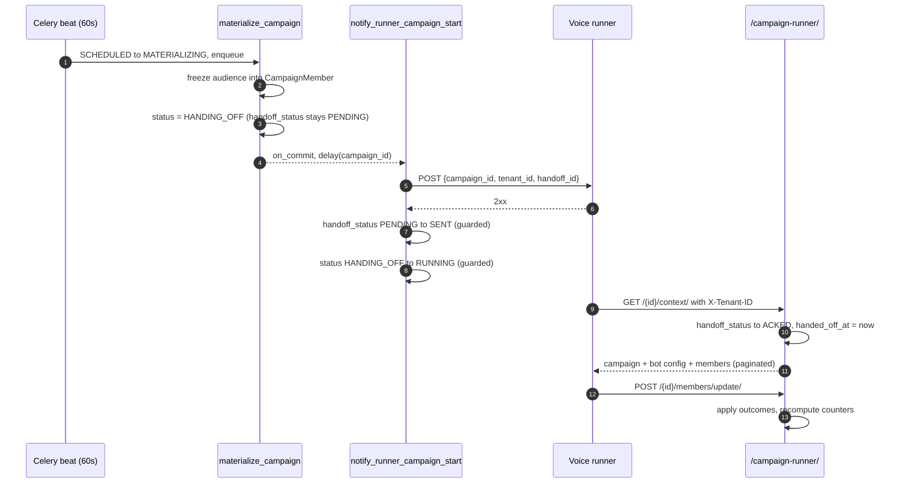

# Campaign Runner Push Handoff — Implementation Plan

Notify the external voice runner outbound when a campaign is ready to start, so it stops
being the runner's problem to discover work it has no way to discover.

**Related:** [Campaign Module Overview](../campaigns/README.md) ·
[Campaign Runner API](../apiDocs/core/campaign_runner.md) ·
[Campaign Module Plan](./campaign-module-plan.md)

---

## Contents

1. [The gap](#1-the-gap)
2. [What already exists](#2-what-already-exists)
3. [Design decisions](#3-design-decisions)
4. [The new flow](#4-the-new-flow)
5. [File-by-file changes](#5-file-by-file-changes)
6. [Concurrency, idempotency, and the ACK race](#6-concurrency-idempotency-and-the-ack-race)
7. [Failure handling](#7-failure-handling)
8. [Configuration](#8-configuration)
9. [Test plan](#9-test-plan)
10. [Rollout](#10-rollout)
11. [Out of scope](#11-out-of-scope)

---

## 1. The gap

`materialize_campaign` ends by setting the campaign to `RUNNING` and returning. Nothing
else happens. There is no outbound HTTP anywhere in this codebase for campaigns — no
runner URL setting, no `requests.post`, no webhook.

`RUNNING` therefore means *"the data is ready"*, not *"anybody is dialling"*.

The runner is expected to pull `GET /campaign-runner/{id}/context/`. But it has no way to
arrive at that URL on its own:

```python
# core/views/campaign_runner.py
vb_agent_allowed_actions = frozenset({"context", "update_members"})
```

Both are `detail=True`. There is no list action, no "what is due" endpoint, no queue to
drain. The runner must already know the campaign id to ask for anything at all.

**So the push is not a latency optimisation over polling. It is the only discovery
mechanism.** That framing matters for failure handling in §7: a permanently failed
notify means the campaign genuinely never runs, so it cannot be logged and forgotten.

---

## 2. What already exists

The schema was built for this and then left unwired. Confirmed by grep across the repo:

| Symbol | Defined at | Assigned anywhere? |
|---|---|---|
| `Campaign.Status.HANDING_OFF` | [campaign.py:94](../../core/models/campaign.py#L94) | **No** — only read, in `LIVE_STATUSES` and `WORKABLE_STATUSES` |
| `Campaign.HandoffStatus.SENT` | [campaign.py:110](../../core/models/campaign.py#L110) | **No** — never written |
| `Campaign.handoff_id` | [campaign.py:222](../../core/models/campaign.py#L222) | Yes — minted at `/launch/`, never transmitted |
| `Campaign.handed_off_at` | [campaign.py:238](../../core/models/campaign.py#L238) | Yes — stamped on first `/context/` pull |

Two consequences worth stating up front:

- **No migration is required.** `HANDING_OFF` and `SENT` are already in
  `core/migrations/0038_...`. This is pure service-layer work.
- **The runner already accepts `HANDING_OFF`.** `WORKABLE_STATUSES = [RUNNING,
  HANDING_OFF]` means a runner that receives the push and immediately calls `/context/`
  is served correctly, even before we flip the campaign to `RUNNING`. The existing code
  anticipated the exact ordering this plan introduces.

`handoff_id` is described in the model as an idempotency key and is re-minted on every
`/launch/`. It has never been sent to anyone. This plan is what makes it mean something.

---

## 3. Design decisions

### 3.1 Push carries identity only; the runner still pulls the payload

The notify body carries `campaign_id`, `tenant_id`, and `handoff_id` — enough to
authorise and de-duplicate, and nothing else of substance. The runner then calls
`/context/` for the bot config and the audience.

Rationale:

- The audience can be 100k members and is already paginated on `/context/`. Pushing it
  would mean re-implementing pagination over an outbound call.
- Suppression filtering lives in the `/context/` **queryset** — deliberately, per the
  comment there, so a serializer change cannot leak past it. A second serialisation path
  for the same data is a second place for that to go wrong.
- A push body is a snapshot at send time; `/context/` is current at pull time. If a
  campaign is cancelled between the two, the pull reflects it and the push would not.

### 3.2 Notify from a Celery task, not inline in `materialize_campaign`

`materialize_campaign` is already doing batched writes with a savepoint per batch. An
outbound HTTP call inside it would mean a network timeout can fail a 100k-row
materialisation that otherwise succeeded.

Separate task, enqueued via `transaction.on_commit` — matching the existing idiom at
[campaigns.py:325](../../core/services/campaigns.py#L325) and
[campaign.py:326](../../core/views/campaign.py#L326).

### 3.3 `HANDING_OFF` is a real state, not a formality

Current: `MATERIALIZING → RUNNING`.
New: `MATERIALIZING → HANDING_OFF → RUNNING`.

`RUNNING` should mean *"the runner has been told"*. Without the intermediate state there
is no way to distinguish "notified and working" from "notify task is still queued" from
"notify failed and nobody is dialling" — all three would read `RUNNING` in the UI.

### 3.4 `handoff_status` becomes strictly monotonic

`PENDING → SENT → ACKED`, never backwards. Enforced with guarded queryset updates
rather than `save()`. See §6 — this is what makes the ACK race safe.

### 3.5 Mirror the ETL integration idiom

[core/models/knowledge_base.py:288-306](../../core/models/knowledge_base.py#L288-L306)
is the existing shape for calling an external service: a `*_URL` setting, a
`*_SYSTEM_TOKEN` shared bearer, `requests.post(..., timeout=...)`, failure recorded on
the row. This plan follows it, with two deliberate upgrades:

- **Retry with backoff**, which the ETL call does not have (it fails once and gives up).
- **4xx vs 5xx separation** — see §7.

---

## 4. The new flow



Note steps 7-9 may interleave with 5-6 — the runner can call `/context/` before the
notify task has committed `SENT`. That is expected and handled; §6.

---

## 5. File-by-file changes

### 5.1 `core/services/campaign_handoff.py` — new

New module rather than growing `campaigns.py`, which is about lifecycle and audience.
This is about talking to a foreign system.

```
notify_enabled()                 -> bool   # the rollout flag
build_notify_payload(campaign)   -> dict
notify_runner(campaign)          -> bool   # the HTTP call; raises Transient/PermanentHandoffError
mark_sent(campaign_id)           -> bool   # guarded PENDING to SENT, then HANDING_OFF to RUNNING
mark_handoff_failed(campaign_id, message)  # handoff_status = FAILED + error_message
notify_campaign_start(campaign_id)         # the orchestration the task calls
stale_handoffs()                 -> list   # ids for the sweeper
```

`notify_campaign_start` short-circuits twice before it sends anything: a campaign that
is no longer `HANDING_OFF`, and one already `ACKED`. The second is belt-and-braces
against the race in §6 — the guarded update would protect the ACK anyway, but there is
no point posting a notification the runner has already demonstrably acted on. Both
return `None` rather than raising: the sweeper re-enqueues this task, and a raise would
turn every no-op sweep into an alert.

`build_notify_payload` returns exactly:

```python
{
    "campaign_id": str(campaign.pk),
    "tenant_id": str(campaign.tenant_id),
    "handoff_id": str(campaign.handoff_id),   # idempotency key — see §6
    "agent_id": str(campaign.agent_id),       # lets the runner warm bot config early
    "pending_count": campaign.pending_count,  # advisory: lets it size its queue
}
```

`pending_count` is advisory only, exactly as `credits` is on `/context/` — the runner
is not asked to enforce it, and the authoritative list is what `/context/` returns.

Headers mirror ETL: `Authorization: Bearer <CAMPAIGN_RUNNER_TOKEN>`,
`Content-Type: application/json`, plus `X-Handoff-Id` so the runner can dedupe at its
edge without parsing the body.

### 5.2 `core/services/campaigns.py` — modify `materialize_campaign`

At [campaigns.py:180-183](../../core/services/campaigns.py#L180-L183), replace the
terminal transition:

```python
# before
campaign.status = Campaign.Status.RUNNING
campaign.started_at = timezone.now()
campaign.save(update_fields=["status", "started_at", "updated_at"])

# after
campaign.status = Campaign.Status.HANDING_OFF
campaign.started_at = timezone.now()
campaign.save(update_fields=["status", "started_at", "updated_at"])
transaction.on_commit(
    lambda: notify_task.delay(str(campaign_id))
)
```

`started_at` stays here, not in the notify task: it records when *we* started work on
the campaign, and it is what the audience snapshot is contemporaneous with.

The existing `pending_count == 0` guard above it is unchanged and still fires first — we
must not notify the runner about a campaign with nobody to call.

### 5.3 `core/tasks.py` — two new tasks

```python
@shared_task(base=ReportedTask, bind=True, max_retries=5, default_retry_delay=30)
def notify_runner_campaign_start(self, campaign_id): ...

@shared_task(base=ReportedTask)
def retry_stale_handoffs(): ...
```

Both delegate to the service, matching `start_due_campaigns` at
[tasks.py:854](../../core/tasks.py#L854), which is a four-line pass-through. Retry uses
`raise self.retry(exc=exc)` — the idiom already used five times in this file.

Exponential backoff via `countdown=min(30 * 2 ** self.request.retries, 600)`, so the
schedule is 30s / 60s / 120s / 240s / 480s — roughly 15 minutes of total patience before
giving up. A runner deploy rolling over should survive that window.

### 5.4 `config/settings/base.py` — settings + beat entry

New block beside the existing campaign settings at line 712, and one beat entry beside
`campaigns-start-due` at line 778:

```python
"campaigns-retry-stale-handoffs": {
    "task": "core.tasks.retry_stale_handoffs",
    "schedule": 300.0,  # every 5 minutes
},
```

### 5.5 `pyproject.toml` — declare `requests`

`requests` is imported at [knowledge_base.py:3](../../core/models/knowledge_base.py#L3)
and is **not in `dependencies`** — it resolves transitively through
`google-api-python-client` / `razorpay`. Adding a second import site is the moment to fix
that, with the same reasoning this file already applies to `python-dateutil` and
`tzdata`:

```python
# Explicit, not transitive: reaches us via google-api-python-client today, but two
# integrations now import it directly. A dependency that can vanish when an unrelated
# package is dropped is not a dependency we have.
"requests>=2.32",
```

### 5.6 `.env.example` — documented entries

Following the existing commented style around `ETL_SERVER_URL` (line 781).

---

## 6. Concurrency, idempotency, and the ACK race

### The race

The runner can call `GET /context/` before the notify task commits its own status
write — a fast runner on a slow database will. `/context/` sets
`handoff_status = ACKED` at
[campaign_runner.py:141-147](../../core/views/campaign_runner.py#L141-L147). If the
notify task then does `campaign.handoff_status = SENT; campaign.save()`, it **overwrites
ACKED with SENT** and the campaign permanently reads as never-acknowledged.

### The fix — guarded updates, no locks

```python
# Advances only from PENDING. If the runner already ACKED, this matches zero rows.
Campaign.objects.filter(
    pk=campaign_id,
    handoff_status=Campaign.HandoffStatus.PENDING,
).update(handoff_status=Campaign.HandoffStatus.SENT)
```

Same guard on the campaign status, for a different reason — a tenant may have cancelled
during the handoff:

```python
Campaign.objects.filter(
    pk=campaign_id,
    status=Campaign.Status.HANDING_OFF,
).update(status=Campaign.Status.RUNNING)
```

A `CANCELLED` campaign matches zero rows and stays cancelled. Without this guard the
notify task would resurrect it into `RUNNING`.

This is a queryset `.update()`, not `select_for_update` + `save()`: single-statement,
atomic in the database, no lock held across an HTTP call. `start_due_campaigns` uses
`select_for_update` because it must read-then-decide; here the condition *is* the write,
so the guard is sufficient and cheaper.

### Idempotency at the runner

`handoff_id` is re-minted on every `/launch/`, so it identifies *this attempt* at running
*this campaign*. Retries of the notify task send the same `handoff_id`; a relaunch sends
a new one. The contract we ask of the runner:

> Two notifications with the same `handoff_id` are the same job. Ignore the second.
> A different `handoff_id` for the same `campaign_id` supersedes the earlier one.

That contract needs to be written down for the runner team, not just implied.

---

## 7. Failure handling

Because the push is the only discovery mechanism (§1), a silent failure means a campaign
that a tenant launched and paid attention to simply never happens.

| Outcome | Treatment | Why |
|---|---|---|
| Timeout / connection error | Retry with backoff | Runner restart or a network blip |
| 5xx | Retry with backoff | Runner's problem, likely transient |
| 429 | Retry with backoff, honour `Retry-After` if present | Explicit backpressure |
| 4xx other than 429 | **No retry.** `handoff_status = FAILED` immediately | A malformed body or a rejected token will fail identically five more times |
| Retries exhausted | `handoff_status = FAILED`, `error_message` set | Visible, and picked up by the sweeper |

On permanent failure the campaign stays in `HANDING_OFF` rather than moving to `FAILED`:

- `HANDING_OFF` is in `WORKABLE_STATUSES`, so if the runner ever does reach `/context/`
  — a manual replay, an operator kicking it — it is served correctly.
- `FAILED` is terminal, and the audience is already materialised. Throwing away a
  correct 100k-row snapshot because one HTTP call failed is the wrong trade.
- `error_message` and `handoff_status = FAILED` make it visible without being terminal.

### The sweeper

`retry_stale_handoffs`, every 5 minutes:

```python
Campaign.objects.filter(
    status=Campaign.Status.HANDING_OFF,
    handoff_status__in=[HandoffStatus.PENDING, HandoffStatus.FAILED],
    started_at__lte=timezone.now() - timedelta(minutes=STALE_MINUTES),
)
```

Re-enqueues the notify task for each. It catches three things: a worker that died
holding the task, retries exhausted during a runner outage longer than 15 minutes, and
an `on_commit` hook lost to a process kill.

The age floor is **20 minutes**, and it must stay above the notify task's own retry
budget — five retries of exponential backoff is roughly fifteen minutes. A 10-minute
floor, which an earlier draft of this plan proposed, would have the sweeper stacking a
duplicate task on top of one still patiently retrying. Because `handoff_id` is
unchanged, a re-notify is a duplicate the runner is contracted to ignore — so this is a
question of noise, not correctness, but there is no reason to make the noise.

A campaign still in `HANDING_OFF` after several sweeps is the alertable condition. That
is what `ReportedTask` exists for, and it should be a named log line rather than a
generic exception.

---

## 8. Configuration

```python
# config/settings/base.py — beside the existing campaign block at line 712

# Campaign runner handoff
# The runner cannot discover campaigns on its own — /campaign-runner/ exposes only
# detail routes, keyed by an id it has no way to learn. This push is how it finds out.
CAMPAIGN_RUNNER_NOTIFY_URL = env.str("CAMPAIGN_RUNNER_NOTIFY_URL", default="")
CAMPAIGN_RUNNER_TOKEN = env.str("CAMPAIGN_RUNNER_TOKEN", default="")
CAMPAIGN_RUNNER_TIMEOUT = env.int("CAMPAIGN_RUNNER_TIMEOUT", default=10)
# Off by default so this ships dark and is enabled per environment — see Rollout.
CAMPAIGN_RUNNER_NOTIFY_ENABLED = env.bool("CAMPAIGN_RUNNER_NOTIFY_ENABLED", default=False)
```

`CAMPAIGN_RUNNER_NOTIFY_URL` defaults to empty rather than a localhost guess. An empty
URL with notify enabled is a startup-time misconfiguration and should be loud, not a
connection error per campaign at 3am.

**When `CAMPAIGN_RUNNER_NOTIFY_ENABLED` is false**, `materialize_campaign` keeps the
current behaviour exactly — straight to `RUNNING`, no `HANDING_OFF`, no task enqueued.
That is what makes this safe to merge before the runner side is ready.

---

## 9. Test plan

New file `core/tests/campaigns/test_campaign_handoff.py`, alongside the existing five.
All HTTP mocked — no test may make a real outbound call.

**Happy path**
- Materialise leaves the campaign in `HANDING_OFF` with `handoff_status = PENDING`.
- Notify posts to the configured URL with the exact payload keys and bearer header.
- On 2xx: `handoff_status = SENT`, `status = RUNNING`.
- A subsequent `/context/` pull flips to `ACKED` and stamps `handed_off_at`.

**The ACK race — the one that matters**
- ACK the campaign first (simulate the runner's pull landing early), *then* run the
  notify success path. Assert `handoff_status` is still `ACKED`, not `SENT`.
- Cancel the campaign mid-handoff, then run notify success. Assert the campaign is still
  `CANCELLED` and was not resurrected to `RUNNING`.

**Failures**
- Timeout → retry raised, `handoff_status` still `PENDING`.
- 500 → retry raised.
- 400 → no retry, `handoff_status = FAILED`, `error_message` populated.
- Retries exhausted → `FAILED`, campaign still `HANDING_OFF`, not `FAILED`.

**Sweeper**
- Picks up `HANDING_OFF` + `PENDING` older than the floor; ignores younger ones,
  ignores `ACKED`, ignores terminal campaigns.
- Re-notify sends the *same* `handoff_id`.

**Flag off**
- `CAMPAIGN_RUNNER_NOTIFY_ENABLED = False` → materialise goes straight to `RUNNING`,
  zero HTTP calls, no task enqueued. This is the regression guard for the whole existing
  suite.

**Existing tests to re-check:** `test_campaign_materialize.py` asserts the
`MATERIALIZING → RUNNING` transition. With the flag off it should pass untouched — if it
does not, the flag is not doing its job. Add flag-on variants rather than editing the
existing assertions.

Per repo convention these need Postgres:
`--settings=config.settings.test_postgres`, and run the `core.tests.campaigns` label
only.

---

## 10. Rollout

1. **Merge dark.** `CAMPAIGN_RUNNER_NOTIFY_ENABLED=False` everywhere. Behaviour is
   byte-identical to today; the code is in place and tested.
2. **Agree the contract** with the runner team — the payload in §5.1 and the
   `handoff_id` dedupe rule in §6. This is the real dependency, not the code.
3. **Enable in staging.** Watch `handoff_status` distribution: a healthy campaign should
   reach `ACKED` within seconds of `SENT`. A pile-up at `SENT` means the runner is
   receiving the push but not pulling.
4. **Enable in production.** The sweeper is the safety net; alert on any campaign in
   `HANDING_OFF` for more than ~15 minutes.

Rollback is the flag. Campaigns already in `HANDING_OFF` when it is switched off need a
manual nudge to `RUNNING` — worth a small management command if this is expected to
happen more than once.

---

## 11. Out of scope

Flagged deliberately, not overlooked:

- **Lifecycle notifications for pause / resume / cancel.** Today a tenant cancelling a
  `RUNNING` campaign sets every `PENDING` member to `CANCELLED`
  ([campaign.py:415-423](../../core/views/campaign.py#L415-L423)) — but the runner is
  never told, and it holds its own queue. It will keep dialling until that queue drains.
  Members it reports back are simply "ignored". **This is a live correctness gap and the
  natural next piece of work**, but it is a different endpoint on the runner and a
  different set of races. It should not ride along with this change.
- **A runner-facing list endpoint.** Would give the runner a self-heal path independent
  of our push. Worth considering after the push is proven, and it would need its own
  answer to the tenant-scoping note below.
- **`X-Tenant-ID` as an authorisation boundary.** The docstring at
  [campaign_runner.py:44-56](../../core/views/campaign_runner.py#L44-L56) is explicit
  that a valid runner token can reach any tenant's audience by naming it. We are now
  sending `tenant_id` outbound, which makes the header's weakness more visible but does
  not change it. The fix is a tenant on `AgentToken`, as that note describes.
- **`CAMPAIGN_MAX_CONCURRENT_RUNNING`.** Declared at
  [base.py:719](../../config/settings/base.py#L719) and read nowhere. A handoff gate is
  the obvious place to enforce it, but doing so here would change which campaigns start,
  which is a product decision, not a plumbing one.
