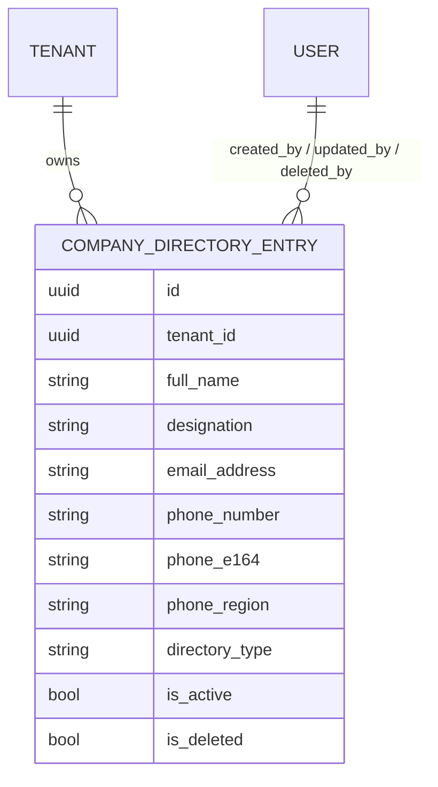

# Company Directory — Architecture & Data Model Plan

**Scope of this document:** architecture and the data model only. No serializers, viewsets,
URLs, or docs are designed here — those come in a separate API plan once this shape is agreed.

---

## 1. What this module is

A per-tenant **system of record for employee and management details**. Each row is one member
of staff: their name, what they do, and how to reach them.

The two `directory_type` values map directly onto that split — `OPERATIONS` for employees,
`EXECUTIVE` for management.

This is a records store, not a routing table. Nothing in the call path reads it (see §2).

This is deliberately *not* `Contact`:

| | `Contact` | `CompanyDirectoryEntry` |
| :--- | :--- | :--- |
| Who is in it | People the tenant calls **outbound** | The tenant's **own staff** |
| Identity key | `phone_e164` — "is this the same person calling in?" | Corporate email |
| Volume | Thousands, bulk-imported | Tens, hand-entered |
| Consent / DNC | Load-bearing (compliance) | Not applicable — these are employees |
| Lifecycle | Campaigns, suppression, call history | None. It is a flat list |

They will look similar in the admin. They are not the same thing and must not share a table:
suppressing a colleague for "do not call" is meaningless, and a campaign must never be able to
dial the directory.

---

## 2. Boundary — what this module does not do

Same honesty as the campaign plan: **this backend cannot place or transfer calls.** Nothing
here dials anyone.

Confirmed with you: the directory is for storing employee and management details, **not** for
the bot to escalate or warm-transfer live calls to. No agent, campaign, or call-routing code
reads this table. If that changes later it is a new integration, not an assumption baked in
here.

That decision shapes §7 — the phone number is validated so the *record* is correct, not so a
dialler can consume it.

---

## 3. Entity overview



One table. No relations beyond `tenant` and the audit users. That is the whole module — and
keeping it that way is the point. Every FK added here is a future `PROTECT` error when someone
tries to delete a colleague who left.

---

## 4. Base class: Tier 2 (`TenantBaseModel`)

Per `AGENTS.md` §1.

**Why Tier 2 and not Tier 1:** the module exposes a `DELETE` endpoint over records that hold a
named person's email and phone number. "Who removed the Head of Customer Relations, and when"
is a question that will eventually be asked. `TenantBaseModel` answers it for free via
`created_by` / `updated_by` / `deleted_by`. `Contact` is Tier 2 for the same reason; this is
consistent with it.

Inherited and **not** re-declared: `id` (UUID), `created_at`, `updated_at`, `deleted_at`,
`is_active`, `is_deleted`, `tenant`, the three audit FKs, and `soft_delete()` / `restore()` /
`activate()` / `deactivate()`.

---

## 5. The model

```python
# core/models/company_directory_entry.py

class CompanyDirectoryEntry(TenantBaseModel):
    class DirectoryType(models.TextChoices):
        OPERATIONS = "OPERATIONS", "Operations"
        EXECUTIVE  = "EXECUTIVE",  "Executive"

    full_name      = models.CharField(max_length=150)
    designation    = models.CharField(max_length=150)
    email_address  = models.EmailField(max_length=254)

    phone_number   = models.CharField(max_length=32)   # as typed, for display
    phone_e164     = models.CharField(max_length=20, db_index=True)
    phone_region   = models.CharField(max_length=2, blank=True)

    directory_type = models.CharField(
        max_length=20,
        choices=DirectoryType.choices,
        db_index=True,
    )
```

### Field-by-field rationale

| Field | Type | Required | Notes |
| :--- | :--- | :--- | :--- |
| `full_name` | `CharField(150)` | ✅ | **One field, not first/last.** See §6. |
| `designation` | `CharField(150)` | ✅ | Free text — "Head of Customer Relations". Deliberately *not* a lookup table; job titles are not a controlled vocabulary and a FK here buys nothing. |
| `email_address` | `EmailField(254)` | ✅ | The identity key. 254 matches `Contact` and the RFC limit. |
| `phone_number` | `CharField(32)` | ✅ | Raw, as typed. Preserved for display. |
| `phone_e164` | `CharField(20)` | derived | Never accepted from a client. See §7. |
| `phone_region` | `CharField(2)` | derived | ISO-3166 alpha-2, resolved during normalisation. |
| `directory_type` | `CharField(20)` | ✅ | `OPERATIONS` / `EXECUTIVE`. **`max_length=20`, not 10** — `"OPERATIONS"` is exactly 10 characters, so a tight bound means the next value added (`"CUSTOMER_SUCCESS"`) needs a schema migration instead of a one-line choices change. 20 is free. |
| `is_active` | inherited | — | "Currently reachable." Lets a tenant park someone on leave without deleting them and losing the audit row. |

### Meta

```python
class Meta:
    db_table = "core_company_directory_entry"
    verbose_name = "Company Directory Entry"
    verbose_name_plural = "Company Directory"
    ordering = ["-created_at"]
    constraints = [
        models.UniqueConstraint(
            Lower("email_address"),
            "tenant",
            condition=models.Q(is_deleted=False),
            name="unique_active_directory_email_tenant",
        ),
    ]
    indexes = [
        models.Index(fields=["tenant", "directory_type"]),
        models.Index(fields=["tenant", "phone_e164"]),
    ]
```

---

## 6. Design decisions worth arguing about

### 6.1 `full_name` as a single field ✅ recommended

The spec says "Full Name *". `Contact` splits into `first_name` / `last_name`, so there is a
pull toward consistency — but splitting is the wrong call here:

- Splitting is **lossy and guessy**. "Sarah Jenkins" is easy; "Maria del Carmen Rodríguez
  García" and mononymous names are not. Any split is a heuristic that will be wrong for real
  employees.
- `Contact` splits because bulk CSV import has separate columns to map. This module is
  hand-entered from a single text input.
- Nothing here needs the parts. There is no mail-merge, no "Dear {first_name}", no dedup
  matching on surname.

`Contact` also already exposes a `full_name` **property**, so read-side code that wants a
display name works identically across both models.

### 6.2 Uniqueness on email, not phone ✅ recommended

Partial-unique on `(tenant, lower(email_address))` where `is_deleted=False`.

- **Email is the right key.** Corporate email is one-per-person by construction, it is required
  here, and it is how a human would answer "have we already added Sarah?"
- **Phone must NOT be unique.** Several colleagues legitimately share one number — a
  switchboard, a department line, a desk extension, a shared mobile. A unique phone constraint
  would reject the second person on the ops desk, which is a normal, correct thing to enter.
- **Case-insensitive**, via `Lower()`, matching the `Campaign.name` constraint already in the
  codebase. `Sarah.Jenkins@co.com` and `sarah.jenkins@co.com` are the same mailbox and must
  collide.
- **Partial** (`is_deleted=False`), so soft-deleting someone does not permanently burn their
  email address if they rejoin.

**Consequence that must be handled:** because the constraint is partial, `restore()` can hit a
raw `IntegrityError` if the email was re-used while the row was deleted. `Contact.restore()`
already solves exactly this for phone — mirror it for email rather than leaving a 500 in the
admin.

### 6.3 Name validation — keep it minimal ⚠️

Recommendation: validate **length and non-blank-after-strip only**. Do *not* add a
`[A-Za-z\s\-]+` style pattern.

Strict name regexes are a well-known way to reject real people: `O'Brien`, `Jean-Luc`, `José`,
`Ng`, `van der Berg`, `Sr.`. The campaign module got away with a character-class rule because
it validates a *campaign name* — a label a user invents. A person's name is not something we
get to have opinions about.

Proposed: `full_name` 2–150 after strip; `designation` 2–150 after strip. That is it.

### 6.4 `directory_type` required, no default ✅ **confirmed**

The UI spec does not star it, but a directory entry with no category cannot be placed in the
grouped list the design describes. Required with **no default** forces the choice at creation
rather than silently filing everyone under whichever value I picked as default — which is how a
directory ends up with forty people all marked Operations.

`OPERATIONS` = employees, `EXECUTIVE` = management, matching how you described the module.

---

## 7. Phone handling — validate for record correctness

Store all three columns (`phone_number`, `phone_e164`, `phone_region`) and derive the last two
on `save()`, exactly as `Contact` does, using the existing `normalize_phone()` helper.

**The routing argument is gone** — you confirmed in §2 that nothing dials these people. So the
justification stands or falls on one thing: *is the stored number correct?*

For a system of record whose entire purpose is holding employee contact details, the phone
being right **is the product**. Without validation the table quietly accumulates `"ext. 402"`,
`"n/a"`, `"555-1234"` with no area code, and a transposed digit in the Head of Operations'
number that nobody notices until someone needs it. `normalize_phone()` rejects all of that at
entry, which is squarely in service of "store employee details" rather than any call feature.

`phone_e164` is then just the output of that validation, and costs one indexed column. It also
makes `+1 (555) 123-4567` and `+15551234567` recognisably the same number, so the directory can
be searched and deduplicated sensibly.

> If you would rather store the number as a plain unvalidated string, this is the one place to
> say so — it removes two columns and the `save()` override below. My recommendation is to keep
> the validation, but the routing rationale no longer supports it and I am not going to pretend
> it does.

The `save()` override should copy `Contact.save()`'s `update_fields` handling verbatim, so that
targeted housekeeping saves (`soft_delete`, `deactivate`, `restore`) skip re-normalisation.
Without that, a row whose number later becomes unparseable can never be deleted — it fails
validation on the way out. `Contact` already hit this; the comment on
[contact.py:136-140](core/models/contact.py#L136-L140) records why.

---

## 8. Deletion

Soft delete only, via the inherited `soft_delete()`. Nothing special:

- No lifecycle to guard (unlike `Campaign.soft_delete`, which refuses while live).
- No inbound FKs to `PROTECT`, because §3 keeps the table relation-free.
- `BaseQuerySet.delete()` already raises on bulk delete, so the API layer cannot bypass it.

If a `bulk_delete` action is exposed later it must loop and call `soft_delete()` per row — the
same guard the campaign API plan flagged.

---

## 9. Update — `PATCH` is in scope ✅ **confirmed**

The originally requested surface was **Listing, Create, Get by ID, Delete**, with no update.
That gap does not survive contact with §1: a **system of record for employee and management
details** is a thing whose contents change.

- A promotion is `designation` + `directory_type` changing on the *same person*. Without
  `PATCH` it is a delete and a re-add — new UUID, new `created_at`, and the promotion recorded
  in the audit trail as a departure.
- Someone changing desk or mobile number is an edit, not a new employee.
- Correcting `"Head of Custmer Relations"` should not destroy the record's history.

So the surface becomes **List / Create / Get by ID / Update / Delete**. `PATCH` is roughly ten
lines on top of what the model already provides and changes nothing in the schema — the model
below would have been identical either way.

`PUT` is deliberately *not* offered: full-replace semantics on a record with derived phone
columns invites a client to blank fields it did not intend to touch.

---

## 10. Files to be created / touched

| File | Change |
| :--- | :--- |
| `core/models/company_directory_entry.py` | **new** — the model |
| `core/models/__init__.py` | export `CompanyDirectoryEntry` |
| `core/admin/company_directory_entry_admin.py` | **new** — `TenantBaseAdmin`, per `AGENTS.md` §2 |
| `core/admin/__init__.py` | register the admin |
| `core/migrations/00XX_companydirectoryentry.py` | generated — one `CreateModel`, one constraint, two indexes |
| `core/tests/company_directory/` | **new** — `__init__.py` + `test_company_directory_model.py` |

Nothing existing is modified. This module adds only.

**Migration shape:** a single additive `CreateModel`. No changes to existing tables, no data
migration, no downtime consideration.

---

## 11. Model-level test coverage to write

1. Create with valid data → `phone_e164` / `phone_region` derived correctly.
2. Raw client-supplied `phone_e164` is overwritten, never trusted.
3. Invalid phone → `ValidationError` on `phone_number` (not a 500).
4. Duplicate email, same tenant, differing case → `IntegrityError`.
5. Duplicate email across **different** tenants → allowed.
6. Soft-delete then re-create with the same email → allowed.
7. `restore()` into a taken email → clean `ValidationError`, not `IntegrityError`.
8. Two entries sharing one phone number → allowed (§6.2).
9. `soft_delete()` / `deactivate()` on a row with a now-unparseable number → still works (§7).
10. `full_name` / `designation` length bounds; whitespace-only rejected.
11. `directory_type` restricted to the two choices.

> Note for whoever runs these: `full_clean()` must be called with
> `exclude=["created_by", "updated_by", "deleted_by"]` — `BaseModel` declares those `null=True`
> but not `blank=True`, so `full_clean()` fails on every Tier 2 model otherwise.

---

## 12. Decisions taken

| # | Decision | Outcome |
| :--- | :--- | :--- |
| 1 | What is the directory **for**? | **Storing employee and management details.** Not a routing table — nothing in the call path reads it (§2) |
| 2 | Model name | **`CompanyDirectoryEntry`**, table `core_company_directory_entry` (§5) |
| 3 | Ship `PATCH`? | **Yes** — follows from #1; a record store whose records cannot be corrected is not one (§9) |
| 4 | Is `directory_type` required? | **Yes, required, no default** (§6.4) |

### Still open

| # | Question | Default if you say nothing |
| :--- | :--- | :--- |
| 5 | Keep phone validation + `phone_e164`, now that the routing rationale is gone? (§7) | Keep it — a wrong number in an employee record is a defect in the thing being stored |
| 6 | Should the list group/filter by `directory_type` server-side, or does the UI split the rows? | Expose `?directory_type=` as a filter and let the UI group. Decided in the **API** plan, not here — no schema impact |
