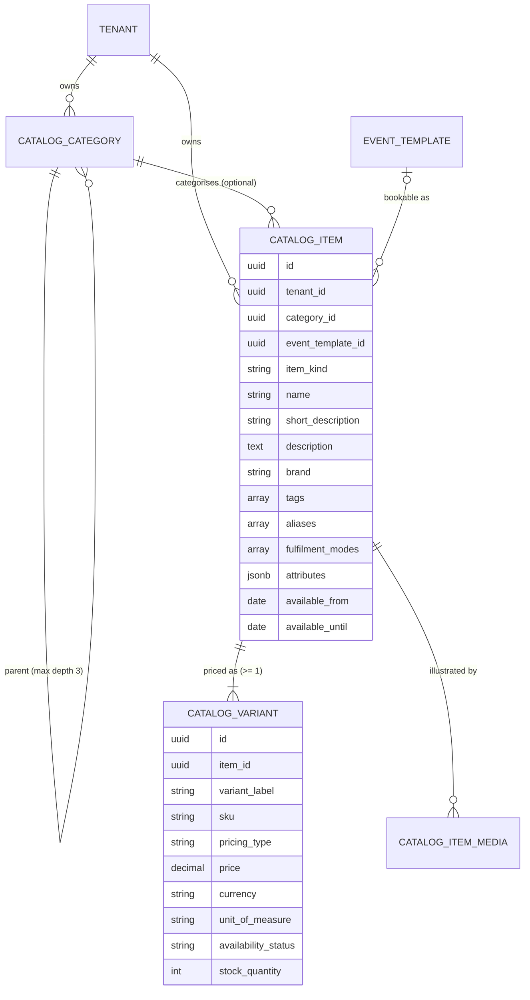

# Product & Service Catalog — Architecture & Data Model Plan

**Scope of this document:** architecture and the **data model only**. No serializers, viewsets,
URLs, admin, or API docs are designed here — those come in a separate API plan once this shape
is agreed. Same split as [company-directory-module-plan.md](company-directory-module-plan.md).

**Status:** design proposal. Field list needs your sign-off before any code is written.

---

## 1. What this module is

A per-tenant **system of record for everything the tenant sells** — goods, services, or both.
One place the tenant maintains, and the place any consumer asks "what does this business offer,
what does it cost, and can they supply it right now?"

The immediate consumer is the **voice agent**. Today a bot answering "how much is a dental
cleaning?" can only work from unstructured Knowledge Base text, which means the answer is
whatever the embedding retrieves — a price from a PDF written last year, if it retrieves at all.
A structured catalog turns that into a lookup with one right answer.

The requirement driving the design is explicit: **it must cover every kind of business product
and service**, not retail goods with services bolted on. §3 is the evidence that it does.

---

## 2. Boundary — what this module does **not** do

Stated up front, same honesty as the campaign and directory plans.

| Not in this module | Where it belongs |
| :--- | :--- |
| Orders, carts, checkout, invoices | Nowhere yet. This module never records a transaction. |
| Payments | `onboard` Razorpay integration is for the **tenant's subscription to us**, not the tenant's own commerce. Unrelated. |
| Inventory ledger / stock movements | `stock_quantity` is a **number the tenant states**, not a balance this module computes. Nothing decrements it. |
| Suppliers, purchase orders, cost price, margin | Out of scope. This is a sell-side catalog. |
| Multi-warehouse / per-location stock | Deferred (§13). Single stock number per variant. |
| Customer-specific or segment price lists | Deferred (§13). |
| Shipping, delivery zones, logistics | Out of scope. `fulfilment_modes` records *that* delivery exists, not how it is routed. |
| **Date-priced inventory — hotels, homestays, cinemas, ticketed events** | **Out of scope by decision, not deferred.** These need a rate-per-calendar-date table and per-date seat/room capacity. Confirmed as a vertical this product will not serve — see §3.1 gap 4. |
| Speaking, dialling, or answering | The voice runtime **reads** this catalog. Nothing here talks to a caller. |
| Booking a service | [`EventTemplate`](../../core/models/event_template.py) + `Booking` already own that. A service item **points at** an event template; it does not re-implement scheduling (D7). |

The single most important line: **this module stores facts, it does not enforce them.**
`min_order_quantity = 100` is a sentence the agent can say. No code rejects an order of 50,
because there are no orders.

---

## 3. Coverage matrix — "all types of business product and service"

This is the test the design has to pass. Each row is a real business, the row it would store,
and the fields that carry it. No row needs a schema change.

| Business type | Example catalog row | Carried by |
| :--- | :--- | :--- |
| **Retail / e-commerce** | "Nike Air Max" → Size 8 / 9 / 10, each with own SKU, price, stock | `item` + 3 `variants` + `sku` + `track_inventory` |
| **Restaurant** | "Paneer Butter Masala" → Half ₹220 / Full ₹380, veg, ready in 20 min | `variants.variant_label` + `attributes` (`{"veg": true, "spice": "medium"}`) + `lead_time_minutes` + `sort_order` |
| **Clinic / dental / diagnostics** | "Dental Cleaning" → SERVICE, 30 min, ₹1,500, bookable | `item_kind=SERVICE` + `event_template` FK + `pricing_type=FIXED` |
| **Agricultural supplier** | "Urea Fertilizer" → 1 kg / 5 kg / 50 kg bag, HSN code, stock per pack | `variants` + `unit_of_measure=KG` + `unit_label="50 kg bag"` + `tax_code` |
| **Real estate — sale** | "3 BHK, Andheri West" → ₹2.4 Cr or price on request | `pricing_type=FIXED\|ON_REQUEST` + `attributes` (`{"bhk": 3, "carpet_area_sqft": 1150, "furnishing": "semi"}`) |
| **Real estate — rent** | Same unit → ₹85,000 per month + 2 months deposit | `pricing_type=RECURRING`, `recurring_interval=MONTH`, `deposit_amount` |
| **Gym / SaaS / membership** | "Annual Membership" → ₹12,000 / year | `item_kind=SERVICE` + `pricing_type=RECURRING`, `interval=YEAR` |
| **Equipment / vehicle rental** | "JCB Excavator" → ₹2,500 per hour, ₹25,000 deposit, min 4 hours | `unit_of_measure=HOUR` + `deposit_amount` + `min_order_quantity` |
| **Consulting / agency / construction** | "Website Development" → from ₹50,000, scoped per project | `pricing_type=FROM` (or `ON_REQUEST`) |
| **Salon / spa** | "Haircut" → Adult ₹300 / Child ₹200 / Home visit ₹500 | `variants` + `fulfilment_modes=[AT_BUSINESS, AT_CUSTOMER]` |
| **Education / coaching** | "IELTS Crash Course" → 6 weeks, ₹25,000, 12 sessions | `unit_of_measure=SESSION` + `attributes` (`{"batch_size": 15, "level": "B2"}`) |
| **Digital goods** | "Recipe eBook" → ₹299, no stock, instant | `item_kind=DIGITAL_GOOD` + `track_inventory=False` |
| **Free / lead-gen offer** | "Free 15-min consultation" | `pricing_type=FREE` |
| **Wholesale / B2B** | "Cement, 50 kg" → ₹380/bag, min 100 bags, multiples of 10 | `min_order_quantity` + `quantity_increment` |
| **Seasonal** | "Mango Shake" → listed 1 Apr – 30 Jun only | `available_from` / `available_until` |
| **Packages / combos** | "Full Body Checkup" → 12 tests bundled | `item_kind=BUNDLE` (enum in P0; component table in P1 — D8) |
| **Insurance / loans / broking** | "Term Life Plan" → 0.9% per annum of sum insured; "Home Loan" → 8.4% p.a. | `pricing_type=RATE` + `unit_of_measure=PERCENT` + `unit_label` (§3.1 gap 1) |
| **Taxi / courier / freight** | "Airport Drop" → ₹50 base + ₹18 per km | `base_price` + `price` + `unit_of_measure=KM` (§3.1 gap 2) |
| **Repair / field service** | "AC Service Visit" → ₹300 visit charge + ₹150 per unit serviced | `base_price` + `price` + `unit_of_measure=PIECE` |
| **Restaurant / QSR add-ons** | "Extra Cheese +₹40", "Add Fries +₹60" on a burger | `item_kind=ADD_ON` + `add_on_items` M2M (§3.1 gap 3) |
| **Product attachments** | "2-Year Extended Warranty +₹1,999", "Installation +₹500" | Same — an add-on is an add-on whether it is food or a warranty |
| **Gym / salon peak pricing** | "Off-Peak Membership" ₹800/mo, "All-Access" ₹1,400/mo | Two `variants`. A fixed set of named rate buckets is exactly what variants are (§3.1 gap 4) |
| **Tour operator** | "Goa 3N/4D" → Peak season ₹18,000 / Off season ₹12,000 | Two `variants` + `unit_of_measure=NIGHT`, same reason |
| **School / college fees** | "Class 8 Annual Fee" → tuition + exam + lab + transport | ⚠️ Workaround: one item per component, or `BUNDLE` when it lands (§13) |
| **Pharmacy** | "Dolo 650" → strip of 15, ₹32, prescription required | Covered; batch/expiry tracking is deliberately out of scope (§3.1) |

Two things fall out of that table and become the spine of the design:

1. **Price and stock belong to the *variant*, never the item** (D2). Most rows above have more
   than one price for one nameable thing.
2. **"What it is" and "how it is charged" are different axes** (D3). A rented excavator is a
   physical good charged hourly; a monthly rent is a property charged recurringly. Collapsing
   these into one `type` field is what forces a schema change per new business model.

---

## 3.1 Gap audit — what the first draft did **not** cover

The matrix above was written forwards, from businesses I could think of, which is how coverage
claims get made and then quietly fail. So it was re-checked backwards: walk all 20 top-level
NAICS/ISIC sectors, and for each one try to break the schema.

Four gaps were real. Three are cheap and are now folded into the design above; one is a genuine
decision for you.

### Gap 1 — rate / percentage pricing ✅ **fixed (2 enum values)**

**Broke on:** insurance, loans, mutual funds, broking, commission agents, CAs on turnover-based
fees. A meaningful slice of the Indian inbound-call market — insurance agents and loan DSAs
practically *are* a phone business.

Their price is not an amount. It is `8.4% per annum`, `0.9% of sum insured`, `2% brokerage`.
The original `pricing_type` set could only record that as `ON_REQUEST`, which throws away the one
number the caller rang to ask for.

**Fix:** `pricing_type=RATE`, the number in `price`, `unit_of_measure=PERCENT`, and the basis in
`unit_label` ("% per annum of loan amount"). Two enum values, no new column.

> **Honest limit:** this lets the agent *quote a published rate*. It does not compute an
> insurance premium from age × sum insured × term — that is a quote engine, and it is out of
> scope. For those, the tenant uses `FROM` ("premiums start at ₹8,400/year") and the bot hands
> off. Better to say that here than to imply the schema solves underwriting.

### Gap 2 — composite pricing: base + per-unit ✅ **fixed (1 column)**

**Broke on:** taxis, courier, freight, movers, field repair, plumbers, electricians, event
hire — anything with a call-out charge, a base fare, or a minimum.

"₹50 base + ₹18 per km" and "₹300 visit charge + ₹150 per unit" are two numbers. The variant had
one. Squeezing it into `description` means the agent cannot quote it and nothing can compute it.

**Fix:** `base_price` on the variant. When set, the total reads `base_price + (price ×
quantity)`, and `price` is the per-unit rate. Null for every ordinary product, so nothing else
changes.

### Gap 3 — add-ons / modifiers ✅ **fixed (1 enum value + 1 M2M)**

**Broke on:** every restaurant and QSR ("extra cheese +₹40"), and just as hard on retail
("2-year extended warranty +₹1,999", "installation +₹500"), telecom ("add 50 GB"), travel ("add
airport transfer").

This is **not** a variant and **not** a bundle, which is why it was missed:

| | Variant | Bundle | Add-on |
| :--- | :--- | :--- | :--- |
| Question it answers | *Which one* do you want? | Buy these *together* as one line | What do you want *on top*? |
| Cardinality | Pick exactly 1 | Fixed contents | Pick 0..n |
| Example | Small / Medium / Large | Full Body Checkup = 12 tests | Extra cheese, warranty |

Modelling an add-on as a variant makes it mutually exclusive with the thing it modifies — you
cannot have Large *and* extra cheese. Modelling it as a bundle makes it mandatory.

**Fix:** `item_kind=ADD_ON` (so add-ons are excluded from the main listing by kind, not by a
convention) plus a self-referential `add_on_items` M2M on `CatalogItem`. Add-ons are priced
through their own variants like anything else, so "extra cheese" can itself have Regular/Double.

Deferred to P1: **modifier groups** with selection rules ("choose exactly 1 crust", "up to 3
toppings"). The flat M2M covers what to offer; the group covers how many you may pick. §13.

### Gap 4 — date-priced inventory ✅ **closed as out of scope (D11)**

**Would have broken on:** hotels and homestays (a rate per calendar date), cinemas and ticketed
events (a dated showing with 120 seats).

The schema stores **one price per variant, valid forever**. A hotel room does not have one
price — it has a rate for each date and availability per date. That is a different shape, not a
missing column: it needs a fifth table (`CatalogRateCalendar`), a most-specific-wins resolution
rule, and an overlap constraint, all of which are dead weight for every business that is not
date-priced.

**Confirmed with you: hotels, cinemas and ticketed events are verticals this product will never
serve.** So this is recorded in §2 as out of scope rather than in §13 as deferred — the
distinction matters, because "deferred" tells the next developer it is coming.

**What this does *not* give up.** The neighbouring cases the gap originally swept in are all
still covered, by variants:

| Case | How it is covered |
| :--- | :--- |
| Gym peak / off-peak | Two variants: "Off-Peak Membership", "All-Access" |
| Tour package season pricing | Two variants: "Peak season", "Off season" |
| Restaurant lunch buffet vs dinner buffet | Two variants |
| Seasonal listing (mango shake, Apr–Jun) | `available_from` / `available_until` on the item |

**The dividing line, stated so nobody tries to cross it later:** a **fixed set of named rate
buckets** is what variants are for. A **distinct rate per calendar date** is not — modelling a
hotel as 365 variants would technically save but produce an unusable catalog, and
`CATALOG_MAX_VARIANTS_PER_ITEM` (default 100) will stop it before it starts.

`unit_of_measure=NIGHT` stays in the enum. Banquet halls, marquees and equipment hired overnight
are all per-night without being date-priced.

### Considered and deliberately declined

Not gaps — decisions, so that "we didn't think of it" is not confused with "we thought about it
and said no".

| Case | Why not |
| :--- | :--- |
| **Batch / expiry / serial tracking** (pharmacy, electronics IMEI) | This is an ERP's job. Tracking expiry means tracking movements, which means a stock ledger — explicitly out of scope (§2). `attributes` can hold a note. |
| **"Includes 4 visits / 100 GB / 10 sessions"** | Would need `included_quantity` **and** `included_unit`, because the included unit differs from the pricing unit ("₹5,000 per YEAR, includes 4 VISITs"). Two columns for something `attributes` already holds and the agent reads from `short_description`. This is exactly the long tail `attributes` exists for (D4). |
| **Made-to-measure / formula pricing** (cut-to-size glass, tailoring, ₹/sq ft × dimensions) | Needs a formula evaluator. `unit_of_measure=SQ_FT` + a per-unit `price` covers the quote; the multiplication is the caller's or the agent's. |
| **Multi-seller / marketplace** | One tenant, one catalog. A different product. |
| **Auctions, exchange offers, barter** | `ON_REQUEST` and a human. |
| **Compatibility matrices** (this part fits that vehicle) | `attributes` + `tags`, thinly. A real fitment model is an auto-parts product of its own. |

### Verdict

Gaps 1–3 are folded into the design, and gap 4 is closed by scoping it out. **The schema now
expresses every sector this product intends to serve**, without a formula engine, an EAV, or a
per-vertical table.

Cost of getting there: **two columns, three enum values, one M2M — and one vertical
deliberately dropped.** The module stays at four tables.

Nothing in §3 is marked ⚠️ any longer except school fee breakup, which has a working shape
today (one item per component) rather than a missing one.

---

## 4. Naming

Proposed: **`CatalogItem`** / `CatalogVariant` / `CatalogCategory` / `CatalogItemMedia`,
tables `core_catalog_items`, `core_catalog_variants`, `core_catalog_categories`,
`core_catalog_item_media`.

- `Product` is wrong on its own — two thirds of the target businesses sell services.
- `ProductService` reads like a Java class and pluralises badly.
- `Offering` is accurate but unfamiliar; every frontend dev knows what a catalog is.
- The codebase names things for what they are (`DirectoryContact`, `EventTemplate`,
  `BusinessHours`), and "catalog" is the standing word for *the list of what a business sells*.

Open for your call — see §16.

---

## 5. Entity overview



Four tables. The only outbound FK beyond `tenant` and the audit users is `event_template`, and
it is `SET_NULL` — deleting a meeting type must never destroy a catalog row.

---

## 6. Base classes

Per [AGENTS.md](../../AGENTS.md) §1.

| Model | Tier | Base class | Why |
| :--- | :--- | :--- | :--- |
| `CatalogCategory` | 2 | `TenantBaseModel` | Renaming or removing a menu section reorganises the whole catalog. `updated_by` matters. |
| `CatalogItem` | 2 | `TenantBaseModel` | "Who delisted our best-selling product?" |
| `CatalogVariant` | 2 | `TenantBaseModel` | **Price lives here.** "Who set this to ₹1?" is the single question this module most has to be able to answer. Non-negotiable. |
| `CatalogItemMedia` | 1 | `TenantBaseModelCore` | Derivative of an audited parent; a mis-uploaded photo is not an incident. Matches `ContactImportFile`. |

Inherited and **not** re-declared anywhere below: `id` (UUID), `created_at`, `updated_at`,
`deleted_at`, `is_active`, `is_deleted`, `tenant`, the three audit FKs, and
`soft_delete()` / `restore()` / `activate()` / `deactivate()`.

`CatalogItem` deliberately does **not** extend
[`KBBaseModel`](../../core/common/models/kb_base_model.py) — see D10.

---

## 7. `CatalogCategory`

`core/models/catalog_category.py`

The tenant's own navigation tree — "Menu → Starters", "Services → Diagnostics". Self-nesting,
capped at 3 levels.

| Field | Type | Required | Notes |
| :--- | :--- | :--- | :--- |
| `name` | `CharField(150)` | ✅ | 2–150 after strip. No character-class regex — see D12. |
| `parent` | `FK(self, PROTECT, null)` | — | `null` = root category. `PROTECT` for the hard-delete path; the soft-delete path is guarded in §11. |
| `depth` | `PositiveSmallIntegerField` | derived | 0 for root. Stored, not computed: it makes the depth cap a cheap check and lets the tree render without recursive queries. Never client-writable. |
| `description` | `TextField(blank)` | — | Optional blurb. |
| `sort_order` | `PositiveIntegerField(default=0)` | — | Manual ordering. Restaurants care intensely about menu section order. |
| `is_active` | inherited | — | Hides the section without deleting it or its items. |

### Constraints

```python
constraints = [
    # Two constraints, not one, because Postgres treats NULLs as distinct in a unique
    # index: a single UniqueConstraint over (tenant, lower(name), parent) would happily
    # allow two root categories both called "Services".
    models.UniqueConstraint(
        Lower("name"), "tenant",
        condition=models.Q(is_deleted=False, parent__isnull=True),
        name="unique_active_root_catalog_category_tenant",
    ),
    models.UniqueConstraint(
        Lower("name"), "tenant", "parent",
        condition=models.Q(is_deleted=False, parent__isnull=False),
        name="unique_active_child_catalog_category_parent",
    ),
    models.CheckConstraint(
        condition=models.Q(depth__gte=0) & models.Q(depth__lte=2),
        name="catalog_category_depth_bounded",
    ),
]
indexes = [
    models.Index(fields=["tenant", "parent", "sort_order"]),
]
```

> The deployment runs `postgres:latest`, so `UniqueConstraint(..., nulls_distinct=False)`
> (Django 5+, PG 15+) would collapse those two into one. The two-constraint form is used anyway
> because it does not silently change behaviour if the image is ever pinned to an older major.

Case-insensitive via `Lower()`, matching the
[`Campaign.name`](../../core/models/campaign.py#L259) constraint. Partial on `is_deleted=False`,
so deleting a section does not permanently burn its name.

### `clean()`

1. `parent.tenant_id == self.tenant_id` — otherwise a tenant can graft its category under a
   stranger's tree by naming an id. Same class of hole as
   [`TenantSettings.clean()`](../../tenant/models/TenantSettings.py#L95).
2. No cycles: walk `parent` upward, refuse if `self.pk` reappears.
3. `depth = 0 if parent is None else parent.depth + 1`, refuse if `> 2`.

---

## 8. `CatalogItem`

`core/models/catalog_item.py`

The nameable, describable thing. **Not** the priceable thing.

| Field | Type | Required | Notes |
| :--- | :--- | :--- | :--- |
| `item_kind` | `CharField(20, choices)` | ✅ | `PHYSICAL_GOOD` / `DIGITAL_GOOD` / `SERVICE` / `BUNDLE` / `ADD_ON` / `OTHER`. **What it is, never how it is charged** (D3). `ADD_ON` exists so add-ons are excluded from the main listing by kind rather than by convention (§3.1 gap 3). `max_length=20` not 13 — `PHYSICAL_GOOD` is 13 chars, and a tight bound means the next value is a migration instead of a one-line change (the [`DirectoryContact.category`](../../core/models/directory_contact.py#L42) lesson). No default: forcing the choice is what stops a catalog filing everything under whatever I picked. |
| `category` | `FK(CatalogCategory, SET_NULL, null)` | — | Optional on purpose. A tenant must be able to add their first product before designing a taxonomy. `SET_NULL`, so removing a section orphans items rather than deleting them. |
| `name` | `CharField(200)` | ✅ | 2–200 after strip. **Not unique** — see D5. |
| `item_code` | `CharField(50, blank)` | — | The tenant's own reference ("PRD-1024"). Tenant-supplied, never auto-generated. Unique per tenant when non-blank. |
| `short_description` | `CharField(255, blank)` | — | **The one sentence the agent says out loud.** Distinct from `description` because a bot reading 800 words at a caller is a defect, and truncating prose mid-clause sounds broken. |
| `description` | `TextField(blank)` | — | Long form — dashboard, tenant website, and the RAG payload if D10 goes that way. |
| `brand` | `CharField(150, blank)` | — | Promoted out of `attributes` because it is both spoken and filtered. "Do you have Tata salt?" |
| `tags` | `ArrayField(CharField(50), default=list, blank)` | — | Cross-cutting labels ("bestseller", "organic"). GIN. Mirrors [`Contact.tags`](../../core/models/contact.py#L52). Count clamped in the serializer, not the DB. |
| `aliases` | `ArrayField(CharField(100), default=list, blank)` | — | **What callers actually say.** "coke" → "Coca-Cola 500 ml"; "teeth cleaning" → "Scaling & Polishing". ASR returns the caller's words, not the catalog's. Separate from `tags` because they do different jobs: tags categorise, aliases recognise. GIN. |
| `fulfilment_modes` | `ArrayField(CharField(20, choices), default=list, blank)` | — | `AT_BUSINESS` / `AT_CUSTOMER` / `REMOTE` / `DELIVERY` / `PICKUP` / `DINE_IN`. An array because a restaurant is genuinely all three of dine-in, delivery and pickup. "Do you do home visits?" is a top-five inbound question for salons, clinics and repair trades, and today nothing in the schema can answer it. |
| `attributes` | `JSONField(default=dict, blank)` | — | The industry-specific long tail — `{"bhk": 3, "carpet_area_sqft": 1150}`, `{"veg": true, "allergens": ["nuts"]}`. Byte cap enforced in the serializer. GIN (`jsonb_path_ops`). See D4 for why this is JSON and not columns or EAV. |
| `event_template` | `FK(core.EventTemplate, SET_NULL, null)` | — | Set → this service is bookable, and **duration, buffers, notice and horizon are read from the template, never duplicated here** (D7). |
| `add_on_items` | `M2M(self, symmetrical=False, blank, related_name="add_on_for")` | — | What may be added on top of this item — "extra cheese", "extended warranty", "airport transfer" (§3.1 gap 3). Targets should be `item_kind=ADD_ON`, validated in `clean()`, and are priced through their own variants like anything else. Not symmetrical: cheese goes on a burger, not the reverse. Selection rules ("choose exactly 1 crust") are P1 (§13). |
| `lead_time_minutes` | `PositiveIntegerField(null)` | — | How long until it can be handed over or started: restaurant prep time, made-to-order lead time, "ready in 2 days" (= 2880). Minutes throughout so there is one unit, not two. |
| `available_from` | `DateField(null)` | — | Seasonal listing window. Null = always. |
| `available_until` | `DateField(null)` | — | Null = indefinitely. |
| `pronunciation_hint` | `CharField(150, blank)` | — | TTS spelling for names the synthesiser mangles — "Xylo-Guard 5G", "Levocetirizine". The codebase already carries a [`CustomVoice`](../../core/models/custom_voice.py) model, so output quality is an accepted concern. **First candidate to cut** if the field list feels long (§14). |
| `is_featured` | `BooleanField(default=False)` | — | "What do you recommend?" needs an answer that is not "the most recently created row". |
| `sort_order` | `PositiveIntegerField(default=0)` | — | Manual ordering within a category. |
| `is_active` | inherited | — | **Listed and sellable.** The lever for delisting without losing history. |

### Constraints & indexes

```python
constraints = [
    models.UniqueConstraint(
        Lower("item_code"), "tenant",
        condition=models.Q(is_deleted=False) & ~models.Q(item_code=""),
        name="unique_active_catalog_item_code_tenant",
    ),
    models.CheckConstraint(
        condition=models.Q(available_until__isnull=True)
        | models.Q(available_from__isnull=True)
        | models.Q(available_until__gte=models.F("available_from")),
        name="catalog_item_availability_window_ordered",
    ),
]
indexes = [
    models.Index(fields=["tenant", "category", "sort_order"]),
    models.Index(fields=["tenant", "item_kind"]),
    models.Index(fields=["tenant", "is_active"]),
    GinIndex(fields=["tags"]),
    GinIndex(fields=["aliases"]),
    GinIndex(fields=["attributes"], name="catalog_item_attributes_gin"),
]
```

Partial **and** blank-excluding on `item_code`, both for the reason recorded on
[`DirectoryContact`](../../core/models/directory_contact.py#L94): excluding deleted rows stops a
removed item burning its code, and excluding `""` is what makes the field optional at all — two
empty strings collide under a plain unique constraint.

### `clean()`

1. `category.tenant_id == self.tenant_id`.
2. `event_template.tenant_id == self.tenant_id`.
3. `event_template` set → `item_kind` must be `SERVICE`. A bookable bag of fertilizer is a
   data-entry mistake, not a business model.
4. Every `add_on_items` target is same-tenant, has `item_kind=ADD_ON`, and is not `self`. M2M
   validation runs after the instance is saved, so this belongs in the serializer as well as
   `clean()` — `full_clean()` cannot see an unsaved M2M.

---

## 9. `CatalogVariant`

`core/models/catalog_variant.py`

**The priceable, sellable unit.** Every item has at least one; single-price items get one
auto-created default variant so that no consumer ever has to ask "does this item have variants,
or is the price on the parent?" (D2).

### Identity & structure

| Field | Type | Required | Notes |
| :--- | :--- | :--- | :--- |
| `item` | `FK(CatalogItem, CASCADE, related_name="variants")` | ✅ | Hard cascade: a variant has no meaning without its item. |
| `variant_label` | `CharField(120)` | ✅ | What makes this one different, **in the words the agent will say**: "Large", "50 kg bag", "Adult", "Home visit". Defaults to `"Standard"` for single-variant items. |
| `options` | `JSONField(default=dict, blank)` | — | The structured form of the same thing — `{"size": "L", "colour": "Red"}` — for filtering and grid UIs. Free-form in P0; a formal option/value model is P2 (§13). |
| `sku` | `CharField(64, blank)` | — | Optional: service businesses have none. Unique per tenant, case-insensitively, when non-blank. |
| `barcode` | `CharField(64, blank)` | — | EAN/UPC/GTIN. **Deliberately not unique** — two tenants, and even two rows, can legitimately resell the same barcoded product. |
| `is_default` | `BooleanField(default=False)` | — | The one quoted when the caller does not specify. At most one per item, enforced in the DB. |
| `sort_order` | `PositiveIntegerField(default=0)` | — | Small before Large, not alphabetical. |
| `is_active` | inherited | — | Retire one size without touching the others. |

### Pricing

| Field | Type | Required | Notes |
| :--- | :--- | :--- | :--- |
| `pricing_type` | `CharField(20, choices)` | ✅ | `FIXED` / `FROM` / `RANGE` / `RECURRING` / `RATE` / `ON_REQUEST` / `FREE`. **How it is charged** — the second axis (D3). Default `FIXED`. `RATE` is percentage pricing — interest, brokerage, commission (§3.1 gap 1). |
| `price` | `DecimalField(14, 2, null)` | conditional | Required for `FIXED`, `FROM`, `RECURRING`, `RATE`. Null for `ON_REQUEST`. **When `base_price` is set this is the per-unit rate**, not the total. For `RATE` it holds the percentage. `max_digits=14` survives a property in INR and a car in IDR; `Plan.base_price` uses `(10, 2)`, which caps at ~₹99 lakh and would reject a real-estate row. |
| `base_price` | `DecimalField(14, 2, null)` | — | The fixed component of a composite price — call-out charge, base fare, minimum (§3.1 gap 2). Total reads `base_price + (price × quantity)`. Null for every ordinary product, which is most of them. |
| `max_price` | `DecimalField(14, 2, null)` | conditional | Upper bound for `RANGE`. Null otherwise. |
| `compare_at_price` | `DecimalField(14, 2, null)` | — | MRP / strike-through, so a discount is expressible without a separate promotions model. |
| `currency` | `CharField(3)` | ✅ | ISO-4217, uppercase, validated by regex. Default from `CATALOG_DEFAULT_CURRENCY` (`INR`). **Not a `TextChoices`** — baking a currency list into a migration has the same problem the [`BusinessHours.timezone`](../../core/models/business_hours.py#L44) comment records for timezones. |
| `unit_of_measure` | `CharField(20, choices)` | ✅ | Default `PIECE`. Count: `PIECE` / `DOZEN` / `PACK` / `BOX`. Weight & volume: `GRAM` / `KG` / `QUINTAL` / `TONNE` / `ML` / `LITRE`. Distance & area: `METRE` / `KM` / `SQ_FT` / `SQ_METRE` / `ACRE`. Time: `MINUTE` / `HOUR` / `DAY` / `NIGHT` / `WEEK` / `MONTH` / `YEAR`. Service: `SESSION` / `VISIT` / `TRIP` / `PERSON`. Rate: `PERCENT`. Escape hatch: `OTHER`. Deliberately generous — `KM` (taxi, §3.1 gap 2), `PERCENT` (finance, gap 1), `QUINTAL` / `ACRE` (agri) were all missing from the first draft. Adding a value later is an `AlterField` with no data change, but every omission is a business that cannot be listed today. |
| `unit_label` | `CharField(50, blank)` | — | The words for the invoice line and the sentence: "per 50 kg bag", "per plate", "per night", "% per annum of loan amount". `unit_of_measure` is for logic; this is for humans and TTS. Falls back to the choice's display label. |
| `recurring_interval` | `CharField(10, choices, null)` | conditional | `DAY` / `WEEK` / `MONTH` / `QUARTER` / `YEAR`. Required for `RECURRING`, must be null otherwise. |
| `recurring_interval_count` | `PositiveSmallIntegerField(default=1)` | — | "every 3 months" = `MONTH` × 3. |
| `deposit_amount` | `DecimalField(14, 2, null)` | — | Refundable deposit — equipment rental, rented property, event hire. Without it, rentals cannot be quoted honestly. |
| `duration_minutes` | `PositiveSmallIntegerField(null)` | conditional | Display duration for a service that is **not** wired to an `EventTemplate`. **Must be null when `item.event_template` is set** — one source of truth for duration (D7). |
| `tax_rate_percentage` | `DecimalField(5, 2, null)` | — | 0–100. `(5, 2)` matches [`Plan.tax_percentage`](../../onboard/models/plan.py#L60). |
| `is_tax_inclusive` | `BooleanField(default=True)` | — | Default `True` for the Indian MRP convention: the number the tenant types is the number the caller pays. A wrong default here means every quoted price is wrong by 18%. |
| `tax_code` | `CharField(20, blank)` | — | HSN (goods) / SAC (services). Free text, not validated against a code list — those change and this module is not a tax engine. |

### Availability

| Field | Type | Required | Notes |
| :--- | :--- | :--- | :--- |
| `availability_status` | `CharField(20, choices)` | ✅ | `IN_STOCK` / `LOW_STOCK` / `OUT_OF_STOCK` / `PREORDER` / `MADE_TO_ORDER` / `SEASONAL` / `DISCONTINUED`. Default `IN_STOCK`. Stated by the tenant, **never derived from `stock_quantity`** — the two disagree constantly in practice ("we have 3 left but they're reserved"), and a derived column would silently overwrite what the tenant said. |
| `track_inventory` | `BooleanField(default=False)` | — | Default `False`: most services and a good share of goods are not counted. Opt in, so `stock_quantity=0` never means "out of stock" for a haircut. |
| `stock_quantity` | `IntegerField(null)` | — | Meaningful only when `track_inventory`. `>= 0`. **Nothing in this module changes it** (§2). |
| `low_stock_threshold` | `PositiveIntegerField(null)` | — | Where `LOW_STOCK` starts, for the tenant's own dashboard. |
| `min_order_quantity` | `DecimalField(12, 3, null)` | — | Wholesale minimums. Decimal because "minimum 0.5 kg" is real. |
| `quantity_increment` | `DecimalField(12, 3, null)` | — | "sold in multiples of 10". |

### Constraints

```python
constraints = [
    models.UniqueConstraint(
        Lower("sku"), "tenant",
        condition=models.Q(is_deleted=False) & ~models.Q(sku=""),
        name="unique_active_catalog_variant_sku_tenant",
    ),
    # At most one default per item. "At least one" cannot be a DB constraint (the first
    # variant would be unsavable) and is enforced in the write path instead.
    models.UniqueConstraint(
        fields=["item"],
        condition=models.Q(is_deleted=False, is_default=True),
        name="unique_default_catalog_variant_per_item",
    ),
    # Money is never negative, in the database, not just the serializer — a management
    # command or data fix must not be able to write -₹500.
    models.CheckConstraint(
        condition=models.Q(price__isnull=True) | models.Q(price__gte=0),
        name="catalog_variant_price_non_negative",
    ),
    models.CheckConstraint(
        condition=models.Q(base_price__isnull=True) | models.Q(base_price__gte=0),
        name="catalog_variant_base_price_non_negative",
    ),
    # A percentage is bounded even though a price is not. 8.4% p.a. is a loan;
    # 840% is a typo that would be read out to a caller as fact.
    models.CheckConstraint(
        condition=~models.Q(pricing_type="RATE")
        | (models.Q(price__gte=0) & models.Q(price__lte=100)),
        name="catalog_variant_rate_bounded",
    ),
    models.CheckConstraint(
        condition=models.Q(max_price__isnull=True)
        | models.Q(price__isnull=True)
        | models.Q(max_price__gte=models.F("price")),
        name="catalog_variant_price_range_ordered",
    ),
    # pricing_type coherence: the shape of the row must match what it claims to be.
    models.CheckConstraint(
        condition=(
            ~models.Q(pricing_type__in=["FIXED", "FROM", "RECURRING", "RATE"])
            | models.Q(price__isnull=False)
        ),
        name="catalog_variant_price_required_when_priced",
    ),
    models.CheckConstraint(
        condition=(
            models.Q(pricing_type="RECURRING", recurring_interval__isnull=False)
            | (~models.Q(pricing_type="RECURRING") & models.Q(recurring_interval__isnull=True))
        ),
        name="catalog_variant_recurring_interval_coherent",
    ),
    models.CheckConstraint(
        condition=~models.Q(pricing_type="RANGE") | models.Q(max_price__isnull=False),
        name="catalog_variant_range_requires_max",
    ),
    models.CheckConstraint(
        condition=models.Q(stock_quantity__isnull=True) | models.Q(stock_quantity__gte=0),
        name="catalog_variant_stock_non_negative",
    ),
    models.CheckConstraint(
        condition=models.Q(tax_rate_percentage__isnull=True)
        | (models.Q(tax_rate_percentage__gte=0) & models.Q(tax_rate_percentage__lte=100)),
        name="catalog_variant_tax_rate_bounded",
    ),
]
indexes = [
    models.Index(fields=["item", "sort_order"]),
    models.Index(fields=["tenant", "sku"]),
    models.Index(fields=["tenant", "availability_status"]),
]
```

The `pricing_type` coherence checks are in the **database**, not only the serializer, for the
same reason [`EventTemplate`](../../core/models/event_template.py#L129) puts its bounds there: a
`RECURRING` price with no interval is a row the agent cannot read out, and the next writer of
this table will be a bulk importer or a data fix, not the API.

### `clean()`

1. `item.tenant_id == self.tenant_id`.
2. `duration_minutes` must be null when `item.event_template_id` is set (D7).
3. `stock_quantity` must be null when `track_inventory=False` — one representation, so nothing
   can be both untracked and holding a count.

### Properties

- `is_quotable` — `pricing_type != ON_REQUEST`.
- `is_sellable` — `is_active and availability_status not in {OUT_OF_STOCK, DISCONTINUED}`, and,
  when `track_inventory`, `stock_quantity > 0`. **The single method the voice runtime should
  call**, so "can we sell this?" has one definition rather than one per consumer.
- `display_price` — the string form, with base component, interval and unit folded in: "₹2,500
  per hour", "₹50 base + ₹18 per km", "8.4% per annum of loan amount", "from ₹50,000", "price on
  request". Voice and dashboard must not each invent their own formatting, and the composite and
  rate shapes (§3.1 gaps 1–2) are exactly where two implementations would diverge.

---

## 10. `CatalogItemMedia`

`core/models/catalog_item_media.py` — Tier 1 Core.

| Field | Type | Notes |
| :--- | :--- | :--- |
| `item` | `FK(CatalogItem, CASCADE, related_name="media")` | |
| `media_type` | `CharField(20, choices)` | `IMAGE` / `VIDEO` / `DOCUMENT` (spec sheet, brochure, lab report). |
| `file` | `FileField(upload_to=..., max_length=500)` | Key is `t-{tenant_id}/catalog/{item_id}/{uuid}{ext}`, matching [`kb_file_upload_path`](../../core/models/knowledge_base.py#L12). |
| `original_name` | `CharField(255, blank)` | Sanitised — basename only, no path separators or control characters. |
| `extension` | `CharField(10, blank)` | |
| `file_size_in_bytes` | `BigIntegerField(default=0)` | |
| `upload_status` | `CharField(10, choices)` | `PENDING` / `CONFIRMED` / `FAILED`. |
| `alt_text` | `CharField(255, blank)` | Accessibility, and the caption a chat channel would show. |
| `is_primary` | `BooleanField(default=False)` | At most one per item, partial unique. |
| `sort_order` | `PositiveIntegerField(default=0)` | Gallery order. |

**Upload flow is stateful from day one.** `request-upload-url` creates the row `PENDING` and
returns `{media_id, upload_url}`; `confirm-upload` accepts `media_id` and reads the key from the
tenant-scoped row. The object key never crosses the wire. This is D2 of the
[contact module plan](contact-module-plan.md#2-decisions-locked), and §21 of that document is the
record of what the stateless `object_key` pattern cost in Knowledge Base and Call Recordings —
a cross-tenant read *and* a cross-tenant delete. That mistake is not being repeated in a new
module.

The API design belongs in the API plan; it is stated here because it constrains the model
(`upload_status` exists for this reason and no other).

**This whole table is droppable to P1** with zero impact on the other three — the only lever in
this plan that removes a table without changing a design decision (§14).

---

## 11. Soft delete & lifecycle

Inherited `soft_delete()` everywhere, with two guards.

**`CatalogCategory.soft_delete()`** refuses while it has active child categories or active
items, naming the count. Modelled on
[`EventTemplate.soft_delete()`](../../core/models/event_template.py#L145): `PROTECT` on the FK
cannot cover it, because the row is soft-deleted and the database constraint never fires — the
items would be left pointing at a category the UI no longer lists. The check runs in the model,
not the viewset, so `bulk_delete` and a shell session get it too.

**`CatalogItem.soft_delete()`** cascades to its variants and media. A variant of a delisted item
being still `is_active=True` is exactly the sort of orphan that later gets quoted at a caller.

**`restore()` must be overridden on `CatalogItem` and `CatalogVariant`.** Both uniqueness
constraints are partial, so `item_code` / `sku` can be taken while the row sits deleted, and a
plain restore raises a raw `IntegrityError` out of the admin.
[`Contact.restore()`](../../core/models/contact.py#L149) already solves this shape for phone
numbers — mirror it, with a clean `ValidationError`.

No name-suffixing dance is needed on delete (unlike `Agent`, `EventTemplate`, `KnowledgeBase`),
because `name` is not unique here (D5). Only `item_code` and `sku` are, and those are optional
and blank-excluded, so a deleted row holding one is a real clash worth reporting rather than
silently mangling.

---

## 12. Settings (`config/settings/base.py`)

```python
# Product & Service Catalog
CATALOG_DEFAULT_CURRENCY       = env.str("CATALOG_DEFAULT_CURRENCY", default="INR")
CATALOG_MAX_CATEGORY_DEPTH     = env.int("CATALOG_MAX_CATEGORY_DEPTH", default=3)
CATALOG_MAX_VARIANTS_PER_ITEM  = env.int("CATALOG_MAX_VARIANTS_PER_ITEM", default=100)
CATALOG_MAX_TAGS_PER_ITEM      = env.int("CATALOG_MAX_TAGS_PER_ITEM", default=25)
CATALOG_MAX_ALIASES_PER_ITEM   = env.int("CATALOG_MAX_ALIASES_PER_ITEM", default=25)
CATALOG_MAX_ATTRIBUTE_BYTES    = env.int("CATALOG_MAX_ATTRIBUTE_BYTES", default=8192)
CATALOG_MAX_MEDIA_PER_ITEM     = env.int("CATALOG_MAX_MEDIA_PER_ITEM", default=10)
```

Follows [contact-module-plan §4](contact-module-plan.md#4-settings-configsettingsbasepy). The
caps on `attributes`, `tags` and `aliases` are enforced in the serializer — a JSON column with no
byte ceiling is an unbounded write a tenant can perform on themselves, the same reasoning that
put `MAX_HORIZON_DAYS` on `EventTemplate`.

---

## 13. Deliberately deferred

Named so it is clear these were considered, not missed. None requires reworking the four tables
above; each is additive.

Note the difference from §2: things listed **there** are out of scope and are not coming. Things
listed **here** are coming, when something needs them.

| Deferred | Shape when it lands | Why not now |
| :--- | :--- | :--- |
| **Bundle components** | `CatalogBundleComponent(bundle_variant, component_variant, quantity)` | `item_kind=BUNDLE` is in the enum from day one, so the table is purely additive. Needs a recursion guard (a bundle containing itself) — real work, no consumer yet. **D8.** |
| **Modifier groups** | `CatalogAddOnGroup(item, name, min_select, max_select)` + membership | The flat `add_on_items` M2M records *what* may be added; a group records *how many you may pick* ("exactly 1 crust", "up to 3 toppings"). Needed for a self-service ordering UI, not for a bot that reads the options out. |
| **Fee components** | Reuse `BUNDLE`, or a `CatalogFeeComponent` child table | School fees and hospital bills break into tuition / exam / lab / transport. Workaround today is one item per component; acceptable because each component is separately priced and separately quotable anyway. |
| **Volume / slab pricing** | `CatalogPriceTier(variant, min_quantity, unit_price)` | "₹380/bag up to 99, ₹350 above" — wholesale-only, and the flat price already covers the stated case. |
| **Tenant-defined attribute schema** | `CatalogAttributeDefinition(tenant, item_kind, key, data_type, choices, is_required)` | Turns `attributes` from free JSON into a validated, UI-renderable form. The right end state (D4) but a module of its own. |
| **Structured variant options** | `CatalogOption` / `CatalogOptionValue` (Shopify-style) | `variant_label` + `options` JSON covers the case; three tables to generate a size × colour grid is not worth it until a UI needs it. |
| **Per-location stock** | `CatalogVariantStock(variant, location, quantity)` | There is no location model yet. |
| **Segment / customer price lists** | `CatalogPriceList` + membership | No customer-tier concept exists. |
| **Per-agent catalog scoping** | `Agent.catalog_items` M2M, or a `visibility` field | In P0 the whole tenant catalog is visible to all its agents. Add when a tenant actually runs a sales bot and a support bot that must see different lists. |
| **Physical dimensions / weight** | `weight_grams`, `length/width/height_mm` | Only needed for shipping rates, which are out of scope. `unit_label` already carries "50 kg bag" for speech. |
| **Trigram search index** | `pg_trgm` + `GinIndex(opclasses=["gin_trgm_ops"])` | `?search=` via `icontains` is fine at catalog scale (hundreds to low thousands of rows). Needs a `CREATE EXTENSION` migration; revisit if a tenant loads 50k SKUs. |
| **Bulk CSV import** | Reuse the `ContactImport*` pipeline shape | A 5,000-SKU catalog will need it. Entirely separate module, and it should be built against a settled schema. |

---

## 14. Trim list — if the field count feels high

The design is 4 tables / ~62 columns for sixteen business models. If you want it leaner, these
are the fields I would cut first, in order, and what each costs:

| Cut | Cost |
| :--- | :--- |
| `pronunciation_hint` | TTS mangles some product names. Add later; one nullable column. |
| `compare_at_price` | No strike-through / "was ₹X" without it. |
| `quantity_increment` | "multiples of 10" becomes free text in `description`. |
| `low_stock_threshold` | Tenant's own dashboard loses a warning line. |
| `barcode` | No scanner workflow later without a migration. |
| `CatalogItemMedia` (whole table) | No images. Biggest single reduction; zero impact on the other three tables (§10). |

I would **not** cut: `aliases`, `fulfilment_modes`, `short_description`, `attributes`,
`deposit_amount`, `base_price`, `add_on_items`, or anything else in the pricing block. Each is
load-bearing for at least two rows of the §3 matrix, `base_price` and `add_on_items` are two of
the three §3.1 gap fixes, and `aliases` + `short_description` are the two fields that make this a
*voicebot* catalog rather than a generic one.

---

## 15. Model-level test coverage to write

Run with `--settings=config.settings.test_postgres` — `ArrayField`, `JSONField` GIN and the
`Lower()` constraints are all Postgres-only, and the default SQLite test DB cannot create them.

> `full_clean()` must be called with `exclude=["created_by", "updated_by", "deleted_by"]`.
> `BaseModel` declares those `null=True` but not `blank=True`, so `full_clean()` fails on every
> Tier 2 model otherwise.

**Category**
1. Root uniqueness is case-insensitive per tenant; **two root categories with the same name are
   rejected** (the NULL-parent trap in §7).
2. Same name under two different parents is allowed.
3. Same name in two different tenants is allowed.
4. `depth` derived correctly at each level; a 4th level is rejected.
5. Cycle (`A → B → A`) rejected with `ValidationError`, not infinite recursion.
6. Cross-tenant `parent` rejected.
7. `soft_delete()` refuses while active children or items exist; succeeds once they are gone.

**Item**
8. Create with only the required fields (`item_kind`, `name`, one variant) succeeds — the
   "tenant adds their first product before designing a taxonomy" path.
9. Duplicate `item_code`, same tenant, differing case → `IntegrityError` (in `transaction.atomic()`).
10. Two items with the **same name** → allowed (D5).
11. Blank `item_code` on many rows → allowed (blank-excluded constraint).
12. Soft-delete then re-create with the same `item_code` → allowed; `restore()` into a taken
    code → clean `ValidationError`.
13. Cross-tenant `category` and cross-tenant `event_template` both rejected.
14. `event_template` set with `item_kind=PHYSICAL_GOOD` → rejected.
15. `available_until` before `available_from` → rejected by the check constraint.
16. `attributes` round-trips nested JSON; queryable by key.

**Variant**
17. Second `is_default=True` on the same item → `IntegrityError`; allowed on a different item.
18. Negative `price`, negative `stock_quantity`, `tax_rate_percentage=101` → all rejected **at
    the database level** (write via `.update()` / raw to prove the serializer is not what is
    holding the line).
19. `pricing_type=FIXED` with `price=None` → rejected.
20. `pricing_type=RECURRING` with no `recurring_interval` → rejected; and `recurring_interval`
    set on a `FIXED` row → rejected.
21. `pricing_type=RANGE` with no `max_price` → rejected; `max_price < price` → rejected.
22. `pricing_type=ON_REQUEST` with `price=None` → **accepted** (the quote-based case must work).
22a. `pricing_type=RATE` with `price=8.4`, `unit=PERCENT` → accepted; `price=840` → rejected by
    `catalog_variant_rate_bounded` (§3.1 gap 1).
22b. `base_price=50`, `price=18`, `unit=KM` → accepted; negative `base_price` → rejected at the
    database level (§3.1 gap 2).
23. `duration_minutes` set while the parent has an `event_template` → rejected (D7).
24. `stock_quantity` set while `track_inventory=False` → rejected.
25. Duplicate `sku` case-insensitively per tenant → rejected; same `sku` across tenants → allowed.
26. `is_sellable` across the matrix: inactive, `OUT_OF_STOCK`, tracked-and-zero,
    tracked-and-positive, untracked.
27. Deleting the item cascades variants; `soft_delete()` on the item deactivates them.

**Add-ons (§3.1 gap 3)**
28. An `ADD_ON` item attached to a burger; the burger's `add_on_for` reverse is empty and the
    add-on's is not — the relation is not symmetrical.
29. Attaching a non-`ADD_ON` item as an add-on → rejected.
30. Attaching an item to itself → rejected.
31. Cross-tenant add-on → rejected.
32. An add-on with its own variants (Regular / Double cheese) prices correctly.

**Cross-model**
33. **Every row of the §3 matrix constructs and reads back correctly, including the rows added
    by the gap audit.** This is the actual acceptance test for "covers all business types" and
    should be data-driven — a list of fixtures, not twenty-five hand-written tests — so that
    answering Q7 later means appending a fixture, and so that a regression shows up as *"the
    insurance row no longer builds"* rather than as a failed assertion with no business
    attached to it.

---

## 16. Decisions

### Taken (my recommendation — say so if you disagree)

| # | Decision | Rationale |
| :--- | :--- | :--- |
| **D1** | **One `CatalogItem` table with an `item_kind` discriminator**, not separate `Product` and `Service` tables. | ~90% of the fields are shared. Separate tables means every consumer does two queries and a union, a bundle cannot mix the two, and a restaurant's "home delivery" line has no home. Kind-specific coherence is enforced by check constraints instead (§9). |
| **D2** | **Price and stock live on `CatalogVariant`. Every item has ≥ 1 variant, auto-created as `Standard` when the tenant defines no options.** | Eleven of the sixteen §3 rows have several prices for one nameable thing. The alternative — price on the item, optional variants that override — means two places to read a price from, every consumer branching, and eventually the agent quoting the wrong one. Always-a-variant costs one join and removes the branch. |
| **D3** | **`item_kind` = what it is; `pricing_type` + `unit_of_measure` + `recurring_interval` = how it is charged.** Two independent axes. | A rented excavator is a physical good charged hourly. A monthly rent is a property charged recurringly. A gym membership is a service charged yearly. One combined `type` enum needs a new value — and a migration — for every new business model. |
| **D4** | **Industry-specific fields go in a JSON `attributes` column**, with `brand`, `unit_of_measure` and `fulfilment_modes` promoted to real columns because they are filtered and spoken. | Columns for BHK + carpet area + allergens + spice level + dosage + batch size is unbounded. EAV is three tables and a join per attribute. The codebase already uses `JSONField` for exactly this kind of open shape (`Agent.languages`, `transfer_destinations`, `ContactImportRow.raw_data`), and Postgres GIN makes it queryable. The honest cost: nothing validates the keys, so a tenant can write `{"bhk": "three"}`. Mitigated by the promoted columns, a byte cap, and `CatalogAttributeDefinition` as the P1 exit (§13). |
| **D5** | **`name` is not unique.** Uniqueness lives on `item_code` and `sku`, both optional. | A departure from the house pattern (`Agent`, `EventTemplate`, `Campaign`, `KnowledgeBase` all unique-name), so it needs justifying: those are *configuration objects a user names*. A catalog is a *data set*, and "Basmati Rice 5 kg" from two brands is a correct pair of rows, not a bug. Accidental double-entry gets a serializer-level "possible duplicate" warning in the API plan, not a constraint that blocks legitimate data. |
| **D6** | **`availability_status` is stated by the tenant, never derived from `stock_quantity`.** | They disagree constantly in reality — "3 left but all reserved", "out of stock but taking pre-orders". A derived column silently overwrites what the tenant said. `is_sellable` combines them at read time instead, in one place. |
| **D7** | **A bookable service points at an `EventTemplate`; scheduling rules are never duplicated.** If `event_template` is set, `duration_minutes` must be null. | `EventTemplate` already owns duration, buffers, notice, horizon, granularity and assignment strategy, and `Booking` depends on it. Two durations that can disagree is a bug that surfaces as a double-booked host. The nullable `duration_minutes` exists only so a barber can list "Haircut — 30 min" without configuring a bookable event type. |
| **D8** | **`BUNDLE` is in the `item_kind` enum in P0; the component table lands in P1.** | The enum value is free now and a migration later. The table needs a self-reference recursion guard and has no consumer yet. |
| **D9** | **Tier 2 (`TenantBaseModel`) for category, item and variant; Tier 1 Core for media.** | "Who changed this price?" is the question this module most has to answer. Media is derivative of an audited parent. |
| **D10** | **`CatalogItem` does not extend `KBBaseModel`. The catalog is a live structured lookup, not RAG content.** | Prices and stock change. An embedding quoting last month's price is worse than no answer, because it is confidently wrong and there is no way to tell. The agent should read this table at conversation time. Inheriting `KBBaseModel` would also add nine ETL columns to a table where most rows never use them. **If you want semantic search over long `description` text, that is a `sync_to_knowledge_base` flag + a nullable `KnowledgeBase` FK in P1 — descriptive text only, never price or stock.** Flagged as an open question below because it is the one decision that changes a base class. |
| **D11** | **Date-priced inventory is out of scope permanently. No `CatalogRateCalendar`, no per-date capacity. Hotels, homestays, cinemas and ticketed events are not served.** *(Your call — Q8 answered.)* | Confirmed as a vertical this product will never cover, so it belongs in §2 (out of scope) rather than §13 (deferred) — a developer reading "deferred" would plan for it. The module stays at four tables and pricing stays flat, which keeps `display_price`, the check constraints and every consumer simpler than they would otherwise be. The adjacent cases the gap appeared to sweep in — gym peak/off-peak, tour season pricing, lunch vs dinner buffet — are all **fixed rate buckets** and are handled by variants (§3.1 gap 4). |

### Open — your call

| # | Question | Default if you say nothing |
| :--- | :--- | :--- |
| **Q1** | **Naming.** `CatalogItem` / `CatalogVariant` / `CatalogCategory`, or `Product` / `ProductVariant` (with services stored as products), or `Offering`? | `CatalogItem` (§4). |
| **Q2** | **Does the voice agent need semantic/RAG search over the catalog, or is structured lookup enough for now?** This is D10 and it decides a base class. | Structured lookup only in P0. `sync_to_knowledge_base` as a P1 hook. |
| **Q3** | **Ship `CatalogItemMedia` in P0, or defer images to P1?** | Ship it — additive, and a tenant asks for product photos on day two. Cut it if you want the smallest possible first migration (§14). |
| **Q4** | **Is `category` optional (my proposal) or required?** | Optional. Requiring it forces a taxonomy decision before the tenant has added anything. |
| **Q5** | **Category depth cap: 3 levels?** | 3. Deeper trees are a UI problem long before they are a data problem. |
| **Q6** | **Multi-currency per tenant, or one currency per tenant?** `currency` sits on the variant either way; the question is whether the API lets it vary. | Allow it to vary (the column exists), default every row from `CATALOG_DEFAULT_CURRENCY`. No cross-variant consistency constraint. |
| **Q7** | **Any business type in §3 missing, or a field your tenants need that is not there?** This is the one to answer carefully — it is much cheaper now than after the migration. | Ship §3 + §3.1 as the covered set. |

**Q8 (date-priced verticals) is answered and closed — see D11.**

---

## 17. Files to be created / touched

| File | Change |
| :--- | :--- |
| `core/models/catalog_category.py` | **new** |
| `core/models/catalog_item.py` | **new** |
| `core/models/catalog_variant.py` | **new** |
| `core/models/catalog_item_media.py` | **new** (Q3) |
| `core/models/__init__.py` | export the four models |
| `core/admin/catalog_category_admin.py` | **new** — `TenantBaseAdmin`, per AGENTS.md §2 |
| `core/admin/catalog_item_admin.py` | **new** — with a `CatalogVariant` inline; variants are unusable as a separate admin screen |
| `core/admin/catalog_variant_admin.py` | **new** |
| `core/admin/catalog_item_media_admin.py` | **new** (Q3) |
| `core/admin/__init__.py` | register all four |
| `config/settings/base.py` | the seven `CATALOG_*` settings (§12) |
| `core/migrations/00XX_catalog.py` | generated — 4 `CreateModel` + the auto-created `add_on_items` through table, 6 unique constraints, 12 check constraints, 9 indexes |
| `core/tests/catalog/` | **new** — `__init__.py` + `test_catalog_category.py`, `test_catalog_item.py`, `test_catalog_variant.py`, `test_catalog_add_ons.py`, `test_business_type_coverage.py` |

**Migration shape:** entirely additive. Four `CreateModel`s, no changes to existing tables, no
data migration, no downtime consideration. Nothing existing is modified except
`core/models/__init__.py`, the admin index, and settings.

Not in this plan, by design: serializers, viewsets, urls, `docs/apiDocs/core/catalog*.md`, and
the `docs/_sidebar.md` entry. Those are the API plan, once the shape below is signed off.

---

## 18. What I need from you

1. **§16 Q1–Q7** — especially **Q7**. If a tenant of yours sells something §3 still cannot
   express, that is the gap worth finding before the migration exists. The gap audit in §3.1
   found four; it will not have found all of them.
2. **§14** — trim anything you think is speculative. `pronunciation_hint` remains the weakest
   field in the plan.
3. **D2** (variants as a separate table) and **D10** (no RAG ingestion) are the two decisions
   that would be expensive to reverse later. Everything else is a column.

Q8 is answered (D11). Nothing else blocks the model build.

---

## 19. Change log

**v1 → v2** (this revision, in response to "have we covered all kinds of business?"):

Re-audited the design backwards against all 20 NAICS/ISIC sectors instead of forwards from
remembered examples. Four gaps found, recorded in full in §3.1.

| Gap | Sectors it blocked | Resolution |
| :--- | :--- | :--- |
| Rate / percentage pricing | Insurance, loans, broking, commission agents | ✅ `pricing_type=RATE` + `unit_of_measure=PERCENT` |
| Composite base + per-unit pricing | Taxi, courier, freight, field repair, trades | ✅ `base_price` column |
| Add-ons / modifiers | Every restaurant; retail warranties, installation, telecom | ✅ `item_kind=ADD_ON` + `add_on_items` M2M |
| Date-priced rates & capacity | Hotels, cinemas, ticketed events | ⚠️ Raised as Q8 — resolved in v3 |

Also: ten rows added to the §3 matrix; `unit_of_measure` widened from 14 values to 26 (`KM`,
`PERCENT`, `QUINTAL`, `ACRE`, `TONNE`, `VISIT`, `TRIP` and others were simply absent); three new
check constraints; a "considered and declined" list so that deliberate omissions are
distinguishable from oversights.

**v2 → v3** (this revision): **Q8 answered — hotels, cinemas and ticketed events are confirmed
as verticals this product will never serve (D11).** Gap 4 is therefore closed by scoping, not by
building:

- Moved from §13 (deferred, i.e. coming) to §2 (out of scope, i.e. not coming). `CatalogRateCalendar`
  is deleted from the plan entirely. §13 now opens with a note on the difference between the
  two lists, so the distinction survives the next reader.
- The two ⚠️ matrix rows were replaced with rows that **are** covered — gym peak/off-peak and
  tour season pricing — both as plain variants, plus an explicit statement of the dividing line
  (a fixed set of named rate buckets is a variant; a rate per calendar date is not, and
  `CATALOG_MAX_VARIANTS_PER_ITEM` will stop anyone trying to fake one with the other).
- `unit_of_measure=NIGHT` retained — banquet halls and overnight equipment hire are per-night
  without being date-priced.

**Final shape: four tables, no open blockers.** Q1–Q7 remain preferences; none of them changes
the table count.
