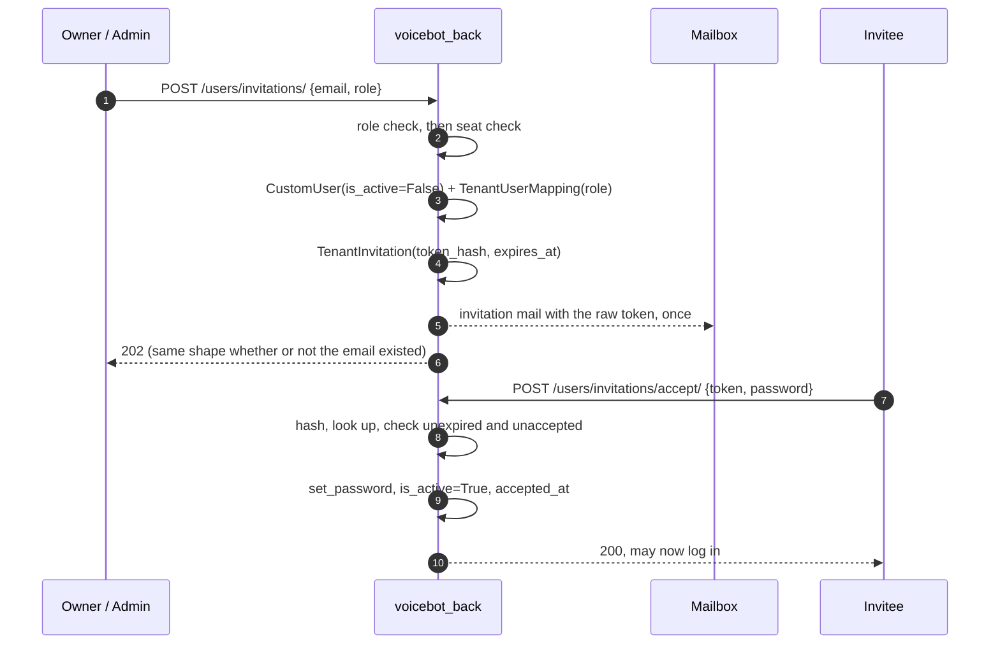

# Tenant User Management — Implementation Plan

Let a tenant add its own people, so the `USER` allowance it is already sold and metered
against becomes a thing it can actually spend.

**Related:** [Users API](../apiDocs/user/README.md) ·
[Plan & Entitlements](./plan-configuration-module-plan.md) ·
[Billing end-to-end](./billing-end-to-end-flow.md)

---

## Contents

1. [Correcting the premise](#1-correcting-the-premise)
2. [What is actually missing](#2-what-is-actually-missing)
3. [The security finding, first](#3-the-security-finding-first)
4. [Design decisions](#4-design-decisions)
5. [The invite flow](#5-the-invite-flow)
6. [File-by-file changes](#6-file-by-file-changes)
7. [Seat accounting](#7-seat-accounting)
8. [Test plan](#8-test-plan)
9. [Rollout](#9-rollout)
10. [Out of scope](#10-out-of-scope)

---

## 1. Correcting the premise

A user-creation mechanism **does already exist**. `POST /users/` reaches
[`CustomUserViewSet.perform_create`](../../user/views/custom_user.py#L174), which:

1. checks the `USER` entitlement — before the mapping is written, deliberately;
2. creates the `CustomUser` through the serializer;
3. creates a `TenantUserMapping` binding them to **the requester's own tenant**.

So the wiring between "plan says 10 users" and "tenant creates a user" is in place, and
the seat check is real. What is missing is everything around it: the created person is
never told they exist, anyone can take over anyone's account, deleting them does not
give the seat back, and there is no notion of who is allowed to do any of this.

This plan is therefore not "build user creation". It is **make the existing creation
path safe, complete, and usable**, which is a different and mostly smaller job.

---

## 2. What is actually missing

| # | Gap | Severity |
|---|---|---|
| 1 | Any tenant user can reset any colleague's password and take over their account | **Security — live today** |
| 2 | Deleting a user does not free the seat; the allowance leaks permanently | **Bug — undermines the feature being sold** |
| 3 | A created user is never notified and usually cannot log in | Blocking for usability |
| 4 | No roles inside a tenant: everyone can do everything to everyone | Design gap |

### 3 in detail — the created user cannot get in

`password` on [`UserSerializer`](../../user/serializers/custom_user.py#L30) is
`required=False`. Omit it and `create_user(password=None)` calls `set_password(None)`,
which produces an unusable password. Nothing emails the new person. They do not know an
account exists, and could not use it if they did.

The alternative today is worse: the admin *supplies* a password, which means one person
chooses and knows another person's credentials.

There is a latent third path — the new user could stumble through *forgot password* —
but its OTP is valid for `OTP_VALIDITY_MINUTES` (2 by default), which is a
password-reset window, not an onboarding one.

Login itself is not the obstacle:
[`user/serializers/auth.py:52`](../../user/serializers/auth.py#L52) gates on `is_active`
only. `is_verified` is read-only on the serializer, defaults `False`, and **nothing
checks it at login** — so it is decorative here and must not be mistaken for a gate.

### 4 in detail — the roles that were promised but never built

[`CustomUser.UserType`](../../user/models/CustomUser.py#L47) states plainly:

> `USER` is everybody who works at a tenant. **There is no separate role within a
> tenant** — permissions there come from the tenant mapping, not from here.

But [`TenantUserMapping`](../../tenant/models/TenantUserMapping.py) carries only `user`
and `tenant`. There is no role on it. The docstring describes an intent that was never
implemented, so today every tenant user is equal: each can create more users, edit any
colleague, and delete the person who created them.

`ADMIN` on `UserType` is **not** the answer, and the same docstring says why — it is
reserved for platform staff, and a tenant administrator must never be able to reach
platform operations. It is also assigned by no code path today.

---

## 3. The security finding, first

**Any tenant user can take over any colleague's account.** Two ordinary-looking pieces
combine:

[`get_queryset`](../../user/views/custom_user.py#L152) returns every user sharing the
requester's tenant — for write as much as read:

```python
q_filter = models.Q(id=user.id)
active_tenant = user.tenant_mapping.tenant
q_filter |= models.Q(tenant_mapping__tenant=active_tenant)
```

[`UserSerializer.update`](../../user/serializers/custom_user.py#L111) accepts `password`
and applies it:

```python
password = validated_data.pop("password", None)
...
if password:
    instance.set_password(password)
```

So:

```http
PATCH /users/{colleague_id}/   {"password": "whatever-i-choose"}
```

succeeds, and the caller then logs in as that colleague. `is_active` is writable on the
same path, so a user can also deactivate anyone in their tenant.

This is live now, with however many users a tenant already has. It is listed here rather
than filed separately because **this feature multiplies it**: the whole point is to make
tenants have many users, and every user added is another account anyone can seize.

**Fix, and it is small:** password must never be settable through the user resource.
Removing `password` from `UserSerializer.update` leaves exactly two ways to set one —
`change-password` (which verifies `old_password`) and the invite/reset flows (which
prove control of the mailbox). Both are correct; the third way was the bug.

This must ship **with or before** anything else here, and does not depend on the rest of
the plan.

---

## 4. Design decisions

### 4.1 Three roles on the mapping, not on the user

Add `role` to `TenantUserMapping` — where the `UserType` docstring already says
permissions belong, and where it is naturally scoped to one tenant.

| Role | May do |
|---|---|
| `OWNER` | Everything an admin can, plus transfer ownership. Exactly one per tenant. Cannot be removed or demoted by anyone else. |
| `ADMIN` | Invite, remove, and edit members. Cannot touch the owner. |
| `MEMBER` | Edit only themselves. |

Three, not a matrix, for the reason the `PlatformRole` docstring already gives about the
console: *"a permission matrix nobody can hold in their head is one that gets bypassed"*.

`OWNER` exists specifically so a tenant cannot lock itself out — the failure mode where
two admins remove each other, or one removes the person holding the billing
relationship. The invariant is **every tenant always has exactly one owner**, enforced
in the service and backed by a constraint.

### 4.2 Invite by email; never set a colleague's password

The inviter supplies an email and a role, never a password. The invitee proves control
of the mailbox and chooses their own credentials. This is what makes §3's fix
sustainable rather than merely a removal.

### 4.3 A dedicated invitation token, not the OTP machinery

Reusing the forgot-password OTP would be less code, but a 6-digit code valid for two
minutes is wrong for onboarding on two counts: the window is far too short, and six
digits is guessable when the window is long enough to be useful.

A separate `TenantInvitation` row with a high-entropy token, **stored hashed**, and a
multi-day expiry. Hashed because a leaked database read must not hand over live invites,
same reasoning the platform already applies to credentials.

### 4.4 The user and the mapping are created when the invite is sent

Not on acceptance. The seat gauge counts `TenantUserMapping` rows
([`entitlements.py:184`](../../onboard/services/entitlements.py#L184)), so a mapping must
exist exactly when a seat is spent. If invitations were free until accepted, a five-seat
tenant could send fifty and have all fifty accept — the check would have passed fifty
times against a count that never moved.

The cost is that a pending invite holds a seat, which is the honest answer anyway: the
tenant has committed that seat to a named person. Revoking or expiring gives it back —
provided §7 is fixed, which is why that section is not optional.

The invited `CustomUser` is created `is_active=False` with an unusable password, and
activated on acceptance. Since login gates on `is_active`, this is what makes an
un-accepted invite unusable as an account.

### 4.5 Do not tell the inviter whether an email already exists

`CustomUser.email` is `unique=True` platform-wide and `TenantUserMapping.user` is a
`OneToOneField`, so one email is one account at one tenant. Inviting an address that
already exists anywhere therefore cannot succeed.

The naive 400 (`user with this email already exists`) tells the inviter that address has
an account **on the platform** — possibly at another tenant, including a competitor.
That is a membership disclosure to anyone who can send invites. Return the same accepted
response either way and let the mail differ: an existing user gets a "you already have
an account" mail rather than an invitation.

---

## 5. The invite flow



**Revoke** (`POST /users/invitations/{id}/revoke/`) soft-deletes the invitation, the
mapping, and the placeholder user — returning the seat.

**Expiry** needs no beat: an invitation is checked against `expires_at` at acceptance.
A nightly sweep to release seats held by long-dead invitations can come later; it is a
tidiness job, not a correctness one, and the tenant can always revoke by hand.

---

## 6. File-by-file changes

### Phase 1 — the security fix (ships alone, first)

| File | Change |
|---|---|
| [user/serializers/custom_user.py](../../user/serializers/custom_user.py) | Drop `password` from `update()`. Keep it on `create()` only for the superuser path, or drop it entirely if nothing depends on it. |
| [user/views/custom_user.py](../../user/views/custom_user.py#L152) | Split read scope from write scope: peers remain **listable**, but `update`/`partial_update`/`destroy` resolve against self only, until Phase 2 grants more. |

Phase 1 deliberately over-restricts writes. Narrowing first and re-granting in Phase 2
means that if Phase 2 slips, the system is left safe rather than open.

### Phase 2 — roles

| File | Change |
|---|---|
| `tenant/models/TenantUserMapping.py` | `role` = `OWNER`/`ADMIN`/`MEMBER`, default `MEMBER`. Partial unique index on `(tenant)` where `role=OWNER and is_deleted=False`, so "exactly one owner" is a database fact, not a convention. |
| `tenant/migrations/` | Add field + constraint. **Data migration**: every existing mapping becomes `ADMIN`, and the earliest mapping per tenant becomes `OWNER` — see the note below. |
| `tenant/services/membership.py` *(new)* | `can_manage_members(user)`, `assert_can_act_on(actor, target)`, `transfer_ownership(...)`. One place, because "may I touch this person" will otherwise be re-derived in each view. |
| [user/views/custom_user.py](../../user/views/custom_user.py) | Re-grant peer writes to `OWNER`/`ADMIN` through the service. Owner is untouchable by others. |

> **On the backfill:** making everyone `ADMIN` preserves today's behaviour rather than
> silently demoting people who currently have full access — a migration that removes
> capability is one that pages someone. Tightening to `MEMBER` is a per-tenant decision
> made afterwards, in the UI, by that tenant's owner. The earliest mapping is a
> heuristic for "the founder", not a certainty; tenants must be able to transfer it.

### Phase 3 — invitations

| File | Change |
|---|---|
| `tenant/models/TenantInvitation.py` *(new)* | `tenant`, `email`, `role`, `token_hash`, `expires_at`, `accepted_at`, `invited_by`. Indexed on `token_hash`. |
| `tenant/services/invitations.py` *(new)* | `create_invitation`, `accept`, `revoke`. Seat check lives here so it cannot be bypassed by a second caller. |
| `user/views/invitation.py` *(new)* | `POST /users/invitations/`, `POST /users/invitations/accept/` (**unauthenticated** — the invitee has no account yet), `GET /users/invitations/`, `POST /{id}/revoke/`. |
| `user/serializers/invitation.py` *(new)* | Standard 4-tier per `AGENTS.md`. |
| [utils/tasks.py](../../utils/tasks.py) | Reuse `send_email_task` + `email_log.record`, exactly as [forgot_password.py](../../user/views/auth/forgot_password.py#L73) does. No new mail plumbing. |
| `templates/` | Invitation and already-registered mails. |

Acceptance is the one unauthenticated write here, so it needs its own throttle —
`token` is the only credential, and an unthrottled endpoint is an offer to enumerate.
[`utils/throttling.py`](../../utils/throttling.py) already carries the scoped-throttle
pattern this should follow.

---

## 7. Seat accounting

**The leak.** [`perform_destroy`](../../utils/views/base_model_viewset.py#L609) soft-deletes
the `CustomUser`. Nothing touches `TenantUserMapping`. The `OneToOneField`'s
`on_delete=CASCADE` never fires, because a soft delete is a flag write, not a delete.

The gauge counts mappings:

```python
# onboard/services/entitlements.py:184
return TenantUserMapping.objects.filter(tenant_id=tenant_id, is_deleted=False).count()
```

So a removed user keeps consuming a seat **forever**. A tenant on ten seats that has
churned through ten people is full, with nobody to show for it, and the only visible
symptom is a 402 they cannot explain.

This is worth stating plainly: it defeats the exact feature the allowance is sold as.

**Fix.** Soft-delete the mapping whenever the user is soft-deleted — in
`CustomUserViewSet.perform_destroy`, or better in a service both the viewset and any
future admin path call. Then, once and out-of-band, a management command to release
mappings whose user is already soft-deleted; kept out of the migration for the same
reason [`backfill_call_logs`](../../core/services/contact_resolution.py#L62) is — a slow
backfill must not block a deploy.

Worth a test that asserts the count *drops* after a delete, since nothing today would
notice if it silently stopped doing so.

---

## 8. Test plan

Postgres, per repo convention: `--settings=config.settings.test_postgres`, narrow
labels.

**Phase 1 — the takeover (`user/tests/`)**

- A member PATCHing a peer's `password` is refused. *This is the regression test that
  matters most; it should have existed before now.*
- A member PATCHing a peer's `is_active` is refused.
- A user changing their own password through `change-password` still works.
- Peers remain listable — the fix must not blind the tenant to its own roster.

**Phase 2 — roles**

- Member cannot invite, remove, or edit a peer.
- Admin can, but cannot remove or demote the owner.
- The owner-uniqueness constraint rejects a second owner.
- Ownership transfer moves the role atomically, leaving exactly one owner.
- The data migration lands one owner per tenant and admins elsewhere.

**Phase 3 — invitations**

- Full path: invite → mail queued → accept → user active and can log in.
- Pre-acceptance the user is `is_active=False` and login fails.
- Expired token rejected; already-accepted token rejected; unknown token rejected —
  all with the same response, so the endpoint is not an oracle.
- Inviting an address that already exists returns the *same* response as a fresh invite
  (§4.5) and sends different mail.
- Revoke frees the seat.

**Seat accounting (§7) — the one nothing currently guards**

- Creating a user increments `current_usage(tenant, USER)`.
- Deleting a user decrements it.
- Invite holds a seat; revoke returns it.
- At the limit, an invite is a **402**, not a 403 — the code the frontend already
  handles for "buy more", per `QuotaExceededError`.

---

## 9. Rollout

1. **Phase 1 alone**, as its own change. It is a fix, not a feature, and should not wait
   behind the rest.
2. **Phase 2** with the backfill run and verified per tenant before the UI exposes roles.
3. **Phase 3** behind a flag until the mail templates are approved — an invitation is a
   customer-facing email under the tenant's name.

Each phase is independently shippable and independently valuable, which is the point of
splitting them this way.

---

## 10. Out of scope

- **Self-service signup.** There is none today — `user/views/auth/` has login, logout,
  forgot/reset password and token refresh, and no register. Tenants and their first user
  are created elsewhere. Inviting into an existing tenant is a different problem and
  this plan does not change how a tenant is born.
- **One person in several tenants.** `TenantUserMapping.user` is a `OneToOneField` and
  `email` is globally unique. Supporting multi-tenant membership means replacing both,
  plus a tenant switcher and a re-think of `X-Tenant-ID`. Large, and not required to let
  a tenant add its own staff.
- **Per-object permissions inside a tenant** (this agent, that campaign). The three
  roles here are about managing *people*, not about scoping resources.
- **`is_verified`.** It is written by no flow reachable here and checked at no gate. It
  should either be given a meaning or removed, but conflating it with invite acceptance
  would give it two.
