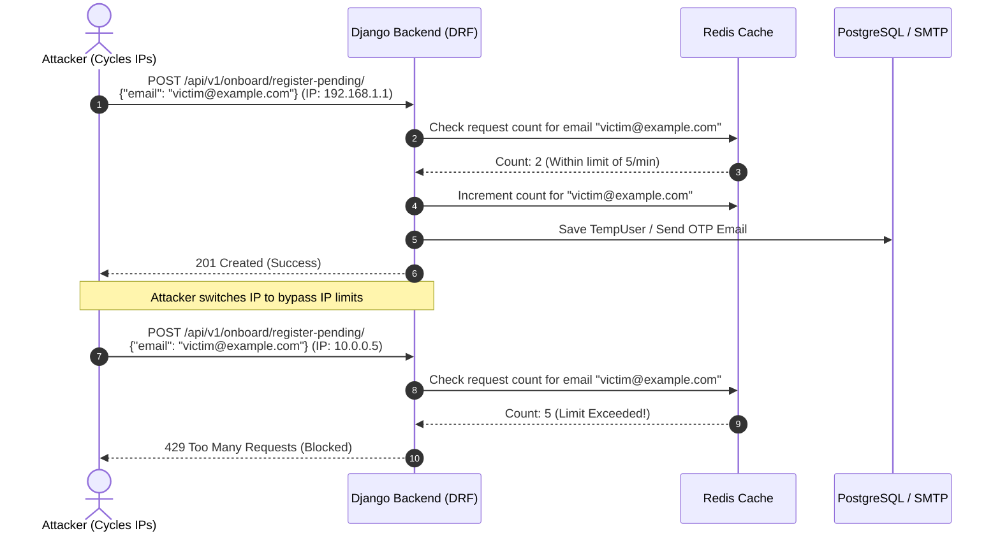
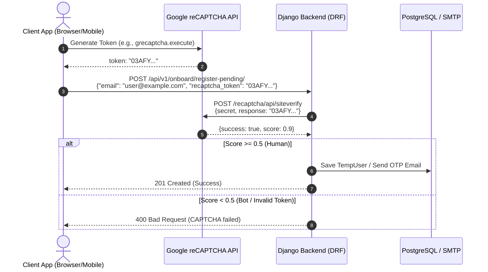
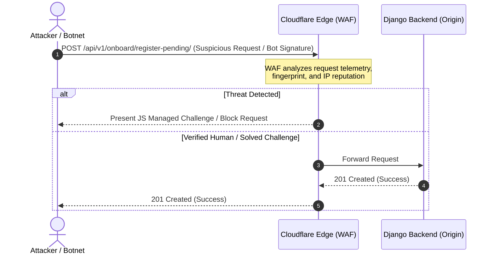

# Implementation Plan: Throttling & Protection for Write and Email-Sending APIs

This plan outlines the design and implementation of a security protection layer to safeguard endpoints that perform database write operations or trigger email delivery (OTP codes, password resets) from volumetric abuse, spam, and IP-rotation/distributed attacks.

## Mitigating IP-Rotation (Distributed) Attacks

Since attackers can easily cycle through multiple IP addresses to bypass standard IP-based rate limiting, we propose three distinct protection flows. Below is the detailed explanation, sequence flow, and cost breakdown for each option:

### Flow A: Email-Level Rate Limiting
This flow protects against target abuse (e.g., spamming a single user's inbox) by tracking rate limits per email address instead of source IP. Even if the attacker cycles through 1,000 different IPs, the system tracks and blocks requests targeting the same email address once the threshold is crossed.

* **Cost/Price**: **$0 (Free)**
* **Details**: Runs entirely within our existing infrastructure (Django + default Redis cache). No third-party APIs or subscription fees are required.



---

### Flow B: Google reCAPTCHA / hCaptcha Verification
This flow requires the client to prove they are human before the backend executes any database write or email-sending operations. It completely prevents automated scripts and botnets from programmatically spamming endpoints, regardless of how many IPs they use.

* **Cost/Price**: **$0 (Free Tier) to ~$1/1,000 requests**
* **Details**:
  * **Google reCAPTCHA v3**: Free up to **10,000 assessments per month**. Beyond 10k, costs $1.00 per 1,000 assessments.
  * **hCaptcha**: Free tier is very generous (up to 1,000,000 requests/month for basic publishers), then starts at $99/month for advanced enterprise features.



---

### Flow C: Cloudflare / WAF Edge Protection
This flow offloads bot detection and rate limiting to the CDN/WAF layer. Attacks are mitigated at the network edge before they ever reach the Django backend, saving server resources and bandwidth.

* **Cost/Price**: **$0 (Free Plan) to $20/month (Pro Plan)**
* **Details**:
  * **Cloudflare Free Plan**: Includes basic DDoS protection and managed browser challenge pages (e.g. Turnstile) at no cost.
  * **Cloudflare Pro Plan**: $20/month, providing advanced WAF rulesets, custom rate-limiting rules, and detailed analytics.



---

## Proposed Changes (Core + Option B: reCAPTCHA Support)

### Utility Abstractions

#### [NEW] [throttling.py](file:///c:/Users/Hello/Desktop/Projects/Voicebot/voicebot_back/utils/throttling.py)
* `SensitiveActionThrottle`: Subclass of `SimpleRateThrottle` using scope `sensitive_action`. Tracks authenticated user ID or client IP.
* `EmailRateThrottle`: Subclass of `SimpleRateThrottle` using scope `email_action`. Extracts and normalizes email/email_address from `request.data` to prevent targeted spamming across multiple IPs.

#### [NEW] [captcha.py](file:///c:/Users/Hello/Desktop/Projects/Voicebot/voicebot_back/utils/captcha.py)
* Implement a helper/validator `verify_recaptcha_token(token)`:
  * Performs a secure HTTP request to Google/hCaptcha verification endpoint.
  * Uses a `RECAPTCHA_SECRET_KEY` fetched from django settings.
  * Returns `True` if valid, `False` otherwise.
  * In non-production/development settings (`settings.DEBUG = True` or during tests), it can allow a dummy bypass token (e.g., `'PASSED_CAPTCHA'`) to prevent blocking automated test suites.

---

## Proposed Configuration Settings

#### [MODIFY] [base.py](file:///c:/Users/Hello/Desktop/Projects/Voicebot/voicebot_back/config/settings/base.py)
* Add default rate limits:
  ```python
  REST_FRAMEWORK = {
      ...
      "DEFAULT_THROTTLE_RATES": {
          "sensitive_action": "10/minute",
          "email_action": "5/minute",
      },
  }
  ```
* Add settings for CAPTCHA secrets:
  ```python
  RECAPTCHA_SECRET_KEY = env.str("RECAPTCHA_SECRET_KEY", default="")
  ENABLE_RECAPTCHA = env.bool("ENABLE_RECAPTCHA", default=False)
  ```

---

## Verification Plan

### Automated Tests
* Implement unit tests in `onboard/tests/test_throttling.py` to:
  * Verify that `EmailRateThrottle` blocks multiple requests targeting the same email even when client IP changes.
  * Mock reCAPTCHA API verification calls to verify that correct/incorrect tokens behave as expected.
* Execute unit tests:
  ```bash
  uv run python manage.py test onboard --settings=config.settings.local
  ```
