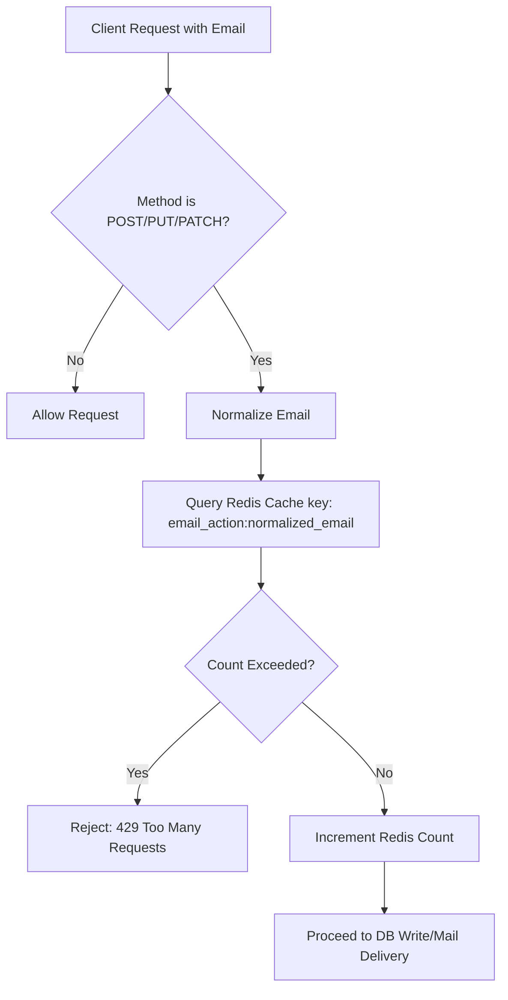
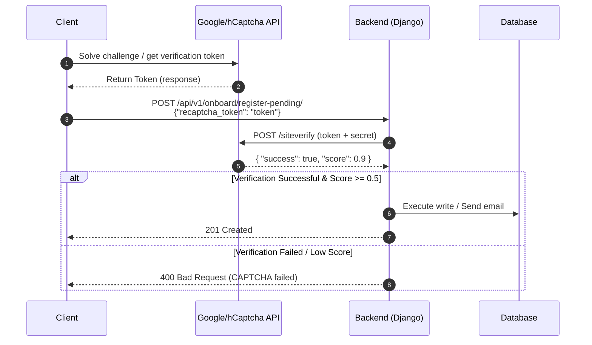
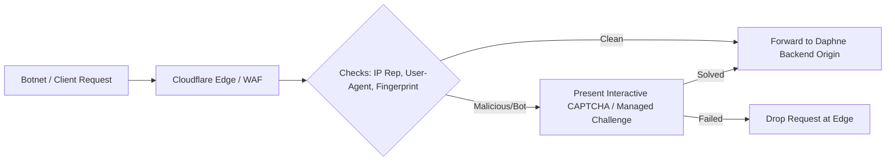

# Security Loopholes & Mitigation Report: Public & Write API Protection

This report analyzes current vulnerabilities (loopholes) in the application's public and write endpoints, detailing the threat vectors, system impacts, and proposed solutions.

---

## 1. Identified Security Loopholes

### 🔍 Loophole 1: Lack of Throttling on Public Write & Email-Sending Endpoints
* **Description**: Public endpoints like registration (`register-pending/`), email OTP resending (`resend-otp/`, `forgot-password/resend/`), and password resets (`forgot-password/`) have no rate-limiting constraints.
* **Threat Vector**: Attackers can write scripts to call these endpoints thousands of times in a short duration.
* **System Impact**:
  * **SMTP Service Exhaustion & Costs**: High volume of SMTP connections running up billing costs or triggering rate-limiting locks from the email provider.
  * **Domain Reputation Damage**: The sending email address/domain could be flagged as a source of spam and blacklisted by major email providers (Gmail, Outlook).
  * **Database Flooding**: Creation of thousands of dummy `TempUser` or registration records.

### 🔍 Loophole 2: IP-Rotation Bypasses for IP-Based Throttling
* **Description**: Simple IP-based rate limiting matches client IP addresses.
* **Threat Vector**: Using residential proxies, VPN services, or distributed botnets, attackers can cycle through different IP addresses on every request.
* **System Impact**:
  * Bypasses client-IP rate limits entirely, rendering standard `AnonRateThrottle` ineffective.
  * Legitimate users can be targeted (e.g., locking out a single email address by sending requests from multiple IPs).

### 🔍 Loophole 3: Automated Bot Registration (No CAPTCHA Verification)
* **Description**: Public endpoints accept request payloads directly without validating if the sender is a human.
* **Threat Vector**: Bots can automate the full signup funnel programmatically.
* **System Impact**:
  * Fake account creation, database pollution, and resource consumption.

### 🔍 Loophole 4: Razorpay Order Creation Abuse
* **Description**: The `create-order-just-in-time/` endpoint triggers external API calls to Razorpay to generate a payment order ID.
* **Threat Vector**: Flooding the endpoint with requests.
* **System Impact**:
  * **Razorpay Rate-Limiting**: Exceeding Razorpay API limits, blocking legitimate users from purchasing.
  * **Transaction DB Bloat**: Thousands of pending `Transaction` records created in the PostgreSQL database.

---

## 2. Recommended Solutions

| Threat Vector | Mitigation Strategy / Solution | Implementation Details |
| :--- | :--- | :--- |
| **IP-Rotation (Targeted Account Spam)** | **Email-Level Rate Limiting** | Track request frequency based on the normalized `email` payload field rather than IP. |
| **Automated Bot Abuse** | **reCAPTCHA v3 / Turnstile Integration** | Require a cryptographic validation token in public requests; verify against provider APIs before executing DB/mail actions. |
| **Volumetric Attacks (DDoS)** | **Cloudflare / WAF Edge Rules** | Perform bot challenge screens (JS challenge/CAPTCHA) at the DNS edge before traffic reaches the Django origin server. |
| **Disposable Accounts** | **Disposable Email Domain Validation** | Implement a validator in the `CheckEmailSerializer` and `TempUserSignupSerializer` to block domains listed in public disposable domain blacklists. |
| **API Abuse (Authenticated)** | **User-Level Scoped Throttling** | Set strict daily/hourly limits for authenticated write actions (`sensitive_action` scope). |

---

## 3. Detailed Solution Workflows

### 🛡️ Workflow A: Email-Level Rate Limiting
Normalizes input emails (lowercase, strip whitespace) and caches them in Redis.

### 🛡️ Workflow B: reCAPTCHA Verification Flow
Integrates frontend validation tokens with Google/hCaptcha servers.

### 🛡️ Workflow C: Cloudflare Edge Challenge Flow
Uses CDN edge detection to drop bot requests.

