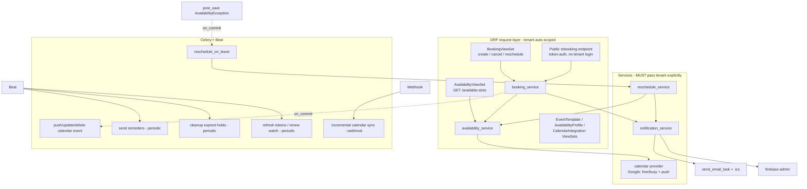

# Generalized Scheduling & Booking — Implementation Plan (V4)

> ⚠️ **Superseded in part (2026-07-31): `ROUND_ROBIN` was removed.** Pooled
> auto-assignment and leave-time auto-reassignment no longer exist — every
> non-`COLLECTIVE` booking names its host, and a host's leave always flags the
> booking `REQUIRES_RESCHEDULE`. This document is kept as the historical design
> record; see [`implementation-plan-scratch/remove-round-robin-plan.md`](implementation-plan-scratch/remove-round-robin-plan.md).

> ⚠️ **Superseded in part (2026-08-05): availability is materialized, and the slots
> endpoint takes UTC instants.** Working hours are no longer walked from
> `AvailabilityRule` at request time — they are pre-converted into absolute UTC
> `AvailabilityWindow` rows, which is what made overnight shifts representable.
> `GET /available-slots/` now takes `start_utc`/`end_utc` instead of
> `date_from`/`date_to`, so the §7.1 signature below is out of date. Current
> behaviour: [`flows/booking-flow-internals.md`](flows/booking-flow-internals.md)
> and [`apiDocs/core/availability_slots.md`](apiDocs/core/availability_slots.md).

> **Status: ✅ IMPLEMENTED** (Phases 1–4 + webhook incremental sync + reassignment re-sync).
> Code under `core/` (models, services, serializers, views, urls, admin, tasks); migrations `0020`–`0026`; 79 tests in `core/tests/scheduling/` (Postgres). To deploy, follow [`scheduling-deployment-checklist.md`](scheduling-deployment-checklist.md).
> **Decision resolved:** COLLECTIVE = **one `Booking` per host** (shared `group_id`, all-or-nothing), per the open question in §20.
> **Deferred by choice:** Calendly/Outlook providers (Google-only v1); the provider layer is pluggable for later.
> **Supersedes V3.**
> **Audience:** The engineer/agent implementing this (Claude Code or Antigravity).
> **Golden rule:** This system schedules real people's time and touches external accounts and customer PII. Correctness > features. Every query that runs **outside** a DRF request must pass `tenant` explicitly, every write path that can double-book must be protected at the **database** level, and every external side effect must be **idempotent and retryable**. When in doubt, prefer the safe/boring option.

---

## 0. How to use this document

This is a build spec, not prose. Implement **phase by phase** (Section 18); do not start a later phase until the earlier phase's acceptance criteria pass. Every model, serializer, viewset, admin, service, task, and test named here is required unless marked *(optional)* or *(later phase)*.

Before writing anything, read Section 2 (Conventions) and mirror the existing code exactly. This codebase has strong, consistent patterns — deviating from them is how bugs get in.

---

## 1. Scope & non-goals

**In scope (final state):** multi-tenant event types, per-user weekly availability, time-off/leave, pooled availability routing (round-robin / collective / direct), on-demand booking with hard double-booking prevention, temporary slot holds, external calendar sync (Google first) via free/busy + webhooks, emergency-leave auto-reassignment + customer-driven reschedule, and a full notification lifecycle (email + FCM + `.ics`) with reminders.

**Non-goals (v1):**
- Calendly and Outlook providers (design pluggable; ship **Google only** first — see §9).
- Payments/deposits on bookings.
- Recurring appointment series (model supports single occurrences; recurrence is a future extension).
- Group events with capacity > the host set (attendees are unbounded, but "seats" logic is out of scope).

---

## 2. Codebase conventions this plan MUST follow

These are verified facts about this repo. Follow them precisely.

### 2.1 Base models (choose the tier deliberately)
- **Tier 2 — `TenantBaseModel`** (`from tenant.common import TenantBaseModel`): UUID pk, `tenant` FK (**non-null**), `created_at/updated_at/deleted_at`, `is_active/is_deleted`, **`created_by/updated_by/deleted_by`** audit FKs. Use for anything where "who did this" matters.
- **Tier 1 — `TenantBaseModelCore`**: same, **minus** the three user-audit FKs. Use for high-volume junction/log rows that don't need accountability.
- Both provide `objects` (hides `is_deleted=True`), `all_objects`, and `soft_delete(user=None)/restore()`.
- **There is no history/versioning layer** in this repo. If you need a change trail, you build it (we do — `BookingEvent`, §4.10).

### 2.2 Tenant isolation — CRITICAL
- Tenant scoping lives **only** in `TenantBaseViewSet.get_queryset()` and is auto-injected on create by `TenantBaseViewSet.perform_create()`. There is **no middleware, no thread-local, no tenant-aware manager.**
- **Therefore: any code path that is not a DRF viewset request — every service, signal handler, Celery task, and management command — receives NO automatic tenant filtering.** These paths MUST filter `tenant=<explicit value>` on every query and set `tenant=` on every create. This is the single most important correctness rule in this document. A missed filter here is a cross-tenant data leak (e.g. reassigning Tenant A's booking to Tenant B's agent).
- The active tenant for a request is `request.user.tenant_mapping.tenant` (`TenantUserMapping` is **OneToOne** — a user belongs to exactly one tenant).

### 2.3 Serializers — the "4-tier" convention
Per model, four serializers named exactly:
- `<Model>RefSerializer` — tiny read-only embed (`id`, label field); `read_only_fields = fields`.
- `<Model>Serializer` — the **one** full read/write serializer; extends `TenantBaseModelSerializer` (or `...Core...`); create & update logic live in its `create()`/`update()`. `tenant` and audit FKs are read-only here.
- `<Model>ListSerializer` — lightweight list view (subset, no audit).
- `<Model>DropdownSerializer` — `{label, value}` for pickers.
> Do **not** invent List/Detail/Create/Update serializers — that is not this repo's pattern.

### 2.4 ViewSets, URLs, Admin
- ViewSets extend **`TenantBaseViewSet`** (`from tenant.common import ...`). Declare `serializer_class`, `list_serializer_class`, `dropdown_serializer_class`, `filterset_fields`, `search_fields`, `ordering_fields`, `ordering`, `select_related_fields`, `prefetch_related_fields`. Responses are wrapped by `ResponseMixin` (`{status, message, data, errors}`) and paginated by `SetPagination`.
- One router file per model in `core/urls/<model>.py` (a `DefaultRouter`), aggregated by one line in `core/urls/__init__.py`.
- Admins extend **`TenantBaseAdmin`** and **extend** (never replace) the base tuples, e.g. `list_filter = (...) + TenantBaseAdmin.list_filter`.

### 2.5 Soft-delete + unique-field truncation
When a model has a **per-tenant unique** field, its `soft_delete()` override must append `-deleted-<YYYYMMDDHHMMSS>` **after truncating** the base value to fit `max_length` (see the exact pattern in `core/models/agent.py` / `core/models/knowledge_base.py`). Do the delete under `transaction.atomic()` + `select_for_update()`. Follow this for `EventTemplate.name`.

### 2.6 Validation idiom
Cross-row checks go in serializer `validate(self, attrs)`: query the model filtered by tenant + fields, `.exclude(pk=self.instance.pk)` on update, `is_deleted=False`, raise `serializers.ValidationError({...})` on `.exists()`. (See `core/serializers/kb_website.py`.) **Note:** for double-booking this is necessary but **not sufficient** — the DB constraint in §11 is the real guarantee.

### 2.7 Async, TZ, signals
- Celery is configured (Redis broker/backend, DB `/2`). Only email tasks exist today. **Celery Beat is not installed** — add it (§8).
- `USE_TZ = True`, `TIME_ZONE = "UTC"`. Store **all** datetimes UTC-aware. A `Timezone` model already exists (`onboard.Timezone`, IANA ids) and `CustomUser.timezone` FKs to it — **reuse it**, never a free-text tz field.
- `core` uses no signals and `core/apps.py` has no `ready()`. You will add `core/signals.py` and a `ready()` (§8.4). Keep signal handlers thin (enqueue only).

### 2.8 New dependencies to add (`pyproject.toml`)
`django-celery-beat` (scheduled tasks), `google-api-python-client` + `google-auth` + `google-auth-oauthlib` (Google Calendar), `firebase-admin` (FCM), and promote `cryptography` to a **direct** dependency (token encryption). Add the Postgres `btree_gist` extension via migration (§11). Pin versions; run `uv lock`.

---

## 3. Architecture overview

**Source-of-truth principle:** *your DB is the source of truth for bookings you create.* External calendars are treated as a **read-side busy signal** (queried on demand) and a **write-side mirror** (bookings pushed out). You do **not** import external events into the `Booking` table (that was a V3 mistake — it causes echo loops and query pollution). See §9.

---

## 4. Data models

All models live in `core/models/` (one file per model, re-exported from `core/models/__init__.py`), admins in `core/admin/`, following §2. All FKs are to UUID pks. All datetimes are UTC-aware.

> **Tier changes from V3, with rationale:** `CalendarIntegration` and `AvailabilityException` are promoted to **Tier 2** — both are accountability-relevant (who connected an account / who logged a leave that auto-cancels customer bookings). `AvailabilityProfile`'s 14 day-columns are **replaced** by a normalized `AvailabilityRule` child. External events are **not** stored as `Booking` rows.

### 4.1 `EventTemplate` (Tier 2 — `TenantBaseModel`)
Defines an appointment type ("30-Min Demo").

| Field | Type | Notes |
|---|---|---|
| `name` | Char(100) | Unique per tenant among alive rows. Truncation-safe `soft_delete` (§2.5). |
| `slug` | Slug(120) | *(optional)* Unique per tenant; for public links. |
| `description` | Text | blank |
| `duration_minutes` | PositiveSmallInt | > 0, validated |
| `buffer_before_minutes` | PositiveSmallInt | default 0 |
| `buffer_after_minutes` | PositiveSmallInt | default 0 |
| `assignment_strategy` | Char choices | `ROUND_ROBIN`, `COLLECTIVE`, `DIRECT` |
| `min_notice_minutes` | PositiveInt | default 120 — earliest bookable offset from now |
| `max_horizon_days` | PositiveSmallInt | default 60 — furthest bookable date |
| `slot_granularity_minutes` | PositiveSmallInt | default 15 — slot step |
| `cancellation_lead_minutes` | PositiveInt | default 60 — min notice to cancel |
| `reschedule_lead_minutes` | PositiveInt | default 60 |
| `location_type` | Char choices | `IN_PERSON`, `PHONE`, `VIDEO` *(optional)* |
| `color` | Char(7) | hex, for UI *(optional)* |

**Constraints:** `UniqueConstraint(tenant, name)` with `condition=Q(is_deleted=False)`; `CheckConstraint(duration_minutes > 0)`.

### 4.2 `UserEventSkill` (Tier 1 — `TenantBaseModelCore`)
Which users can host which templates.

| Field | Type | Notes |
|---|---|---|
| `user` | FK(AUTH_USER_MODEL) | |
| `event_template` | FK(EventTemplate) | related_name `skills` |
| `weight` | PositiveSmallInt | default 1 — round-robin bias *(optional)* |

**Constraints:** `UniqueConstraint(tenant, user, event_template, condition=is_deleted=False)`. **Integrity rule (validate in serializer + service):** `user`'s tenant == `event_template.tenant` == `self.tenant`.

### 4.3 `AvailabilityProfile` (Tier 2 — `TenantBaseModel`)
A user's working-hours container.

| Field | Type | Notes |
|---|---|---|
| `user` | FK(AUTH_USER_MODEL) | |
| `timezone` | FK(`onboard.Timezone`) | **reuse existing model**; drives DST-correct slot math |
| `name` | Char(100) | default "Default" |

**Constraints:** one alive profile per `(tenant, user)` unless you explicitly support multiple named profiles — start with `UniqueConstraint(tenant, user, condition=is_deleted=False)`.

### 4.4 `AvailabilityRule` (Tier 1 — `TenantBaseModelCore`) — replaces V3 day-columns
One weekly working block. Multiple rows per profile per weekday (supports split shifts).

| Field | Type | Notes |
|---|---|---|
| `profile` | FK(AvailabilityProfile) | related_name `rules` |
| `weekday` | SmallInt | 0=Monday … 6=Sunday (Python `weekday()`) |
| `start_time` | Time | naive wall-clock in the profile's tz |
| `end_time` | Time | must be > `start_time` |

**Constraints:** `CheckConstraint(end_time > start_time)`. **Validate:** no two rules for the same `(profile, weekday)` overlap.

### 4.5 `CalendarIntegration` (Tier 2 — `TenantBaseModel`)
OAuth connection to an external calendar.

| Field | Type | Notes |
|---|---|---|
| `user` | FK(AUTH_USER_MODEL) | |
| `provider` | Char choices | `GOOGLE` (v1); `OUTLOOK` reserved |
| `account_email` | Char(254) | connected account identity |
| `access_token` | Text | **encrypted at rest** (§13.1) |
| `refresh_token` | Text | **encrypted at rest** |
| `token_expires_at` | DateTime | |
| `scope` | Text | granted scopes |
| `sync_status` | Char choices | `CONNECTED`, `REAUTH_REQUIRED`, `ERROR`, `DISCONNECTED` |
| `sync_token` | Text | provider incremental-sync cursor |
| `watch_channel_id` | Char | webhook channel id |
| `watch_resource_id` | Char | |
| `watch_expires_at` | DateTime | renew before expiry (§8) |
| `last_synced_at` | DateTime | |
| `last_error` | Text | blank; last sync failure detail |

**Constraints:** `UniqueConstraint(tenant, user, provider, condition=is_deleted=False)`. **Never** expose token fields in any serializer.

### 4.6 `AvailabilityException` (Tier 2 — `TenantBaseModel`)
Time off / leave / emergency. Drives the reschedule workflow.

| Field | Type | Notes |
|---|---|---|
| `user` | FK(AUTH_USER_MODEL) | |
| `start_time` | DateTime (UTC) | |
| `end_time` | DateTime (UTC) | must be > `start_time` |
| `type` | Char choices | `VACATION`, `SICK`, `EMERGENCY`, `HOLIDAY`, `OTHER` |
| `reason` | Char(255) | blank |
| `is_all_day` | Bool | default False |

**Constraints:** `CheckConstraint(end_time > start_time)`; index `(tenant, user, start_time, end_time)`. Leaves may overlap each other.

### 4.7 `Booking` (Tier 2 — `TenantBaseModel`)
A single real appointment. **No external-block rows here.**

| Field | Type | Notes |
|---|---|---|
| `event_template` | FK(EventTemplate) | **non-null** |
| `title` | Char(255) | |
| `primary_host` | FK(AUTH_USER_MODEL) | denormalized host used by routing + the exclusion constraint; also present in `BookingParticipant` |
| `start_time` | DateTime (UTC) | |
| `end_time` | DateTime (UTC) | |
| `effective_start_time` | DateTime (UTC) | `start_time - buffer_before`; set in service; used by exclusion constraint |
| `effective_end_time` | DateTime (UTC) | `end_time + buffer_after` |
| `status` | Char choices | `HELD`, `SCHEDULED`, `CONFIRMED`, `COMPLETED`, `CANCELED`, `NO_SHOW`, `REQUIRES_RESCHEDULE` |
| `source` | Char choices | `CUSTOMER`, `INTERNAL`, `PUBLIC_LINK` |
| `hold_expires_at` | DateTime | non-null only while `status=HELD` (§11.3) |
| `reschedule_token` | UUID | null until a reschedule is requested |
| `reschedule_token_expires_at` | DateTime | |
| `external_event_id` | Char | id of the mirrored event in the host's calendar (idempotency key for push) |
| `external_provider` | Char choices | matches `CalendarIntegration.provider` |
| `cancellation_reason` | Char(255) | blank |

**Status semantics:** *active* statuses (that block time) = `{HELD, SCHEDULED, CONFIRMED, REQUIRES_RESCHEDULE}`. `REQUIRES_RESCHEDULE` still blocks until resolved (the slot is still tentatively the customer's). *Terminal* = `{COMPLETED, CANCELED, NO_SHOW}`.

**Constraints:** see §11 for the `ExclusionConstraint`. Plus `CheckConstraint(end_time > start_time)` and a check that `hold_expires_at` is set iff `status=HELD`.

### 4.8 `BookingParticipant` (Tier 1 — `TenantBaseModelCore`)

| Field | Type | Notes |
|---|---|---|
| `booking` | FK(Booking) | related_name `participants` |
| `user` | FK(AUTH_USER_MODEL) | null for external guests/customers |
| `name` | Char(255) | |
| `email` | Email | validated |
| `phone_number` | Char | validated *(optional)* |
| `role` | Char choices | `HOST`, `ATTENDEE`, `GUEST` |
| `response_status` | Char choices | `NEEDS_ACTION`, `ACCEPTED`, `DECLINED` |

### 4.9 `ExternalBusyBlock` (Tier 1 — `TenantBaseModelCore`) *(optional cache — see §9.2)*
Cache of external free/busy intervals. Only add if on-demand latency proves too high.

| Field | Type | Notes |
|---|---|---|
| `integration` | FK(CalendarIntegration) | |
| `user` | FK(AUTH_USER_MODEL) | |
| `external_event_id` | Char | idempotency key for upserts |
| `start_time` / `end_time` | DateTime (UTC) | |
| `cached_until` | DateTime | TTL; stale rows ignored/refreshed |

### 4.10 `BookingEvent` (Tier 1 — `TenantBaseModelCore`) — append-only audit log
Because there's no history layer and bookings change host automatically, this is how support/debugging works. **Never updated or deleted.**

| Field | Type | Notes |
|---|---|---|
| `booking` | FK(Booking) | related_name `events` |
| `event_type` | Char choices | `CREATED`, `CONFIRMED`, `REASSIGNED`, `RESCHEDULE_REQUESTED`, `RESCHEDULED`, `CANCELED`, `NO_SHOW`, `COMPLETED`, `EXTERNAL_SYNCED`, `NOTIFICATION_SENT`, `HOLD_EXPIRED` |
| `actor` | FK(AUTH_USER_MODEL) | null = system/automated |
| `from_host` / `to_host` | FK(AUTH_USER_MODEL) | for `REASSIGNED` |
| `metadata` | JSON | free-form (old/new times, provider ids, error) |

### 4.11 `DeviceToken` (Tier 1 — `TenantBaseModelCore`) — FCM
| Field | Type | Notes |
|---|---|---|
| `user` | FK(AUTH_USER_MODEL) | internal team members |
| `token` | Char | FCM registration token |
| `platform` | Char choices | `ANDROID`, `IOS`, `WEB` |
| `is_active` | Bool | deactivate on `Unregistered`/`InvalidRegistration` errors |
| `last_seen_at` | DateTime | |

**Constraints:** `UniqueConstraint(tenant, token, condition=is_deleted=False)`.

### 4.12 `NotificationLog` (Tier 1 — `TenantBaseModelCore`) — idempotency/dedup
Guarantees each logical notification is sent at most once (survives Celery retries).

| Field | Type | Notes |
|---|---|---|
| `booking` | FK(Booking) | null for non-booking notifications |
| `channel` | Char choices | `EMAIL`, `FCM` |
| `notification_type` | Char choices | `CONFIRMATION`, `REMINDER`, `RESCHEDULE_REQUEST`, `REASSIGNED`, `CANCELED`, `RESCHEDULED` |
| `recipient` | Char | email / user id |
| `dedup_key` | Char(255) | **unique** — e.g. `f"{booking_id}:{type}:{recipient}:{bucket}"` |
| `status` | Char choices | `PENDING`, `SENT`, `FAILED` |
| `sent_at` | DateTime | |
| `error` | Text | blank |

---

## 5. Serializers

Follow the 4-tier convention (§2.3) for every model exposed via API: `EventTemplate`, `UserEventSkill`, `AvailabilityProfile` (nest `AvailabilityRule` as a `Nested...Serializer` with the `flag` create/update/delete idiom used in `knowledge_base.py`), `AvailabilityException`, `CalendarIntegration` (**read-only token fields excluded entirely**), `Booking` (+ nested `BookingParticipant`), `DeviceToken`. `BookingEvent`, `NotificationLog`, `ExternalBusyBlock` need only Ref + List (read-only, admin/debug).

**Validation rules to implement (serializer `validate`/`validate_<field>`):**
- `EventTemplate`: `name` unique per tenant (alive); `duration_minutes > 0`; buffers ≥ 0; strategy in enum; `name` regex/length like existing templates.
- `AvailabilityRule` (nested): `end_time > start_time`; no overlap within same `(profile, weekday)`.
- `AvailabilityException`: `end_time > start_time`.
- `UserEventSkill`: tenant-consistency of `user` and `event_template` (§4.2).
- `Booking` (create): template exists & active & in tenant; requested slot passes the **availability engine** (not just format); `start`/`end` consistent with template duration; enforce `min_notice_minutes` and `max_horizon_days`. **The overlap `.exists()` check here is a fast-fail UX guard only — the authoritative guard is the DB constraint (§11).**
- `Booking` (cancel/reschedule): enforce `cancellation_lead_minutes` / `reschedule_lead_minutes`; block on terminal statuses.

> All tenant-scoped `.filter()` calls inside serializers derive tenant from `self.context['request'].user.tenant_mapping.tenant` (superuser → skip), matching existing serializers.

---

## 6. ViewSets, endpoints & URLs

All authenticated viewsets extend `TenantBaseViewSet`. Register each in `core/urls/<model>.py` + `core/urls/__init__.py`.

| ViewSet | Route | Notes |
|---|---|---|
| `EventTemplateViewSet` | `event-templates` | standard CRUD + `dropdown` |
| `UserEventSkillViewSet` | `event-skills` | |
| `AvailabilityProfileViewSet` | `availability-profiles` | nested rules write via serializer |
| `AvailabilityExceptionViewSet` | `availability-exceptions` | create triggers reschedule signal (§8.4) |
| `CalendarIntegrationViewSet` | `calendar-integrations` | + `@action connect` (OAuth start), `@action callback` (OAuth redirect), `@action disconnect` |
| `AvailabilityViewSet` | `availability` | read-only; `@action available-slots` (§7.1) |
| `BookingViewSet` | `bookings` | CRUD + `@action hold`, `@action confirm`, `@action cancel`, `@action reschedule`, `@action complete`, `@action no-show` |
| `DeviceTokenViewSet` | `device-tokens` | register/deactivate push tokens |

**`GET /available-slots/`** query params: `event_template`, `date_from`, `date_to` (bounded by `max_horizon_days`), optional `user` (for `DIRECT`), optional `timezone` (render slots in caller's tz). Returns slots with the list of eligible host ids per slot. **Read-only, cacheable** (short TTL in Redis keyed by tenant+template+date+host-set).

**Public rebooking endpoint (Phase 4, unauthenticated):** a separate view (not in `TenantBaseViewSet`) under e.g. `api/v1/core/public/reschedule/<token>/`:
- `GET` → validate `reschedule_token` (constant-time compare) + expiry → derive tenant from the booking → return booking summary + available slots for its template.
- `POST` → book the chosen slot atomically (§11), mark old booking `RESCHEDULED`, notify.
- **Security:** signed/opaque token, single-use, expiring, strict rate-limit (reuse `django-defender`/DRF throttle), no tenant enumeration in errors. See §13.3.

---

## 7. Services layer (`core/services/`)

New package (doesn't exist today). Plain modules with functions or small classes, instantiated inline (mirror `utils/s3_storage/service.py`). **Every function that queries or writes takes `tenant` (or a tenant-bound object) and scopes explicitly** (§2.2). All multi-write operations run in `transaction.atomic()`; all external side effects are enqueued via `transaction.on_commit()`.

### 7.1 `availability_service.py`
`get_available_slots(tenant, event_template, date_from, date_to, target_user=None) -> list[Slot]`

Algorithm (bulk queries only — no per-host N+1):
1. Determine candidate hosts: `DIRECT` → `[target_user]`; else all users with a `UserEventSkill` for this template **in this tenant**.
2. Bulk-fetch, in ≤3 queries scoped to tenant + candidate hosts + window: `AvailabilityProfile` (+`rules`), active `Booking`s (using `effective_*` ranges), `AvailabilityException`s.
3. For each host, generate candidate start times per day from `AvailabilityRule`s, **resolving wall-clock times through the profile's tz with `zoneinfo`** (DST-correct — §12), stepped by `slot_granularity_minutes`, each of length `duration_minutes`.
4. Subtract busy intervals: bookings (effective ranges, incl. buffers), exceptions, and **external free/busy** (§9.2 — on-demand call, per host, cached). Interval math is done in memory on merged sorted intervals.
5. Apply `min_notice_minutes` (drop slots earlier than `now + min_notice`) and `max_horizon_days`.
6. Combine per strategy: `ROUND_ROBIN` → union across hosts (slot offered if ≥1 host free; carry eligible-host list); `COLLECTIVE` → intersection (all required hosts free); `DIRECT` → the single host.
7. Return normalized, de-duplicated, sorted slots.

### 7.2 `booking_service.py`
- `hold_slot(...)` → create `Booking(status=HELD, hold_expires_at=now+HOLD_TTL)` inside the atomic + constraint guard (§11). Also set a Redis key as a fast pre-check. Returns hold or 409.
- `create_booking(...)` / `confirm_hold(...)` → validate against availability engine, pick host (`_select_host`), compute `effective_*`, insert/transition under `transaction.atomic()`; **catch `IntegrityError` from the exclusion constraint and return HTTP 409** (never 500). Create `BookingParticipant`s + `BookingEvent(CREATED/CONFIRMED)`. `on_commit` → enqueue calendar push + confirmation notification.
- `_select_host(strategy, eligible_hosts, template)` → `ROUND_ROBIN`: least-loaded (fewest active bookings in window) with `weight` tiebreak; `DIRECT`: given host; `COLLECTIVE`: all.
- `cancel_booking`, `complete_booking`, `mark_no_show`, `reschedule_booking` → status transitions with lead-time enforcement, `BookingEvent`, `on_commit` external update/delete + notification. Guard illegal transitions (terminal → *).

### 7.3 `reschedule_service.py`
`handle_leave(tenant, exception_id)` (called from the Celery task, never inline in the request):
1. Load the exception; find active bookings for **that user, that tenant** overlapping the leave window (`effective_start < leave_end AND effective_end > leave_start`), locked with `select_for_update()`.
2. For each booking, if `template.assignment_strategy == ROUND_ROBIN`: ask `availability_service` for another eligible host **in the same tenant** free at that exact slot. If found → reassign (`primary_host`, host `BookingParticipant`), `BookingEvent(REASSIGNED, from_host, to_host)`, `on_commit` → update external event + notify internal (silent to customer).
3. Else → set `status=REQUIRES_RESCHEDULE`, mint `reschedule_token` (+ expiry), `BookingEvent(RESCHEDULE_REQUESTED)`, `on_commit` → notify customer (email w/ public link) + internal (FCM).
4. Fully idempotent: re-running for the same exception must not double-notify (guard via `NotificationLog` dedup + event checks) or reassign twice.

### 7.4 `notification_service.py`
`notify(tenant, notification_type, booking, channels)`:
- Compute `dedup_key`; `get_or_create` a `NotificationLog` row; **if already `SENT`, return** (idempotent).
- Email: render an `emails/*` template (extend existing `templates/emails/generic_email.html`), attach a generated **`.ics`** (§10.2), send via the existing `send_email_task` pattern (add `.ics` attachment support to it or a sibling task).
- FCM: send to the user's active `DeviceToken`s via `firebase-admin`; on `Unregistered`/`InvalidRegistration`, deactivate the token.
- Mark log `SENT`/`FAILED`; write `BookingEvent(NOTIFICATION_SENT)`.
- **Notifications are emitted explicitly from services — do NOT hang a blanket `post_save` on `Booking`** (that double-fires on internal saves like reassignment/audit-stamping — see §8.4).

### 7.5 `calendar/` provider package
`calendar/base.py` — `CalendarProvider` interface: `get_freebusy(user, window)`, `push_event(booking)`, `update_event(booking)`, `delete_event(booking)`, `refresh_access_token(integration)`, `setup_watch(integration)`, `handle_webhook(payload)`. `calendar/google.py` implements it. A `get_provider(integration)` factory returns the right impl. Token encryption via `core/services/crypto.py` (§13.1). All network calls: timeouts, bounded retries with backoff, and `sync_status=REAUTH_REQUIRED` on `invalid_grant`.

---

## 8. Async tasks & scheduling

Add `django-celery-beat`. Tasks live in `core/tasks.py` (autodiscovered). **Every task is idempotent**, takes ids (not objects), re-loads and re-scopes by tenant, and is safe to retry. Use `bind=True`, `max_retries`, `retry_backoff=True`, `acks_late=True`.

| Task | Trigger | Idempotency |
|---|---|---|
| `push_booking_to_calendar` | `on_commit` after create | keyed by `Booking.external_event_id`; if set, update instead of insert |
| `update_calendar_event` / `delete_calendar_event` | `on_commit` after reschedule/cancel | no-op if no `external_event_id` |
| `reschedule_on_leave` | `on_commit` after `AvailabilityException` create (via signal) | guarded by `BookingEvent`/`NotificationLog` |
| `send_notification` | called by `notification_service` (or inline) | `NotificationLog.dedup_key` |
| `send_due_reminders` | **Beat**, every 5 min | scans bookings in `[now+offset-window, now+offset]`; dedup via `NotificationLog` (bucketed key); skips terminal statuses |
| `cleanup_expired_holds` | **Beat**, every 1 min | transitions `HELD` past `hold_expires_at` → releases slot; `BookingEvent(HOLD_EXPIRED)` |
| `refresh_calendar_tokens` | **Beat**, every 15 min | refreshes tokens expiring soon; sets `REAUTH_REQUIRED` on failure |
| `renew_calendar_watches` | **Beat**, hourly | renews Google watch channels before `watch_expires_at` |
| `incremental_calendar_sync` | webhook endpoint | uses `sync_token`; upserts `ExternalBusyBlock` by `external_event_id`; **ignores events we created** (echo guard: skip ids matching our `Booking.external_event_id`) |

### 8.4 Signals (`core/signals.py`, registered in `core/apps.py.ready()`)
- `post_save` on `AvailabilityException` (created only) → `transaction.on_commit(lambda: reschedule_on_leave.delay(exception.tenant_id, exception.id))`. **The handler does nothing else** — no queries, no notifications inline.
- Do **not** add notification signals on `Booking`.

---

## 9. External calendar integration (Google first)

### 9.1 OAuth
`connect` action returns Google's consent URL (offline access, calendar scope, `state` = signed tenant+user). `callback` exchanges the code, stores an encrypted `CalendarIntegration`, sets up a watch channel. `disconnect` revokes + soft-deletes. Design the provider behind the `CalendarProvider` interface so Outlook can be added without touching services.

### 9.2 Read side — free/busy **on demand**, not mirrored
At slot-computation time, call the provider's **free/busy API** for the host over the query window (cache the result briefly in Redis, TTL ~60s, keyed per user+window). This keeps external data fresh, minimizes stored PII, and avoids the V3 echo-loop. `ExternalBusyBlock` (§4.9) is an **optional** persistent cache only if free/busy latency is unacceptable; if used, it is refreshed by `incremental_calendar_sync` and never surfaced as a `Booking`.

### 9.3 Write side — mirror our bookings out
On booking create → `push_event`; store the returned id in `Booking.external_event_id`. On reschedule/cancel → `update_event`/`delete_event`. All via retryable tasks (§8), idempotent on `external_event_id`.

### 9.4 Webhooks (incremental)
Register a Google watch channel per integration; a public webhook endpoint enqueues `incremental_calendar_sync`, which pulls changes via `sync_token`. **Echo guard:** skip any changed event whose id equals one of our `Booking.external_event_id` (we caused it). Renew channels before expiry (§8).

---

## 10. Notifications

### 10.1 Lifecycle (email + FCM)
Confirmation (on book), reminder (Beat, configurable offset e.g. 24h + 1h before), reschedule-request (to customer, with public link), reassigned (internal only), canceled, rescheduled-confirmation, no-show *(optional)*. All routed through `notification_service` with `NotificationLog` dedup.

### 10.2 `.ics` attachments
Generate a valid VCALENDAR/VEVENT (UTC times, `UID` = booking id, `SEQUENCE` bump on update, `METHOD:REQUEST`/`CANCEL`) and attach to confirmation/reschedule/cancel emails. This is cheap and high-value; reuses the existing email path (extend `send_email_task` to accept attachments).

### 10.3 FCM
`firebase-admin` initialized from a service-account credential (path/JSON via env). Send to active `DeviceToken`s; prune invalid tokens on send errors. Internal-team notifications only in v1.

---

## 11. Concurrency & correctness (the anti-double-booking core)

### 11.1 Database exclusion constraint (authoritative guard)
Enable Postgres `btree_gist` in a migration (`CREATE EXTENSION IF NOT EXISTS btree_gist;` via `TrigramExtension`-style operation or `RunSQL` with reverse). Add a Django `ExclusionConstraint` on `Booking`:
- expressions: `tenant` **=**, `primary_host` **=**, `tstzrange(effective_start_time, effective_end_time)` **overlaps (&&)**
- `condition = Q(is_deleted=False) & Q(status__in=[HELD, SCHEDULED, CONFIRMED, REQUIRES_RESCHEDULE])`

This makes it **physically impossible** for one host to have two overlapping active bookings in a tenant, buffers included. `COLLECTIVE` (multi-host) bookings create one `Booking` per host or model host-time separately — decide during Phase 2; the constraint keys on `primary_host`, so collective bookings need one row per host to be fully protected.

### 11.2 Write path
`create_booking`/`confirm_hold`/public-reschedule run in `transaction.atomic()`. Rely on the constraint as the source of truth and **catch `IntegrityError` → return 409 Conflict** with a clean message. Optionally `select_for_update()` the host's active bookings for a friendlier pre-check, but the constraint is what guarantees correctness under concurrency.

### 11.3 Holds
A hold is a `Booking(status=HELD, hold_expires_at)` — it occupies the constraint like any active booking, so nobody else can grab the slot. A short Redis key (`SET NX EX`) gives a fast optimistic pre-check before the DB write. `cleanup_expired_holds` (Beat) releases stale holds. Confirming a hold transitions `HELD → SCHEDULED/CONFIRMED` and clears `hold_expires_at`.

### 11.4 Idempotency everywhere
External pushes keyed by `external_event_id`; notifications by `NotificationLog.dedup_key`; reschedule guarded by `BookingEvent`. Assume every task can run twice.

---

## 12. Timezone & DST

- Store/compare all datetimes in **UTC-aware** form. `AvailabilityRule` times are **naive wall-clock** interpreted in `AvailabilityProfile.timezone`.
- Slot generation: for each date, localize the rule's wall-clock time into the profile tz with `zoneinfo` and convert to UTC. Handle **spring-forward gaps** (a nonexistent local time → skip/shift) and **fall-back overlaps** (ambiguous local time → pick a defined `fold`). Never do naive `date + timedelta` offset arithmetic across a DST boundary.
- Render `available-slots` in the caller's requested tz (or their `CustomUser.timezone`) for display, but book in UTC.

---

## 13. Security & privacy

### 13.1 Token encryption (`core/services/crypto.py`)
Encrypt `CalendarIntegration.access_token`/`refresh_token` with Fernet (`cryptography`). Key from env `SCHEDULING_TOKEN_ENCRYPTION_KEY` (support key rotation via `MultiFernet`). Tokens are **never** returned by any serializer/admin field.

### 13.2 Tenant isolation (restate)
Every service/task/signal/command query filters `tenant` explicitly. Add a dedicated test class asserting cross-tenant reassignment/pooling is impossible (§17).

### 13.3 Public rebooking token
Opaque, single-use, expiring (`reschedule_token` + `reschedule_token_expires_at`), constant-time compared, throttled. Errors must not reveal whether a token/tenant exists. Once used → invalidate.

### 13.4 PII & retention
`BookingParticipant` stores customer email/phone. Add a retention/cleanup management command (purge terminal bookings' PII after N days) and document it. External calendar data is queried on demand, minimizing stored PII.

### 13.5 Webhook auth
Validate Google's `X-Goog-Channel-Token`/resource ids; reject unknown channels. Rate-limit the endpoint.

---

## 14. Configuration & env vars

Add to settings + `.env.example`:
- `SCHEDULING_TOKEN_ENCRYPTION_KEY` (Fernet key)
- `GOOGLE_CALENDAR_CLIENT_ID`, `GOOGLE_CALENDAR_CLIENT_SECRET`, `GOOGLE_CALENDAR_REDIRECT_URI`, `GOOGLE_CALENDAR_WEBHOOK_URL`
- `FIREBASE_CREDENTIALS` (path or JSON)
- `BOOKING_HOLD_TTL_SECONDS` (default 300)
- `BOOKING_REMINDER_OFFSETS_MINUTES` (default `1440,60`)
- `SCHEDULING_DEFAULT_SLOT_GRANULARITY_MINUTES` (default 15)
- Beat schedule entries for the periodic tasks (§8).

---

## 15. Migrations & rollout

1. **Migration A:** `CREATE EXTENSION IF NOT EXISTS btree_gist` (reversible).
2. **Migration B+:** models per phase. The `ExclusionConstraint` migration depends on A.
3. No data backfill (greenfield domain).
4. Gate each phase behind a settings feature flag (e.g. `SCHEDULING_ENABLED`, `CALENDAR_SYNC_ENABLED`, `PUSH_NOTIFICATIONS_ENABLED`) so partial deploys are safe.
5. Run `makemigrations --check` in CI; migrations must be squash-clean and reversible.

---

## 16. Observability & ops

- Structured logs on every state transition and external call (the repo already has `RequestTracingMiddleware` with tenant id).
- Prometheus metrics (django-prometheus is installed): counters for bookings created/confirmed/failed-409, reassignment success/failure, notification sent/failed, calendar-sync errors; histogram for `available-slots` latency.
- Alert on: rising `REAUTH_REQUIRED`, notification failure rate, reschedule fallbacks (`REQUIRES_RESCHEDULE`) spikes.
- A `--dry-run` mode on the reschedule and reminder tasks for safe verification in staging.

---

## 17. Testing strategy (`core/tests/`)

Mirror the existing test layout. **Ship no phase without its tests green.**

**Unit**
- Slot engine: rule → slots; buffers; min-notice; horizon; granularity; empty availability; **DST spring-forward gap & fall-back overlap**.
- Interval subtraction correctness (bookings ∪ exceptions ∪ external busy).
- Host selection: round-robin fairness/least-loaded; collective intersection; direct.

**Integration / DB**
- **Concurrency:** two simultaneous `create_booking` for the same host/slot → exactly one succeeds, other gets 409 (assert via the exclusion constraint, not the serializer check).
- Buffer overlap rejected at DB level.
- Hold lifecycle: hold blocks others; expiry releases; confirm transitions cleanly.
- Reschedule engine: overlapping leave → reassigns when a host is free; sets `REQUIRES_RESCHEDULE` when none; idempotent on re-run (no double notify/reassign).
- **Tenant isolation (critical):** reschedule/pooling never selects a host from another tenant; `available-slots` never leaks cross-tenant; public token derives correct tenant.
- Notification dedup: reassignment save does **not** send a spurious "new booking" email; retries send once.
- External sync: echo guard ignores our own pushed events; push idempotent on `external_event_id`; `invalid_grant` → `REAUTH_REQUIRED` (no crash).
- Illegal status transitions rejected; cancel/reschedule lead-time enforced.

**Manual (staging)**
- Connect Google (real sandbox account) → book 2 PM → log emergency leave 1–5 PM → verify reassignment **or** `REQUIRES_RESCHEDULE` + customer email w/ working public link + internal FCM. Verify the mirrored Google event is created/updated/deleted and no echo re-import occurs.

---

## 18. Phased delivery (build in this order; gate on acceptance criteria)

**Phase 1 — MVP (internal, no external deps).**
Models: `EventTemplate`, `AvailabilityProfile`, `AvailabilityRule`, `Booking`, `BookingParticipant`, `BookingEvent`, `UserEventSkill`. `btree_gist` + exclusion constraint. Slot engine (single host, DST + buffers + min-notice + horizon). `booking_service` create/cancel/hold/confirm with 409 handling. Email confirmation + `.ics` via existing email task. Admin + 4-tier serializers + viewsets + URLs.
*Acceptance:* can create/cancel bookings; double-booking impossible under concurrent load (test); DST tests green; confirmation email w/ `.ics` sends once.

**Phase 2 — Pooling + leave + reminders.**
`AvailabilityException` + signal + `reschedule_on_leave` task + `reschedule_service` (round-robin reassignment / `REQUIRES_RESCHEDULE`). Host selection strategies. `NotificationLog` + reminder Beat task + `cleanup_expired_holds` Beat task.
*Acceptance:* emergency-leave workflow behaves per §7.3; reminders fire once; tenant-isolation tests green; no duplicate notifications.

**Phase 3 — Google Calendar sync.**
`CalendarIntegration` + `crypto` + OAuth connect/callback/disconnect + on-demand free/busy in the slot engine + push/update/delete tasks + webhooks + token/watch refresh Beat tasks.
*Acceptance:* free/busy blocks slots; our bookings mirror out and update/delete; echo guard verified; `invalid_grant` degrades gracefully.

**Phase 4 — Push + public rebooking.**
`DeviceToken` + `firebase-admin` FCM path; public tokenized rebooking endpoint (throttled, single-use, expiring). Retention/cleanup command.
*Acceptance:* internal FCM delivered/pruned; customer can self-reschedule via link; security tests (token replay/expiry/enumeration) green.

---

## 19. Edge-case & failure catalog (must be explicitly handled — this is the "crash-free" checklist)

| Scenario | Required behavior |
|---|---|
| Two concurrent bookings, same host/slot | Exactly one wins; other → **409**, never 500 |
| Buffer overlap (adjacent bookings within buffer) | Rejected by exclusion constraint |
| Hold expires between hold and confirm | Confirm re-checks; if slot re-taken → 409 |
| DST spring-forward (nonexistent local time) | Slot skipped/shifted, no crash |
| DST fall-back (ambiguous local time) | Deterministic `fold` choice |
| Leave overlaps N bookings | Each handled once; idempotent on task retry |
| No eligible host for reassignment | `REQUIRES_RESCHEDULE` + notify, no crash |
| Reassignment save | **No** customer "new booking" email (explicit-notify design) |
| Google token `invalid_grant` | `REAUTH_REQUIRED`, surfaced to user, booking flow still works locally |
| Webhook replays our own event | Echo guard skips it |
| Push task retried | Idempotent via `external_event_id` |
| Notification task retried | Idempotent via `NotificationLog.dedup_key` |
| Public reschedule token reused/expired | Rejected; no tenant leak in error |
| `EventTemplate` soft-deleted with active bookings | Block or cascade per policy (default: block, like `AgentTemplate`) |
| Cancel/reschedule after `cancellation_lead_minutes` | Rejected with clear message |
| Terminal → active transition attempt | Rejected |
| Timezone row deleted while referenced | FK protected; fall back to tenant/UTC |
| Invalid participant email/phone | Validated at serializer; bad rows never reach send |
| Cross-tenant host in pool/reassignment | Impossible (explicit tenant filter + test) |
| Reminder for canceled/rescheduled booking | Skipped (status check before send) |

---

## 20. Open decisions (confirm before/at Phase start)

1. **Multiple availability profiles per user** or one? (Plan assumes one alive profile per user; change the unique constraint if multiple.)
2. **`COLLECTIVE` modeling:** one `Booking` per host (fully constraint-protected, recommended) vs one booking with multiple host participants (needs extra guarding). Decide at Phase 2.
3. **Reminder offsets** default (`1440,60` min) — confirm business preference.
4. **Hold TTL** default (300s) — confirm.
5. **Provider order after Google** — Outlook vs Calendly (Calendly is booking-oriented, not free/busy; may need a different abstraction — defer).
6. **PII retention window** for terminal bookings.

---

### Appendix — Deviations from V3 (and why)
- **External events no longer stored as `Booking` rows** → on-demand free/busy (avoids echo loops, staleness, PII sprawl).
- **`AvailabilityProfile` day-columns → normalized `AvailabilityRule`** (split shifts, flexibility).
- **`CalendarIntegration` & `AvailabilityException` promoted to Tier 2** (accountability).
- **OAuth tokens encrypted at rest** (were plain).
- **DB exclusion constraint added** as the authoritative anti-double-booking guard (serializer check alone races).
- **Reschedule/notify moved out of synchronous signals into idempotent Celery tasks**; notifications emitted explicitly (no double-fire).
- **Added:** `BookingEvent` audit log, `NotificationLog` dedup, `DeviceToken`, holds, reminders (Beat), `.ics`, public rebooking security model, timezone-model reuse, min-notice/horizon/lead-time policies.
