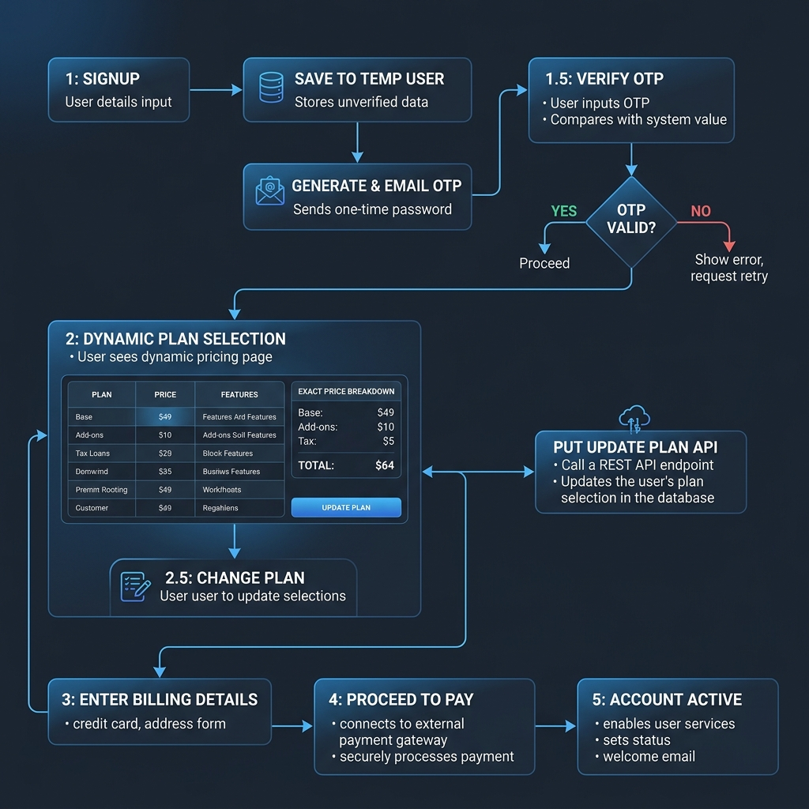

# Developer Reference: Onboarding & Razorpay Payments API Guide

This guide serves as the definitive reference for integrating and maintaining the **OTP-Verified Dynamic Onboarding & Just-In-Time Razorpay Subscription Funnel**. All backend models, serializers, views, and routing logic reside inside the **`onboard`** Django application.

---

## 🗺️ 1. Complete Funnel & Sequence Flow

Below is the pre-rendered sequence flowchart. (If your markdown viewer has the Mermaid plugin enabled, you can also preview the live-interactive Mermaid code block further down!)



### Live-Interactive Diagram Code

```mermaid
sequenceDiagram
    autonumber
    actor Client as Frontend Client
    participant Backend as Voicebot Backend
    participant Razorpay as Razorpay API Gateway

    Note over Client,Backend: STEP 1: Registration & OTP Verification
    Client->>Backend: POST /register-pending/ (signup credentials + selected initial plan)
    Note over Backend: Validates names, passwords, duplicates<br/>Saves unverified entry to TempUser<br/>Generates & emails 5-Digit OTP
    Backend-->>Client: HTTP 201 Created (temp_registration_id)

    Client->>Backend: POST /verify-otp/ (temp_registration_id + otp_code)
    Note over Backend: Matches OTP (10 min expiry check)<br/>Toggles is_email_verified = True
    Backend-->>Client: HTTP 200 OK (temporary_token + initial pricing breakdown)

    Note over Client,Backend: STEP 2: Checkout & Plan Selection
    rect rgb(30, 41, 59)
        Note over Client: User swaps plan on Checkout Screen
        Client->>Backend: PATCH /update-plan/ (plan_id) [Auth: Bearer temp_token]
        Note over Backend: Updates selected_plan_id on TempUser<br/>Recomputes tax/price dynamics instantly
        Backend-->>Client: HTTP 200 OK (updated plan details & billing breakdown)
    end

    Note over Client,Backend: STEP 3: Just-in-Time Order Initiation
    Client->>Backend: POST /create-order-just-in-time/ (billing_address + gstin) [Auth: Bearer temp_token]
    Note over Backend: Validates address & GSTIN<br/>Saves address referencing TempUser<br/>Initiates Razorpay Order ID<br/>Logs pending local Transaction
    Backend-->>Client: HTTP 200 OK (razorpay_order_id + amount in Paisa + currency + key_id)

    Note over Client,Razorpay: STEP 4: Razorpay Checkout Gateway
    Client->>Razorpay: Open Checkout Modal & Complete Payment
    Razorpay-->>Client: Returns Payment Signature (razorpay_payment_id + razorpay_signature)

    Note over Client,Backend: STEP 5: Signature Verification & Promotion
    Client->>Backend: POST /verify/ (payment keys & signatures) [Auth: Bearer temp_token]
    Note over Backend: Cryptographically verifies signature hash<br/>Promotes TempUser -> active CustomUser<br/>Converts transactions & billing logs<br/>Discards TempUser
    Backend-->>Client: HTTP 200 OK (permanent Refresh/Access JWTs + user details)
```


---

## 🔏 2. Authentication Scopes & Headers

Authentication is strictly segregated during onboarding to guarantee maximum security:

| Funnel Stage | Header Requirement | Target User Type | Permitted Actions |
| :--- | :--- | :--- | :--- |
| **Step 1 & 1.5** | *None* | Anonymous Public | `/register-pending/`, `/verify-otp/`, `/change-email/`, `/forgot-password/`, `/reset-password/`, `/webhook/` |
| **Step 2 to 5** | `Authorization: Bearer <temporary_token>` | Authenticated `TempUser` | `/update-plan/`, `/create-order-just-in-time/`, `/verify/`, `/cancel-order/` |
| **Active Session** | `Authorization: Bearer <access_jwt_token>` | Authenticated `CustomUser` | Main system dashboard, core user APIs, Voicebot mutations |

> [!WARNING]
> The **`temporary_token`** is cryptographically signed using the server's `SECRET_KEY` and expires strictly **1 hour** after OTP verification. It is restricted to the `/api/v1/onboard/` endpoints and **cannot** be used to access main dashboard resources (yields `401 Unauthorized`).

---

## 🛠️ 3. Complete Endpoint Reference

### 0. Check Email Availability (`/check-email/`)
* **Endpoint**: `POST /api/v1/onboard/check-email/`
* **Auth Level**: Anonymous Public (No Headers)
* **Description**: High-performance, latency-optimized endpoint to check email availability in real-time as users type on the signup form. Queries database B-Tree indexes using `.exists()` on both active users and pending registrations with zero-latency overhead.
* **Request Payload**:
  ```json
  {
    "email": "jane.doe@example.com"
  }
  ```
* **Success Output (200 OK)**:
  ```json
  {
    "status": true,
    "message": "Email availability checked.",
    "data": {
      "email": "jane.doe@example.com",
      "available": true,
      "exists_in_active_users": false,
      "exists_in_pending_registrations": false
    },
    "errors": null
  }
  ```

---

### 1. Register Pending User (`/register-pending/`)
* **Endpoint**: `POST /api/v1/onboard/register-pending/`
* **Auth Level**: Anonymous Public (No Headers)
* **Description**: Performs robust validation on credentials, checks for duplicate email records across both temporary and permanent tables, saves details into `TempUser` table, and sends a 5-digit verification code.
* **Request Payload**:
  ```json
  {
    "plan_id": "89c926e0-29a1-436a-ab4f-c381f3443399",
    "first_name": "Jane",
    "last_name": "Doe",
    "business_name": "Doe Software Solutions",
    "email": "jane.doe@example.com",
    "password": "SecurePassword123!",
    "confirm_password": "SecurePassword123!",
    "referral_code": "REF12345"
  }
  ```
  
  > [!NOTE]
  > * **`referral_code`** is optional and used to attribute registration rewards. It is validated and saved under the newly created `Tenant` organization upon payment success.

* **Success Output (201 Created)**:
  ```json
  {
    "status": true,
    "message": "Registration initiated. Verification OTP has been emailed.",
    "data": {
      "temp_registration_id": "8645e54d-ebcc-4458-ba20-ea0101b0f16a",
      "email": "jane.doe@example.com"
    },
    "errors": null
  }
  ```
* **Validation Failure Output (400 Bad Request)**:
  ```json
  {
    "status": false,
    "message": "Validation failed",
    "data": null,
    "errors": {
      "confirm_password": ["Passwords do not match."],
      "first_name": ["First name must contain only alphabetic characters."]
    }
  }
  ```

---

### 2. Verify OTP (`/verify-otp/`)
* **Endpoint**: `POST /api/v1/onboard/verify-otp/`
* **Auth Level**: Anonymous Public (No Headers)
* **Description**: Validates the emailed 5-digit verification code against the database. If correct and within the 10-minute validity window, grants a short-lived temporary token and the plan's cost details.
* **Request Payload**:
  ```json
  {
    "temp_registration_id": "8645e54d-ebcc-4458-ba20-ea0101b0f16a",
    "otp_code": "58392"
  }
  ```
* **Success Output (200 OK)**:
  ```json
  {
    "status": true,
    "message": "Email verified successfully",
    "data": {
      "temporary_token": "ey...signed_cryptographic_state_hash",
      "email": "jane.doe@example.com",
      "plan": {
        "id": "89c926e0-29a1-436a-ab4f-c381f3443399",
        "name": "Starter Plan",
        "code": "starter_inr"
      },
      "billing_breakdown": {
        "base_price": "2000.00",
        "discount_amount": "200.00",
        "net_base_price": "1800.00",
        "tax_percentage": "18.00",
        "tax_amount": "324.00",
        "total_price": "2124.00",
        "currency": "INR"
      }
    },
    "errors": null
  }
  ```
* **Error Output Examples (400 Bad Request)**:
  * Incorrect Code: `{"status": false, "message": "Invalid OTP code", "data": null, "errors": ["INVALID_OTP"]}`
  * Expired Code: `{"status": false, "message": "Verification code has expired", "data": null, "errors": ["OTP_EXPIRED"]}`

---

### 2.1 Resend OTP (`/resend-otp/`)
* **Endpoint**: `POST /api/v1/onboard/resend-otp/`
* **Auth Level**: Anonymous Public (No Headers)
* **Description**: Generates and emails a fresh 5-digit OTP code to the user. Features a **30-second resend cooldown limit** to prevent API abuse.
* **Request Payload**:
  ```json
  {
    "temp_registration_id": "8645e54d-ebcc-4458-ba20-ea0101b0f16a"
  }
  ```
* **Success Output (200 OK)**:
  ```json
  {
    "status": true,
    "message": "A new verification OTP has been emailed.",
    "data": {
      "temp_registration_id": "8645e54d-ebcc-4458-ba20-ea0101b0f16a",
      "email": "jane.doe@example.com"
    },
    "errors": null
  }
  ```
* **Cooldown Failure Output (400 Bad Request)**:
  ```json
  {
    "status": false,
    "message": "Please wait before resending OTP.",
    "data": {
      "cooldown_remaining": 22
    },
    "errors": ["OTP_COOLDOWN_ACTIVE"]
  }
  ```

---

### 2.1.1 Change Email (`/change-email/`)
* **Endpoint**: `POST /api/v1/onboard/change-email/`
* **Auth Level**: Anonymous Public (No Headers)
* **Description**: Allows the user to update their email address during the OTP stage without losing any entered details (names, business name, password). Generates a fresh **5-digit verification OTP** and emails it to the updated email address.
* **Request Payload**:
  ```json
  {
    "temp_registration_id": "8645e54d-ebcc-4458-ba20-ea0101b0f16a",
    "new_email": "jane.newemail@example.com"
  }
  ```
* **Success Output (200 OK)**:
  ```json
  {
    "status": true,
    "message": "Email updated successfully. A new verification OTP has been emailed.",
    "data": {
      "temp_registration_id": "8645e54d-ebcc-4458-ba20-ea0101b0f16a",
      "email": "jane.newemail@example.com"
    },
    "errors": null
  }
  ```

---

### 2.1.2 Forgot Password (`/forgot-password/`)
* **Endpoint**: `POST /api/v1/onboard/forgot-password/`
* **Auth Level**: Anonymous Public (No Headers)
* **Description**: Initiates a password reset request for unverified onboarding `TempUser` accounts. Cryptographically constructs a **one-time-use secure token** valid for **30 minutes**, and emails a password reset link to the user's registered address.

  > [!TIP]
  > The reset token is uniquely signed using a hash of the current temporary password. As soon as the password is reset, this hash updates and the token is **immediately and automatically invalidated**, ensuring perfect one-time usability without database bloating.

* **Request Payload**:
  ```json
  {
    "email": "jane.doe@example.com"
  }
  ```
* **Success Output (200 OK)**:
  ```json
  {
    "status": true,
    "message": "If the email is registered in our temporary signup system, a reset link will be sent shortly.",
    "data": null,
    "errors": null
  }
  ```

---

### 2.1.3 Reset Password (`/reset-password/`)
* **Endpoint**: `POST /api/v1/onboard/reset-password/`
* **Auth Level**: Anonymous Public (No Headers)
* **Description**: Executes the password reset using the token and user ID parsed from the email reset link's query parameters. Enforces identical mixed-case, numeric, and special character password policies as initial registration.
* **Request Payload**:
  ```json
  {
    "temp_registration_id": "8645e54d-ebcc-4458-ba20-ea0101b0f16a",
    "token": "ey...signed_cryptographic_reset_token",
    "password": "NewSecurePassword123!",
    "confirm_password": "NewSecurePassword123!"
  }
  ```
* **Success Output (200 OK)**:
  ```json
  {
    "status": true,
    "message": "Password reset successfully. You can now verify OTP or proceed with onboarding.",
    "data": null,
    "errors": null
  }
  ```

---

### 2.2 Resume Session (`/resume-session/`)
* **Endpoint**: `POST /api/v1/onboard/resume-session/`
* **Auth Level**: Anonymous Public (No Headers)
* **Description**: Allows the frontend to cleanly **reissue temporary tokens upon expiry** or **restore user onboarding states where they left off** (e.g. upon browser restarts, page refreshes, or drop-offs).
* **Request Payload (by Email or Temp ID)**:
  ```json
  {
    "email": "jane.doe@example.com"
  }
  ```
* **Success Output - Email Unverified (200 OK)**:
  Automatically emails a new 5-digit OTP code and instructs client to redirect to the verification screen:
  ```json
  {
    "status": true,
    "message": "Registration is pending email verification. A new OTP has been emailed.",
    "data": {
      "temp_registration_id": "8645e54d-ebcc-4458-ba20-ea0101b0f16a",
      "email": "jane.doe@example.com",
      "step": "OTP_VERIFICATION_REQUIRED"
    },
    "errors": null
  }
  ```
* **Success Output - Verified & Resuming State (200 OK)**:
  Reissues a fresh 1-hour `temporary_token` and determines their exact current onboarding status based on filled database fields (e.g. `step` value, loaded plan breakdown, saved billing address, or active pending Razorpay Order ID):
  ```json
  {
    "status": true,
    "message": "Session resumed successfully.",
    "data": {
      "temporary_token": "ey...signed_fresh_scoped_token",
      "email": "jane.doe@example.com",
      "step": "BILLING_ADDRESS_REQUIRED", // Steps: "BILLING_ADDRESS_REQUIRED", "PROCEED_TO_PAYMENT", "PAYMENT_VERIFICATION_REQUIRED"
      "plan": {
        "id": "89c926e0-29a1-436a-ab4f-c381f3443399",
        "name": "Starter Plan",
        "code": "starter_inr"
      },
      "billing_breakdown": {
        "base_price": "2000.00",
        "discount_amount": "200.00",
        "net_base_price": "1800.00",
        "tax_percentage": "18.00",
        "tax_amount": "324.00",
        "total_price": "2124.00",
        "currency": "INR"
      },
      "billing_address": null,
      "razorpay_order_id": null
    },
    "errors": null
  }
  ```

---

### 3. Dynamic Plan Update (`/update-plan/`)
* **Endpoint**: `PATCH /api/v1/onboard/update-plan/`
* **Auth Level**: Temporary Scoped (`Authorization: Bearer <temporary_token>`)
* **Description**: Allows dynamic upgrades/downgrades on the checkout screen. Swaps the selected plan on the `TempUser` record and immediately re-computes and returns the updated tax and price breakdown in one single round-trip.
* **Request Payload**:
  ```json
  {
    "plan_id": "495fae22-ba00-47db-a22c-a2b10103b41a" // Pro Plan ID
  }
  ```
* **Success Output (200 OK)**:
  ```json
  {
    "status": true,
    "message": "Plan updated successfully",
    "data": {
      "plan": {
        "id": "495fae22-ba00-47db-a22c-a2b10103b41a",
        "name": "Pro Plan",
        "code": "pro_inr"
      },
      "billing_breakdown": {
        "base_price": "4000.00",
        "discount_amount": "0.00",
        "net_base_price": "4000.00",
        "tax_percentage": "18.00",
        "tax_amount": "720.00",
        "total_price": "4720.00",
        "currency": "INR"
      }
    },
    "errors": null
  }
  ```

---

### 4. Create Order Just-in-Time (`/create-order-just-in-time/`)
* **Endpoint**: `POST /api/v1/onboard/create-order-just-in-time/`
* **Auth Level**: Temporary Scoped (`Authorization: Bearer <temporary_token>`)
* **Description**: Validates and saves the user’s Billing Address, contacts Razorpay to generate a unified Order ID, and creates a local pending `Transaction` log.
* **Request Payload**:
  ```json
  {
    "phone_number": "919876543210",
    "billing_address": {
      "line1": "Flat 304, IT Park Complex",
      "city": "Bengaluru",
      "state": "Karnataka",
      "zip_code": "560001",
      "country": "IN",
      "gstin": "29AAAAA1111A1Z1" // Optional Indian GSTIN format
    }
  }
  ```
  
  > [!NOTE]
  > * **`phone_number`** is required here as contact details for billing/invoicing, which is captured and updated on the `TempUser` record (then promoted to the final `CustomUser` account).
* **Success Output (200 OK)**:
  ```json
  {
    "status": true,
    "message": "Razorpay order initiated",
    "data": {
      "razorpay_order_id": "order_MZk2G9h21uO3p9",
      "amount": 472000, // Total price represented in Paisa (4720.00 * 100)
      "currency": "INR",
      "razorpay_key_id": "rzp_test_MasterKeyId"
    },
    "errors": null
  }
  ```
* **Invalid GSTIN/Address Output (400 Bad Request)**:
  ```json
  {
    "status": false,
    "message": "Invalid billing address data",
    "data": null,
    "errors": {
      "gstin": ["Please enter a valid GSTIN format (e.g. 07AAAAA1111A1Z1)."]
    }
  }
  ```

---

### 5. Verify Signature & Promote (`/verify/`)
* **Endpoint**: `POST /api/v1/onboard/verify/`
* **Auth Level**: Temporary Scoped (`Authorization: Bearer <temporary_token>`)
* **Description**: Cryptographically verifies the Razorpay payment signature. If valid, promotes the `TempUser` to a live active `CustomUser`, converts associated billing/transactions records, deletes the redundant temp record, and returns standard permanent JWT credentials.
* **Request Payload**:
  ```json
  {
    "razorpay_order_id": "order_MZk2G9h21uO3p9",
    "razorpay_payment_id": "pay_MZk2M3h45uO7p8",
    "razorpay_signature": "9d8f3ca857501a357f864e29b12c8a35607310f885731215b22596ab84ef028c"
  }
  ```
* **Success Output (200 OK)**:
  ```json
  {
    "status": true,
    "message": "Payment verified. Welcome onboard!",
    "data": {
      "tokens": {
        "refresh": "eyJ...permanent_refresh_jwt",
        "access": "eyJ...permanent_access_jwt"
      },
      "user": {
        "id": "7d455e92-3939-40bd-a707-f6f16fef37bd",
        "email": "jane.doe@example.com",
        "is_active": true
      }
    },
    "errors": null
  }
  ```

---

### 6. Cancel & Discard Onboarding (`/cancel-order/`)
* **Endpoint**: `POST /api/v1/onboard/cancel-order/`
* **Auth Level**: Temporary Scoped (`Authorization: Bearer <temporary_token>`)
* **Description**: Discards order states and wipes temporary database records if the user declines or drops off on the payment screen.
* **Request Payload**:
  ```json
  {
    "razorpay_order_id": "order_MZk2G9h21uO3p9"
  }
  ```
* **Success Output (200 OK)**:
  ```json
  {
    "status": true,
    "message": "Order and registration progress discarded successfully",
    "data": null,
    "errors": null
  }
  ```

---

### 7. Webhook Captures (`/webhook/`)
* **Endpoint**: `POST /api/v1/onboard/webhook/`
* **Auth Level**: Public (Signature Validated via `X-Razorpay-Signature` header)
* **Description**: Catches async background status updates from Razorpay's servers. 
  
  > [!IMPORTANT]
  > Every incoming webhook payload (valid or invalid signature, successful or failed event type) is **automatically registered and historically saved** in the `onboard_razorpay_webhook_log` database table. This provides a bulletproof audit trail and captures event IDs, raw payloads, IP signatures, and processing stack trace tracebacks (stored in `error_message` if verification or handling fails).

* **Payload Structure (payment.captured)**:
  ```json
  {
    "event": "payment.captured",
    "payload": {
      "payment": {
        "entity": {
          "id": "pay_MZk2M3h45uO7p8",
          "order_id": "order_MZk2G9h21uO3p9",
          "amount": 472000,
          "status": "captured"
        }
      }
    }
  }
  ```
* **Success Output**: Returns `{"status": "success"}` with HTTP 200.

---

## 🧪 4. Offline Mocking & Local Testing

To allow offline development and prevent test execution crashes:
1. When unit tests run (`settings.TESTING = True`) or no real keys are set in `settings.py`, the backend automatically generates a dummy `order_<uuid>` and bypasses payment gateway validation.
2. Webhook and payment verification signatures will pass automatically when using dummy keys (`rzp_test_dummykey`), allowing you to test frontend integration setups completely offline!
